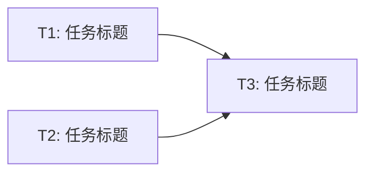

# RFC Template

Copy this template to `docs/rfcs/NNNN-slug.md` and fill in each section.

```markdown
# RFC-NNNN: 标题

- **状态**: draft | accepted | implementing | implemented | superseded | rejected
- **优先级**: P0 | P1 | P2 | P3
- **标签**: `architecture`, `protocol`, `cli`, `performance`, `dx` 等
- **影响模块**: 列出受影响的模块/目录
- **负责人**: <Agent 名 / 人名>
- **创建日期**: YYYY-MM-DD
- **更新日期**: YYYY-MM-DD

## 摘要

一段话描述这个 RFC 要解决什么问题。

## 动机

为什么需要这个变更？当前存在什么问题？

## 设计

### 概述

高层次的设计思路和架构方向。用文字和图表描述系统如何工作，而非具体代码。

### 关键设计决策

列出核心设计决策及其理由：

1. **决策 1**: 描述 + 理由
2. **决策 2**: 描述 + 理由

### 接口契约

定义模块之间的边界和契约（函数签名、消息格式、数据模型等），
只描述 **what**（接口是什么），不描述 **how**（如何实现）。

### 架构图

用文字或 Mermaid 图展示组件关系、数据流向。

> **注意**: RFC 不应包含具体实现代码。RFC 关注「做什么」和「为什么」，
> 而非「怎么写代码」——实现细节在 Phase 3 实施阶段细化。

## 权衡取舍

### 考虑过的替代方案

列出考虑过但未采用的方案，以及原因。

### 缺点

当前方案的缺点或限制。

## 实现计划

### 子任务分解

将实现拆分为可独立实现和验证的子任务。

> **范围约束**: 子任务数量不得超过 6 个。超过说明 RFC scope 过大，需拆分为多个独立 RFC。
>
> **文件分配约束**: 各子任务的「涉及文件」必须互不重叠——这是协同模式（同一 worktree
> 多 Agent 并行）不冲突的前提。若两个子任务必须改同一文件，要么合并它们，
> 要么把该文件的改动单独拆成一个子任务。

#### 依赖关系图

<!-- 用 Mermaid 展示子任务依赖（DAG）。无依赖的子任务可并行。 -->



#### 子任务列表

| ID | 标题 | 依赖 | 涉及文件 | 状态 |
|----|------|------|---------|------|
| T1 | 任务标题 | - | `path/a.py` | pending |
| T2 | 任务标题 | - | `path/b.py` | pending |
| T3 | 任务标题 | T1, T2 | `path/c.py` | blocked |

状态: `pending` | `in-progress`（代码修改中） | `implemented`（代码修改完毕） | `blocked`

> **并行提示**: 无依赖关系且文件清单互不重叠的子任务（如 T1、T2）可在不同 Agent 会话中并行实现。

#### 子任务定义

**T1: 任务标题**
- **范围**: 这个子任务要做什么
- **涉及文件**: `path/a.py`（新增/修改说明）
- **验收标准**: 如何判断完成

**T2: 任务标题**
- **范围**: 这个子任务要做什么
- **涉及文件**: `path/b.py`
- **验收标准**: 如何判断完成

**T3: 任务标题**
- **范围**: 这个子任务要做什么
- **涉及文件**: `path/c.py`
- **验收标准**: 如何判断完成

## 测试方案

### 单元测试

描述需要添加的单元测试。

### 集成测试

描述端到端或集成测试场景。

### 手动验证

描述手动测试步骤（如适用）。

## 未解决的问题

需要进一步讨论的问题（仅放用户明确选择「保留为 open question」的条目）。

## 参考资料

相关链接、文档。
```
