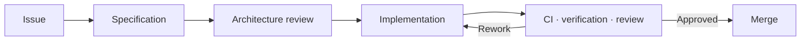

# OpenAgents

English | [简体中文](README.zh-CN.md)

**Spec-driven, multi-agent software delivery.** OpenAgents turns issues into specifications, code changes, verified results, and reviewed pull requests. A persistent delivery loop coordinates the work and merges PRs once the configured gates pass.

Use it independently with GitHub or Gitea, or as the delivery component of [AHE-Beta](https://github.com/Curry09/AHE-Beta). Execution supports Claude Code or NexAU. Python 3.12+ · [MIT](LICENSE).

## How it works



The default `standard` flow discovers labeled issues, coordinates dependencies, and advances each issue or PR from its current state. CI results, review decisions, and verification evidence refer to the candidate commit being checked. Work can resume from persisted state after a restart.

## Quick start

You need [uv](https://docs.astral.sh/uv/), Python 3.12+, Git, the [GitHub CLI](https://cli.github.com/), and a working [Claude Code](https://code.claude.com/docs/en/overview) installation. Authenticate `gh` and complete a working Claude Code session before starting delivery.

Install from this source repository:

```bash
git clone https://github.com/Curry09/OpenAgents.git
cd OpenAgents
uv tool install --from . openagents
openagents --help
```

Then change to the **target repository**: an existing Git repository with a GitHub remote and permission to create issues, push branches, and merge PRs.

```bash
cd /path/to/your-project
gh auth status
openagents init
openagents issue "Add CSV export to the order list"
openagents vigil
```

`init` creates `.openagents/openagents.yml` and prepares workflow labels. Review that configuration before starting `vigil`. The default CI gate waits for checks; if the target has no CI workflow, add one or explicitly choose `stages.ci: skip`. Delivery invokes models, changes code, and operates on the remote repository; the default flow merges approved PRs automatically. `release: manual` controls release timing, rather than PR merging.

For concurrent work, use `openagents vigil --parallel 4`. For a bounded run, use `openagents vigil --once`; this drains the current work cycle and exits, so subjects waiting on external checks may remain unfinished. Use `openagents report` to inspect local timing and token usage.

## Configuration and backends

The default configuration uses GitHub, Claude Code, and agent-run verification stages. To use Gitea, NexAU, or a different delivery flow, see the [configuration guide](docs/CONFIGURATION.md).

For the optional NexAU backend:

```bash
uv tool install --force --from . 'openagents[nexau]'
```

NexAU uses an Anthropic-compatible Messages endpoint and is pinned to [hzhua/nexau](https://github.com/hzhua/nexau) commit `28511d9f0362191a6c378fd441b2be55309a9e32`. Set the model, endpoint, and credentials in the environment as described in the guide. OpenAgents does not automatically load `.env` files.

The installed command runs from a separate uv tool environment. Reinstall with `--force` after changing the source. For reproducible source runs, use the committed lockfile and disable pre-command self-update; see [verification](docs/VERIFICATION.md).

## Documentation

| Guide | Contents |
| --- | --- |
| [CLI](docs/cli.md) | Commands, batch delivery, reports, and shell completion |
| [Configuration](docs/CONFIGURATION.md) | Backends, GitHub/Gitea, flow selection, and quality gates |
| [Architecture](docs/ARCHITECTURE.md) | Roles, reconciliation, persistence, and failure recovery |
| [AHE-Beta integration](docs/integrations/ahe-beta.md) | Generated configuration, evidence transport, and execution conditions |
| [Verification](docs/VERIFICATION.md) | Offline checks, reader probes, and live validation |
| [Releasing](docs/RELEASING.md) | Version pinning, release assets, and paired releases |
| [Specs](docs/specs/README.md) | Design contracts and generated implementation maps; primarily Chinese |

The optional desktop app is experimental. See [Contributing](CONTRIBUTING.md) for development setup and desktop checks.

[Contributing](CONTRIBUTING.md) · [Security](SECURITY.md) · [Third-party sources](THIRD_PARTY.md) · [Changelog](CHANGELOG.md)
