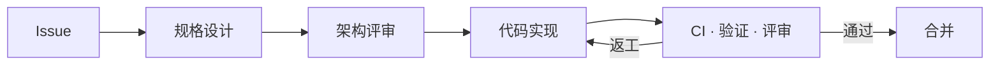

# OpenAgents

[English](README.md) | 简体中文

**以 Spec 驱动的多 Agent 软件交付框架。** OpenAgents 将 Issue 转为规格、代码改动、验证结果和经过评审的 Pull Request，由持续运行的交付循环协调各阶段工作，并在配置的门禁通过后合并 PR。

它可以配合 GitHub 或 Gitea 独立使用，也可以作为 [AHE-Beta](https://github.com/Curry09/AHE-Beta) 的交付组件。执行后端支持 Claude Code 或 NexAU。Python 3.12+ · [MIT](LICENSE)。

## 工作流程



默认的 `standard` 流程发现带标签的 Issue、协调依赖关系，并根据当前状态推进每个 Issue 或 PR。CI 结果、评审结论和验证证据与被检查的候选提交关联；进程重启后可以根据持久化状态继续推进。

## 快速开始

准备 [uv](https://docs.astral.sh/uv/)、Python 3.12+、Git、[GitHub CLI](https://cli.github.com/) 和可正常使用的 [Claude Code](https://code.claude.com/docs/en/overview)。启动交付前，完成 `gh` 登录，并确认 Claude Code 会话可以正常调用模型。

从本仓源码安装：

```bash
git clone https://github.com/Curry09/OpenAgents.git
cd OpenAgents
uv tool install --from . openagents
openagents --help
```

接着进入**待开发的目标仓库**：它应是已有 GitHub remote 的 Git 仓库，当前账户具有创建 Issue、推送分支和合并 PR 的权限。

```bash
cd /path/to/your-project
gh auth status
openagents init
openagents issue "Add CSV export to the order list"
openagents vigil
```

`init` 创建 `.openagents/openagents.yml` 并准备工作流标签。启动 `vigil` 前，先核对生成的配置。默认 CI 门禁会等待检查结果；目标仓库没有 CI 时，需要先补充工作流，或明确设置 `stages.ci: skip`。交付过程会调用模型、修改代码并操作远端仓库；默认流程自动合并通过评审的 PR。`release: manual` 控制发布版本的时机，不控制 PR 合并。

需要并发交付时，使用 `openagents vigil --parallel 4`。需要运行一个有限周期时，使用 `openagents vigil --once`；它处理当前周期的队列后退出，仍在等待外部检查的任务可能尚未完成。使用 `openagents report` 查看本地耗时和 Token 用量。

## 配置与后端

默认配置使用 GitHub、Claude Code 和由 Agent 执行的验证阶段。Gitea、NexAU 以及其他交付流程的设置见[配置指南](docs/CONFIGURATION.zh-CN.md)。

使用可选的 NexAU 后端时：

```bash
uv tool install --force --from . 'openagents[nexau]'
```

NexAU 使用 Anthropic-compatible Messages 接口，依赖固定在 [hzhua/nexau](https://github.com/hzhua/nexau) 的提交 `28511d9f0362191a6c378fd441b2be55309a9e32`。按配置指南在环境变量中设置模型、端点和凭证；OpenAgents 不会自动读取 `.env` 文件。

安装后的命令运行在独立的 uv tool 环境中；源码改动后需要加 `--force` 重新安装。需要可复现的源码运行时，使用已提交的锁文件，并关闭命令执行前的自动更新，详见[验证指南](docs/VERIFICATION.zh-CN.md)。

## 文档导航

| 指南 | 内容 |
| --- | --- |
| [CLI](docs/cli.zh-CN.md) | 命令、批量交付、运行报告与命令补全 |
| [配置](docs/CONFIGURATION.zh-CN.md) | 后端、GitHub/Gitea、流程选择与质量门禁 |
| [架构](docs/ARCHITECTURE.zh-CN.md) | 角色、状态协调、持久化与故障恢复 |
| [AHE-Beta 联合使用](docs/integrations/ahe-beta.zh-CN.md) | 生成配置、证据传输与执行条件 |
| [验证](docs/VERIFICATION.zh-CN.md) | 离线检查、读取端探针与真实运行验收 |
| [发布](docs/RELEASING.zh-CN.md) | 版本固定、发布产物与两仓联合发布 |
| [Spec](docs/specs/README.md) | 设计契约及自动生成的实现映射，主要使用中文 |

可选桌面端目前为实验功能，开发环境和检查方式见[贡献指南](CONTRIBUTING.zh-CN.md)。

[贡献指南](CONTRIBUTING.zh-CN.md) · [安全说明](SECURITY.zh-CN.md) · [第三方来源](THIRD_PARTY.zh-CN.md) · [更新记录](CHANGELOG.md)
