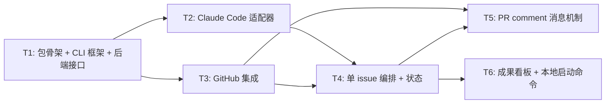

# RFC-0001: MVP — 单 issue → 单 agent → 真实 PR 的最小自举闭环

- **状态**: implementing
- **优先级**: P0
- **标签**: `architecture`, `cli`, `protocol`
- **影响模块**: `openagents/`（新建 Python 包）、`tests/`、`pyproject.toml`
- **负责人**: TBD
- **创建日期**: 2026-06-02
- **更新日期**: 2026-06-02

## 摘要

为 OpenAgents 实现第一个可运行的 MVP：一条命令从 GitHub 拉取一个 issue，派发**单个** agent（后端为 Claude Code）在独立分支上修改代码并开出**真实 PR**；PR 上的人工 comment 通过消息机制回送给 agent，使其继续迭代；同时提供一条**本地命令**启动「成果看板」，集中呈现每个 issue 的处理状态与对应 PR 链接。这条链路打通后，OpenAgents 即具备「用自己迭代自己」的最小循环。

## 动机

当前仓库（见 [CLAUDE.md](../../CLAUDE.md)）只有工程脚手架（CI、commit 规范、RFC 编号防冲突、lefthook），**没有任何产品代码**，也没有一篇 RFC。CLAUDE.md 的核心诉求是「最小化搭建一个 MVP，然后用这个 MVP 迭代自身」。

要让框架开始自举，必须先打通一条端到端最短链路，覆盖 CLAUDE.md 的关键设计理念：

- 理念 5–6：从仓库拉 issue → 解决 → 提 PR，单 issue 派发一个 agent。
- 理念 2：Agent 背后接不同 coding agent（本 MVP 先接 Claude Code，但**接口层抽象到位**，为 codex/nexau 留扩展点）。
- 理念 2 续 / 理念 8：Agent 之间通过类 GitHub 的 PR + comment 机制传递消息；以成果为中心，需要一个面向成果的本地呈现入口。

不打通这条链路，后续的多 agent 协同、多后端、消息总线都无从迭代。

### 前置条件（需用户确认）

本 RFC 选定「GitHub issues + 真实 PR」路线，依赖以下环境前提：

1. 本机已安装并鉴权 `gh` CLI（`gh auth status` 通过）—— 这是冷启动建仓与所有 GitHub 操作的前提。
2. 已配置 Claude Code CLI，可在非交互模式下被子进程调用。

> 注：目标项目的 git 仓库与远端**不再是硬性前置条件**——决策 10 让 OpenAgents 在 cwd 缺 git/remote 时交互式新建。本框架自身的仓库 `Curry09/OpenAgents`（私有）已于 bootstrap 阶段建好。

## 设计

### 概述

新建 Python 包 `openagents/`，提供 `openagents` CLI 入口。MVP 由六个解耦模块组成，数据流如下：

```
用户 ──> CLI(任意命令) ──> Config.ensure_project(cwd 解析 git/remote，缺失则交互新建)
                                      │
用户 ──> CLI(solve <issue#>) ──> Orchestrator ──> GitHub(拉取 issue 正文)
                                      │
                                      ├─> AgentBackend(ClaudeCode 适配器) 在分支上改代码、commit
                                      │
                                      ├─> GitHub(开 PR) ──> 写回 State
                                      │
   PR 评论 / CI 失败 ──> CLI(poll / watch 循环) ──> Messages(检测 merge / CI 状态 / 新 comment) ──> Orchestrator(把 comment 或 CI 失败日志喂回 agent 追加 commit，修到 CI 全绿)

用户 ──> CLI(board) ──> Results(读 State 渲染成果看板) ──> 本地浏览器
```

- **CLI 层**（`cli.py`）：唯一的命令入口，注册 `init` / `solve` / `poll` / `watch` / `board` 子命令，仅做参数解析与分发，业务逻辑下沉到各模块。除 `board` 外的命令在执行前先调用项目绑定 preflight（决策 10）。
- **后端抽象层**（`backends/base.py` + `backends/claude_code.py`）：定义 `AgentBackend` 协议，MVP 只实现 Claude Code 适配器；新后端只需新增一个适配器文件。
- **GitHub 集成层**（`github.py`）：封装 `gh` CLI，提供拉 issue、开 PR、读/写 comment 的薄封装。
- **编排层**（`orchestrator.py` + `state.py`）：单 issue → 单 agent 的编排，维护每个 agent / issue 的状态。
- **消息层**（`messages.py`）：轮询 PR comment，发现新评论时生成「your PR #N received a comment」事件并交回编排层。
- **成果层**（`results.py`）：读取 State，渲染本地成果看板并启动本地查看。

### 关键设计决策

1. **CLI 为唯一入口、业务逻辑下沉到模块**：`cli.py` 只负责注册子命令与分发，命令实现通过函数内延迟 `import` 调用各业务模块。理由：让 `cli.py` 成为单一子任务（T1）拥有的文件，其余子任务各自拥有独立模块文件，**文件清单互不重叠**，满足协同模式无冲突前提。

2. **后端用 Protocol 抽象、MVP 只实现一个适配器**：定义 `AgentBackend` 接口（输入：工作目录 + 任务描述 + 上下文；输出：是否产生改动 + 摘要）。理由：CLAUDE.md 理念 2 要求兼容多 coding agent，但奥卡姆剃刀要求 MVP 不过度设计——先把接口边界划清，只落地 Claude Code。

3. **GitHub 操作一律走 `gh` CLI 子进程封装，而非 REST SDK**：理由：`gh` 已处理鉴权与分页，零额外依赖（`pyproject` 保持 `dependencies` 最小），与脚手架里已有的 `check-rfc-number-conflicts.py` 调用 `gh` 的方式一致。

4. **状态持久化用本地 JSON 文件（`.openagents/state.json`）**：理由：MVP 不引入数据库；状态需跨 `solve` / `poll` / `board` 多次进程调用共享，文件足够且可被成果看板直接读取。

5. **消息机制采用「轮询 PR comment + 本地游标」而非 webhook**：理由：无需公网回调服务，本地即可运行；State 中记录每个 PR 已处理到的最后 comment id 作为游标，比对出新 comment 即触发 agent 迭代。这是「类 GitHub 的 comment 通知」的最小实现。

6. **轮询自动化：提供 `watch` 循环命令**：理由：用户要求 comment 拉取自动化，而非每次手动跑。`poll` 做一次性扫描，`watch` 在其之上按固定间隔（标准库 `time.sleep`）循环调用 `poll`，无需引入调度器或公网服务，符合奥卡姆剃刀。更复杂的 cron/`/loop` 接入作为后续 RFC 增量。

7. **agent 回应 comment 采用「追加 commit」而非 force-push**：理由：reviewer 能在 PR 上清晰看到「针对这条评论 agent 具体改了什么」的独立 diff，旧评论上下文不丢失；实现只需 `git commit` + `git push`，无需处理历史重写。代价是合并前分支堆叠多个小 commit（最终 merge 可 squash，属后续细节）。

8. **issue 终止条件：PR 合并即 `done`**：理由：规则简单明确、可机械判定。`poll`/`watch` 检测到 PR 已 merge 时把对应 issue 状态置 `done` 并停止后续迭代；未合并则保持 `iterating`/`pr-open`。

9. **成果看板用「渲染静态 HTML + 启动本地查看」**：理由：CLAUDE.md 理念 8「以成果为中心，前端用于呈现成果」。MVP 不引入前端框架，由 `results.py` 把 State 渲染成单页 HTML 并用标准库 `webbrowser` 打开，零前端依赖。

10. **项目绑定：以 cwd 为目标项目，缺 git/remote 时交互式新建（基础性决策）**：OpenAgents 不持有「项目」参数，而是像 cursor/git 一样**以当前工作目录为操作对象**。每个需要仓库的命令先做 preflight：从 cwd 向上解析 git root，再读 `origin` 远端。
    - 若 cwd **不是 git 仓库** → 提示用户是否 `git init`。
    - 若**无 `origin` 远端** → 提示用户是否新建（`gh repo create`，可选私有/公开）。
    - 用户确认后自动补齐再继续；非交互场景（如 CI）下缺失则报错退出，不擅自创建。
    理由：这是「项目如何传给 OpenAgents」的答案——无需显式传仓库参数，降低使用心智；同时把「冷启动一个新项目」这一高频动作内建为产品能力（呼应 CLAUDE.md「从 0 快速搭建项目」）。提供显式 `openagents init` 命令承载该逻辑，其余命令复用同一 preflight。

11. **CI 必须全绿：CI 失败也是 iterate 触发源**：agent 开 PR 后不仅响应人工 comment，还要监控 PR 的 CI 状态。CI 失败时，把失败的 check 日志作为一种「消息事件」喂回 agent 继续修、重推，**反复直到 CI 全绿**，再交人 review。理由：绿色 CI 是交付硬门槛；这把「修到 CI 通过」内建进自举循环，使 agent 产出可直接合并。`poll`/`watch` 在比对 comment 游标的同时读取 `gh pr checks` 状态；失败则触发 `iterate(..., reason="ci")`。

### 接口契约

> 仅描述边界契约（what），不含实现（how）。

**项目绑定 / Config**（`config.py`）
- `resolve_project() -> ProjectContext | None` —— 从 cwd 向上解析 git root 与 `origin` 远端；非 git 仓库返回 `None`。
- `ensure_project(interactive) -> ProjectContext` —— preflight：缺 git 仓库或远端时，`interactive=True` 则提示用户并按需 `git init` / 调用 `github.create_repo`；`interactive=False`（CI 等）缺失则抛错。返回就绪的 `ProjectContext(repo_root, remote)`。

**AgentBackend 协议**（`backends/base.py`）
- `name: str` —— 后端标识（如 `"claude-code"`）。
- `run(work_dir, task, context) -> AgentResult` —— 在 `work_dir` 内按 `task` 描述改代码；`context` 携带 issue 正文与历史 comment；返回 `AgentResult(changed: bool, summary: str)`。

**GitHub 封装**（`github.py`）
- `create_repo(name, private) -> remote_url` —— 用 `gh repo create` 新建远端并关联为 `origin`（供 `config.ensure_project` 冷启动调用）。
- `check_status(pr_number) -> CheckStatus(state, failed_logs)` —— 读 `gh pr checks` 的 CI 状态（决策 11）；失败时附带可喂回 agent 的失败日志摘要。
- `get_issue(number) -> Issue(number, title, body)`
- `create_pr(branch, title, body) -> PR(number, url)`
- `list_comments(pr_number) -> list[Comment(id, author, body)]`
- `post_comment(pr_number, body) -> None`

**State**（`state.py`）
- `record_run(issue_number, branch, pr) -> None`
- `update_status(issue_number, status) -> None` —— status ∈ {`solving`, `pr-open`, `iterating`, `done`}（PR 被 merge 时置 `done`）
- `get_cursor(pr_number) -> last_comment_id | None` / `set_cursor(pr_number, comment_id)`
- `all_runs() -> list[RunRecord]`（供成果看板读取）

**Orchestrator**（`orchestrator.py`）
- `solve(issue_number) -> PR` —— 完整执行「拉 issue → 建分支 → 调后端 → 开 PR → 写 State」。
- `iterate(pr_number, comment) -> None` —— 把一条新 comment 作为上下文喂回后端继续改，并**追加 commit** 后 push（决策 7）。

**Messages**（`messages.py`）
- `poll() -> list[Event]` —— 对所有 `pr-open`/`iterating` 状态的 PR：先检测是否已 merge（已 merge → 置 `done`，跳过）；否则 (a) 读 CI 状态，失败则以失败日志触发 `Orchestrator.iterate(reason="ci")`（决策 11）；(b) 比对 comment 游标，新 comment 触发 `iterate(reason="comment")` 并推进游标。
- `watch(interval) -> None` —— 每隔 `interval` 秒循环调用 `poll`（决策 6），直到无 open PR 或用户中断。

**CLI**（`cli.py`）
- `openagents init` —— 绑定/初始化当前目录为 OpenAgents 项目（git init / 新建远端），即决策 10 的显式入口。
- `openagents solve <issue-number>`
- `openagents poll` —— 拉取并处理所有 PR 的新 comment（一次性）。
- `openagents watch [--interval N]` —— 按间隔循环 `poll`，自动化拉取。
- `openagents board` —— 启动本地成果看板。

### 架构图

见上文「概述」数据流图。子任务依赖见下文 DAG。

> **注意**: 本 RFC 不含具体实现代码，实现细节在 Phase 3 细化。

## 权衡取舍

### 考虑过的替代方案

1. **本地 issue 文件 + 仅打印 diff（不接 GitHub）**：更简单、无网络依赖，但偏离用户明确选择的「真实 GitHub PR」路线，且无法验证 comment 消息机制的真实形态。已否决。
2. **直接调用 GitHub REST API（PyGithub）**：需要管理 token、分页、依赖第三方库，与脚手架既有的 `gh` 用法不一致，增加实体。已否决，改用 `gh` 子进程。
3. **消息机制用 GitHub webhook**：实时性更好，但需要公网可达的回调服务，MVP 阶段过重。已否决，改用本地轮询 + 游标。
4. **成果看板用 React/Web 框架**：呈现更丰富，但 MVP 引入前端工具链成本过高。已否决，改用标准库渲染静态 HTML。

### 缺点

- 轮询而非 webhook：comment 通知有延迟（取决于 `watch` 间隔）；`watch` 为前台阻塞循环，关掉进程即停（后台守护/cron 接入留后续 RFC）。
- 单后端：codex/nexau 尚未落地，跨后端解耦只在接口层验证，未经真实第二后端检验。
- 成果看板为静态快照：非实时刷新，需重新运行 `board`。
- 强依赖外部环境（GitHub remote + gh 鉴权 + Claude Code CLI），首次配置成本较高。

## 实现计划

### 子任务分解

> **范围约束**: 子任务数量不得超过 6 个。
> **文件分配约束**: 各子任务的「涉及文件」互不重叠。

#### 依赖关系图



#### 子任务列表

| ID | 标题 | 依赖 | 涉及文件 | 状态 |
|----|------|------|---------|------|
| T1 | 包骨架 + CLI 框架 + 后端接口契约 | - | `openagents/__init__.py`, `openagents/cli.py`, `openagents/config.py`, `openagents/backends/__init__.py`, `openagents/backends/base.py`, `pyproject.toml`, `tests/test_cli.py`, `tests/test_config.py`, `tests/test_base.py` | implemented |
| T2 | Claude Code 后端适配器 | T1 | `openagents/backends/claude_code.py`, `tests/test_backend_claude_code.py` | blocked |
| T3 | GitHub 集成（issue/PR/comment） | T1 | `openagents/github.py`, `tests/test_github.py` | blocked |
| T4 | 单 issue → 单 agent 编排 + 状态 | T2, T3 | `openagents/orchestrator.py`, `openagents/state.py`, `tests/test_orchestrator.py`, `tests/test_state.py` | blocked |
| T5 | PR comment 消息机制 | T3, T4 | `openagents/messages.py`, `tests/test_messages.py` | blocked |
| T6 | 成果看板 + 本地启动命令 | T4 | `openagents/results.py`, `openagents/templates/board.html`, `tests/test_results.py` | blocked |

状态: `pending` | `in-progress`（代码修改中） | `implemented`（代码修改完毕） | `blocked`

> **并行提示**: T2 与 T3 在 T1 完成后无相互依赖且文件互不重叠，可在不同 Agent 会话并行。T1 完成后即解锁这两条并行支线。

#### 子任务定义

**T1: 包骨架 + CLI 框架 + 后端接口契约**
- **范围**: 建 `openagents/` 包；`cli.py` 注册 `init`/`solve`/`poll`/`watch`/`board` 五个子命令（命令体内延迟 import 业务模块，本子任务只放可运行的骨架与占位提示）；`config.py` 实现项目绑定 `resolve_project`/`ensure_project`（决策 10：cwd 解析 git root + remote，缺失时交互式新建；`gh repo create` 部分通过延迟 import 调用 `github.create_repo`）；`backends/base.py` 定义 `AgentBackend` 协议与 `AgentResult`；在 `pyproject.toml` 声明 CLI entry point 与必要依赖（CLI 框架）。
- **涉及文件**: 见上表（新增包文件 + 修改 `pyproject.toml`；测试拆为 `tests/test_cli.py` / `tests/test_config.py` / `tests/test_base.py`）。
- **验收标准**: `openagents --help` 列出五个子命令；`AgentBackend` 协议可被导入；`resolve_project` 能从 cwd 正确识别 git root 与 remote、非仓库返回 `None`，`ensure_project(interactive=False)` 缺失时抛错（交互分支与 `git init`/`gh` 被 mock）；`ruff check`/`ruff format --check` 通过；`tests/test_cli.py` 验证子命令注册与 preflight 调用。

**T2: Claude Code 后端适配器**
- **范围**: 实现 `ClaudeCodeBackend`，以子进程方式非交互调用 Claude Code，在给定工作目录按任务描述改代码，返回 `AgentResult`。
- **涉及文件**: `openagents/backends/claude_code.py`, `tests/test_backend_claude_code.py`。
- **验收标准**: 给定一个临时仓库与任务，适配器能驱动 Claude Code 产生文件改动并正确报告 `changed/summary`；子进程调用被 mock 的单测通过。

**T3: GitHub 集成（issue/PR/comment）**
- **范围**: 封装 `gh` CLI，实现 `create_repo`（供冷启动绑定）/`get_issue`/`create_pr`/`list_comments`/`post_comment`/`check_status`（CI 状态，决策 11），统一错误处理。
- **涉及文件**: `openagents/github.py`, `tests/test_github.py`。
- **验收标准**: 各函数对 `gh` 输出正确解析为数据类；`create_repo` 正确组装 `gh repo create` 参数（私有/公开）；`check_status` 正确归类 pass/fail 并提取失败日志摘要；`gh` 子进程被 mock 的单测覆盖正常与错误路径。

**T4: 单 issue → 单 agent 编排 + 状态**
- **范围**: 实现 `Orchestrator.solve`（拉 issue → 建分支 → 调后端 → 开 PR → 写 State）与 `iterate`（喂回 comment → 追加 commit → push，决策 7）；实现 `State` 的 JSON 持久化（`.openagents/state.json`）含状态机（含 `done`）与 comment 游标。
- **涉及文件**: `openagents/orchestrator.py`, `openagents/state.py`, `tests/test_orchestrator.py`, `tests/test_state.py`。
- **验收标准**: 用 mock 的 backend + github，`solve` 端到端产出一条 RunRecord 且状态流转正确；State 读写与游标逻辑单测通过。

**T5: PR comment 消息机制 + CI 监控**
- **范围**: 实现 `Messages.poll`：对 open 状态 PR 先检测是否已 merge（已 merge → 置 `done` 并跳过，决策 8）；否则 (a) 读 CI 状态，失败则以失败日志触发 `iterate(reason="ci")`（决策 11，修到 CI 全绿）；(b) 比对游标，新 comment 触发 `iterate(reason="comment")` 并更新游标。实现 `Messages.watch`：按间隔循环 `poll`（决策 6）。
- **涉及文件**: `openagents/messages.py`, `tests/test_messages.py`。
- **验收标准**: 给定带新 comment 的 mock PR，`poll` 正确触发一次 `iterate(reason="comment")` 并推进游标；CI 失败的 mock PR 触发 `iterate(reason="ci")`，CI 全绿则不触发；已 merge 的 PR 被置 `done` 且不再迭代；无新 comment 且 CI 绿时不触发；`watch` 的循环间隔逻辑（`time.sleep` 被 mock）单测通过。

**T6: 成果看板 + 本地启动命令**
- **范围**: 实现 `results.render(runs) -> html` 与 `board()` 启动逻辑（渲染 State 为单页 HTML 并用 `webbrowser` 打开）；提供 HTML 模板。
- **涉及文件**: `openagents/results.py`, `openagents/templates/board.html`, `tests/test_results.py`。
- **验收标准**: 给定若干 RunRecord，`render` 产出含 issue 标题/状态/PR 链接的 HTML；`board` 命令能生成文件并触发本地打开（打开动作在测试中被 mock）；单测通过。

## 测试方案

### 单元测试

- 每个子任务自带 `tests/test_*.py`，外部副作用（`gh`、Claude Code 子进程、`webbrowser`）一律 mock。
- 覆盖：CLI 子命令注册、后端 `AgentResult` 契约、GitHub 解析的正常/异常路径、State 状态机与游标、消息触发条件、看板渲染内容。

### 集成测试

- `tests/test_integration_solve.py`（归属 T4，可在 T4 内追加）：用 mock 后端 + mock github 串起 `solve → poll → board`，断言状态从 `solving → pr-open → iterating` 正确流转、看板能反映最终成果。

### 手动验证

1. 配置 GitHub remote 与 `gh auth`、Claude Code CLI。
2. 在远端仓库建一个简单 issue。
3. `openagents solve <issue#>` → 检查产生新分支与真实 PR。
4. 在 PR 上人工留一条 comment → `openagents poll` → 检查 agent 产生新 commit 回应。
5. `openagents board` → 浏览器打开看板，确认该 issue 状态与 PR 链接正确呈现。

## 未解决的问题

无。评审中识别的三个候选均已拍定并写入设计：

- poll 触发方式 → 决策 6（提供 `watch` 自动化循环）。
- agent 回应 comment 的提交方式 → 决策 7（追加 commit）。
- issue 终止条件 → 决策 8（PR 合并即 `done`）。

## 参考资料

- [CLAUDE.md](../../CLAUDE.md) —— 项目总体原则与设计理念（理念 2/5/6/8）
- [.claude/skills/rfc-driven-development](../../.claude/skills/rfc-driven-development/SKILL.md) —— RFC 驱动开发流程
- [scripts/check-rfc-number-conflicts.py](../../scripts/check-rfc-number-conflicts.py) —— RFC 编号约定与 `gh` 调用范例
