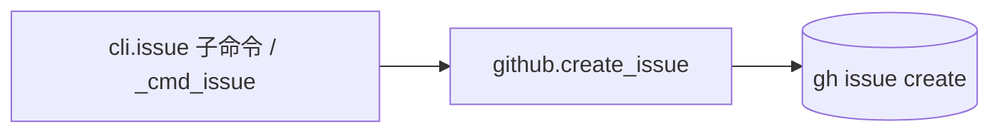
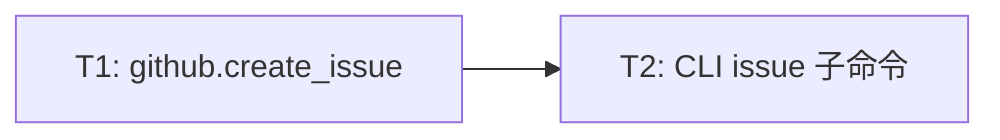

# RFC-0002: OpenAgents 主动提 issue

- **状态**: implemented
- **优先级**: P1
- **标签**: `cli`, `github`
- **影响模块**: `openagents/cli.py`, `openagents/github.py`
- **负责人**: openagents-agent
- **创建日期**: 2026-06-03
- **更新日期**: 2026-06-05

## 摘要

为 OpenAgents CLI 增加 `openagents issue <title>` 子命令，把一个新 issue 直接提交到当前项目绑定的 GitHub 仓库。这是 RFC-0001「拉取 issue → 解决 → 提 PR」闭环的反向补充：让 OpenAgents（人或 Agent）能主动把待办/缺陷登记成 GitHub issue，作为后续 `solve` 的输入。

## 动机

RFC-0001 已经能消费 issue（`solve`），但 issue 的产生仍依赖人手动到 GitHub 网页创建。CLAUDE.md 设计理念 5 要求 OpenAgents「对于正在写的某一个仓库，要做到能主动从仓库拉取 issue、解决 issue、提 PR」——其中「主动登记问题」缺一环。补上「提 issue」后：

- 人或 Agent 在终端里一条命令即可登记问题，无需切换到浏览器；
- 为 issue 层面的并行（多 worktree 分头解 issue）提供入口——先批量提 issue，再分发 `solve`；
- 与现有 `gh` 封装一致，零新增依赖。

## 设计

### 概述

完全复用 RFC-0001 T3 已建立的 `gh` CLI 封装风格：在 `openagents/github.py` 增加一个 `create_issue` 薄封装，调用 `gh issue create`；在 `openagents/cli.py` 注册 `issue` 子命令并把参数透传给该封装。命令与 `solve`/`poll` 一样先走项目绑定 preflight（决策 10），确保 `gh` 在正确的仓库上下文里执行。

数据流：

```
用户 ─ openagents issue "<title>" [--body ...] [--label ...]
        │
        ▼
   cli._cmd_issue (preflight: ensure_project)
        │  透传 title/body/labels
        ▼
   github.create_issue ──► gh issue create --title --body [--label ...]
        │  解析 stdout 的 issue url 末段 number
        ▼
   返回 Issue(number,title,body) ──► CLI 打印 "✓ 已创建 issue #<n>"
```

### 关键设计决策

1. **走 `gh issue create` 子进程，复用现有封装**：与 RFC-0001 决策 3 一致——GitHub 操作一律走 `gh` CLI，零额外依赖，鉴权交给 `gh`。`create_issue` 复用既有的 `_run_gh` 助手与错误处理（`GithubError`）。
2. **复用既有 `Issue` 数据模型**：`gh issue create` 在 stdout 返回新 issue 的 url（形如 `.../issues/<n>`），从末段解析出 number，连同传入的 title/body 组装成已有的 `Issue` dataclass 返回——不新增数据类型，保持最小化（设计理念 1）。number 解析复用一个与 `_parse_pr_number` 同构的 `_parse_issue_number`（marker 为 `/issues/`）。
3. **CLI 接口取最简**：positional `title`（必填）+ `--body`（可选，默认空串）+ `--label`（可重复，`action="append"`，默认空）。labels 是 issue triage 的常用元数据且经由 `gh --label` 实现成本极低，故纳入 MVP；assignee/milestone 等留待后续。
4. **走 preflight（决策 10）**：`issue` 命令需要项目绑定（git root + remote），故纳入 `_dispatch` 的 handlers 表，执行前 `ensure_project(interactive=True)`，与 `solve`/`poll`/`watch` 一致；只有 `board` 跳过 preflight。
5. **`issue` 命令自动附加发现标签 `openagents`（与 vigil 发现门控同源）**（2026-06-04 增补）：`openagents issue` 提的 issue 默认总是带上 `openagents` 标签——在用户 `--label` 之外**追加并去重**（用户显式传 `--label openagents` 不会重复）。理由：vigil 发现段默认按 `--label openagents` 门控（RFC-0004 决策 2），若提 issue 不打这个标签，OpenAgents 自己提的 issue 反而不会被自己的守夜人发现，propose→discover 闭环断裂（正是实测中 #3/#7 无标签、vigil 扫不到的根因）。把标签值抽成单一常量 `DISCOVERY_LABEL`，由 `_cmd_issue`（附加）与 `_cmd_vigil`（发现回落）共用，保证两端永远一致、改一处即同步——这也顺带消除了 vigil 回落里的魔法字符串 `"openagents"`。
6. **提 issue 前确保发现标签已存在（自动建标签）**（2026-06-05 增补）：`gh issue create --label <L>` 要求标签 `<L>` 在仓库里**预先存在**，否则报 `could not add label: 'openagents' not found`。既然决策 5 由我们强制附加 `openagents`，确保它存在就是我们的责任——`_cmd_issue` 在 `create_issue` 前先调 `github.ensure_label(name=DISCOVERY_LABEL)`：不存在则 `gh label create` 创建，已存在则吞掉 gh 的 "already exists" 非零退出、**不覆盖**既有颜色/描述（与 `check_status` 吞 "no checks reported" 同一容错风格）。只确保我们强加的发现标签；用户经 `--label` 显式传的标签仍沿用 gh 原生行为（拼错即失败，不替用户臆造标签）。

### 接口契约

新增 github 层函数（仅描述 what）：

```
create_issue(*, title: str, body: str, labels: list[str]) -> Issue
    # 运行 `gh issue create --title <title> --body <body> [--label <l> ...]`
    # 从 stdout 的 issue url 末段解析 number；解析失败抛 GithubError
    # 返回复用的 Issue(number, title, body)

ensure_label(*, name: str, color: str = ..., description: str = ...) -> None
    # 决策 6：确保仓库存在名为 name 的标签——不存在则 `gh label create` 创建，
    # 已存在则吞掉 gh 的 "already exists" 退出码、不覆盖既有颜色/描述；其它错误照抛。
```

新增 CLI 子命令：

```
openagents issue <title> [--body BODY] [--label LABEL]...
    # title:  positional，issue 标题
    # --body: 可选，issue 正文，默认 ""
    # --label: 可重复，给 issue 打标签；最终标签 = 用户标签 + DISCOVERY_LABEL（去重，决策 5）
    # 即便不传 --label，也总会附带 "openagents"，使 issue 可被 vigil 发现
    # 成功打印 "✓ 已创建 issue #<number>：<title>"，返回码 0
```

### 架构图



> RFC 不含具体实现代码；上面只给接口签名与数据流。

## 权衡取舍

### 考虑过的替代方案

1. **全 flag 接口（`--title --body`）**：更显式但更啰嗦，且与现有 `solve <issue>` 的 positional 风格不一致。否决——positional title 更短、更符合既有 CLI 习惯。
2. **Agent 自动起草正文**：传一句话描述，调 coding-agent 后端把它扩写成结构化 issue。更贴合多 Agent 愿景，但引入后端依赖与不确定性，超出「主动提 issue」的最小范围。否决——留作后续 RFC（可作为 `issue` 的 `--draft-with-agent` 增强）。
3. **给 `Issue` 增加 `url` 字段以便打印链接**：会改动既有 `get_issue` 的构造与 dataclass 形状，牵动 RFC-0001 的文件。否决——MVP 打印 issue number 已足够定位；保持 `Issue` 形状不变，文件改动最小。

### 缺点

- 不支持 assignee/milestone/模板等富元数据，复杂 issue 仍需网页或后续增强。
- 正文仅接受命令行字符串，超长正文不便（无 `--body-file`）；留待后续。

## 实现计划

### 子任务分解

> 范围约束：2 个子任务，未超过 6。
> 文件分配约束：T1 与 T2 的涉及文件互不重叠。

#### 依赖关系图



#### 子任务列表

| ID | 标题 | 依赖 | 涉及文件 | 状态 |
|----|------|------|---------|------|
| T1 | github 层 create_issue | - | `openagents/github.py`, `tests/test_github.py` | implemented |
| T2 | CLI issue 子命令 | T1 | `openagents/cli.py`, `tests/test_cli.py` | implemented |
| T3 | issue 自动附加发现标签 + 确保标签存在（决策 5/6） | T2 | `openagents/cli.py`, `openagents/github.py`, `tests/test_cli.py`, `tests/test_github.py` | implemented |

状态: `pending` | `in-progress`（代码修改中） | `implemented`（代码修改完毕） | `blocked`

> 并行提示：T2 依赖 T1（调用其新函数），需顺序实现；二者文件清单互不重叠。

#### 子任务定义

**T1: github 层 create_issue**
- **范围**: 在 `openagents/github.py` 增加 `create_issue(*, title, body, labels)`，调用 `gh issue create`，解析 issue number，返回 `Issue`；增加 `_parse_issue_number` 助手。
- **涉及文件**: `openagents/github.py`（新增函数）、`tests/test_github.py`（新增用例）
- **验收标准**: 单测覆盖——成功解析 number、带 labels 时命令含 `--label`、url 不可解析时抛 `GithubError`、gh 非零退出时抛 `GithubError`。

**T2: CLI issue 子命令**
- **范围**: 在 `openagents/cli.py` 注册 `issue` 子命令（positional title + `--body` + 可重复 `--label`），实现 `_cmd_issue` 走 preflight 并调用 `github.create_issue`，挂入 `_dispatch` handlers。
- **涉及文件**: `openagents/cli.py`（注册 + handler）、`tests/test_cli.py`（新增用例）
- **验收标准**: 单测覆盖——parser 注册了 `issue`、`issue "T" --body B --label x --label y` 正确透传给打桩的 `create_issue` 且走 preflight、返回码 0。

**T3: issue 自动附加发现标签 + 确保标签存在（决策 5/6）**
- **范围**: 在 `openagents/cli.py` 引入模块级常量 `DISCOVERY_LABEL = "openagents"`；`_cmd_issue` 在用户 `--label` 之外追加 `DISCOVERY_LABEL` 并按出现顺序去重，且在 `create_issue` 前先调 `github.ensure_label(name=DISCOVERY_LABEL)`；`_cmd_vigil` 的发现回落改用同一常量。在 `openagents/github.py` 新增 `ensure_label`（不存在则建、已存在则吞 "already exists"）。
- **涉及文件**: `openagents/cli.py`（常量 + `_cmd_issue`/`_cmd_vigil`）、`openagents/github.py`（`ensure_label`）、`tests/test_cli.py`、`tests/test_github.py`
- **验收标准**: 单测覆盖——无 `--label` 时 `create_issue` 收到 `["openagents"]`；`--label bug --label p1` 时收到 `["bug","p1","openagents"]`；`--label openagents --label bug` 去重为 `["openagents","bug"]`；vigil 默认门控仍为 `["openagents"]`；`_cmd_issue` 在 create 前调用 `ensure_label(name="openagents")`；`ensure_label` 缺失时建标签、"already exists" 时不抛、其它 gh 错误照抛。

## 测试方案

### 单元测试

- `tests/test_github.py`：`create_issue` 的成功路径（解析 number、命令首段为 `["gh","issue","create"]`、含 `--title`/`--body`）、labels 透传、url 不可解析抛错、gh 非零抛错。
- `tests/test_cli.py`：`issue` 出现在子命令集合；`_cmd_issue` 透传 title/body 给打桩的 `github.create_issue` 并先跑 preflight；返回码 0。labels 行为（决策 5）：无 `--label` → `["openagents"]`；`--label bug --label p1` → `["bug","p1","openagents"]`；显式含 `openagents` 时去重不重复；vigil 默认门控仍 `["openagents"]`。

### 集成测试

通过 CLI 端到端 dispatch（打桩 `ensure_project` 与 `github.create_issue`）验证从 `main(["issue", ...])` 到调用 github 层的链路；真实 `gh` 调用不在 CI 内（与 RFC-0001 一致，全部 mock）。

### 手动验证

在已绑定的项目目录执行：`openagents issue "测试：来自 CLI 的 issue" --body "由 RFC-0002 创建" --label test`，到 GitHub 确认 issue 创建成功且带 label。决策 5 验证：执行 `openagents issue "无显式标签"`（不传 `--label`），确认 issue 仍自动带上 `openagents` 标签，且随后 `openagents vigil --once` 能发现并派单它。

## 未解决的问题

无（assignee/`--body-file`/Agent 起草正文等增强留作后续 RFC，不作为本 RFC open question）。

## 参考资料

- RFC-0001：MVP 单 issue → 单 agent → 真实 PR（`gh` 封装与 CLI 风格来源）
- `gh issue create` 文档：https://cli.github.com/manual/gh_issue_create
