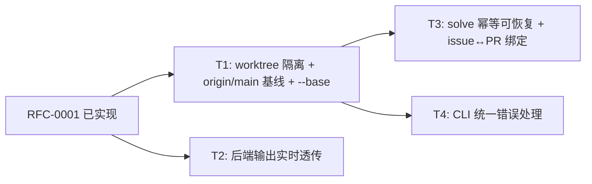

# RFC-0003: issue 求解隔离 —— 每 issue 独立 worktree + 分支基线锁定最新 main

- **状态**: implemented
- **优先级**: P1
- **标签**: `architecture`, `backend`, `cli`
- **影响模块**: `openagents/orchestrator.py`、`openagents/cli.py`、`openagents/backends/claude_code.py`、`tests/`
- **负责人**: TBD
- **创建日期**: 2026-06-03
- **更新日期**: 2026-06-03

## 摘要

修正 RFC-0001 中 `solve` 的工作区、分支基线、可观测性与健壮性。现状：`solve` 在**主工作树原地** `git checkout -b <branch>` 求解 issue，分支基线是「执行命令那一刻的当前 HEAD」，后端 `claude -p` 以 `capture_output` 整段吞掉输出（运行数分钟零反馈），且 `solve` 无幂等——中途报错（如 push 非快进被拒）后重跑会撞同一堵墙、无法继续。本 RFC 改为：每个 issue 在**独立 git worktree** 中、从**最新 `origin/main`** 拉出的分支上求解（为 CLAUDE.md 理念 5「issue 层面并行」提供隔离前提、杜绝基线漂移），后端输出**实时透传**到终端，并让 `solve` **幂等可恢复**（按 State 分流「全新/续写」，一个 issue 绑定一个 PR，报错后能从断点继续）、CLI **统一错误处理**（不再吐 traceback）。

## 动机

RFC-0001 未就「分支从哪拉、在哪改」做显式决策，实现取了最省事的 `git checkout -b <branch>`（从当前 HEAD、在主工作树原地）。本仓库端到端实测（`openagents solve 3`）暴露两类缺陷：

1. **基线随当前 HEAD 漂移**：连续 `solve` 时，后一个 issue 的分支会从前一个 issue 的分支头上拉出，前者的改动被并入后者的 PR，PR 互相污染。
2. **无隔离**：求解过程直接改动用户主工作树；多个 issue 无法并行（都在主树抢分支）。实测中内层 agent 自行切到别的分支后，orchestrator 的 `commit/push` 落到了错误分支，PR 开歪——根因正是「基线靠副作用决定 + 无工作树隔离」。

CLAUDE.md 理念 5 要求「issue 层面并行」，理念 6「单 issue 派发一个 agent」。要让 issue 真正并行且互不干扰，每个 issue 必须有独立、基线确定的工作区。

## 设计

### 关键设计决策

1. **每 issue 独立 worktree（隔离主工作树）**：求解工作区为确定式派生路径 `<repo_root>/.openagents/worktrees/issue-<n>`。理由：隔离是跨 issue 并行（理念 5）的前提，且求解不再污染用户主树；`.openagents/` 已被 `.gitignore` 忽略，worktree 文件不会出现在主树 `git status` 中。路径**确定式派生**而非写入 state，免去额外持久化实体（奥卡姆剃刀）。

2. **solve 前同步并锁定基线到最新 `origin/<base>`**：先 `git fetch origin <base>`，再 `git worktree add -b <branch> <path> origin/<base>`，`<base>` 默认 `main`。一条 `worktree add` 同时完成「建隔离工作树」与「从最新 main 拉分支」两件事。理由：杜绝基线随当前 HEAD 漂移；满足「solve 前先拉最新 main」的诉求；`fetch`（而非 `checkout main && pull`）刷新基线，不触碰用户当前检出。

3. **`--base` 覆盖依赖场景**：提供 `openagents solve <n> --base <ref>` 显式指定基线，默认 `main`。理由：默认隔离/独立，但不堵死「issue B 依赖 issue A 改动」的依赖式工作流；基线应**显式声明**，而非靠「你恰好停在哪个分支」隐式决定（后者是 bug 不是 feature）。

4. **全新求解前幂等清理**（仅 fresh 路径）：判定为「全新求解」时，建 worktree 前尽力清理同 issue 的残留 worktree 与本地分支（`worktree remove --force` / `worktree prune` / `branch -D`，失败忽略），再从 `origin/<base>` 新建。理由：全新求解意味着远端尚无该 issue 分支（见决策 7 的分流），清掉本地残留是安全的。**续写路径不走此清理**（否则会丢掉已提交的工作、导致 push 非快进——这正是原实现的 bug）。

5. **iterate 复用 worktree**：`iterate` 在 `solve` 建的同一 worktree 中续写、**追加 commit**（沿用 RFC-0001 决策 7，绝不 force-push）；worktree 缺失（如跨进程后被清理）则从远端分支重建后再续写。

6. **求解过程实时反馈（两层）**：`solve` 全程静默是直接的可用性问题，分两层解决——
   - **后端事件流**：`claude -p` 默认 `--output-format=text` 会把输出整段缓冲到结束才吐（端到端实测：运行中输出文件 0 字节，跑完才一次性出现），故 `ClaudeCodeBackend` 改用 `--output-format stream-json --verbose` + `subprocess.Popen` 逐行读取 NDJSON 事件，把助手文本与工具动作（如 `🔧 Edit openagents/github.py`）即时打印，并从 `result` 事件取最终文本作 PR 摘要。
   - **编排阶段进度**：`Orchestrator` 在拉 issue / 建 worktree / 调起 claude / 提交推送 / 开 PR 各阶段向 stderr 打 `▶ …` 进度行，保证即便后端暂时无事件也有反馈。
   理由：仅靠「Popen 透传」不够——上游 `claude -p` 缓冲时无事件可透传（初版踩到此坑）；stream-json 才有实时事件，阶段进度行则与后端行为无关地兜底。

7. **solve 按 State 分流「全新/续写」，一个 issue 绑定一个 PR**：`solve` 入口先 `state.find_by_issue(n)` 反查——
   - 该 issue 有进行中的 run（状态 ≠ `done`），**或**远端已存在其分支（`git ls-remote --heads`，State 丢失时的兜底）→ 走**续写**：复用已有分支/worktree（缺失则从远端分支重建，保住已提交工作），追加 commit，推到**同一 PR**；
   - 否则 → 走**全新求解**（决策 1/2/4）。
   理由：这是「每个 issue 与 PR 绑定」的落点；也让「重跑 = 继续」而非「重开/撞墙」。

8. **分步落 State + gh 兜底恢复绑定**：State 从「最后才写」改为**进入即写**——`solve` 一开始 `begin_run`（状态 `solving`、PR 待开），开 PR 后 `record_run`（`pr-open`），续写后置 `iterating`。于是 push 后崩、开 PR 前崩、开 PR 后崩各种中断都能恢复。续写补开 PR 前先 `github.find_pr_by_branch` 复用分支上已有的 open PR（避免重复 `gh pr create`，并在 State 丢失时恢复 issue↔PR 绑定）。

9. **CLI 统一错误处理**：`cli` 把已知运行期异常（`OrchestratorError` / `GithubError` / `RuntimeError`）转成 `✗ <消息>` 到 stderr + 非零退出码，不再把 Python traceback 抛给用户。理由：traceback 对用户无用且观感差；未知异常仍向上抛出（暴露真实 bug）。
   - **精炼（依赖缺失友好化）**：宣告过的第三方依赖缺失（`ModuleNotFoundError`，顶层模块名 ≠ `openagents`，如 venv 未 `uv pip install -e .` 时 import `ruamel`/`jsonschema` 失败）不是真实 bug，而是装环境漏了——转成 `✗ 缺少依赖 '<name>'：…uv pip install -e .（或 uv sync）` 的一行可操作提示。而 `openagents.*` 自身模块缺失仍是真 bug，照旧抛 traceback。

### 接口契约（相对 RFC-0001 的变更）

- `Orchestrator.solve(issue_number, base="main") -> PR` —— 新增 `base` 参数（默认 `main`）；内部按 State 分流「全新/续写」（决策 7/8），返回该 issue 绑定的 PR。
- `Orchestrator.iterate(pr_number, reason, detail) -> None` —— 签名不变，内部改为在该 issue 的 worktree 中续写。
- `AgentBackend.run(work_dir, task, context) -> AgentResult` —— 协议不变；`ClaudeCodeBackend` 内部改用 `stream-json --verbose` + `Popen` 解析事件实时打印（决策 6），`AgentResult.summary` 取自 `result` 事件。
- `State`：新增 `begin_run(issue_number, branch)`（记 `solving`、PR 待开）与 `find_by_issue(issue_number) -> RunRecord | None`（决策 7/8）。
- `github.find_pr_by_branch(branch) -> PR | None` —— 查分支当前 open PR（决策 8）。
- **CLI**：`openagents solve <issue-number> [--base <ref>]`，`--base` 默认 `main`；运行期错误干净退出（决策 9）。

> 本 RFC 不含具体实现代码，实现细节在 Phase 3 落地。

### 不在本 RFC 范围

- **worktree 生命周期清理**（PR 合并后自动移除、跨 issue 累积治理）：留作后续 RFC。本 RFC 中「同一 issue 重跑」由决策 7 分流为续写（复用而非新建）；不同 issue 的 worktree 会累积在 `.openagents/worktrees/` 下，可手动 `git worktree prune` 或删除。见「未解决的问题」。
- **`--force` 显式重开**（废弃旧分支/PR、从 `origin/<base>` 重来）：本 RFC 未提供；需重开时手动删远端分支/关 PR。留作后续增量。

## 权衡取舍

### 考虑过的替代方案

1. **仅修基线、不加 worktree**（solve 前 `git checkout main && git pull && git checkout -b`）：改动更小，但仍在主工作树原地操作——无法跨 issue 并行，且会切换用户当前分支、污染主树。已否决。
2. **worktree 路径写入 `state.json`**：可把 worktree 放任意位置，但增加持久化实体与一致性负担；确定式派生（决策 1）已足够。已否决。
3. **每 issue 独立克隆仓库**：隔离更彻底，但磁盘与时间成本远高于 worktree，且需重复鉴权。已否决，`git worktree` 共享对象库即可。

### 缺点

- worktree 在 `.openagents/worktrees/` 下累积，需手动或后续 RFC 清理。
- 依赖 `origin` 可达（`fetch` 刷新基线）；完全离线时基线为本地已有的 `origin/<base>` 引用，可能不是最新。

## 实现计划

### 子任务分解

> T1/T2 文件清单互不重叠，可并行。T3/T4 与 T1 在同一 PR 内**顺序**实现，文件清单与 T1 有重叠（`orchestrator.py` / `cli.py`）——这是 amend 已实现子任务、非并行执行，无冲突风险。与 open PR #4（RFC-0002）仅在 `cli.py` 上相邻（不同函数），合并时按常规解决。

#### 依赖关系图

#### 子任务列表

| ID | 标题 | 依赖 | 涉及文件 | 状态 |
|----|------|------|---------|------|
| T1 | solve/iterate 改用每 issue worktree + `origin/<base>` 基线 + `--base` 选项 | RFC-0001 | `openagents/orchestrator.py`, `openagents/cli.py`, `tests/test_orchestrator.py`, `tests/test_cli.py` | implemented |
| T2 | 求解实时反馈：后端 stream-json 事件流 + 编排阶段进度行 | RFC-0001 | `openagents/backends/claude_code.py`, `openagents/orchestrator.py`, `tests/test_backend_claude_code.py`, `tests/test_orchestrator.py` | implemented |
| T3 | solve 幂等可恢复（按 State 分流 fresh/resume）+ issue↔PR 绑定 + gh 兜底 | T1 | `openagents/orchestrator.py`, `openagents/state.py`, `openagents/github.py`, `tests/test_orchestrator.py`, `tests/test_state.py`, `tests/test_github.py` | implemented |
| T4 | CLI 统一错误处理（运行期异常 → 干净退出，不吐 traceback） | T1 | `openagents/cli.py`, `tests/test_cli.py` | implemented |

> 文档改动（本 RFC 文件、`docs/rfcs/README.md`、RFC-0001 交叉引用）随本子任务一并提交。

状态: `pending` | `in-progress`（代码修改中） | `implemented`（代码修改完毕） | `blocked`

#### 子任务定义

**T1: solve/iterate 改用每 issue worktree + `origin/<base>` 基线 + `--base` 选项**
- **范围**: 重写 `Orchestrator` 的工作区逻辑——`solve` 先 `fetch origin <base>`，在 `<repo_root>/.openagents/worktrees/issue-<n>` 建从 `origin/<base>` 拉出的 worktree（建前幂等清理残留），在该 worktree 内调后端、`add/commit/push`、开 PR；`iterate` 复用/重建同一 worktree 后续写。`cli.py` 的 `solve` 子命令新增 `--base`（默认 `main`）并透传给 `Orchestrator.solve`。
- **涉及文件**: `openagents/orchestrator.py`, `openagents/cli.py`, `tests/test_orchestrator.py`, `tests/test_cli.py`。
- **验收标准**: `solve` 调用序列含 `git fetch origin main` 与 `git worktree add -b openagents/issue-<n> <path> origin/main`，**不再**在主树 `checkout -b`；后端 `work_dir` 为 worktree 路径；`commit/push` 正常且不 force-push；`solve --base <ref>` 时 worktree 自 `origin/<ref>` 拉出；`iterate` 在 worktree 内追加 commit；CLI 将 `--base` 透传、默认 `main`；`ruff check`/`ruff format --check`/`pytest` 全通过。

**T2: 求解实时反馈（后端 stream-json 事件流 + 编排阶段进度行）**
- **范围**: `ClaudeCodeBackend.run` 改用 `--output-format stream-json --verbose` + `Popen`，逐行解析 NDJSON 事件，实时打印助手文本与工具动作（`🔧 <tool>: <hint>`）到 stdout，从 `result` 事件取摘要；非零退出抛 `RuntimeError`（带详情），非 JSON 行原样透传并作兜底详情。`Orchestrator` 在各阶段向 stderr 打 `▶ …` 进度行。`git status` 判定改动逻辑不变。
- **涉及文件**: `openagents/backends/claude_code.py`, `openagents/orchestrator.py`, `tests/test_backend_claude_code.py`, `tests/test_orchestrator.py`。
- **验收标准**: 后端 `Popen` 命令含 `--output-format stream-json --verbose`；assistant 文本/工具事件经 `capsys` 实时可见；`summary` 取自 `result` 事件；非零退出抛 `RuntimeError`；`solve` 各阶段在 stderr 有 `▶` 进度行；子进程 mock 单测全通过。

**T3: solve 幂等可恢复 + issue↔PR 绑定 + gh 兜底**
- **范围**: `solve` 入口 `state.find_by_issue` 反查并按决策 7 分流——续写复用分支/worktree（不走决策 4 的清理）、追加 commit、`find_pr_by_branch` 复用或补开 PR；全新走决策 1/2/4 并 `begin_run` 先记 `solving`。`_commit_and_push` 容忍「无改动可提交」（跳过 commit 仍 push）。`state.py` 加 `begin_run` / `find_by_issue`；`github.py` 加 `find_pr_by_branch`。
- **涉及文件**: `openagents/orchestrator.py`, `openagents/state.py`, `openagents/github.py`, `tests/test_orchestrator.py`, `tests/test_state.py`, `tests/test_github.py`。
- **验收标准**: 该 issue 已有 open PR 时 `solve` 走续写、复用 PR（不调用 `create_pr`）、不重建分支、状态置 `iterating`；`begin_run` 后崩溃场景（无 PR）重跑能补开 PR；`find_by_issue`/`begin_run`/`find_pr_by_branch` 单测通过。

**T4: CLI 统一错误处理**
- **范围**: `cli` 在分发外层捕获 `OrchestratorError` / `GithubError` / `RuntimeError`，打印 `✗ <消息>` 到 stderr 并返回非零退出码；未知异常仍向上抛出。
- **涉及文件**: `openagents/cli.py`, `tests/test_cli.py`。
- **验收标准**: `solve` 抛 `OrchestratorError` 时 `main` 返回 1、stderr 含 `✗` 与原因、无 traceback；单测通过。

## 测试方案

### 单元测试

- `tests/test_orchestrator.py`：`solve` 的 git 序列断言（`fetch origin main`、`worktree add -b ... origin/main`、无主树 `checkout -b`、`commit`/`push`）；后端 `work_dir` 为 worktree 路径；`--base` 透传到 `origin/<ref>`；`iterate` 在 worktree 内追加 commit、不 force-push。
- `tests/test_cli.py`：`solve` 默认 `base="main"`；`solve --base dev` 透传 `base="dev"`。
- `tests/test_backend_claude_code.py`：`Popen` 命令含 stream-json 参数；assistant 文本/工具事件经 `capsys` 实时可见；`summary` 取自 `result` 事件；非零退出与非 JSON 行错误路径。
- `tests/test_orchestrator.py`（T2 进度）：`solve` 各阶段在 stderr 打 `▶` 进度行。
- `tests/test_orchestrator.py`（T3）：已有 open PR → 续写复用 PR、不重建分支、状态 `iterating`；`begin_run` 后无 PR → 续写补开 PR。
- `tests/test_state.py`（T3）：`begin_run` 记 `solving`/PR 待开、被 `record_run` 覆盖；`find_by_issue` 命中/未命中。
- `tests/test_github.py`（T3）：`find_pr_by_branch` 命中/无 PR/gh 错误三路径。
- `tests/test_cli.py`（T4）：业务异常 → 返回 1、stderr 含 `✗`、无 traceback。
- 外部副作用（`git` 子进程、`gh`）一律 mock。

### 手动验证

1. 在远端建一个简单 issue（如 #N）。
2. `openagents solve N` → 检查 `.openagents/worktrees/issue-N` 被创建、该分支基线为最新 `origin/main`、主树当前分支未被切换、产生真实 PR。
3. 连续 `openagents solve M` → 检查 issue-M 分支同样从 `origin/main` 拉出，与 issue-N 互不污染。
4. `openagents solve N --base some-branch` → 检查 worktree 基线为 `origin/some-branch`。
5. 对已有 PR 的 issue 再次 `openagents solve N` → 检查**不重开** PR，而是在原分支追加 commit 推到同一 PR（状态 `iterating`）。
6. 制造一次失败（如先手动改坏远端使 push 被拒）→ 检查 CLI 打印 `✗ ...` 干净退出、**无 traceback**，修正后重跑能从断点继续。

## 未解决的问题

- **worktree 生命周期清理**：PR 合并后自动移除对应 worktree、以及 `.openagents/worktrees/` 跨 issue 累积的治理，留作后续 RFC（可在 `Messages` 检测到 PR `done` 时调用清理）。
- **`--force` 显式重开**：废弃旧分支/PR、从 `origin/<base>` 重来的能力，本 RFC 未提供，留作后续增量。

## 参考资料

- [RFC-0001](./0001-mvp-issue-to-pr-loop.md) —— 本 RFC 修正其 `solve` 工作区与分支基线行为
- [CLAUDE.md](../../CLAUDE.md) —— 设计理念 5（issue 层面并行）/ 6（单 issue 单 agent）
- [git worktree 官方文档](https://git-scm.com/docs/git-worktree) —— 共享对象库的多工作树机制
