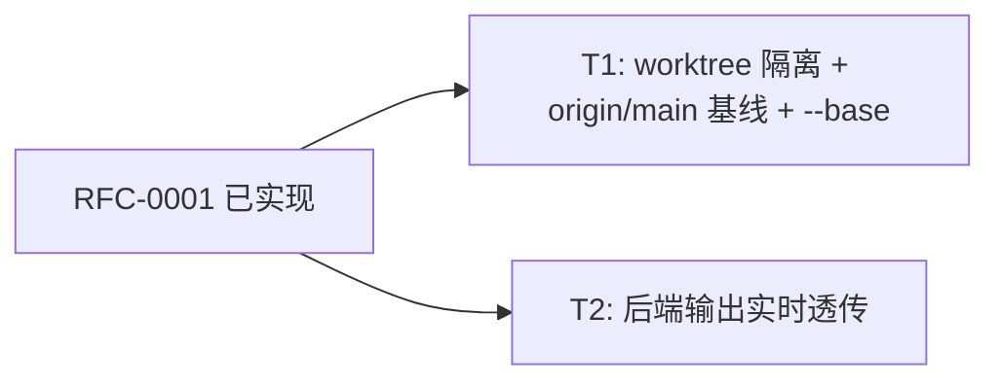

# RFC-0003: issue 求解隔离 —— 每 issue 独立 worktree + 分支基线锁定最新 main

- **状态**: implemented
- **优先级**: P1
- **标签**: `architecture`, `backend`, `cli`
- **影响模块**: `openagents/orchestrator.py`、`openagents/cli.py`、`openagents/backends/claude_code.py`、`tests/`
- **负责人**: TBD
- **创建日期**: 2026-06-03
- **更新日期**: 2026-06-03

## 摘要

修正 RFC-0001 中 `solve` 的工作区、分支基线与可观测性。现状：`solve` 在**主工作树原地** `git checkout -b <branch>` 求解 issue，分支基线是「执行命令那一刻的当前 HEAD」，且后端 `claude -p` 以 `capture_output` 整段吞掉输出（运行数分钟零反馈）。本 RFC 改为：每个 issue 在**独立 git worktree** 中、从**最新 `origin/main`** 拉出的分支上求解（为 CLAUDE.md 理念 5「issue 层面并行」提供隔离前提、杜绝基线漂移），并将后端输出**实时透传**到终端。

## 动机

RFC-0001 未就「分支从哪拉、在哪改」做显式决策，实现取了最省事的 `git checkout -b <branch>`（从当前 HEAD、在主工作树原地）。本仓库端到端实测（`openagents solve 3`）暴露两类缺陷：

1. **基线随当前 HEAD 漂移**：连续 `solve` 时，后一个 issue 的分支会从前一个 issue 的分支头上拉出，前者的改动被并入后者的 PR，PR 互相污染。
2. **无隔离**：求解过程直接改动用户主工作树；多个 issue 无法并行（都在主树抢分支）。实测中内层 agent 自行切到别的分支后，orchestrator 的 `commit/push` 落到了错误分支，PR 开歪——根因正是「基线靠副作用决定 + 无工作树隔离」。

CLAUDE.md 理念 5 要求「issue 层面并行」，理念 6「单 issue 派发一个 agent」。要让 issue 真正并行且互不干扰，每个 issue 必须有独立、基线确定的工作区。

## 设计

### 关键设计决策

1. **每 issue 独立 worktree（隔离主工作树）**：求解工作区为确定式派生路径 `<repo_root>/.openagents/worktrees/issue-<n>`。理由：隔离是跨 issue 并行（理念 5）的前提，且求解不再污染用户主树；`.openagents/` 已被 `.gitignore` 忽略，worktree 文件不会出现在主树 `git status` 中。路径**确定式派生**而非写入 state，免去额外持久化实体（奥卡姆剃刀）。

2. **solve 前同步并锁定基线到最新 `origin/<base>`**：先 `git fetch origin <base>`，再 `git worktree add -b <branch> <path> origin/<base>`，`<base>` 默认 `main`。一条 `worktree add` 同时完成「建隔离工作树」与「从最新 main 拉分支」两件事。理由：杜绝基线随当前 HEAD 漂移；满足「solve 前先拉最新 main」的诉求；`fetch`（而非 `checkout main && pull`）刷新基线，不触碰用户当前检出。

3. **`--base` 覆盖依赖场景**：提供 `openagents solve <n> --base <ref>` 显式指定基线，默认 `main`。理由：默认隔离/独立，但不堵死「issue B 依赖 issue A 改动」的依赖式工作流；基线应**显式声明**，而非靠「你恰好停在哪个分支」隐式决定（后者是 bug 不是 feature）。

4. **solve 幂等**：建 worktree 前尽力清理同 issue 的残留 worktree 与本地分支（`worktree remove --force` / `worktree prune` / `branch -D`，失败忽略），再新建。理由：同一 issue 重跑不应报错。

5. **iterate 复用 worktree**：`iterate` 在 `solve` 建的同一 worktree 中续写、**追加 commit**（沿用 RFC-0001 决策 7，绝不 force-push）；worktree 缺失（如跨进程后被清理）则从远端分支重建后再续写。

6. **求解过程实时透传后端输出**：`ClaudeCodeBackend` 从 `subprocess.run(capture_output=True)`（整段吞掉、运行数分钟零反馈）改为 `subprocess.Popen` 逐行读取 stdout（stderr 合并进 stdout），边读边转发到本进程 stdout，同时累积全文供 PR 摘要。理由：`solve` 全程静默是直接的可用性问题；实时透传让运行中的 `solve` 有进度反馈，又不丢失摘要。代价：合并 stderr 后摘要含少量噪声（仅用于 PR 正文，可接受）。

### 接口契约（相对 RFC-0001 的变更）

- `Orchestrator.solve(issue_number, base="main") -> PR` —— 新增 `base` 参数（默认 `main`）；内部改为「fetch 基线 → 建 worktree → 在 worktree 内调后端/commit/push」。
- `Orchestrator.iterate(pr_number, reason, detail) -> None` —— 签名不变，内部改为在该 issue 的 worktree 中续写。
- `AgentBackend.run(work_dir, task, context) -> AgentResult` —— 协议不变；`ClaudeCodeBackend` 内部从 `run(capture_output)` 改为 `Popen` 实时透传（决策 6），`AgentResult.summary` 语义不变。
- **CLI**：`openagents solve <issue-number> [--base <ref>]`，`--base` 默认 `main`。

> 本 RFC 不含具体实现代码，实现细节在 Phase 3 落地。

### 不在本 RFC 范围

- **worktree 生命周期清理**（PR 合并后自动移除、跨 issue 累积治理）：留作后续 RFC。本 RFC 仅保证「同一 issue 重跑」被决策 4 清理；不同 issue 的 worktree 会累积在 `.openagents/worktrees/` 下，可手动 `git worktree prune` 或删除。见「未解决的问题」。

## 权衡取舍

### 考虑过的替代方案

1. **仅修基线、不加 worktree**（solve 前 `git checkout main && git pull && git checkout -b`）：改动更小，但仍在主工作树原地操作——无法跨 issue 并行，且会切换用户当前分支、污染主树。已否决。
2. **worktree 路径写入 `state.json`**：可把 worktree 放任意位置，但增加持久化实体与一致性负担；确定式派生（决策 1）已足够。已否决。
3. **每 issue 独立克隆仓库**：隔离更彻底，但磁盘与时间成本远高于 worktree，且需重复鉴权。已否决，`git worktree` 共享对象库即可。

### 缺点

- worktree 在 `.openagents/worktrees/` 下累积，需手动或后续 RFC 清理。
- 依赖 `origin` 可达（`fetch` 刷新基线）；完全离线时基线为本地已有的 `origin/<base>` 引用，可能不是最新。

## 实现计划

### 子任务分解

> 两个子任务文件清单互不重叠，可并行。与 open PR #4（RFC-0002）仅在 `cli.py` 上相邻（不同函数），合并时按常规解决。

#### 依赖关系图

#### 子任务列表

| ID | 标题 | 依赖 | 涉及文件 | 状态 |
|----|------|------|---------|------|
| T1 | solve/iterate 改用每 issue worktree + `origin/<base>` 基线 + `--base` 选项 | RFC-0001 | `openagents/orchestrator.py`, `openagents/cli.py`, `tests/test_orchestrator.py`, `tests/test_cli.py` | implemented |
| T2 | 后端输出实时透传（`Popen` 替代 `capture_output`） | RFC-0001 | `openagents/backends/claude_code.py`, `tests/test_backend_claude_code.py` | implemented |

> 文档改动（本 RFC 文件、`docs/rfcs/README.md`、RFC-0001 交叉引用）随本子任务一并提交。

状态: `pending` | `in-progress`（代码修改中） | `implemented`（代码修改完毕） | `blocked`

#### 子任务定义

**T1: solve/iterate 改用每 issue worktree + `origin/<base>` 基线 + `--base` 选项**
- **范围**: 重写 `Orchestrator` 的工作区逻辑——`solve` 先 `fetch origin <base>`，在 `<repo_root>/.openagents/worktrees/issue-<n>` 建从 `origin/<base>` 拉出的 worktree（建前幂等清理残留），在该 worktree 内调后端、`add/commit/push`、开 PR；`iterate` 复用/重建同一 worktree 后续写。`cli.py` 的 `solve` 子命令新增 `--base`（默认 `main`）并透传给 `Orchestrator.solve`。
- **涉及文件**: `openagents/orchestrator.py`, `openagents/cli.py`, `tests/test_orchestrator.py`, `tests/test_cli.py`。
- **验收标准**: `solve` 调用序列含 `git fetch origin main` 与 `git worktree add -b openagents/issue-<n> <path> origin/main`，**不再**在主树 `checkout -b`；后端 `work_dir` 为 worktree 路径；`commit/push` 正常且不 force-push；`solve --base <ref>` 时 worktree 自 `origin/<ref>` 拉出；`iterate` 在 worktree 内追加 commit；CLI 将 `--base` 透传、默认 `main`；`ruff check`/`ruff format --check`/`pytest` 全通过。

**T2: 后端输出实时透传（`Popen` 替代 `capture_output`）**
- **范围**: `ClaudeCodeBackend.run` 内部从 `subprocess.run(capture_output=True)` 改为 `subprocess.Popen`（`stderr` 合并进 `stdout`），逐行边读边转发到本进程 `stdout`，同时累积全文供摘要；非零退出码抛 `RuntimeError`（含已收集输出）。`git status` 判定改动逻辑不变。
- **涉及文件**: `openagents/backends/claude_code.py`, `tests/test_backend_claude_code.py`。
- **验收标准**: claude 输出在运行过程中实时出现在 stdout（`capsys` 断言）；`changed`/`summary` 行为与原先一致；claude 非零退出抛 `RuntimeError` 且含输出；子进程 mock 单测全通过。

## 测试方案

### 单元测试

- `tests/test_orchestrator.py`：`solve` 的 git 序列断言（`fetch origin main`、`worktree add -b ... origin/main`、无主树 `checkout -b`、`commit`/`push`）；后端 `work_dir` 为 worktree 路径；`--base` 透传到 `origin/<ref>`；`iterate` 在 worktree 内追加 commit、不 force-push。
- `tests/test_cli.py`：`solve` 默认 `base="main"`；`solve --base dev` 透传 `base="dev"`。
- `tests/test_backend_claude_code.py`：`Popen` 输出经 `capsys` 实时可见；`changed`/`summary`/非零退出错误路径不变。
- 外部副作用（`git` 子进程、`gh`）一律 mock。

### 手动验证

1. 在远端建一个简单 issue（如 #N）。
2. `openagents solve N` → 检查 `.openagents/worktrees/issue-N` 被创建、该分支基线为最新 `origin/main`、主树当前分支未被切换、产生真实 PR。
3. 连续 `openagents solve M` → 检查 issue-M 分支同样从 `origin/main` 拉出，与 issue-N 互不污染。
4. `openagents solve N --base some-branch` → 检查 worktree 基线为 `origin/some-branch`。

## 未解决的问题

- **worktree 生命周期清理**：PR 合并后自动移除对应 worktree、以及 `.openagents/worktrees/` 跨 issue 累积的治理，留作后续 RFC（可在 `Messages` 检测到 PR `done` 时调用清理）。本 RFC 暂仅处理「同 issue 重跑」的幂等清理。

## 参考资料

- [RFC-0001](./0001-mvp-issue-to-pr-loop.md) —— 本 RFC 修正其 `solve` 工作区与分支基线行为
- [CLAUDE.md](../../CLAUDE.md) —— 设计理念 5（issue 层面并行）/ 6（单 issue 单 agent）
- [git worktree 官方文档](https://git-scm.com/docs/git-worktree) —— 共享对象库的多工作树机制
