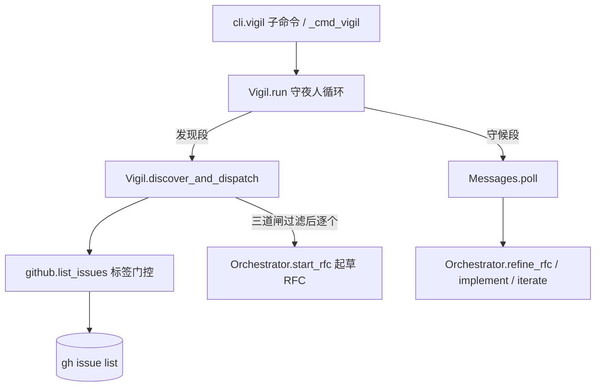
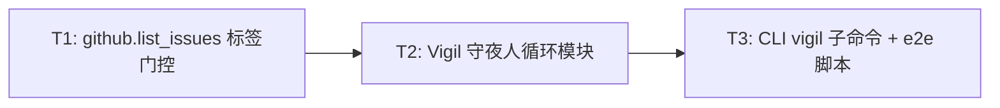

# RFC-0004: openagents vigil —— 守夜人模式（自主 issue→PR 全流程循环）

- **状态**: implemented
- **优先级**: P1
- **标签**: `architecture`, `cli`, `automation`
- **影响模块**: `openagents/vigil.py`（新建）、`openagents/github.py`、`openagents/cli.py`、`tests/`
- **负责人**: openagents-agent（issue #9）
- **创建日期**: 2026-06-03
- **更新日期**: 2026-06-04

> **与 RFC-0005 的调和（2026-06-04）**：本 RFC 起草时主干仍是一站式 `Orchestrator.solve`（issue→RFC→实现→转正一气呵成）。RFC-0005 已将 `solve` 拆为四个原子步骤 `start_rfc / refine_rfc / implement / iterate`。rebase 到新 main 后，vigil **发现段的派单由 `Orchestrator.solve` 改为 `Orchestrator.start_rfc`**（只起草 RFC、开 draft PR）；后续 `refine_rfc → implement → iterate` 整条 RFC-first 循环改由**守候段 `Messages.poll`** 按 `rfc-approved` 标签 / 评论 / CI 自动分流驱动（见 RFC-0005）。这反而让 vigil 更薄——它只管「发现 + 起草」，无需感知原子步骤。下文凡提及「派单 solve」均按此理解为「派单 `start_rfc`」。

## 摘要

为 OpenAgents CLI 增加 `openagents vigil` 子命令——「守夜人模式」。开启后它在一个前台循环里持续做两件事：(1) **主动监控并拉取新 issue**，对带约定标签、且尚未处理过的 open issue 自动派单 `solve` 开真实 PR；(2) **自动读取 PR 的 comment / CI 状态并解决**（复用 RFC-0001 的 `Messages.poll`）。人类唯一需要介入的环节是 **PR 审核**——其余从「发现 issue」到「修到 CI 全绿、回应每条 comment」全部自动闭环。这把 RFC-0001 的 `solve`（消费单 issue）与 `watch`（轮询单组已知 PR）合成一条**无人值守的端到端流水线**，是 CLAUDE.md「全自动流程 / 减少项目搭建时间 / 人只做宏观把控」的直接落地。

## 动机

RFC-0001/0003 已经具备闭环的各个**零件**，但仍需人类手动驱动：

- `solve <issue#>`：一次只消费**一个**显式指定的 issue——issue 的「发现」靠人。
- `watch`：只轮询 **State 里已有 run** 的 PR，且「无 open PR 即退出」（见 `messages.py:57` 的 `_has_open_pr` 退出条件）——它既不会去 GitHub 发现**新** issue，也不会在队列暂时排空时继续守候。

于是「全自动」缺了最关键的一环：**自主发现新 issue 并派单**，以及**长期守候**。CLAUDE.md 的核心诉求是：

- 理念 5：「对于正在写的某一个仓库，要做到能主动从仓库拉取 issue、解决 issue、提 PR。PR 需要人来审核」。
- 设计目标 1/2：减少项目搭建时间；改变人类负责的部分（不再是细节，而是宏观把控）。
- `todo` 第 9 条：「人从此之后花时间在两个阶段：第一阶段 RFC 撰写，第二阶段按成果微调」。

`vigil` 把人类从「逐条 `solve` + 盯着 `watch`」中解放出来：人类只需 **给 issue 打标签（宏观决定哪些交给 agent）** 和 **审核 PR（按成果微调）**，中间全自动。

### 一次性 agent 与「代码即 checkpoint」（issue #9 的硬约束）

issue #9 明确：**「agent 是一次性的、不可恢复的，代码作为 checkpoint，所有下一个 agent 都从代码出发去改东西」**。这对 vigil 的设计是决定性的——

- vigil 进程**不得**持有任何不可重建的内存状态。它的每一轮循环都必须**从 GitHub + 本地 `.openagents/state.json`（即「代码 + 状态文件」）重新推导**「现在该做什么」。
- 于是 vigil 进程被 `kill` / 崩溃 / 机器重启后，**重新 `openagents vigil` 即从断点继续**：已开 PR 的 issue 不会重开（RFC-0003 决策 7/8 的幂等 `solve`），已处理的 comment 不会重复响应（游标），未处理的新 issue 下一轮自然被重新发现。
- 这正是「代码即 checkpoint」：vigil 是无状态的**调度循环**，所有持久事实都在代码仓库与 State 里，没有「vigil 专属的、丢了就回不来」的运行时状态。

### RFC 作为第一原则（issue #9 的硬约束）

issue #9 强调：**「rfc 作为第一原则，agent 在写代码前需要先更新 rfc 状态（T1:xxx 正在写代码），写代码后需要更新 rfc 状态（T1:xxx 代码已完成）」**。

vigil 派发出去的 `solve` agent 是带着本仓库 `CLAUDE.md`（理念 4：「先改 rfc → 再改代码 → 再更新 rfc」）与 `rfc-driven-development` skill 启动的 Claude Code 子进程，**RFC-first 纪律由 CLAUDE.md 在每个子 agent 启动时自动加载来保证**，而非由 vigil 用代码去强制——这符合理念 1（最小化）与理念 10（解耦）：vigil 只管「发现与调度」，不侵入子 agent 的工作纪律。本 RFC 的设计决策 7 将这一点显式化（vigil 在派单提示里**附带一句 RFC-status 提醒**作为冗余强化，但不依赖它）。

## 设计

### 概述

`vigil` 是一个**薄调度循环**，本身不实现任何「解 issue」或「轮询 PR」的业务——这些已分别由 `Orchestrator` 与 `Messages` 提供。vigil 只新增**一件**真正的新能力：**issue 发现**（去 GitHub 列出符合条件、尚未处理的 open issue）。其余全是对既有零件的编排。

每一轮循环（cycle）顺序做两段，然后 `sleep(interval)`：

```
openagents vigil [--interval N] [--label L ...] [--base REF] [--once]
        │
        ▼
   cli._cmd_vigil (preflight: ensure_project，同 solve/poll)
        │
        ▼
   Vigil.run(interval, labels, base, once)
        │
        │   ┌──────────────── 每轮 cycle ────────────────┐
        │   │ 1) 发现段：github.list_issues(labels)         │
        │   │      → 过滤掉「已有 State run / 远端已有分支」  │
        │   │      → 对每个新 issue: Orchestrator.start_rfc()│  ← RFC-0005：起草 RFC、开 draft PR
        │   │ 2) 守候段：Messages.poll()                    │  ← 复用 RFC-0001 T5 + RFC-0005
        │   │      （merged→done / rfc-approved→implement /  │
        │   │        RFC 评论→refine_rfc / CI 失败→iterate / │
        │   │        代码评论→iterate）                      │
        │   └───────────────────────────────────────────────┘
        │   3) once? → 退出 ；否则 sleep(interval) 回到 1
        ▼
   Ctrl-C / KeyboardInterrupt → 干净退出
```

人类视角：**只在 GitHub 上打标签（投喂 issue）+ 审 PR**，其余 vigil 全包。

### 关键设计决策

1. **vigil 是「发现 + 编排」的薄循环，复用既有零件**：`Vigil` 依赖注入 `Orchestrator`、`Messages`、`State`，循环体里「起草 RFC」直接调 `Orchestrator.start_rfc`（RFC-0005）、「推进 PR」直接调 `Messages.poll`（由它分流 refine_rfc/implement/iterate）。**唯一新增的业务能力是 issue 发现**。理由：奥卡姆剃刀（理念 1）——不重复实现已有逻辑；解耦（理念 10）——vigil 只负责「何时、对谁」调度，不碰「怎么解 / 怎么轮询」，连 RFC-0005 的原子步骤拆分都无需感知。

2. **issue 发现走标签门控（label-gated），默认标签可配置、可用 `--label` 覆盖**：vigil 只自动认领**带约定标签**（默认 `openagents`）的 open issue。理由：(a) **安全**——避免误抓人类不想自动化的 issue；本仓库现存的 issue #3「增加 openagents 提 issue 的功能」**已被 RFC-0002 实现并合并、但 issue 仍处于 open**，若不加门控会被重复求解。(b) **把人类角色精确收敛为「宏观把控」**（设计目标 2）——人类通过「给 issue 打标签」来决定哪些交给 agent，这就是人类的决策点。`--label` 支持重复传入，多个标签取**并集**（任一命中即认领）。

3. **issue 去重三道闸，杜绝重复求解**：一个 open issue 只有**同时**满足才被认领为「新」：(a) 命中标签门控（决策 2）；(b) State 里**没有**该 issue 的 run（`State.find_by_issue` 为空）；(c) 远端**不存在**其分支 `openagents/issue-<n>`（复用 `Orchestrator` 已有的 `git ls-remote` 判据，State 丢失时的兜底）。理由：与 RFC-0003 决策 7「按 State 分流 fresh/resume」同源——已在处理或已处理过的 issue 一律不再发起新 `solve`；这也是「代码即 checkpoint」在发现段的体现（每轮从 State+远端重新推导，不靠内存记忆）。

4. **派单走 `start_rfc`，去重三道闸保证「每 issue 只起草一次 RFC」**：发现段在调 `start_rfc` 前已过去重三道闸（决策 3），其中 (b) State 有 run、(c) 远端有分支两闸——而 `start_rfc` 一进入就 `begin_run` 写 State 并推送分支——确保同一 issue 在后续任何一轮都不会被再次派单起草。理由：RFC-0005 将一站式 `solve`（自带 resume 幂等）拆为原子步骤后，`start_rfc` 是「开 draft PR」的一次性入口，幂等性改由 vigil 的去重闸前置保证；起草成功后该 issue 的推进交给守候段 `poll`，发现段不再碰它。

5. **串行派发（一次一个 issue）**：一轮里发现多个新 issue 时**顺序** `start_rfc`，处理完一个再下一个；`poll` 也顺序处理各 PR。理由：奥卡姆剃刀（理念 1）+ 一次性 agent 模型——串行最简、最可观测、无并发子进程管理；且现有 `ClaudeCodeBackend` 是**前台实时透传**输出（RFC-0003 决策 6），并行会让多个 agent 的 stream 互相打架。issue 层面的**真正并行**（每 issue 独立 worktree 并发，理念 5）依赖额外的子进程/输出管理，**留作后续 RFC**（见「不在本 RFC 范围」）。

6. **持续守候直到中断，区别于 `watch` 的「无 open PR 即退出」**：vigil 默认**永不主动退出**——即使当下既无新 issue 也无 open PR，也继续按 `interval` 轮询，等待人类投喂新 issue 或在 PR 上评论。提供 `--once` 做「单轮发现+poll 后退出」（适配 cron/CI 周期触发）。理由：守夜人语义就是「长期守候」；`watch`（RFC-0001 决策 6）的退出条件是为「把已知 PR 修完就收工」设计的，与 vigil 的「持续监控新 issue」语义不同，故 **vigil 不复用 `watch` 的退出条件，而复用其内核 `poll`**。`watch` 子命令保留不动。

7. **派单提示附带 RFC-first 提醒（冗余强化，不构成依赖）**：vigil 在调用 `solve` 时，issue 正文已由 `Orchestrator` 喂给子 agent，而 RFC-first 纪律（先改 rfc 状态→改代码→再改 rfc 状态）由 `CLAUDE.md` 理念 4 在每个子 agent 启动时自动加载保证（见「动机/RFC 作为第一原则」）。vigil **不**用代码去强制这一纪律（解耦，理念 10）。理由：issue #9 把 RFC-first 列为硬约束，但其执行主体是被派发的 `solve` agent，而非 vigil 调度器；vigil 的职责边界止于「发现与调度」。

8. **错误隔离：单个 issue/PR 失败不拖垮整轮循环**：发现段对某个 issue 的 `solve`、或守候段对某个 PR 的处理抛出已知运行期异常（`OrchestratorError`/`GithubError`）时，vigil **记录并跳过**该项、继续本轮其余项与后续轮次，而非整个进程退出。理由：守夜人要长期无人值守，一个坏 issue 不能让整夜的守候停摆；未知异常仍向上抛出（暴露真实 bug，与 RFC-0003 决策 9 的 CLI 错误哲学一致）。`KeyboardInterrupt` 例外——它是人类的停止信号，直接干净退出。

### 接口契约

> 仅描述边界契约（what），不含实现（how）。

**新增 github 层函数**（`github.py`）
- `list_issues(*, labels: list[str], state: str = "open") -> list[Issue]` —— 走 `gh issue list --state <state> [--label L ...] --json number,title,body`，解析为既有的 `Issue` 列表。`labels` 为空表示不按标签过滤（列出全部 open issue）；多个 label 由 `gh` 以并集（OR）语义处理。复用既有 `_gh_json` 与 `GithubError` 错误处理；不新增数据类型（理念 1）。

**新增 vigil 模块**（`vigil.py`）
- `Vigil(*, orchestrator: Orchestrator, messages: Messages, state: State, work_dir: Path)` —— 依赖注入，不自行构造业务对象（与 `Messages`/`Orchestrator` 的注入风格一致）。`work_dir` 为 repo 根，用于发现段去重闸 (c) 的 `git ls-remote`（Phase 3 精化：显式传 cwd 而非依赖进程 cwd，与 `Orchestrator` 的 `git -C` 风格一致，杜绝基线/路径漂移）。
- `Vigil.run(*, interval: int, labels: list[str], base: str, once: bool) -> None` —— 守夜人主循环：每轮先 `discover_and_dispatch` 再 `messages.poll`，`once=True` 跑一轮即返回，否则 `sleep(interval)` 续循环；`KeyboardInterrupt` 干净退出。
- `Vigil.discover_and_dispatch(*, labels: list[str], base: str) -> list[int]` —— 列出标签门控下的 open issue，按决策 3 三道闸过滤出「新」issue，逐个 `start_rfc`（RFC-0005：派单只起草 RFC；决策 5 串行、决策 8 错误隔离），返回本轮实际派单的 issue 编号列表（便于日志/测试断言）。

**新增 CLI 子命令**（`cli.py`）
- `openagents vigil [--interval N] [--label L]... [--base REF] [--once]`
  - `--interval`：轮询间隔秒，默认 60（与 `watch` 一致）。
  - `--label`：可重复，issue 发现的标签门控；默认 `["openagents"]`（决策 2）。
  - `--base`：透传给 `solve` 的分支基线，默认 `main`（与 RFC-0003 一致）。
  - `--once`：只跑一轮（发现+poll）后退出（决策 6）。
  - 走 preflight `ensure_project(interactive=True)`，与 `solve`/`poll`/`watch` 一致。

> 既有契约**不改动**：`Orchestrator.start_rfc`/`refine_rfc`/`implement`/`iterate`（RFC-0005）、`Messages.poll`/`watch`、`State` 全部按现状复用。

### 架构图



> 本 RFC 不含具体实现代码；以上为接口与数据流。

## 权衡取舍

### 考虑过的替代方案

1. **扩展 `watch` 而非新建 `vigil`**：在 `watch` 里加 issue 发现。否决——`watch` 的语义是「把已知 PR 修完就退出」，与 vigil「长期守候 + 主动发现」冲突；混在一起会让 `watch` 的退出条件语义破裂，且违反单一职责。改为 vigil **复用 `watch` 的内核 `poll`**，但作为独立子命令，`watch` 保持不动。
2. **不做标签门控、自动认领所有 open issue**：最自动化。否决——会重复求解「已完成但仍 open」的 issue（如本仓库 #3），且剥夺人类「决定哪些交给 agent」的宏观控制点（与设计目标 2 背道而驰）。标签门控用极小成本换来安全与可控。
3. **并行派发多 issue（每 issue 独立 worktree 并发）**：吞吐更高、贴合理念 5。否决于本 RFC——需要并发子进程编排与多路 stream 输出管理，复杂度远超「最小可用守夜人」；RFC-0003 已备好 worktree 隔离基建，留作后续 RFC 的纯增量。
4. **vigil 用代码强制子 agent 的 RFC-first 纪律**（如校验 PR diff 是否先改了 rfc）。否决——RFC-first 由 `CLAUDE.md` 在子 agent 侧加载保证（解耦，理念 10）；vigil 侵入校验会耦合调度器与工作纪律，且校验本身脆弱。改为决策 7 的「冗余提醒，不依赖」。
5. **vigil 自带后台守护 / cron**：否决——前台阻塞循环 + `--once`（配外部 cron/`/loop`）已覆盖需求；后台守护进程是更重的实体，违反奥卡姆剃刀。与 RFC-0001 决策 6 对 `watch` 的取舍一致。

### 缺点

- **串行**：一轮里多个新 issue 顺序解，吞吐受限（单个 `solve` 可能耗时数分钟）；issue 层面真正并行留待后续 RFC。
- **轮询延迟**：新 issue / 新 comment 的响应延迟取决于 `--interval`；非实时（与 `watch` 同源缺点，webhook 留后续）。
- **前台阻塞**：vigil 是前台进程，关掉即停；长期无人值守需自行配 `nohup`/`tmux`/外部 supervisor（或用 `--once` + cron）。
- **标签门控的前置成本**：人类需先给 issue 打约定标签 vigil 才会动；这是「安全」与「零配置自动」之间的有意取舍（决策 2）。
- **依赖外部环境**：`gh` 鉴权 + Claude Code CLI + 可达 `origin`，与 RFC-0001/0003 同源。

## 实现计划

### 子任务分解

> **范围约束**：3 个子任务，未超过 6。
> **文件分配约束**：各子任务「涉及文件」互不重叠（github/vigil/cli 三组各自带测试）。

#### 依赖关系图



#### 子任务列表

| ID | 标题 | 依赖 | 涉及文件 | 状态 |
|----|------|------|---------|------|
| T1 | github 层 `list_issues`（标签门控的 issue 发现） | - | `openagents/github.py`, `tests/test_github.py` | implemented |
| T2 | `Vigil` 守夜人循环模块（发现段 + 守候段 + 错误隔离） | T1 | `openagents/vigil.py`, `tests/test_vigil.py` | implemented |
| T3 | CLI `vigil` 子命令 + 端到端脚本 | T2 | `openagents/cli.py`, `tests/test_cli.py`, `scripts/e2e-rfc-0004-vigil.sh` | implemented |

状态: `pending` | `in-progress`（代码修改中） | `implemented`（代码修改完毕） | `blocked`

> 文档改动（本 RFC 文件、`docs/rfcs/README.md`）随子任务一并提交。
> **并行提示**: 本 RFC 子任务链 T1→T2→T3 为顺序依赖（T2 调 T1 的新函数、T3 接 T2 的模块），但三组文件清单互不重叠，满足协同模式无冲突前提；单 agent 顺序实现即可。

#### 子任务定义

**T1: github 层 `list_issues`（标签门控的 issue 发现）**
- **范围**: 在 `openagents/github.py` 增加 `list_issues(*, labels, state="open")`，调用 `gh issue list --state <state> [--label L ...] --json number,title,body`，解析为既有 `Issue` 列表；复用 `_gh_json`/`GithubError`，不新增数据类型。
- **涉及文件**: `openagents/github.py`（新增函数）、`tests/test_github.py`（新增用例）。
- **验收标准**: 单测覆盖——无 label 时命令不含 `--label` 且正确解析多条 issue；带多个 label 时命令含对应多个 `--label`；空结果返回 `[]`；gh 非零退出抛 `GithubError`；`ruff check`/`ruff format --check`/`pytest` 通过。

**T2: `Vigil` 守夜人循环模块**
- **范围**: 新建 `openagents/vigil.py`，实现 `Vigil`（注入 `Orchestrator`/`Messages`/`State`）的 `run`、`discover_and_dispatch`。`discover_and_dispatch` 调 `github.list_issues` 后按决策 3 三道闸（标签已在 list 层、State 无 run、远端无分支）过滤出新 issue，串行 `start_rfc`（RFC-0005：派单只起草 RFC；决策 5），单项失败记录并跳过（决策 8）。`run` 每轮先发现再 `messages.poll`，`once` 跑一轮即返回，否则 `time.sleep(interval)` 续循环，`KeyboardInterrupt` 干净退出。远端分支判据复用一处 `git ls-remote`（在 vigil 内实现一个最小私有助手或经由注入的 orchestrator 暴露；实现细节 Phase 3 定，不改 orchestrator 既有契约）。
- **涉及文件**: `openagents/vigil.py`（新增）、`tests/test_vigil.py`（新增）。
- **验收标准**: 单测（mock `github.list_issues`/`Orchestrator.start_rfc`/`Messages.poll`/`time.sleep` 与远端分支判据）覆盖——已有 State run 的 issue 被跳过；远端已有分支的 issue 被跳过；全新 issue 触发一次 `start_rfc`；某 issue `start_rfc` 抛 `OrchestratorError` 时被跳过且不影响同轮其余 issue 与 `poll`；`once=True` 只跑一轮、不 `sleep`；`once=False` 多轮调用 `sleep(interval)`；`KeyboardInterrupt` 干净返回；`discover_and_dispatch` 返回实际派单编号列表。
- **不做**: 不改动 `orchestrator.py`/`messages.py`/`state.py` 的既有契约（保持文件清单不重叠）。

**T3: CLI `vigil` 子命令 + 端到端脚本**
- **范围**: 在 `openagents/cli.py` 注册 `vigil` 子命令（`--interval` 默认 60、可重复 `--label` 默认 `["openagents"]`、`--base` 默认 `main`、`--once` 旗标），实现 `_cmd_vigil` 走 preflight、构造 `Vigil`（新增 `_vigil_for` 工厂，复用既有 `_orchestrator_for`/`_messages_for`/`_state_for`）并调用 `run`，挂入 `_dispatch` handlers；运行期异常由既有 `_run` 统一处理。新增 `scripts/e2e-rfc-0004-vigil.sh`（离线确定性段 + 可选真实冒烟段，仿 `e2e-rfc-0002`）。
- **涉及文件**: `openagents/cli.py`（注册 + handler + 工厂）、`tests/test_cli.py`（新增用例）、`scripts/e2e-rfc-0004-vigil.sh`（新增）。
- **验收标准**: 单测覆盖——`vigil` 出现在子命令集合；默认 `interval=60`/`labels=["openagents"]`/`base="main"`/`once=False`；`vigil --once --interval 5 --label a --label b --base dev` 正确解析并透传给打桩的 `Vigil.run`；`_cmd_vigil` 先跑 preflight；返回码 0。e2e 脚本离线段（`ruff` + `pytest`）可独立跑通。

## 测试方案

### 单元测试

- `tests/test_github.py`：`list_issues` 的命令组装（无/有 label、state）、多条解析、空结果、gh 非零抛错。
- `tests/test_vigil.py`：发现段三道闸（State 有 run / 远端有分支 → 跳过；全新 → start_rfc 一次）、错误隔离（单 issue 失败跳过、不影响其余与 poll）、循环控制（`once` 单轮不 sleep；多轮 sleep；`KeyboardInterrupt` 干净退出）、`discover_and_dispatch` 返回值。
- `tests/test_cli.py`：`vigil` 子命令注册与参数默认值/透传、preflight 调用、返回码。
- 外部副作用（`gh`、`git`、`time.sleep`、`Orchestrator`/`Messages`）一律 mock。

### 集成测试

- 在 `tests/test_vigil.py` 内用 mock 的 `github.list_issues` + 桩 `Orchestrator`/`Messages` 串起「发现新 issue → start_rfc → poll」一轮 cycle，断言：新 issue 被派单、已处理 issue 被跳过、poll 被调用一次；`once` 模式下整轮后干净返回。

### 手动验证

1. 配置 `gh auth` 与 Claude Code CLI，在已绑定仓库给一个简单 open issue 打上 `openagents` 标签。
2. `openagents vigil --once` → 检查该 issue 被发现并产生真实 PR；无标签的 issue（及已有分支/已 done 的 issue，如 #3）**不被**认领。
3. 在该 PR 上人工留一条 comment → 再次 `openagents vigil --once` → 检查 agent 追加 commit 回应（复用 poll 路径）。
4. `openagents vigil`（不带 `--once`）→ 观察其持续轮询、即使无 open PR 也不退出；`Ctrl-C` 干净停止。
5. `openagents board` → 看板正确反映 vigil 自动开出的 PR 与状态。

## 未解决的问题

无（以下增强均明确留作后续 RFC，不作为本 RFC 的 open question）：

- **issue 层面真正并行**（每 issue 独立 worktree 并发 solve，理念 5）——基建已由 RFC-0003 备好，本 RFC 先串行。
- **后台守护 / 实时 webhook**——本 RFC 用前台循环 + `--once`（配外部 cron）覆盖。
- **PR 合并后 worktree 生命周期清理**——沿用 RFC-0003「未解决的问题」，可在 vigil 检测到 `done` 时触发清理。
- **更细的认领策略**（assignee 过滤、优先级排序、并发上限）——按需在后续 RFC 增量。

## 参考资料

- [RFC-0001](./0001-mvp-issue-to-pr-loop.md) —— `solve` / `Messages.poll`-`watch` 的来源（vigil 复用其内核）
- [RFC-0003](./0003-issue-worktree-isolation.md) —— 幂等 `solve` 与 worktree 隔离（vigil 发现段去重/派单的安全前提）
- [CLAUDE.md](../../CLAUDE.md) —— 设计理念 1（最小化）/ 5（主动拉 issue、PR 人审）/ 10（解耦）；设计目标 1/2
- [todo](../../todo) 第 9 条 —— 人类聚焦「RFC 撰写」与「按成果微调」两阶段
- [gh issue list 文档](https://cli.github.com/manual/gh_issue_list) —— `--label` / `--state` / `--json` 用法
