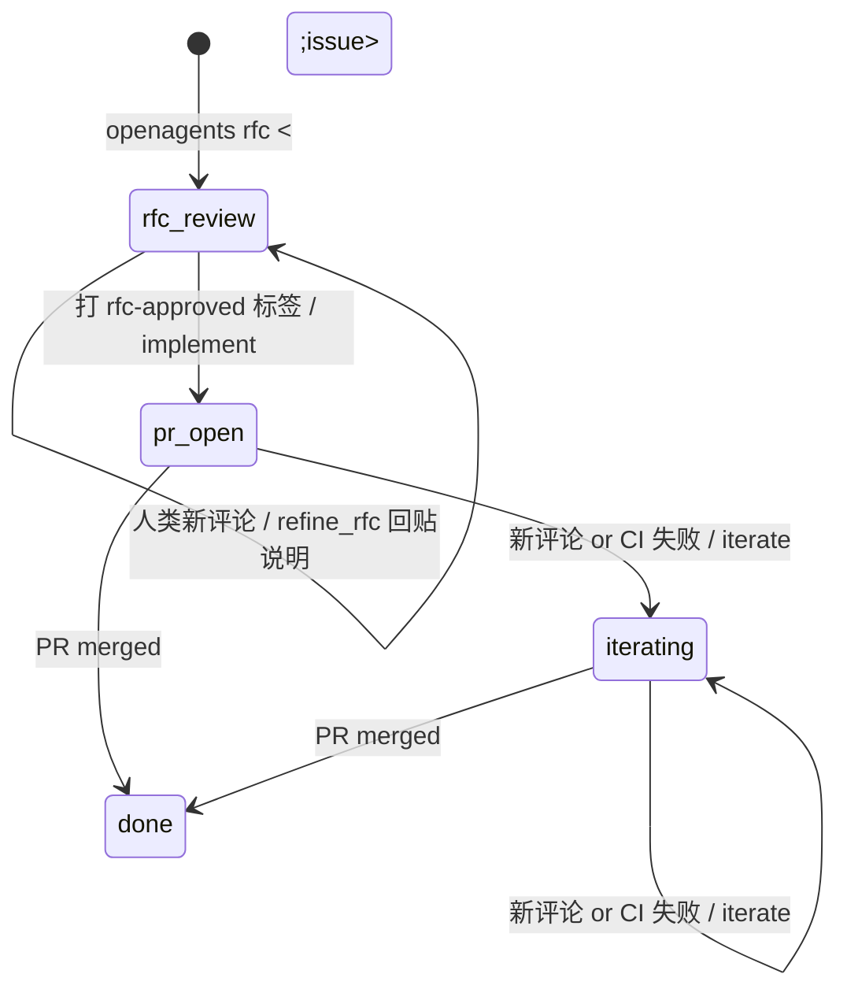
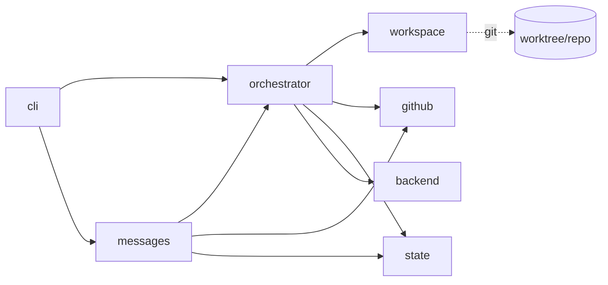
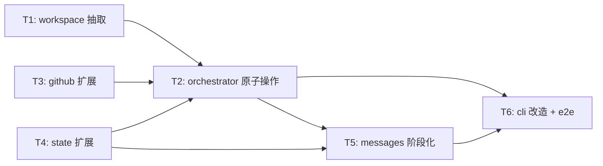

# RFC-0005: solve 原子化拆分 + RFC-first 评审循环

- **状态**: implemented
- **优先级**: P1
- **标签**: `architecture`, `cli`, `protocol`, `dx`
- **影响模块**: backend（orchestrator / workspace / messages / github / state / cli）
- **负责人**: OpenAgents
- **创建日期**: 2026-06-03
- **更新日期**: 2026-06-03

## 摘要

把单体的 `Orchestrator.solve` 拆成按关注点解耦的模块与若干**原子操作**，并在「写代码」之前插入一道 **RFC-first 评审循环**：agent 先起草 RFC（draft PR）→ 人在 PR 上评论 → agent 据评论精炼 RFC 并回贴改动说明 → 人打 `rfc-approved` 标签批准 → agent 才开始按 RFC 写代码。CLI 不再有一站式 `solve`，只暴露可单独触发的原子步骤；跨步骤的编排交给「状态机 + poll 事件循环」。

## 动机

当前 `openagents/orchestrator.py` 的 `solve` 把四类关注点耦合在一个方法里（见 `solve` / `_fresh_solve` / `_resume`）：

1. **git / worktree 机制**（`_prepare_worktree` / `_ensure_worktree` / `_commit_and_push` / `_remote_branch_exists` / `_git`）；
2. **GitHub 交互**（`github.create_pr` / `find_pr_by_branch`）；
3. **后端调用**（`backend.run`，附带任务相关的 prompt）；
4. **状态流转**（`state.begin_run` / `record_run` / `update_status`）。

这带来两个问题：

- **难以单独触发与测试**：人无法只跑「起草」或只跑「精炼」，调试/断点续跑只能整段重来。
- **违背理念 4「先改 RFC 再改码」**：`solve` 直接跳到写代码，没有「先对齐设计」的环节。框架自身就应当先出 RFC、由人评审、再实现。

CLAUDE.md 理念 2（去中心化）/ 理念 4（RFC 对齐）/ 理念 8（以成果为中心）要求：每一步都应是可被 GitHub 事件（新 issue / 新评论 / 标签）驱动的独立动作，人负责宏观把控（评审与批准），而非细节。

## 设计

### 概述

把 `solve` 的职责按**关注点**拆成解耦模块，并把跨步骤编排从「一个 `solve` 方法」改为「**GitHub 事件驱动的状态机**」：

- **新增 `workspace.py`**：只管 worktree 生命周期与 git（无 GitHub / backend / state 知识）。
- **`orchestrator.py` 瘦身**：只保留四个**原子操作**，每个都是「确保工作区 → `backend.run(任务)` → 提交推送 → 一次 GitHub 动作 → 一次状态流转」的薄组合。
- **`github.py` 扩展**：支持 draft PR、取消 draft、读标签、读当前登录名。
- **`state.py` 扩展**：新增 `rfc-review` 状态。
- **`messages.py` 阶段化**：poll 按 run 所处阶段把 GitHub 事件路由到对应原子操作，并过滤 agent 自己发的评论。
- **`cli.py` 改造**：删除 `solve`，新增 `rfc` / `refine-rfc` / `implement` / `iterate` 子命令；`poll` / `watch` 自动驱动同一批步骤。

**一 issue → 一分支 → 一 PR** 的既有不变量保持不变：PR 先以 draft 形态承载 RFC，批准后代码 commit 追加到**同一分支/PR**，再 `mark_ready` 转正。这样可直接复用既有的 worktree 隔离、poll 轮询与评论游标机制。

### 关键设计决策

1. **取消一站式 `solve`，CLI 只触发原子步骤**：跨步骤编排交给「状态机 + poll 事件循环」。理由：理念 2/4——每一步由 GitHub 事件驱动、去中心化，避免把流程硬编码进一个大方法；人通过 GitHub（评论 + 标签）做宏观把控。

2. **一 issue 一分支一 PR 不变；PR 以 draft 承载 RFC，批准后追加代码再转正**：理由——最大化复用既有 worktree / poll / 游标机制，保持成果看板与状态机不变量；避免引入「RFC-PR + 代码-PR」双 PR 带来的 state / 游标扩张。

3. **按关注点拆模块，文件清单互不重叠**：`workspace`（git/worktree）、`orchestrator`（操作编排）、`github`（gh 封装）、`state`（状态）、`messages`（事件路由）、`cli`（分发）。理由——理念「不同模块解耦」；互不重叠的文件清单是协同模式（同 worktree 多 agent 并行）无冲突的前提。

4. **批准信号用 PR 标签 `rfc-approved`**：理由——标签是结构化、可被 poll 稳定识别的信号，不会与普通讨论评论混淆、不会误触发；符合「人做宏观把控」。备选的关键词评论（如 `LGTM`）易和正常讨论混淆，已弃用（见权衡）。

5. **poll 阶段化路由**：`rfc-review` 阶段把「人类新评论」路由到 `refine_rfc`、把 `rfc-approved` 标签路由到 `implement`；`pr-open` / `iterating` 阶段维持「CI 失败 / 新评论 → `iterate`」。阶段直接由 run 的 `status` 推导，无需额外字段。理由——复用既有 poll 骨架，新增分支最小。

6. **`refine_rfc` 回贴评论说明改动；poll 必须按作者过滤 agent 自己的评论**：理由——agent 精炼后回贴的评论本身也是「新评论」，若不按 `author`（== 当前 gh 登录名）过滤，poll 会对自己的评论再次触发 `refine_rfc`，形成自我触发死循环。

### 接口契约

只描述 **what**，不描述 **how**；签名遵循 CLAUDE.md「禁止位置参数」。

**`openagents/workspace.py`（新增）** —— 纯 git / worktree，无 GitHub / backend / state 依赖：

```
class Workspace:
    def __init__(self, *, work_dir: Path) -> None: ...
    def prepare(self, *, issue_number: int, branch: str, base: str) -> Path: ...   # 全新：fetch base → 幂等清理 → 从 origin/<base> 拉隔离 worktree
    def ensure(self, *, issue_number: int, branch: str) -> Path: ...               # 复用既有 worktree；缺失则从远端分支重建
    def commit_and_push(self, *, worktree: Path, branch: str, message: str) -> None: ...  # add -A → commit（无改动则跳过）→ 普通 push（绝不 force）
    def remote_branch_exists(self, *, branch: str) -> bool: ...
```

（迁移自 orchestrator 的 `_prepare_worktree` / `_ensure_worktree` / `_commit_and_push` / `_remote_branch_exists` / `_worktree_path` / `_git`，行为不变。）

**`openagents/orchestrator.py`（瘦身）** —— 四个原子操作，组合 workspace + backend + github + state：

```
class Orchestrator:
    def start_rfc(self, *, issue_number: int, base: str = DEFAULT_BASE) -> PR: ...
        # workspace.prepare → backend 起草 docs/rfcs/ 下 RFC（遵循 rfc-driven skill：扫描 local+open PR 取下一号）
        # → commit_and_push → github.create_pr(draft=True) → state: rfc-review

    def refine_rfc(self, *, pr_number: int, detail: str) -> None: ...
        # workspace.ensure → backend 按评论精炼 RFC → commit_and_push
        # → github.post_comment(改动说明) → state 维持 rfc-review

    def implement(self, *, pr_number: int) -> None: ...
        # workspace.ensure → backend 按已批准 RFC 写代码 → commit_and_push
        # → github.mark_ready(取消 draft) → state: pr-open

    def iterate(self, *, pr_number: int, reason: str, detail: str) -> None: ...   # 既有：CI/comment 反馈 → 追加 commit，state: iterating
```

**`openagents/github.py`（扩展）**：

```
def create_pr(*, branch: str, title: str, body: str, draft: bool = False) -> PR: ...   # 既有签名加 draft（默认 False，向后兼容）
def mark_ready(*, pr_number: int) -> None: ...        # gh pr ready <n>：取消 draft 转正
def has_label(*, pr_number: int, name: str) -> bool: ...  # gh pr view <n> --json labels
def current_login() -> str: ...                       # gh api user --jq .login：当前认证用户名，供过滤 agent 自评论
```

**`openagents/state.py`（扩展）**：

```
STATUS_RFC_REVIEW = "rfc-review"   # 新增：PR 为 draft、承载 RFC、待人评审/批准
# 复用既有 begin_run / record_run / update_status：start_rfc 在 record_run 后 update_status(rfc-review)
```

**`openagents/messages.py`（阶段化）**：

```
APPROVAL_LABEL = "rfc-approved"
# poll 对每个 open run 按阶段路由：
#   merged                         → state: done
#   status == rfc-review:
#       has_label(rfc-approved)    → orchestrator.implement(pr)        （转入 coding）
#       否则有「人类新评论」        → orchestrator.refine_rfc(pr, body) （按作者过滤 agent 自评论 + 推进游标）
#   status ∈ {pr-open, iterating}:
#       CI fail                    → orchestrator.iterate(reason=ci)
#       人类新评论                  → orchestrator.iterate(reason=comment)
```

**`openagents/cli.py`（改造）**：删除 `solve` 子命令；新增

```
openagents rfc <issue> [--base main]   → orchestrator.start_rfc
openagents refine-rfc <pr>             → 取该 PR 最新人类评论 → orchestrator.refine_rfc
openagents implement <pr>              → orchestrator.implement
openagents iterate <pr> --reason {comment,ci}  → orchestrator.iterate（取最新人类评论 / CI 日志作 detail）
（保留 init / issue / poll / watch / board）
```

### 架构图

阶段状态机（节点为 run 状态，边为触发事件）：



模块依赖（数据流）：



> 本 RFC 只描述模块边界与契约；具体实现（prompt 文案、git 命令细节）在 Phase 3 细化。

## 权衡取舍

### 考虑过的替代方案

1. **保留 `solve` 一站式命令、仅把关键步骤额外暴露**：被否。用户明确要求 CLI 不再有 `solve`、只触发每一步——更贴合去中心化/事件驱动理念，且避免「大方法」与「原子步骤」两套入口的语义重叠。

2. **RFC 与代码分两个 PR**：被否。隔离更清晰，但打破「一 issue 一 PR」不变量，state / 游标 / 看板都要扩张，复杂度更高。改用「同一 draft PR 先承载 RFC、批准后追加代码转正」。

3. **批准信号用关键词评论（`LGTM` / `/approve`）**：被否。复用评论机制零新增，但易与正常讨论评论混淆、易误触发。改用结构化的 `rfc-approved` 标签。

4. **RFC 评审走 issue 评论**：被否。需要维护「issue 评论」与「PR 评论」两套游标，复杂度更高。

### 缺点

- **同一 PR 混合 RFC 文档与代码**：评审历史里 RFC 与代码 commit 交织，需靠 commit message 区分阶段。
- **多 issue 并发起草时 RFC 编号可能撞号**（见未解决的问题）。
- **`refine-rfc` / `iterate` 手动触发与 poll 自动触发都需要「取最新人类评论」**：两处各有一小段「按作者过滤」逻辑（均调用 `github.current_login` + `list_comments`），存在少量重复，可接受。
- 跨 PR 文件冲突风险：本 RFC 改动的 `cli.py` / `github.py` / `tests/test_cli.py` / `tests/test_github.py` 与 open PR #10（RFC-0004 vigil）有交集，合并时需处理冲突。

## 实现计划

### 子任务分解

> 子任务数量 = 6（未超上限）。各子任务「涉及文件」互不重叠 → 协同模式可并行。

#### 依赖关系图



#### 子任务列表

| ID | 标题 | 依赖 | 涉及文件 | 状态 |
|----|------|------|---------|------|
| T1 | workspace 模块抽取 | - | `openagents/workspace.py`, `tests/test_workspace.py` | implemented |
| T3 | github 扩展（draft / mark_ready / has_label / current_login） | - | `openagents/github.py`, `tests/test_github.py` | implemented |
| T4 | state 扩展（rfc-review 状态） | - | `openagents/state.py`, `tests/test_state.py` | implemented |
| T2 | orchestrator 瘦身为四原子操作 | T1, T3, T4 | `openagents/orchestrator.py`, `tests/test_orchestrator.py` | implemented |
| T5 | messages 阶段化 + 过滤自评论 | T2, T4 | `openagents/messages.py`, `tests/test_messages.py` | implemented |
| T6 | cli 改造（去 solve，加 4 子命令）+ e2e | T2, T5 | `openagents/cli.py`, `tests/test_cli.py`, `scripts/e2e-rfc-0005-rfc-first.sh` | implemented |

状态: `pending` | `in-progress`（代码修改中） | `implemented`（代码修改完毕） | `blocked`

> **并行提示**: T1 / T3 / T4 无依赖且文件不重叠，可并行；之后 T2；最后 T5 / T6 可并行。

#### 子任务定义

**T1: workspace 模块抽取**
- **范围**: 新建 `Workspace` 类，把 orchestrator 现有的 worktree/git 逻辑（`_prepare_worktree` / `_ensure_worktree` / `_commit_and_push` / `_remote_branch_exists` / `_worktree_path` / `_git`）原样迁入，对外暴露 `prepare` / `ensure` / `commit_and_push` / `remote_branch_exists`。纯 git，无 GitHub / backend / state 依赖。本子任务只新增文件，不改 orchestrator（由 T2 改）。
- **涉及文件**: `openagents/workspace.py`（新增）、`tests/test_workspace.py`（新增）
- **验收标准**: 单测覆盖 prepare（fetch + 幂等清理 + worktree add）、ensure（存在则复用 / 缺失则重建）、commit_and_push（无改动跳过 commit 仍 push）；ruff 通过；注释引用 `RFC-0005`。

**T3: github 扩展**
- **范围**: `create_pr` 增加 `draft: bool = False`（透传 `gh pr create --draft`）；新增 `mark_ready`（`gh pr ready`）、`has_label`（`gh pr view --json labels`）、`current_login`（`gh api user --jq .login`）。
- **涉及文件**: `openagents/github.py`、`tests/test_github.py`
- **验收标准**: 单测 monkeypatch gh 子进程，覆盖 draft 透传、mark_ready、has_label（命中/未命中）、current_login 解析；`create_pr` 旧调用（不传 draft）行为不变；ruff 通过。

**T4: state 扩展**
- **范围**: 新增 `STATUS_RFC_REVIEW = "rfc-review"` 常量，纳入合法状态；不改既有方法签名（start_rfc 复用 `record_run` + `update_status`）。更新 `RunRecord` docstring 的状态枚举说明。
- **涉及文件**: `openagents/state.py`、`tests/test_state.py`
- **验收标准**: 单测验证 `update_status(status=rfc-review)` 落盘与读取；既有用例不回归；ruff 通过。

**T2: orchestrator 瘦身为四原子操作**
- **范围**: 删除 `solve` / `_fresh_solve` / `_resume` 及已迁出的 git/worktree 私有方法；改为持有 `Workspace`，实现 `start_rfc` / `refine_rfc` / `implement`（保留既有 `iterate`，改为走 `Workspace`）。`start_rfc` 的 backend 任务需指示其遵循 rfc-driven skill 起草 RFC（含取号）。`_pr_body` / `_open_or_reuse_pr` 按需保留。
- **涉及文件**: `openagents/orchestrator.py`、`tests/test_orchestrator.py`
- **验收标准**: 单测用假 backend / monkeypatch github、注入假 Workspace，覆盖四操作的「确保工作区→run→提交推送→GitHub 动作→状态流转」；ruff 通过；注释引用 `RFC-0005`。

**T5: messages 阶段化 + 过滤自评论**
- **范围**: `_process_run` 按 run 状态分阶段路由（见接口契约）；新增 `APPROVAL_LABEL`；评论处理按 `author == github.current_login()` 过滤 agent 自评论后再比对游标；`rfc-review` 阶段命中标签调 `implement`、否则人类新评论调 `refine_rfc`。
- **涉及文件**: `openagents/messages.py`、`tests/test_messages.py`
- **验收标准**: 单测覆盖：rfc-review + 标签 → implement；rfc-review + 人类评论 → refine_rfc；rfc-review + 仅 agent 自评论 → 不触发；coding 阶段 CI/comment → iterate；merged → done；ruff 通过。

**T6: cli 改造 + e2e**
- **范围**: 删除 `solve` 子命令与 `_cmd_solve`；新增 `rfc` / `refine-rfc` / `implement` / `iterate` 子命令及处理函数（`refine-rfc`/`iterate` 取最新人类评论作 detail）；更新 `_dispatch` 路由表。新增端到端脚本 `scripts/e2e-rfc-0005-rfc-first.sh`（起草 RFC → 模拟评论 → refine → 打标签 → implement → poll 转 done 的演示）。
- **涉及文件**: `openagents/cli.py`、`tests/test_cli.py`、`scripts/e2e-rfc-0005-rfc-first.sh`（新增）
- **验收标准**: 单测对工厂打桩，验证四子命令分发到对应操作、`solve` 已移除；e2e 脚本可读且步骤完整；ruff 通过。

## 测试方案

### 单元测试

- `test_workspace`: worktree prepare/ensure/commit_and_push 行为（含无改动跳过 commit、远端分支探测）。
- `test_github`: draft 透传、mark_ready、has_label、current_login。
- `test_state`: rfc-review 状态读写。
- `test_orchestrator`: 四原子操作各自的组合编排（假 backend + 假 Workspace + monkeypatch github）。
- `test_messages`: 阶段化路由全分支 + 自评论过滤。
- `test_cli`: 新子命令分发、`solve` 移除。

### 集成测试

- `scripts/e2e-rfc-0005-rfc-first.sh`：在真实/测试仓库串起 `rfc → 评论 → refine-rfc → 打 rfc-approved 标签 → implement → poll` 全链路，验证 PR 从 draft（RFC）转正为代码 PR 直至 done。

### 手动验证

1. `openagents rfc <issue>` → 检查生成 draft PR 且含 `docs/rfcs/NNNN-*.md`。
2. 在 PR 上发一条评论 → `openagents poll` → 检查 RFC 被精炼且 agent 回贴了改动说明评论。
3. 给 PR 打 `rfc-approved` 标签 → `openagents poll` → 检查代码 commit 追加、PR 转正（非 draft）、状态变 pr-open。
4. 确认 agent 不会对自己回贴的评论再次触发 refine（无自我循环）。

## 未解决的问题

1. **多 issue 并发起草时 RFC 编号撞号**：当前依赖 rfc-driven skill 的「扫描 local + open PR 编号 + 尽早推 draft PR 使编号可见」机制。是否需要额外的编号锁/分配服务，留待实现阶段并发实测后再定。
2. **多 agent 共用同一 GitHub 账号时的身份区分**：MVP 用 `author == current_login` 过滤 agent 自评论已足够。若未来多个 agent 共用同一账号，人 / 本 agent / 其他 agent 难以区分，是否需要专用 bot 账号或评论隐藏标记，留待多 agent 场景落地时再定。

## 参考资料

- CLAUDE.md —— 设计理念 2（去中心化）/ 4（RFC 对齐）/ 5–6（并行模式）/ 8（以成果为中心）
- `.claude/skills/rfc-driven-development/SKILL.md` —— RFC 流程与编号规则
- RFC-0001 —— 单 issue → 单 agent → PR 的最小闭环（poll / 游标 / 状态机基础）
- RFC-0003 —— 每 issue 独立 worktree + 分支基线锁定（workspace 抽取的来源）
