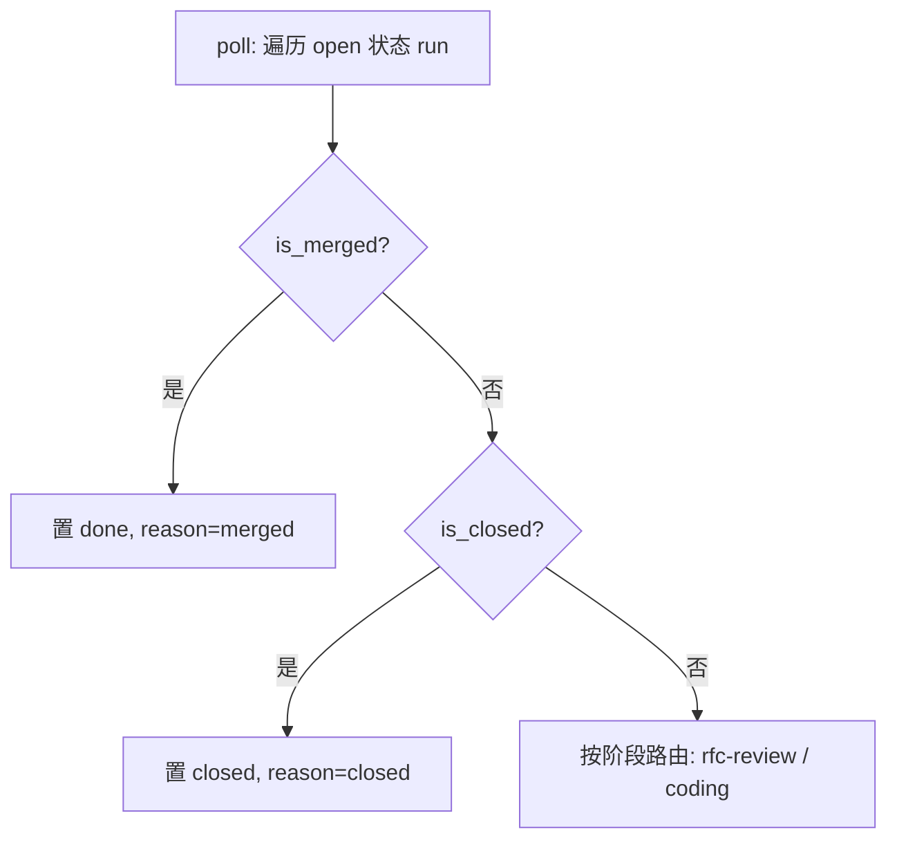
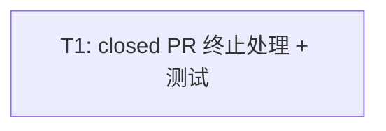

# RFC-0006: 守夜人识别 PR/issue 关闭作为终止信号

- **状态**: implemented
- **优先级**: P1
- **标签**: `protocol`, `cli`
- **影响模块**: `openagents/github.py`, `openagents/state.py`, `openagents/messages.py`
- **负责人**: OpenAgents
- **创建日期**: 2026-06-04
- **更新日期**: 2026-06-04

## 摘要

守夜人（`openagents vigil`）当前只把「PR 被 merge」当作 run 的终止信号。一个被**关闭但未合并**（closed-without-merge）的 PR，状态机永远不会离开开放态，于是每一轮 `poll` 都会被重新捞起并触发编排动作（implement / refine / iterate）。本 RFC 把「PR 关闭」也纳入终止信号，让人主动关掉的 PR 不再被守夜人处理。

## 动机

复现：人在 GitHub 上 close 掉一个仍带 `rfc-approved` 标签、本地状态为 `rfc-review` 的 draft PR（如 PR #13）。守夜人下一轮日志输出 `▶ RFC 已批准，按 RFC 实现 PR #13 的代码 …`，反复对一个已关闭的 PR 调用 `implement()`。

根因（顺 `poll` 调用链）：

1. `messages.poll`（`messages.py:61-63`）遍历 `all_runs()`，只要本地 `status` 仍在 `_OPEN_STATUSES = {rfc-review, pr-open, iterating}`（`messages.py:41`）就继续处理。
2. `_process_run`（`messages.py:80-91`）里**唯一**能把 run 推出开放态的分支是 `github.is_merged(...)` → 置 `done`。没有任何分支处理「PR 被关闭」。
3. `github.is_merged`（`github.py:300-311`）判定 `state == "MERGED"`。GitHub PR 的 `state` 有三态：`OPEN` / `CLOSED` / `MERGED`。closed-without-merge 的 PR `state` 是 `CLOSED`，于是 `is_merged` 返回 `False`，流程穿过终止判定落到阶段路由，被当作开放 PR 继续处理。

issue 侧不存在同样问题：发现段 `vigil.py:70` 调 `github.list_issues(labels=labels)`，而 `list_issues` 默认 `state="open"`（`github.py:127`），closed issue 不会被列出、不会被派单；已派单 issue 又被去重三道闸（`vigil._is_new`）挡住。本 RFC 因此只需修补 PR 侧，并在文档中明确 issue 侧的既有保证。

## 设计

### 概述

把 `_process_run` 的终止判定从「仅 merged」扩展为「merged 或 closed」，两者都是终态、都不再触发任何编排动作，但用**不同的终止状态**区分语义：

- `MERGED` → `done`（合并成功，既有语义不变）
- `CLOSED` → `closed`（人主动放弃，新增终态）

新增的 `closed` 状态**不**加入 `_OPEN_STATUSES`，因此一旦置为 `closed`，该 run 在后续 `poll` 中被直接跳过——天然达成「关闭后不再处理」。

### 关键设计决策

1. **新增 `closed` 终态，而非复用 `done`**：`done` 在看板与语义上代表「合并交付成功」；被人关掉的 PR 是「放弃」，二者成果含义相反。区分开来保留可观测性（CLAUDE.md 可观测性设计），看板（`results.py` 原样渲染 status 字符串）无需改动即可显示 `closed`。

2. **复用 `gh pr view --json state` 单次查询判定三态**：新增 `github.is_closed(*, pr_number)`，与既有 `is_closed` 的孪生函数 `is_merged` 对称——同样读 `state` 字段，判定 `state == "CLOSED"`。保持薄封装风格（决策 3），不引入新数据类型。`is_merged` 保持不变，向后兼容其它潜在调用方。

3. **终止判定顺序：merged 优先，其次 closed，最后阶段路由**：GitHub 中 merged 的 PR 其 `state` 是 `MERGED` 而非 `CLOSED`，两者互斥，顺序不影响正确性；merged 在前与既有「合并优先于一切」（决策 8）表述一致。

4. **issue 侧不改代码**：closed issue 已被 `list_issues(state="open")` 默认过滤。本 RFC 仅以测试与文档固化该保证，不新增逻辑（奥卡姆剃刀）。

### 接口契约

`openagents/github.py` 新增：

```
def is_closed(*, pr_number: int) -> bool
    # True 当且仅当 gh pr view 的 state == "CLOSED"（关闭且未合并；MERGED 不算）。
```

`openagents/state.py` 新增常量：

```
STATUS_CLOSED = "closed"   # 终态：PR 被关闭但未合并；不在 _OPEN_STATUSES 内。
```

`openagents/messages.py` `_process_run` 行为变更（接口签名不变）：

```
merged → update_status(done),   event reason="merged"
closed → update_status(closed), event reason="closed"   # 新增分支
otherwise → 阶段路由（不变）
```

### 架构图



## 权衡取舍

### 考虑过的替代方案

- **复用 `done` 表示关闭**：实现更省一个常量，但抹掉了「合并成功」与「放弃」的语义区别，损害成果看板的可观测性。已拒绝。
- **把 `is_merged` 重构为 `pr_state()` 单一函数、`messages` 改调它一次**：运行时省一次 `gh` 调用，但会改动 `_patch_github` 测试夹具与多处既有测试，diff 涟漪更大。当前 `poll` 间隔默认 60s，多一次 `gh pr view` 成本可忽略；选择与 `is_merged` 对称的 `is_closed`，最小化改动面与回归风险。已拒绝重构。
- **在 issue 发现段额外加 closed 过滤**：`list_issues` 默认 `state="open"` 已保证，重复加判定是冗余实体。已拒绝。

### 缺点

- open PR 的每轮 `poll` 会多一次 `gh pr view --json state`（merged 一次 + closed 一次）。属可接受的轻微开销。
- `closed` 是单向终态，没有「重开 PR 后恢复处理」的路径；若人重开 PR 需手动改 state 或重新派单。MVP 阶段可接受，必要时另起 RFC。

## 实现计划

### 子任务分解

本变更是一处内聚的终止语义修补，横跨 github/state/messages 三个文件但属单一原子改动，作为一个子任务实现。

#### 依赖关系图



#### 子任务列表

| ID | 标题 | 依赖 | 涉及文件 | 状态 |
|----|------|------|---------|------|
| T1 | closed PR 识别为终止信号 | - | `openagents/github.py`, `openagents/state.py`, `openagents/messages.py`, `tests/test_github.py`, `tests/test_messages.py` | implemented |

状态: `pending` | `in-progress`（代码修改中） | `implemented`（代码修改完毕） | `blocked`

#### 子任务定义

**T1: closed PR 识别为终止信号**
- **范围**:
  1. `github.py` 新增 `is_closed(*, pr_number)`，读 `gh pr view --json state` 判定 `CLOSED`。
  2. `state.py` 新增 `STATUS_CLOSED = "closed"` 常量。
  3. `messages.py` `_process_run` 在 merged 判定之后、阶段路由之前插入 closed 分支：置 `STATUS_CLOSED`、返回 `reason="closed"`，不触发任何编排动作。
- **涉及文件**: 见上表。
- **验收标准**:
  - 一个 `state=CLOSED`、带 `rfc-approved` 标签、本地状态 `rfc-review` 的 run 经 `poll` 后：不调用 `implement`，状态被置为 `closed`，事件 `reason="closed"`。
  - `closed` 状态的 run 在后续 `poll` 中被跳过（不在 `_OPEN_STATUSES`）。
  - merged 仍优先于 closed 与阶段路由，既有测试不回归。
  - `ruff check` / `ruff format --check` / `pytest` 全绿。

## 测试方案

### 单元测试

- `tests/test_github.py`：`is_closed` 对 `CLOSED` 返回 True，对 `OPEN`/`MERGED` 返回 False（monkeypatch `_gh_json`）。
- `tests/test_messages.py`：
  - closed PR（带标签/带新评论）→ 不 implement/refine/iterate，置 `STATUS_CLOSED`，`reason="closed"`。
  - merged 优先于 closed（同时为真时走 merged）。
  - 已是 `closed` 状态的 run 不被 `poll` 处理（不在轮询范围）。

### 集成测试

复用既有 vigil 测试框架（`tests/test_vigil.py`）的注入风格即可；无需新增端到端用例（行为已被 messages 单测覆盖）。

### 手动验证

1. 起一个 draft PR（守夜人派单产生），在 GitHub 上直接 Close（不 merge）。
2. 跑 `openagents vigil --once`，确认日志不再出现对该 PR 的 implement/iterate，且 `.openagents/state.json` 中该 run 的 `status` 变为 `closed`。

## 未解决的问题

无。

## 参考资料

- RFC-0001（终止条件「决策 8」）、RFC-0004（守夜人主循环）、RFC-0005（按阶段路由）。
- `gh pr view --json state` 三态取值：`OPEN` / `CLOSED` / `MERGED`。
