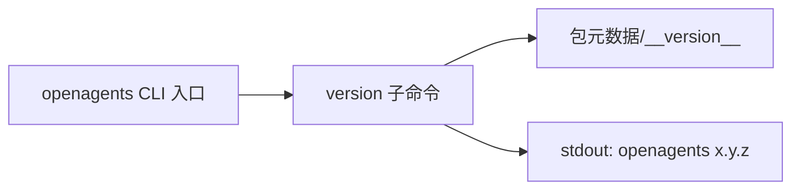
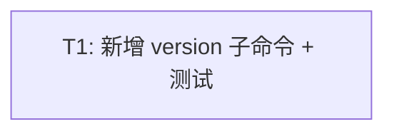

# RFC-0006: 测试 RFC —— `openagents version` 命令

- **状态**: draft
- **优先级**: P3
- **标签**: `cli`, `dx`
- **影响模块**: `openagents/`（CLI）
- **负责人**: openagents-agent (issue #12)
- **创建日期**: 2026-06-03
- **更新日期**: 2026-06-03

## 摘要

为验证 RFC → 实现 → PR → CI 全流程，引入一个最小可验证的变更：新增 `openagents version` 子命令，打印当前包版本。本 RFC 刻意保持最小范围（单子任务），作为流程冒烟测试。

## 动机

issue #12「测试」要求生成一个尽量短的测试 RFC 与 PR，用于验证自举闭环（issue → worktree → RFC → 实现 → PR → CI）是否通畅。需要一个**真实、可验证、零副作用**的改动作为载体——既能跑通 CI，又不引入新的设计风险。`version` 命令满足该条件：它只读取已有元数据并输出，不触碰状态、网络或 GitHub。

## 设计

### 概述

在现有 CLI 入口注册一个 `version` 子命令。命令读取包的版本号（来自包元数据 / `__version__`），输出到 stdout 后以退出码 0 结束。无参数、无副作用、不依赖外部服务。

### 关键设计决策

1. **复用现有 CLI 框架**：在当前 `openagents/cli.py` 的命令分发结构中新增 `version`，不引入新依赖、不改变现有命令行为。理由：奥卡姆剃刀，最小化改动。
2. **版本号单一来源**：版本号从包元数据读取（`importlib.metadata.version` 或既有 `__version__`），不在命令里硬编码。理由：避免版本号双写漂移。
3. **纯读、零副作用**：命令不写状态、不发网络请求。理由：作为冒烟测试载体，必须可在 CI 内确定性地运行。

### 接口契约

- **CLI**：`openagents version` → stdout 打印形如 `openagents <x.y.z>` 的单行字符串，退出码 `0`。
- **内部**：提供一个返回版本字符串的纯函数（无参数），供命令与测试共同调用，便于断言。

### 架构图



> **注意**: 本 RFC 不包含具体实现代码，仅描述接口与边界。

## 权衡取舍

### 考虑过的替代方案

- **`--version` 全局选项**（而非子命令）：更符合常见 CLI 惯例，但当前 CLI 以子命令分发为主；为保持与现有命令风格一致并最小化对入口解析逻辑的改动，选择子命令形式。
- **新增一个无意义的 no-op 命令**：纯占位、无实际价值，违背「证据驱动 / 以成果为中心」。`version` 在测试之外仍有长期实用价值。

### 缺点

- 功能价值有限（仅打印版本），主要价值在于验证流程。
- 若未来改为 `--version` 全局选项，需要做一次兼容处理。

## 实现计划

### 子任务分解

> 本 RFC 为最小测试范围，仅 1 个子任务。

#### 依赖关系图



#### 子任务列表

| ID | 标题 | 依赖 | 涉及文件 | 状态 |
|----|------|------|---------|------|
| T1 | 新增 `version` 子命令并补测试 | - | `openagents/cli.py`, `tests/test_cli.py` | pending |

状态: `pending` | `in-progress`（代码修改中） | `implemented`（代码修改完毕） | `blocked`

#### 子任务定义

**T1: 新增 `version` 子命令并补测试**
- **范围**: 在 CLI 入口注册 `version` 子命令；实现读取版本号的纯函数；命令打印 `openagents <版本>` 并以退出码 0 结束。
- **涉及文件**: `openagents/cli.py`（修改：注册子命令 + 版本读取函数）、`tests/test_cli.py`（修改：新增针对 `version` 的单元测试）。
- **验收标准**:
  - `openagents version` 输出包含当前版本号的单行字符串，退出码为 0。
  - 单元测试覆盖：命令存在、输出格式、退出码。
  - `ruff check` 与 `ruff format --check` 通过；`pytest` 全绿。
  - 代码注释引用 `RFC-0006`。

## 测试方案

### 单元测试

- 调用 `version` 命令，断言退出码为 0。
- 断言 stdout 含 `openagents ` 前缀及非空版本号。
- 断言版本读取函数返回与包元数据一致的版本字符串。

### 集成测试

- 在 CI 中运行 `openagents version`，确认命令注册成功、可正常调用、确定性输出。

### 手动验证

```bash
openagents version
# 期望输出形如：openagents 0.x.y，退出码 0
```

## 未解决的问题

无。

## 参考资料

- issue #12「测试」
- RFC-0001：MVP 自举闭环（CLI 入口与命令分发结构）
- `.claude/skills/rfc-driven-development`：RFC 驱动开发流程
