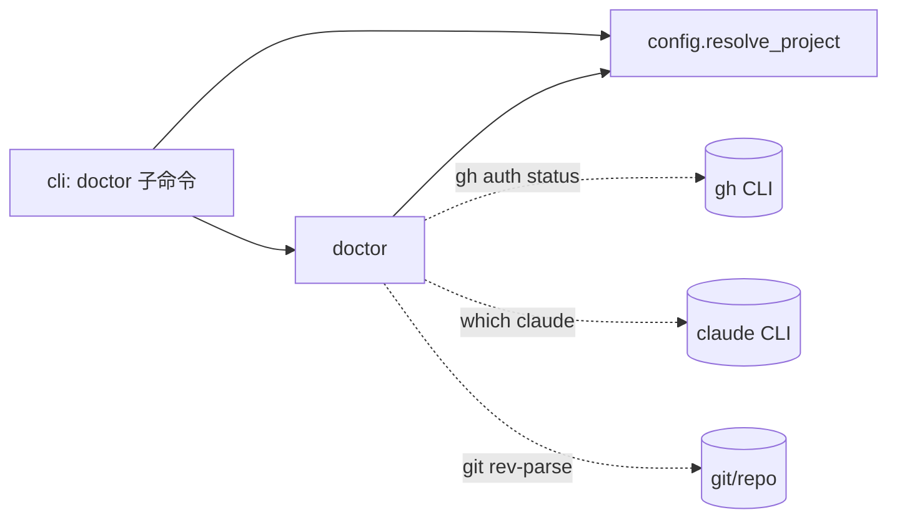

# RFC-0007: openagents doctor —— 环境健康自检（pipeline 预检）

- **状态**: draft
- **优先级**: P2
- **标签**: `cli`, `dx`
- **影响模块**: backend（新增 doctor 模块）/ cli
- **负责人**: OpenAgents
- **创建日期**: 2026-06-05
- **更新日期**: 2026-06-05

## 摘要

新增 `openagents doctor` 子命令：一次性、只读地体检 issue→RFC→PR 闭环所依赖的全部外部前置条件（`git`、`gh` 鉴权、后端 CLI `claude`、项目绑定），打印逐项 ✓/✗ 清单，任一**必需项**失败时以非零退出码返回。让人在派单前用一条命令确认「这台机器能不能跑通流水线」，把现在散落在各命令运行期才暴露的环境错误前移成一次显式预检。

> **关于 issue #18**：该 issue 标题与正文均为占位符「测试」，无具体需求。本 RFC 取**最小且可辩护**的解读——为这个自举式框架补一条「流水线自检」命令。这是「测试」类 issue 在本项目语境下最贴切的落点（验证工具链可用，而非凭空发明大功能，遵循设计理念 1 奥卡姆剃刀 / 理念 7 证据驱动）。范围解读已列入「未解决的问题」，请人在评审时确认。

## 动机

当前框架的每个命令（`rfc` / `implement` / `poll` / `vigil` …）在运行期才会触达外部依赖：

- `git`（`openagents/config.py` 的 `resolve_project` 用 `git rev-parse`）；
- `origin` 远端（`config.py` 读 `remote.origin.url`）；
- `gh` CLI 及其鉴权（`openagents/github.py` 决策 3：所有 GitHub 操作走 `gh` 子进程）；
- 后端 CLI `claude`（`openagents/backends/claude_code.py` 的 `CLAUDE_BIN`）。

任一缺失，都要等到流程跑到一半（可能已建 worktree、已开 draft PR）才以 `GithubError` / `RuntimeError` 暴露，定位成本高、且可能留下半成品状态。守夜人模式（RFC-0004）长跑时尤甚——一个未鉴权的 `gh` 会让整轮循环静默空转。

CLAUDE.md 理念 8（以成果为中心、人做宏观把控）要求人能用最低成本确认「环境就绪」，而不必逐个命令试错。`doctor` 把这些隐式前置条件收敛成一次显式、可读、可脚本化（非零退出）的预检。

## 设计

### 概述

新增**纯只读**的 `openagents/doctor.py`，定义一组互相独立的「检查项」，每项产出一个结构化 `CheckResult`（名称 / 是否通过 / 是否必需 / 明细 / 修复提示）。`run_checks` 汇总所有检查项的结果列表；CLI 的 `doctor` 命令负责渲染清单并据「是否有必需项失败」决定退出码。

检查项复用既有探测逻辑、不重复造轮子：

- **git / 项目绑定**：复用 `config.resolve_project()`（返回 `ProjectContext | None`，含 `repo_root` 与 `remote`）。
- **gh 鉴权**：新增对 `gh auth status` 的薄探测（沿用 github 层「走 gh 子进程」的既定决策）。
- **后端 CLI**：探测 `claude` 是否在 PATH（`shutil.which(CLAUDE_BIN)`）。

与 `board` 一致，`doctor` **跳过常规 preflight**（`ensure_project`）：体检的对象恰恰可能是一个「尚未就绪」的环境，若先 preflight 就会在体检前自己先抛错，自相矛盾。

### 关键设计决策

1. **检查项分「必需 / 可选」两档，退出码只由必需项决定**：`git`、`gh` 安装+鉴权、后端 CLI 为必需（缺则流水线必然失败）；`origin` 远端为可选（纯本地仓库也能起草 RFC，到推送/开 PR 才需要，故标记为 warning 而非 fail）。理由——区分「跑不通」与「将受限」，避免把可降级场景误报为致命，符合理念 1（不过度约束）。

2. **doctor 跳过 `ensure_project` preflight（与 `board` 同档）**：理由——体检目标可能是未就绪环境；先 preflight 会在体检前自抛错，使 doctor 失去意义。`_dispatch` 中与 `board` 并列短路。

3. **检查项与渲染解耦**：`doctor.py` 只产出结构化 `CheckResult` 列表（不 `print`、不 `sys.exit`）；打印与退出码归 `cli.py`。理由——理念「不同模块解耦」；纯数据返回值让 `doctor.py` 可被单测断言、亦可供未来 board/前端复用同一体检结果。

4. **每个失败检查项自带「修复提示」文案**：`CheckResult.fix` 给出可执行的下一步（如 `gh auth login`）。理由——理念 8，让人零额外查询即可自助修复，而非只报「失败」。

5. **只读、零副作用、零新依赖**：所有检查都是探测命令（`git rev-parse` / `gh auth status` / `shutil.which`），不改任何状态、不写盘。理由——预检本身绝不能产生副作用；沿用 github 层「薄封装 gh、零额外依赖」的既定取向。

### 接口契约

只描述 **what**，不描述 **how**；签名遵循 CLAUDE.md「禁止位置参数」。

**`openagents/doctor.py`（新增）**：

```
@dataclass(frozen=True)
class CheckResult:
    name: str          # 检查项名（如 "git" / "gh 鉴权" / "后端 claude"）
    ok: bool           # 是否通过
    required: bool     # 是否为必需项（决定退出码）
    detail: str        # 通过/失败的可读明细（如版本号、错误摘要）
    fix: str | None    # 失败时的修复提示；通过时为 None

def run_checks(*, ctx: ProjectContext | None) -> list[CheckResult]: ...
    # 依次执行全部检查项，返回结果列表（不打印、不退出）。
    # ctx 由调用方用 config.resolve_project() 取得（可能为 None）。

def has_blocking_failure(*, results: list[CheckResult]) -> bool: ...
    # 是否存在「必需项失败」——cli 据此决定退出码。
```

各检查项为模块内 `_` 私有函数（如 `_check_git` / `_check_remote` / `_check_gh_auth` / `_check_backend`），各返回一个 `CheckResult`，由 `run_checks` 编排。

**`openagents/cli.py`（修改）**：新增子命令与处理函数

```
openagents doctor      → _cmd_doctor
# 解析：sub.add_parser("doctor", help="体检 issue→PR 流水线的环境前置条件")
# _cmd_doctor：ctx = config.resolve_project()；results = doctor.run_checks(ctx=ctx)
#   逐行打印 ✓/✗ + detail + （失败时）fix；
#   has_blocking_failure → 返回 1，否则 0。
# _dispatch：与 board 并列短路（doctor 不走 ensure_project preflight）。
```

### 架构图



> 本 RFC 只描述模块边界与契约；具体探测命令的参数细节、清单渲染样式在 Phase 3 细化。

## 权衡取舍

### 考虑过的替代方案

1. **不新增命令，把环境检查塞进每个命令的 preflight（`ensure_project`）里**：被否。会让本就只管「git/remote 绑定」的 preflight 膨胀、与各命令耦合；且无法满足「派单前主动一键体检」的诉求。独立 `doctor` 命令职责单一、可单独运行与脚本化。

2. **doctor 顺带「修复」环境（如自动 `gh auth login`）**：被否。预检必须只读、零副作用；自动修复涉及交互鉴权/写状态，风险与复杂度都更高。改为只报告 + 给出修复提示文案，由人执行。

3. **用 Python 库（PyGithub / GitPython）替代子进程探测**：被否。引入新依赖，违背 github 层「薄封装 gh、零额外依赖」的既定决策（github.py 决策 3）；探测类操作用现成 CLI 足矣。

### 缺点

- **检查项是「快照」**：doctor 通过不代表后续运行期环境不变（如 token 中途过期）。它降低而非消除运行期失败概率。
- **后端可用性只查 PATH 存在性**，不实际跑一次推理（避免耗时/计费）；`claude` 在但鉴权失效的情形 doctor 测不出，留待运行期。
- **`gh auth status` 的输出格式若随 gh 版本变化**，明细解析需相应适配（仅影响 detail 文案，不影响通过/失败判定——判定只看退出码）。

## 实现计划

### 子任务分解

> 子任务数量 = 3（未超上限）。各子任务「涉及文件」互不重叠 → 协同模式可并行/串行。

#### 依赖关系图


#### 子任务列表

| ID | 标题 | 依赖 | 涉及文件 | 状态 |
|----|------|------|---------|------|
| T1 | doctor 核心检查模块 | - | `openagents/doctor.py`, `tests/test_doctor.py` | pending |
| T2 | cli 接线 doctor 子命令 | T1 | `openagents/cli.py`, `tests/test_cli.py` | blocked |
| T3 | e2e 脚本 + README 文档 | T2 | `scripts/e2e-rfc-0007-doctor.sh`, `README.md` | blocked |

状态: `pending` | `in-progress`（代码修改中） | `implemented`（代码修改完毕） | `blocked`

> **并行提示**: 本 RFC 为线性依赖（T1→T2→T3），文件清单仍互不重叠以保证协同模式无冲突。

#### 子任务定义

**T1: doctor 核心检查模块**
- **范围**: 新建 `openagents/doctor.py`，定义 `CheckResult` 数据类、各 `_check_*` 私有检查项（git / origin 远端 / gh 安装+鉴权 / 后端 `claude`）、`run_checks(*, ctx)` 编排与 `has_blocking_failure(*, results)`。纯只读、无副作用、不打印、不退出。本子任务不改 cli（由 T2 改）。
- **涉及文件**: `openagents/doctor.py`（新增）、`tests/test_doctor.py`（新增）
- **验收标准**: 单测 monkeypatch `shutil.which` 与 `subprocess`，覆盖：每项通过/失败两态、required 与可选项（origin 缺失为 warning 非 blocking）、`has_blocking_failure` 在必需项失败/全通过时的返回；失败项 `fix` 文案非空；ruff 通过；注释引用 `RFC-0007`。

**T2: cli 接线 doctor 子命令**
- **范围**: 在 `build_parser` 注册 `doctor` 子命令；新增 `_cmd_doctor`（取 `config.resolve_project()` → `doctor.run_checks` → 渲染 ✓/✗ + detail +（失败时）fix → 按 `has_blocking_failure` 决定退出码）；在 `_dispatch` 中与 `board` 并列短路，跳过 `ensure_project` preflight。
- **涉及文件**: `openagents/cli.py`（修改）、`tests/test_cli.py`（修改）
- **验收标准**: 单测对 `doctor.run_checks` 打桩，验证：全通过 → 退出 0、含必需项失败 → 退出 1、doctor 不触发 `ensure_project`（hermetic，不触达真实 gh/git）；ruff 通过；注释引用 `RFC-0007`。

**T3: e2e 脚本 + README 文档**
- **范围**: 新增 `scripts/e2e-rfc-0007-doctor.sh`：在当前仓库跑 `openagents doctor`，展示通过样例，并演示「人为制造一个失败项（如临时 PATH 去掉 claude）→ 非零退出」的判定。在 `README.md` 增补 `doctor` 命令用法小节。
- **涉及文件**: `scripts/e2e-rfc-0007-doctor.sh`（新增）、`README.md`（修改）
- **验收标准**: 脚本可读、步骤完整、可独立运行；README 列出命令、各检查项含义与必需/可选分档；脚本 `set -euo pipefail` 且对失败演示分支用子 shell 隔离不污染主流程。

## 测试方案

### 单元测试

- `test_doctor`: 各检查项通过/失败两态（monkeypatch `shutil.which` / `subprocess.run`）、origin 缺失记为可选 warning、`run_checks` 汇总顺序、`has_blocking_failure` 判定。
- `test_cli`: `doctor` 子命令分发（对 `run_checks` 打桩）→ 全通过退出 0 / 必需项失败退出 1；doctor 跳过 `ensure_project` preflight。

### 集成测试

- `scripts/e2e-rfc-0007-doctor.sh`: 真实环境跑 `openagents doctor`，验证通过样例输出与「制造失败 → 非零退出」两条路径。

### 手动验证

1. 在就绪环境执行 `openagents doctor` → 全 ✓，退出码 0。
2. `gh auth logout` 后执行 → gh 鉴权项 ✗ 并给出 `gh auth login` 修复提示，退出码 1。
3. 在非 git 目录执行 → git 项 ✗、其余尽力体检；doctor 不因 preflight 自抛错。
4. 纯本地仓库（无 origin）执行 → origin 项为 warning（非 ✗），退出码仍 0。

## 未解决的问题

1. **issue #18 的范围解读**：该 issue 正文为占位符「测试」，本 RFC 将其落点为「流水线环境自检（doctor）」。请人在评审时确认这一解读；若 issue 实为冒烟测试/其它意图，据反馈调整或重定范围。
2. **后端可用性的检查深度**：当前只查 `claude` 是否在 PATH，不实跑推理（避免耗时/计费）。是否需要一个 `--deep` 选项做一次最小推理探活，留待实际使用反馈后再定。

## 参考资料

- CLAUDE.md —— 设计理念 1（奥卡姆剃刀）/ 7（证据驱动）/ 8（以成果为中心，人做宏观把控）/ 10（模块解耦）
- `.claude/skills/rfc-driven-development/SKILL.md` —— RFC 流程与编号规则
- `openagents/config.py` —— `resolve_project` / `ProjectContext`（git 与 origin 探测，doctor 复用）
- `openagents/github.py` —— 决策 3：GitHub 操作走 `gh` 子进程、零额外依赖（doctor 的 gh 检查沿用此取向）
- `openagents/backends/claude_code.py` —— `CLAUDE_BIN`（后端 CLI 名，doctor 探测对象）
- RFC-0001 —— `board` 跳过 preflight 的先例（doctor 沿用同一短路处理）
