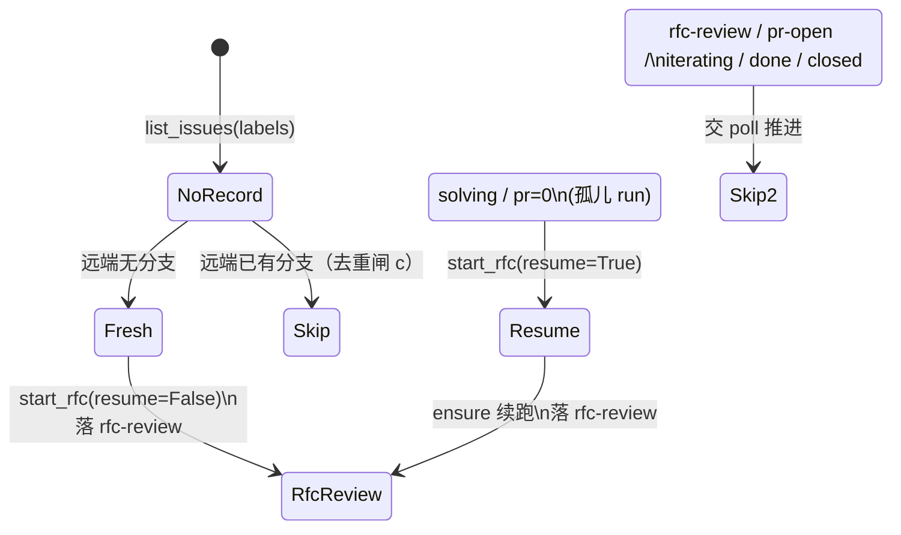
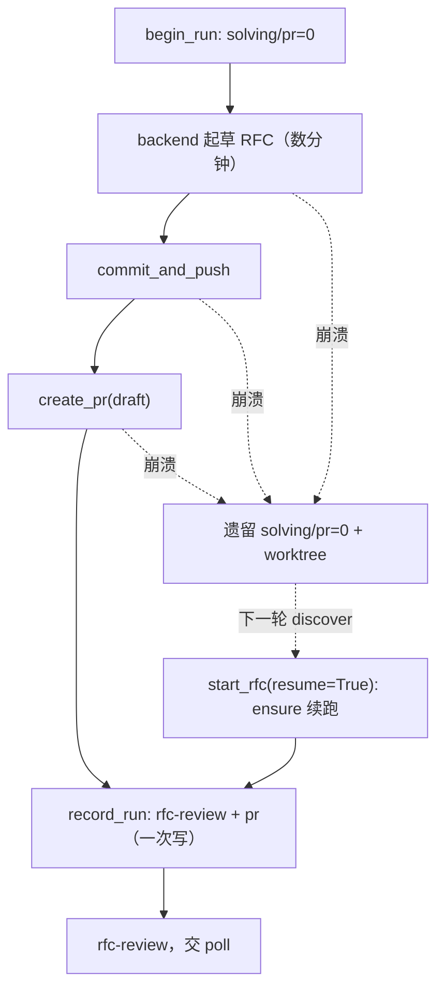
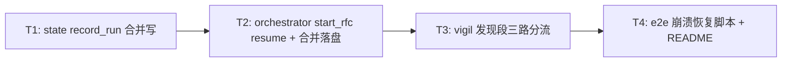

# RFC-0007: 守夜人恢复——激活 solving 为 resume 入口，修复 start_rfc 中途崩溃的孤儿 run

- **状态**: implemented
- **优先级**: P1
- **标签**: `architecture`, `cli`, `dx`, `reliability`
- **影响模块**: backend（vigil / orchestrator / state）
- **负责人**: OpenAgents
- **创建日期**: 2026-06-05
- **更新日期**: 2026-06-05

## 摘要

`Orchestrator.start_rfc` 在「起草 RFC / push / 建 PR」阶段（最常见是耗时几分钟的起草）中途崩溃后，会留下一条 `status=solving, pr_number=0` 的孤儿 run + 残留 worktree，且全项目没有任何代码能恢复它——`solving` 被写却从不被读。本 RFC 把 `solving` 从「只写不读」**激活为 resume 入口**：vigil 发现段识别 `solving/pr=0` 的记录为「待恢复」，复用既有 worktree 从起草步重跑 `start_rfc`；同时把 `start_rfc` 末尾「`record_run`(pr-open) + `update_status`(rfc-review)」两次写**合并为一次直接落 rfc-review（带 pr_number）**，消除中间瞬态 pr-open 窗口。恢复完全从本地 `state.json` 推导，不查 GitHub，状态机保持现有 6 个不新增。

## 动机

vigil 的**跨轮恢复**（进程被 kill/重启后重新从 GitHub + State 推导该做什么）是完整的，但**「单个 issue 在 `start_rfc` 执行到一半时崩溃」没有恢复机制**，会留下孤儿 run：

- `start_rfc` 一进来 `begin_run` 写 `status=solving`(pr=0)，但全项目**没有任何代码读 `solving` 的值做路由**——它只写不读。
- `messages.poll` 的 `_OPEN_STATUSES = {rfc-review, pr-open, iterating}` **不含 `solving`** → 不轮询它。
- vigil 发现段 `_is_new` 只看「记录是否存在」（`find_by_issue` 非空即判非新）→ **不重新派单**。

结果：崩在起草/push/建 PR 这段的 issue，会**永久卡在 `solving`**——poll 不碰、发现段不派，只能人工删 `state.json` 才能重来。

**根因**：RFC-0005 把单体 `solve` 拆成 `start_rfc/refine/implement/iterate` 原子操作时，删掉了原 `solve` 里读 `solving` 做 fresh/resume 分流的逻辑（`_should_resume`/`_resume`），但保留了写 `solving` 的 `begin_run`。**reader 没了、writer 留下，`solving` 退化成死状态**；且 `find_by_issue` 现在被 `_is_new` 当去重闸用，作用从「触发恢复」**反转**成「挡住重新派单」（见 `state.py:137` 的 docstring 仍写着「供 solve 分流 fresh / resume」，而该读者已不存在）。

CLAUDE.md 理念 5/6（issue 层面并行、单 issue 派一个 agent）与 RFC-0004 的「代码即 checkpoint、agent 一次性、被 kill 后重跑即从断点继续」要求：发现段每轮都应能从本地状态重新推导「这个 issue 现在该 fresh 派单还是 resume 续跑」，而非把半途崩溃的 issue 永久搁置。

## 设计

### 概述

修复点有两处，互相独立但协同闭环：

1. **激活 `solving` 为 resume 入口（发现段）**：vigil `discover_and_dispatch` 对每个标签门控的 open issue，按本地 State 分三类路由：
   - **无 run 记录** → fresh 派单（既有路径：`start_rfc` 走 `workspace.prepare` 建全新隔离 worktree）。
   - **`status=solving` 且 `pr_number=0`** → **resume 派单**（新路径：`start_rfc(resume=True)` 走 `workspace.ensure` 复用崩溃残留的 worktree，不铲进度，从起草步重跑）。
   - **其它**（已开 PR / rfc-review / pr-open / iterating / done / closed） → 跳过，交给守候段 `messages.poll` 推进。

   恢复**完全从 `state.json` 推导，不查 GitHub**。各步骤靠**幂等性**兜底：`ensure` 复用既有 worktree、`commit_and_push` 的 commit `check=False`（无改动跳过）、`push -u` 可重复（绝不 force）。

2. **合并 `start_rfc` 末尾两次写为一次落 rfc-review（编排层）**：现有 `start_rfc` 末尾先 `record_run`（落 `pr-open`）再 `update_status`（翻到 `rfc-review`），两次 `_save` 之间存在**瞬态 pr-open** 窗口——一旦此刻被 poll 扫到，会把这条「其实是 draft、待评审」的 run 误当 coding 阶段处理（跑 CI 检查 / iterate）。改为**一次性写入带 `pr_number` 的 `rfc-review`**，消除该窗口。`pr-open` 状态本身**保留**（仍由 `implement` 在 RFC 获批后使用）。

**状态机不变**（仍是 6 个：`solving / rfc-review / pr-open / iterating / done / closed`），不新增状态——只是让 `solving` 重新拥有一个 reader（发现段）。

### 关键设计决策

1. **恢复入口放在 vigil 发现段，而非 poll**：`solving` 的 run **还没有 PR**（`pr_number=0`），而 `poll` 的职责是「推进已开的 PR」（按 merge/标签/CI/评论 路由），对一条没有 PR 的 run 无事可做。「从 issue + 本地 State 重新推导该 fresh 还是 resume 派单」本就是发现段的职责。因此 `solving` **刻意不纳入** `messages._OPEN_STATUSES`，恢复由 `discover_and_dispatch` 承担。理由——关注点归位：发现段管「派单/重新派单」，poll 管「推进 PR」，与 RFC-0004/0005 的分工一致。

2. **resume 用 `workspace.ensure` 而非 `prepare`**：`prepare` 会幂等清理并**铲掉**同 issue 残留的 worktree + 本地分支后从 `origin/<base>` 重拉——会丢掉崩溃前已起草的 RFC 草稿进度。`ensure` 复用既有 worktree（`path.exists()` 即原样返回，保留半成品草稿），缺失才从远端分支重建。理由——恢复的价值在于**接着崩溃点继续**，不浪费已花的几分钟起草。

3. **fresh / resume 的判定下沉到发现段，`start_rfc` 仅按 `resume` 形参选择 prepare/ensure**：发现段是唯一同时掌握「issue 列表 + 本地 State + 远端分支」三类信息的地方，分流决策放这里最自然；`start_rfc` 不自己读 State 猜测模式，只接收一个显式 `resume` 布尔，保持原子操作「无隐藏状态读」的特性（便于单测）。理由——避免把 RFC-0005 刚拆干净的「reader 在编排层」重新塞回去；判定与执行分离。

4. **`record_run` + `update_status` 合并为一次落 rfc-review**：新增 `record_run` 的 `status` 形参（默认 `pr-open`，保持既有调用方与测试夹具向后兼容），`start_rfc` 末尾改为单次 `record_run(status=rfc-review)`，一次 `_save` 即把 `pr_number` 与 `rfc-review` 一起落盘，删去随后的 `update_status`。理由——消除瞬态 pr-open 被 poll 误读为 coding 阶段的窗口（决策 1 的对偶：让 `rfc-review` 永远「带 PR」、`solving` 永远「不带 PR」，两个阶段在 state 上无歧义）。

5. **不为 create_pr 的外部副作用引入 GitHub 查询**：`create_pr` 是对 GitHub 的外部副作用，若崩在「`create_pr` 成功 → 落盘 `rfc-review`」之间的毫秒级窗口，纯 state 无从得知 PR 已建，resume 会重开一个 draft PR。`github.find_pr_by_branch` 在本仓库已存在、理论上可堵这个窗口，但维护者已对齐「恢复不查 GitHub」的约束——接受这个极窄且可人工删的窗口，不为它引入网络查询（记入未解决的问题）。理由——奥卡姆剃刀：用一个罕见可恢复的窄窗换「恢复路径零 GitHub 依赖、可纯 state 单测」的简洁性。

6. **去重三道闸在 resume 路径下不退化**：（a）标签闸仍由 `list_issues(labels=...)` 把门；（b）State 闸由「`solving/pr=0` → 唯一一次 resume 派单；resume 成功后落 `rfc-review` → 下一轮归入『其它』被跳过」保证不重复派单；（c）远端分支闸在 resume 路径**刻意不拦**（我们就是要复用该分支），`ensure` 复用本地 worktree、`push -u` 推同名分支是**更新**而非新建，故不产生重复分支。理由——满足验收标准「恢复路径下不产生重复派单或重复分支」。

### 接口契约

只描述 **what**，不描述 **how**；签名遵循 CLAUDE.md「禁止位置参数 / private 函数禁止默认值」。

**`openagents/state.py`** —— `record_run` 增加 `status` 形参（公有函数，可带默认）：

```
def record_run(*, issue_number: int, branch: str, pr: PR, status: str = STATUS_PR_OPEN) -> None: ...
    # 一次 _save 落盘一条带 pr_number/pr_url 且 status=<给定值> 的 run（按 issue 去重覆盖）。
    # 默认仍 pr-open（既有调用方/测试夹具行为不变）；start_rfc 传 status=STATUS_RFC_REVIEW。
```

`begin_run` / `update_status` / `find_by_issue` 签名不变；`find_by_issue` 的 docstring 更新为「供发现段分流 fresh / resume」（reader 重新归位）。

**`openagents/orchestrator.py`** —— `start_rfc` 增加 `resume` 形参：

```
def start_rfc(*, issue_number: int, base: str = DEFAULT_BASE, resume: bool = False) -> github.PR: ...
    # resume=False（fresh）：workspace.prepare（建全新隔离 worktree）+ begin_run（落 solving/pr=0）
    # resume=True （恢复）：workspace.ensure（复用崩溃残留 worktree，不铲进度、不重写 begin_run）
    # 之后共享同一尾段：backend 起草 RFC → commit_and_push → create_pr(draft=True)
    #                  → record_run(status=STATUS_RFC_REVIEW, 带 pr)   ← 合并原两次写
```

`refine_rfc` / `implement` / `iterate` 不变。

**`openagents/vigil.py`** —— `discover_and_dispatch` 三路分流；`_is_new` 由分类器取代：

```
def discover_and_dispatch(*, labels: list[str], base: str) -> list[int]: ...
    # 对每个 list_issues(labels) 的 open issue：
    #   record = state.find_by_issue(issue.number)
    #   record is None           → 远端无分支才 fresh：start_rfc(resume=False)
    #   solving 且 pr_number==0   → resume：start_rfc(resume=True)
    #   其它                      → 跳过（交 poll）
    # 返回本轮实际派单（fresh+resume）的 issue 编号列表。

def _dispatch_kind(*, issue: github.Issue) -> str | None: ...
    # 返回 "fresh" | "resume" | None；封装上面的分类（含远端分支去重闸）。
```

`messages.py`（含 `_OPEN_STATUSES`）、`poll` 路由、`cli.py` **均不改**——`solving` 仍不在 poll 范围内（决策 1）。

### 架构图

发现段三路分流（节点为单个 open issue 在本地 State 的形态，边为发现段动作）：



`start_rfc` 崩溃点与恢复闭环（说明 solving 何时产生、何时消解）：



> 本 RFC 只描述模块边界与契约；具体实现（分类器写法、prompt 文案）在 Phase 3 细化。

## 权衡取舍

### 考虑过的替代方案

1. **把 `solving` 纳入 `messages._OPEN_STATUSES`、让 poll 恢复**：被否。poll 的每个分支（merge/标签/CI/评论）都假定 run 已有 PR，对 `pr_number=0` 的 run 无从下手，还要在 poll 里再写一套「无 PR 则回退到 start_rfc」逻辑，与发现段职责重叠。恢复天然属于「从 issue+State 推导派单」的发现段（决策 1）。

2. **resume 用 `workspace.prepare` 重拉干净 worktree**：被否。实现更简单（fresh/resume 走同一条 prepare），但会铲掉崩溃前已起草的 RFC 草稿，使「恢复」退化为「从零重来」，违背接着断点继续的目标（决策 2）。

3. **让 `start_rfc` 自己读 State 判定 fresh/resume**（把 RFC-0005 删掉的 `_should_resume` 搬回编排层）：被否。会让原子操作重新隐式依赖 State 读，破坏「无隐藏状态读、可纯参数单测」的特性；判定信息（issue 列表 + 远端分支）也不全在编排层。改由发现段判定、`start_rfc` 收显式 `resume` 形参（决策 3）。

4. **用 `find_pr_by_branch` 堵 create_pr 的毫秒级重复窗口**：被否。能消除重复 draft PR，但要在恢复路径引入 GitHub 网络查询，违背维护者已对齐的「恢复完全从本地 state 推导、不查 GitHub」约束；该窗口极窄、罕见且可人工删（决策 5，记入未解决的问题）。

5. **新增一个 `resuming` 状态**：被否。维护者已约束「状态机保持现有 6 个，不新增状态」。`solving/pr=0` 本身已足以唯一标识「待恢复的孤儿 run」，无需新状态。

### 缺点

- **create_pr → 落盘 rfc-review 之间的毫秒级崩溃会产生重复 draft PR**（决策 5 / 未解决的问题）：纯 state 无法察觉 PR 已建，resume 会重开一个。接受该极窄窗口。
- **恢复仅发生在 vigil 发现段**：只跑 `openagents poll`（不跑 vigil）不会恢复孤儿 run。但「派单/重新派单」本就是发现段而非 poll 的职责，单跑 poll 同样无法 fresh 派单，语义一致。
- **resume 依赖 issue 仍 open 且仍带门控标签**：若崩溃后 issue 被关闭或标签被摘，发现段不会再列到它、也就不恢复。属预期（人主动关闭 = 放弃，与 RFC-0006 一致）。
- **`find_by_issue` 的语义从 RFC-0005 的「去重闸（非空即非新）」回到 RFC-0003 的「分流依据」**：阅读历史 commit 时需注意该 reader 的语义随 RFC 演进有过反复。

## 实现计划

### 子任务分解

> 子任务数量 = 4（未超上限）。各子任务「涉及文件」互不重叠 → 协同模式可并行。

#### 依赖关系图



#### 子任务列表

| ID | 标题 | 依赖 | 涉及文件 | 状态 |
|----|------|------|---------|------|
| T1 | state：record_run 增 status 形参（一次写 rfc-review） | - | `openagents/state.py`, `tests/test_state.py` | implemented |
| T2 | orchestrator：start_rfc 增 resume + 合并落盘 | T1 | `openagents/orchestrator.py`, `tests/test_orchestrator.py` | implemented |
| T3 | vigil：发现段 solving 恢复三路分流 | T2 | `openagents/vigil.py`, `tests/test_vigil.py` | implemented |
| T4 | e2e 崩溃恢复脚本 + README 登记 | T3 | `scripts/e2e-rfc-0007-resume.sh`, `docs/rfcs/README.md` | implemented |

状态: `pending` | `in-progress`（代码修改中） | `implemented`（代码修改完毕） | `blocked`

> **并行提示**: 本 RFC 子任务为线性依赖链（T1→T2→T3→T4），逐个实现；无可并行子任务。

#### 子任务定义

**T1: state —— record_run 合并写**
- **范围**: 给 `record_run` 增加 `status: str = STATUS_PR_OPEN` 关键字形参，一次 `_save` 落盘带 `pr_number/pr_url` 且 `status=<给定值>` 的 run；更新 `find_by_issue` docstring 为「供发现段分流 fresh / resume」与 `RunRecord` docstring 的状态枚举说明（无新增状态）。不改 `begin_run` / `update_status` 签名。
- **涉及文件**: `openagents/state.py`、`tests/test_state.py`
- **验收标准**: 单测覆盖 `record_run(status=STATUS_RFC_REVIEW)` 一次落盘即得 `rfc-review` + 非零 `pr_number`；默认（不传 status）仍落 `pr-open`（既有用例不回归）；ruff 通过；注释引用 `RFC-0007`。

**T2: orchestrator —— start_rfc resume + 合并落盘**
- **范围**: `start_rfc` 增加 `resume: bool = False` 形参。`resume=False` 保持现状（`workspace.prepare` + `begin_run`）；`resume=True` 改走 `workspace.ensure`（复用既有 worktree）且**不**调 `begin_run`。两分支汇合到同一尾段：`backend.run`（起草）→ `commit_and_push` → `create_pr(draft=True)` → **单次** `record_run(status=STATUS_RFC_REVIEW, 带 pr)`（删去原 `record_run` + `update_status` 两次写）。
- **涉及文件**: `openagents/orchestrator.py`、`tests/test_orchestrator.py`
- **验收标准**: 单测（假 backend + 注入假 Workspace + monkeypatch github）覆盖：fresh 走 prepare + begin_run；resume 走 ensure、不调 begin_run、不调 prepare；两者末态都是一次写成的 `rfc-review`（带 pr）、无瞬态 pr-open（断言 `record_run` 以 `rfc-review` 调用且不再单独 `update_status`）；ruff 通过；注释引用 `RFC-0007`。

**T3: vigil —— 发现段 solving 恢复三路分流**
- **范围**: 用 `_dispatch_kind`（返回 `"fresh" | "resume" | None`）取代 `_is_new`：`record is None` 且远端无分支 → `"fresh"`；`record.status == STATUS_SOLVING and record.pr_number == 0` → `"resume"`；其它 → `None`。`discover_and_dispatch` 据此调 `start_rfc(resume=...)`，错误隔离（单 issue 失败记录跳过）保持不变，返回本轮派单编号列表。
- **涉及文件**: `openagents/vigil.py`、`tests/test_vigil.py`
- **验收标准**: 单测覆盖：无 run + 远端无分支 → fresh 派单（resume=False）；`solving/pr=0` → resume 派单（resume=True）；`rfc-review` / `pr-open` / 已开 PR / `done` / `closed` → 跳过；远端已有分支但无 run → 跳过（去重闸 c）；resume 成功落 `rfc-review` 后下一轮不再重复派单。ruff 通过；注释引用 `RFC-0007`。

**T4: e2e 崩溃恢复脚本 + README**
- **范围**: 新增 `scripts/e2e-rfc-0007-resume.sh`：构造一条 `solving/pr=0` 的 run + 残留 worktree（模拟起草阶段崩溃），跑一轮 `openagents vigil --once`，断言该 issue 被自动恢复并最终开出 draft PR（state 落 `rfc-review`），无需人工干预。`docs/rfcs/README.md` 增加 RFC-0007 行。
- **涉及文件**: `scripts/e2e-rfc-0007-resume.sh`（新增）、`docs/rfcs/README.md`
- **验收标准**: 脚本可读、步骤完整（崩溃模拟 → discover 恢复 → 验证 draft PR + rfc-review）；README 列表含 RFC-0007 条目。

## 测试方案

### 单元测试

- `test_state`: `record_run(status=rfc-review)` 一次落盘带 pr 的 rfc-review；默认仍 pr-open（向后兼容）。
- `test_orchestrator`: `start_rfc` fresh（prepare + begin_run）与 resume（ensure、不 begin_run、不 prepare）两分支；末态均为一次写成的 rfc-review、无瞬态 pr-open。
- `test_vigil`: 发现段三路分流全分支（fresh / resume / skip），含远端分支去重闸、resume 成功后不重复派单。

### 集成测试

- `scripts/e2e-rfc-0007-resume.sh`：在测试仓库构造「起草阶段崩溃」残局（solving/pr=0 + worktree），跑一轮 `vigil --once`，验证自动恢复 → 开出 draft PR → state 落 rfc-review。

### 手动验证

1. 正常 `openagents rfc <issue>` 成功后，检查 `state.json` 该 run 直接为 `rfc-review`（带 pr_number），**不出现**瞬态 `pr-open`。
2. 人为构造一条 `solving/pr=0` 的 run（并保留对应 worktree），跑 `openagents vigil --once` → 检查该 issue 被自动恢复、最终开出 draft PR、state 变 `rfc-review`，无需人工删 `state.json`。
3. 对已处于 `rfc-review` / `pr-open` / `done` 的 issue 跑发现段 → 确认不被重复派单、不重复建分支。

## 未解决的问题

1. **create_pr → 落盘 rfc-review 之间的毫秒级崩溃会开出重复 draft PR**：纯 state 无法得知 PR 已建，resume 会重开一个 draft PR。维护者已对齐「恢复完全从本地 state 推导、不查 GitHub」——接受此极窄、罕见且可人工删的窗口，不为它引入 `find_pr_by_branch` 等 GitHub 查询。若未来该窗口在实测中真的造成困扰，再评估是否在 resume 前做一次轻量 `find_pr_by_branch` 探测。

## 参考资料

- 本 RFC 对应 issue #20 —— 守夜人恢复：激活 solving 为 resume 入口，修复 start_rfc 中途崩溃产生的孤儿 run
- CLAUDE.md —— 设计理念 1（奥卡姆剃刀）/ 5–6（并行与单 issue 单 agent）/ 8（以成果为中心）
- RFC-0003 —— 每 issue 独立 worktree + 分支基线锁定（`prepare`/`ensure` 语义、`begin_run` 分步落 state 的来源）
- RFC-0004 —— 守夜人模式（发现段 + 守候段、代码即 checkpoint、去重三道闸）
- RFC-0005 —— solve 原子化拆分（`start_rfc/refine/implement/iterate`、删除 `_should_resume`/`_resume` 的来源）
- RFC-0006 —— PR/issue 关闭作为终止信号（`closed` 终态、与「人主动放弃」的语义一致）
