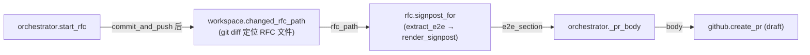
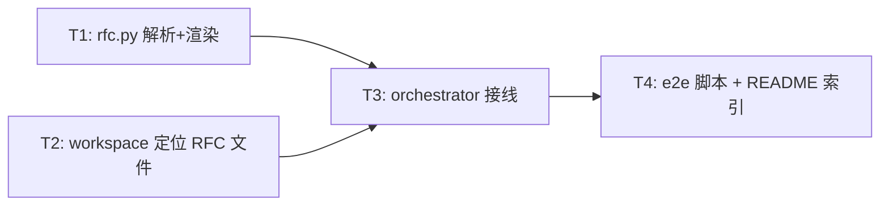

# RFC-0008: PR 正文「端到端验证」指路牌（从 RFC 自动生成）

- **状态**: draft
- **优先级**: P1
- **标签**: `dx`, `cli`
- **影响模块**: `openagents/orchestrator.py`、`openagents/workspace.py`、新增 `openagents/rfc.py`
- **负责人**: openagents-agent
- **创建日期**: 2026-06-05
- **更新日期**: 2026-06-05

## 摘要

让每个由 openagents 开出的 PR，在正文里天生带一段「端到端验证」指路牌——告诉审阅者
「跑哪个脚本、预期是什么、详细手动步骤去哪看」。该段落**单一来源于对应 RFC**
（不复制、不漂移）：在开 PR 时从 RFC 的 `测试方案 > 集成测试`（脚本路径）与 `手动验证`
（一行预期）自动抽取拼出，抽取对缺失字段有兜底、不报错。

## 动机

审阅者拿到一个 PR 时常常不知道「如何做端到端测试」「预期效果是什么」，即便这些信息其实
都已存在。以 PR #21（RFC-0007 守夜人恢复）为例：它已合规——`scripts/e2e-rfc-0007-resume.sh`
存在、RFC 的 `集成测试` 指向了该脚本、`手动验证` 三步也带了预期结果。但 PR 正文只有
`Closes #20\n\nRFC 草稿待评审。`。E2E 的一切都埋在 238 行 RFC 的最底部，审阅者要翻 9 个改动
文件才能发现脚本，体感上「没有 E2E 指导」。

**问题不在内容缺失，而在 PR 门口没有指路牌。** PR 是 agent 间与人机间的消息载体
（CLAUDE.md 设计理念 2），关键导航信息应放在门口，而非埋在长文档底部。当前 PR 正文由
`orchestrator._pr_body` 拼装，固定为 `Closes #N` + 一句摘要，从不引用 RFC 的测试信息。

## 设计

### 概述

新增一个**只懂 RFC 文档语义**的纯模块 `openagents/rfc.py`，负责从一份 RFC Markdown 文本里
抽取端到端验证线索（脚本路径 + 一行预期），并渲染成固定格式的「端到端验证」段落。
`orchestrator.start_rfc` 在开 draft PR 前，先借 `workspace` 定位本分支新增的 RFC 文件，
再调 `rfc` 渲染指路牌，拼进 PR 正文。

为什么放在 `start_rfc`（开 draft PR 时）而不是 `implement`（转正时）：

- `start_rfc` 是**唯一**调用 `github.create_pr` 的地方（issue 所说「在 create_pr 时」）；
  `implement` 只 `mark_ready` 不改正文。在开 PR 时写入，指路牌随 PR 正文持久存在，
  draft→ 代码 PR 全程可见，零新增 gh 调用。
- 开 draft PR 时 RFC 刚由后端起草并提交进 worktree（`commit_and_push` 在 `create_pr` 之前），
  其 `测试方案` 段已按模板填好 `集成测试` 脚本路径与 `手动验证` 预期（见 RFC-0005/0007 实例），
  故此刻即可抽取。脚本文件本身要到 `implement` 才落地，但指路牌是**指针**而非脚本，
  引用一个稍后才存在的路径是预期行为，对缺失字段的兜底也覆盖该情形。

三层关注点解耦（CLAUDE.md 理念 10）：RFC 文档解析（`rfc.py`，纯函数）/ git 定位文件
（`workspace.py`，只懂 git）/ PR 正文编排（`orchestrator.py`）互不渗透。

### 关键设计决策

1. **新增纯模块 `openagents/rfc.py` 承载「RFC 文档语义」**：解析 RFC Markdown 不属于
   `github`（gh 子进程薄封装）也不属于 `orchestrator`（编排），单独成模块、纯函数、易测，
   且为未来「从 RFC 抽取结构化信息」（如 board 呈现成果）留出统一入口。符合理念 1（按职责
   最小切分，不把解析逻辑塞进既有模块）与理念 10（解耦）。

2. **单一来源、不复制**：指路牌内容全部从 RFC 抽取，PR 正文不另存一份测试说明，RFC 改了
   下次开 PR 自然跟随。不新增任何独立测试文档载体（验收标准 3 / 理念 1 奥卡舍剃刀）。

3. **在 `start_rfc` 注入、随正文持久化**：见上「概述」。备选「在 `implement` 刷新正文」
   见权衡取舍，因需新增 `gh pr edit` 且收益有限被否。

4. **git diff 定位本分支的 RFC 文件**：worktree 含 main 上既有的全部 RFC（0001–），无法靠
   glob 区分「本次新增的那一个」。用 `git diff --name-only origin/<base>...HEAD -- docs/rfcs/`
   选出本分支改动的 `NNNN-*.md`（排除 `README.md`），确定式且与决策「git 关注点收敛在
   workspace」一致（RFC-0005 决策 3）。

5. **抽取启发式 + 全程兜底**：脚本路径在 `### 集成测试` 子段内正则匹配
   `scripts/…*.sh` 取首个；一行预期取 `### 手动验证` 子段首个步骤的预期文本。任一字段
   缺失则该 bullet 降级为指向 RFC 的提示而非报错；连 RFC 文件都定位不到时，`_pr_body`
   回退为原有正文（无指路牌段），绝不抛错（验收标准 2）。启发式细节属实现，Phase 3 细化。

6. **成果叙述不进 RFC**：面向最终用户的「功能跑通后能感知到什么」属成果层，归 README /
   `openagents board`，本 RFC 不引入该内容（issue 方案 3 / 理念 8）。本 RFC 只动「指路牌」，
   不动成果层，避免范围蔓延。

### 接口契约

> 仅描述边界与签名（what），不含实现（how）。全部关键字参数（CLAUDE.md：禁止位置参数）；
> `_` 私有函数参数禁止默认值，调用方必须显式传参。

**新增 `openagents/rfc.py`**

```text
@dataclass(frozen=True)
class E2EHints:
    script_path: str | None    # 集成测试脚本相对路径，如 "scripts/e2e-rfc-0008-pr-e2e-signpost.sh"；无则 None
    expected: str | None       # 手动验证的一行预期效果；无则 None

def extract_e2e(*, rfc_text: str) -> E2EHints
    # 纯字符串解析：从 RFC 全文抽取 script_path 与 expected，缺失置 None，绝不抛错。

def render_signpost(*, rfc_number: int, hints: E2EHints) -> str
    # 渲染「## 端到端验证」段落 Markdown。按 hints 各字段有无逐 bullet 降级兜底。

def signpost_for(*, rfc_path: Path) -> str | None
    # 便捷封装：读 rfc_path、从文件名解析 NNNN、extract_e2e → render_signpost。
    # 文件不可读/解析不出编号时返回 None（不抛错）。
```

**`openagents/workspace.py` 新增方法**

```text
def changed_rfc_path(*, worktree: Path, base: str) -> Path | None
    # git diff --name-only origin/<base>...HEAD -- docs/rfcs/ ，
    # 取首个 NNNN-*.md（排除 README.md）的绝对路径；无则 None。只读 git，不抛业务错。
```

**`openagents/orchestrator.py` 改动**

```text
# _pr_body 签名扩展（私有函数，参数无默认值，调用方显式传 e2e_section）：
def _pr_body(*, issue_number: int, summary: str, e2e_section: str | None) -> str
    # 原 "Closes #N\n\n<summary>" 之后，若 e2e_section 非 None 则追加 "\n\n<e2e_section>"。

# start_rfc 内（commit_and_push 之后、create_pr 之前）：
#   rfc_path = self._workspace.changed_rfc_path(worktree=worktree, base=base)
#   e2e = rfc.signpost_for(rfc_path=rfc_path) if rfc_path else None
#   body = self._pr_body(issue_number=issue.number, summary="RFC 草稿待评审。", e2e_section=e2e)
```

渲染产物（脚本与预期齐全时）形如：

```text
## 端到端验证
- 跑：`bash scripts/e2e-rfc-0008-pr-e2e-signpost.sh`
- 预期：<RFC 手动验证首步的一行预期>
- 详细手动步骤见 RFC-0008「手动验证」
```

### 架构图



## 权衡取舍

### 考虑过的替代方案

- **在 `implement`/`mark_ready` 时刷新 PR 正文**：转正时 RFC 与脚本均已最终化，信息最准。
  但需新增 `github.update_pr_body`（`gh pr edit --body`）并重算正文，多一次 gh 往返；而
  draft 阶段写入的指路牌本就随正文持久到代码 PR，refine 对一行预期/脚本路径的改动通常极小。
  收益不抵复杂度，**否决**（理念 1）。可作为后续增量。
- **让后端在起草 RFC 时顺手把指路牌写进 PR 正文**：依赖「agent 记得写」、易漂移，正违背
  issue「自动生成、不靠人记得写」的核心诉求，**否决**。
- **新建独立的「测试说明」文档/PR 模板文件**：多一个载体、与 RFC 双源易漂移，违背验收标准 3
  与理念 1，**否决**。
- **把解析逻辑塞进 `orchestrator` 或 `github`**：耦合编排/网关与文档解析，难测且违背理念 10，
  **否决**，故单列 `rfc.py`。

### 缺点

- 指路牌反映的是 draft 阶段的 RFC 快照；若 refine 后大改了脚本路径或预期，已开 PR 的正文
  不会自动同步（除非将来引入「implement 刷新」增量）。对一行指路牌，漂移风险可接受。
- 抽取基于 Markdown 启发式（小标题定位 + 正则），对严重偏离模板的 RFC 可能取不全字段——
  此时降级兜底为指向 RFC 的提示，不致命。

## 实现计划

### 子任务分解

> 范围约束：4 个子任务（≤6）。文件清单互不重叠，T1/T2 无依赖可并行。

#### 依赖关系图



#### 子任务列表

| ID | 标题 | 依赖 | 涉及文件 | 状态 |
|----|------|------|---------|------|
| T1 | RFC 解析与指路牌渲染（纯模块） | - | `openagents/rfc.py`、`tests/test_rfc.py` | pending |
| T2 | 定位本分支新增的 RFC 文件 | - | `openagents/workspace.py`、`tests/test_workspace.py` | pending |
| T3 | 接线进 PR 正文编排 | T1, T2 | `openagents/orchestrator.py`、`tests/test_orchestrator.py` | blocked |
| T4 | 端到端脚本 + RFC 索引 | T3 | `scripts/e2e-rfc-0008-pr-e2e-signpost.sh`、`docs/rfcs/README.md` | blocked |

状态: `pending` | `in-progress`（代码修改中） | `implemented`（代码修改完毕） | `blocked`

> 并行提示：T1、T2 无依赖且文件清单互不重叠，可在不同 Agent 会话中并行实现。

#### 子任务定义

**T1: RFC 解析与指路牌渲染（纯模块）**
- **范围**: 新建 `openagents/rfc.py`，实现 `E2EHints`、`extract_e2e`、`render_signpost`、
  `signpost_for`（见接口契约）。抽取脚本路径（限 `### 集成测试` 子段）与一行预期
  （限 `### 手动验证` 子段），各字段缺失置 `None` 并在渲染时降级；从文件名解析 NNNN。
  全程不抛错。模块 docstring 与公开函数引用 `RFC-0008`。
- **涉及文件**: `openagents/rfc.py`（新增）、`tests/test_rfc.py`（新增）
- **验收标准**: 单测覆盖——完整 RFC 抽出脚本+预期并渲染三行；无集成测试脚本 / 无手动验证 /
  二者皆无 时各自降级且不抛错；畸形 Markdown 不抛错；文件名 `0008-x.md` 解析出编号 8。
  ruff + pytest 通过。

**T2: 定位本分支新增的 RFC 文件**
- **范围**: 在 `Workspace` 增 `changed_rfc_path`，用 `git diff --name-only origin/<base>...HEAD
  -- docs/rfcs/` 取首个 `NNNN-*.md`（排除 `README.md`）返回绝对 `Path`，无则 `None`；
  复用既有 `_git` 封装。方法 docstring 引用 `RFC-0008`。
- **涉及文件**: `openagents/workspace.py`（修改）、`tests/test_workspace.py`（修改）
- **验收标准**: 单测——在临时 git 仓库造 base 与含新 RFC 的分支，方法返回该 RFC 路径；
  无新增 RFC 时返回 `None`；不把 `README.md` 误判为 RFC。ruff + pytest 通过。

**T3: 接线进 PR 正文编排**
- **范围**: 改 `orchestrator`：`import rfc`；扩展 `_pr_body` 增 `e2e_section`（无默认值）；
  `start_rfc` 在 `commit_and_push` 后、`create_pr` 前定位 RFC 文件→渲染指路牌→拼进正文。
  定位失败/渲染为 `None` 时正文回退为原样、不抛错。新增/改动处注释引用 `RFC-0008`。
- **涉及文件**: `openagents/orchestrator.py`（修改）、`tests/test_orchestrator.py`（修改）
- **验收标准**: 单测（假 backend + 假 Workspace + monkeypatch github）——`start_rfc` 传给
  `create_pr` 的 body 含「## 端到端验证」段且内容来自 RFC；`changed_rfc_path` 返回 `None`
  时 body 不含该段且不抛错。ruff + pytest 通过。

**T4: 端到端脚本 + RFC 索引**
- **范围**: 新增 `scripts/e2e-rfc-0008-pr-e2e-signpost.sh`（沿用既有 e2e 脚本两段式：默认离线
  `ruff check`/`ruff format --check`/`pytest`；`OPENAGENTS_E2E_REAL=1` + `OPENAGENTS_E2E_ISSUE`
  时真实演练 `openagents rfc <issue>` 并断言其 draft PR 正文含「## 端到端验证」段）。
  在 `docs/rfcs/README.md` 的 RFC 列表追加 RFC-0008 行。
- **涉及文件**: `scripts/e2e-rfc-0008-pr-e2e-signpost.sh`（新增）、`docs/rfcs/README.md`（修改）
- **验收标准**: 离线段在干净仓库通过；脚本可执行（`set -euo pipefail`、`chmod +x`）；
  README 列表含 RFC-0008 条目。

## 测试方案

### 单元测试

- `test_rfc`: `extract_e2e` / `render_signpost` / `signpost_for` 的全分支——齐全、缺脚本、
  缺手动验证、二者皆缺、畸形 Markdown、文件名编号解析。
- `test_workspace`: `changed_rfc_path` 在临时 git 仓库的命中 / 未命中 / 排除 README。
- `test_orchestrator`: `start_rfc` 的 PR 正文含指路牌；RFC 定位失败时优雅回退。

### 集成测试

- `scripts/e2e-rfc-0008-pr-e2e-signpost.sh`：默认离线跑全套 `ruff check` + `ruff format --check`
  + `pytest`；`OPENAGENTS_E2E_REAL=1 OPENAGENTS_E2E_ISSUE=<n>` 时在已登录 gh 的真实仓库
  执行 `openagents rfc <issue>`，断言新开 draft PR 的正文包含「## 端到端验证」段。

### 手动验证

1. `openagents rfc <issue>` → 检查生成的 draft PR 正文含「## 端到端验证」段，且「跑」的脚本
   路径与「详细手动步骤见 RFC-NNNN」均与该 issue 对应的 RFC 一致。
2. 起草一份 `测试方案` 缺 `集成测试` 脚本（或缺 `手动验证`）的 RFC → `openagents rfc <issue>`
   → 检查 PR 正文该段对应 bullet 降级为指向 RFC 的提示，命令不报错。
3. 临时改名/移除 RFC 文件使 `changed_rfc_path` 取不到 → `openagents rfc <issue>` → 检查 PR
   正文回退为原有 `Closes #N` + 摘要、无指路牌段且不报错。

## 未解决的问题

无。「是否在 `implement` 转正时刷新指路牌」已在「权衡取舍」中作为后续可选增量记录，
不作为本 RFC 的待决问题——draft 阶段写入的指路牌已随正文持久到代码 PR，本 RFC scope 到此为止。

## 参考资料

- issue #22 —— 本 RFC 的来源与验收标准
- PR #21 / RFC-0007（`docs/rfcs/0007-vigil-solving-resume.md`，open）—— 现状例证
- RFC-0005（`docs/rfcs/0005-solve-atomization-rfc-first-loop.md`）—— `start_rfc`/draft PR/
  `_pr_body` 现状与 git 关注点收敛在 workspace 的决策来源
- RFC-0002（`docs/rfcs/0002-create-issue.md`）—— 主动提 issue
- `CLAUDE.md` —— 设计理念 1（奥卡姆剃刀）、2（PR 作为消息载体）、8（以成果为中心）、
  10（模块解耦）
