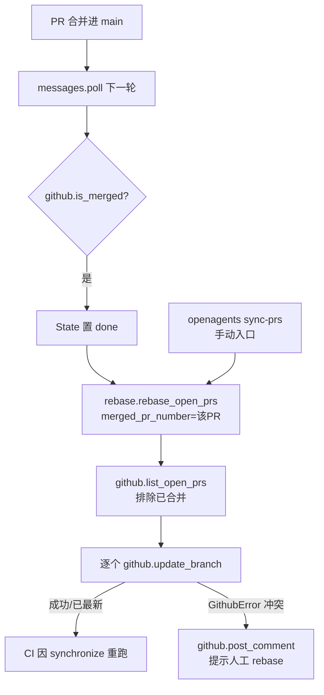
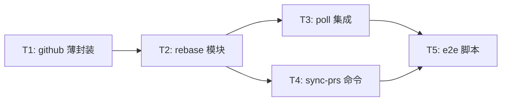

# RFC-0009: 合并后自动 rebase 其他 open PR

- **状态**: draft
- **优先级**: P1
- **标签**: `cli`, `ci`, `automation`
- **影响模块**: `openagents/github.py`、`openagents/rebase.py`（新增）、`openagents/messages.py`、`openagents/cli.py`、`scripts/`、`tests/`
- **负责人**: openagents agent（issue #24）
- **创建日期**: 2026-06-05
- **更新日期**: 2026-06-05

## 摘要

一个 PR 合并进 `main` 后，其余 open 的 PR 仍停留在旧 base 上，与 `main` 产生差异/潜在冲突，需要人手动 rebase 并重新 push 才能重跑 CI。本 RFC 让「合并」成为一个事件信号：合并被守候循环（`messages.poll`）侦测到后，自动对其余 open PR 执行 `gh pr update-branch`（把最新 `main` 并入各 PR 分支），由此触发它们的 CI 重跑；无法自动并入（冲突）时在该 PR 上留言提示人工处理。同时提供一个手动入口 `openagents sync-prs`。

## 动机

当前仓库现状（已排查）：

- `.github/workflows/ci.yml` 仅在 `pull_request`（base=main）触发，**没有** `push: main` 或 `pull_request.closed`（merged）触发——合并不产生任何自动化动作。
- 无 Mergify / merge queue / dependabot 等第三方配置。
- `openagents/github.py` 仅有建 PR、查状态、评论、合并/关闭检测（`is_merged` / `is_closed`），**无** rebase / update-branch 能力。
- 既有 RFC 里「rebase」仅作为 Phase 3 验证清单中的**手动检查项**出现，无自动化设计。

结合「issue 层面并行」（多 Agent 并行提 PR，RFC-0003/0004）的设计，合并后落后于 `main` 的 open PR 会越积越多，冲突概率随并行度上升。让合并自动驱动其余 PR 同步，可把人从「合并后逐个手动 rebase」中解放出来（CLAUDE.md 理念：人做宏观把控，不做细节）。

## 设计

### 概述

复用仓库既有的「**代码即编排 + gh CLI**」架构（RFC-0001 决策 3），把自动同步挂到**已存在的守候循环**上，而不是新增一条 GitHub Actions workflow：

1. `github` 层新增两个对 `gh` 的薄封装：`list_open_prs`（列出所有 open PR）与 `update_branch`（对单个 PR 执行 `gh pr update-branch`）。
2. 新增一个**解耦的小模块** `openagents/rebase.py`，提供 `rebase_open_prs`：列出 open PR、排除刚合并的那个、逐个 `update_branch`；遇冲突（`GithubError`）则在该 PR 留言提示人工 rebase 并继续下一个（错误隔离，沿用 RFC-0004 决策 8 的风格）。
3. `messages.poll` 在既有的「侦测到 PR 合并 → 置 done」分支后，追加一次 `rebase.rebase_open_prs(merged_pr_number=...)` 扇出——合并与扇出同处一个 poll 轮次，语义内聚。
4. `cli` 新增手动子命令 `openagents sync-prs`，作为自动 poll 路径的手动对应物（与 rfc/refine-rfc/implement/iterate 的「手动 vs 自动」对称，RFC-0005 决策 1）。

**为什么挂在 poll 循环而非新建 workflow（关键）**：GitHub Actions 用默认 `GITHUB_TOKEN` 推送产生的事件**不会**再触发新的 workflow 运行（GitHub 官方明确限制，见参考资料）。若用一条 `pull_request.closed` workflow + 默认 token 去 `update-branch` 其它 PR，这些 PR 分支虽被更新，但其 `pull_request`（synchronize）CI **不会重跑**——直接违反验收标准 2。要在 workflow 路径下重跑 CI，必须额外配置 PAT / GitHub App token 作为 secret。而 `messages.poll` 跑在**用户/agent 自己的 `gh` 鉴权**下（与 vigil 同源），其 `update-branch` 产生的 synchronize 事件能正常重跑 CI，且零新增 secret、零新增 CI 基础设施（奥卡姆剃刀）。

### 关键设计决策

1. **触发位置：挂到既有 `messages.poll`，不新增 GitHub Actions workflow。**
   理由见上：避开 `GITHUB_TOKEN` 不重触发下游 workflow 的限制（否则验收标准 2 不成立）；复用既有 gh 鉴权与轮询架构；可用 monkeypatch `github.*` 做 hermetic 单测；不引入新 secret / CI 基础设施。合并侦测本来就发生在 poll，合并→置 done→扇出 rebase 同处一轮，内聚。

2. **同步方式：默认 merge（`gh pr update-branch` 默认行为），rebase 作为可选项。**
   `gh pr update-branch <n>` 默认把 base 以**合并提交**并入 PR 分支（等价于 GitHub 网页「Update branch」按钮）；`--rebase` 才改为 rebase（已在 gh 2.88 验证）。merge 不重写历史、不需 force-push、更不易失败，适合无人值守的自动循环；验收标准 2 也明确允许「rebase 或 merge」。因此 `update_branch` 暴露 `rebase: bool = False` 形参，默认走 merge，rebase 留作显式 opt-in。功能口语上叫「auto-rebase」，技术上默认是 update-branch(merge)——如实记录。

3. **同步范围：所有 open PR，排除刚合并的那个；以 `gh pr list` 为真源而非本地 State。**
   `github.list_open_prs()` 直接问 GitHub，覆盖面比 `State`（只含 openagents 自己建的 run）更全，且对「手动建的 PR」也成立。刚合并的 PR 合并后已不在 open 列表，但合并瞬间存在竞态，故再按 `merged_pr_number` 显式排除一次兜底。draft PR（承载 RFC、尚无代码）也一并更新——只是把 main 并进去，无害且能避免日后冲突，保持最简（是否跳过 draft 列为可选精化）。

4. **冲突处理：捕获 `GithubError` → 在该 PR 留言提示人工 → 继续下一个。**
   `gh pr update-branch` 在 base 与 head 存在无法自动解决的冲突时返回非零 → `github` 层抛 `GithubError`。`rebase_open_prs` 对每个 PR 单独 try/except：冲突时调 `post_comment` 贴一条「无法自动同步，请手动 rebase」的提示评论，记一个 `conflict` 事件并继续——单个 PR 失败不拖垮整轮扇出（沿用 RFC-0004 决策 8 错误隔离）。满足验收标准 3。

5. **「已是最新」视为 no-op 成功，不报错。**
   PR 分支已与 base 同步时 `gh pr update-branch` 以非零退出并报「already up to date」之类信息。`update_branch` 吞掉该特例、返回 `False`（表示未发生更新），不抛错——与既有 `ensure_label` 吞「already exists」、`check_status` 吞「no checks reported」同一容错风格。避免对已最新的 PR 误判为失败而误留言。

6. **手动入口 `openagents sync-prs`。**
   作为自动 poll 路径的手动对应物：人/agent 可在不跑 vigil 的情况下一次性把 open PR 同步到最新 main。`--merged <n>` 指定要排除的已合并 PR（缺省则不排除、同步全部 open PR）；`--rebase` 切换到 rebase 方式。

### 接口契约

只描述「接口是什么」，不含实现代码（实现在 Phase 3）。

**`openagents/github.py`（新增两个模块函数）**

```
def list_open_prs() -> list[PR]:
    """`gh pr list --state open --json number,url` → [PR]；无则返回 []。"""

def update_branch(*, pr_number: int, rebase: bool = False) -> bool:
    """`gh pr update-branch <pr_number> [--rebase]`。
    返回 True 表示分支已被更新；返回 False 表示「已是最新」（no-op）。
    冲突或其它失败抛 GithubError（决策 4/5）。"""
```

复用既有 `PR` 数据类与 `_run_gh` / `_gh_json` 封装，不新增数据类型（CLAUDE.md 理念 1）。

**`openagents/rebase.py`（新增模块）**

```
def rebase_open_prs(*, merged_pr_number: int | None = None, rebase: bool = False) -> list[dict]:
    """对每个 open PR（排除 merged_pr_number）执行 github.update_branch。
    冲突时 github.post_comment 留言并继续。
    返回事件列表，每项 {pr_number, result}，
    result ∈ {"updated", "up-to-date", "conflict"}（供日志/测试断言）。"""
```

以模块函数（而非类）方式调用 `github.*`，测试中 monkeypatch `github.list_open_prs` / `update_branch` / `post_comment`，保持 hermetic（不触达真实 gh）。

**`openagents/messages.py`（在合并分支追加扇出）**

`_process_run` 侦测到 `github.is_merged` 为真、置 `STATUS_DONE` 之后，追加一次：
`rebase.rebase_open_prs(merged_pr_number=pr_number)`；返回的 `merged` 事件可附带本轮同步结果计数。其余 poll 行为不变。

**`openagents/cli.py`（新增子命令）**

```
openagents sync-prs [--merged <n>] [--rebase]
  --merged   要排除的已合并 PR 编号（缺省：不排除，同步全部 open PR）
  --rebase   用 rebase 而非 merge 方式同步（默认 merge）
```
handler 延迟 import `openagents.rebase` 并调用 `rebase_open_prs`，打印同步结果摘要（与既有命令风格一致）。

### 架构图



> 注：RFC 不含具体实现代码，以上为接口签名与数据流，实现细节在 Phase 3 细化。

## 权衡取舍

### 考虑过的替代方案

1. **GitHub 原生 merge queue / branch protection「Require branches to be up to date」。**
   零代码，但：(a) require-up-to-date 只在「点 merge 的那一刻」要求最新，并不会主动帮其余 PR 同步，仍需人逐个点 Update branch；(b) merge queue 适合「所有 PR 都跑同一套必需 CI 且追求严格线性合并」的场景，对本仓当前的多 Agent 自建循环偏重，且仍受「队列内更新由 GitHub 触发、与自建 CI 的交互」不确定性影响。与「减少人工介入」的目标不完全契合，故不作为主方案（但与本方案不冲突，可叠加）。

2. **新增 `pull_request.closed`（merged）/ `push: main` 的 GitHub Actions workflow，在云端 `update-branch` 其余 PR（issue 候选方案 2）。**
   更「云原生」、不依赖本地 poll 在跑。但默认 `GITHUB_TOKEN` 推送**不触发**下游 workflow → 被同步的 PR 的 CI **不重跑**，违反验收标准 2；要修复必须配置 PAT / GitHub App token 作为 secret，增加凭据管理与安全面（理念 1 反对）。本方案选择挂在已在用户鉴权下运行的 `poll` 循环，天然规避该限制。该 workflow 路径可作为「无人跑 vigil 时」的未来补充（见未解决的问题）。

3. **用 rebase（force-push）而非 merge 作为默认同步方式。**
   历史更线性、无合并提交。但 rebase 重写 PR 分支历史、需 force-push、冲突概率与破坏性更高，对无人值守循环不稳健。故默认 merge、把 rebase 留作 `--rebase` 显式 opt-in（决策 2）。

### 缺点

- **依赖 poll/vigil 在运行**：若无人跑 `openagents watch` / `vigil`，自动同步不会发生（合并侦测同样依赖 poll，二者一致）。`sync-prs` 手动入口可兜底。
- **每次合并触发一轮全量 `update-branch`**：open PR 多时会有一批 `gh` 调用与 CI 重跑（CI 成本）。可接受；若需要可后续按「确实落后于 main」过滤。
- **同一 poll 轮内若有多个 PR 同时被侦测为合并**，会触发多次扇出（少见）；当前不去重，保持最简。

## 实现计划

### 子任务分解

> 范围约束：5 个子任务（≤6）。文件清单互不重叠，满足协同模式无冲突前提。

#### 依赖关系图



#### 子任务列表

| ID | 标题 | 依赖 | 涉及文件 | 状态 |
|----|------|------|---------|------|
| T1 | github 层 `list_open_prs` + `update_branch` | - | `openagents/github.py`、`tests/test_github.py` | pending |
| T2 | `rebase_open_prs` 扇出模块 | T1 | `openagents/rebase.py`、`tests/test_rebase.py` | pending |
| T3 | `messages.poll` 合并后扇出集成 | T2 | `openagents/messages.py`、`tests/test_messages.py` | pending |
| T4 | `openagents sync-prs` 手动命令 | T2 | `openagents/cli.py`、`tests/test_cli.py` | pending |
| T5 | 端到端脚本 | T3, T4 | `scripts/e2e-rfc-0009-auto-rebase.sh` | pending |

状态: `pending` | `in-progress`（代码修改中） | `implemented`（代码修改完毕） | `blocked`

> 并行提示：T3 与 T4 都只依赖 T2 且文件清单不重叠，可在不同 Agent 会话中并行实现。

#### 子任务定义

**T1: github 层 `list_open_prs` + `update_branch`**
- **范围**: 在 `github.py` 新增两个模块函数：`list_open_prs()`（`gh pr list --state open --json number,url`，解析为 `PR` 列表）与 `update_branch(*, pr_number, rebase=False)`（`gh pr update-branch <n> [--rebase]`，成功返回 `True`、「已是最新」吞掉返回 `False`、冲突/其它失败抛 `GithubError`）。复用既有 `_run_gh` / `_gh_json` / `PR`。函数体注释引用 `RFC-0009`。
- **涉及文件**: `openagents/github.py`（新增函数）、`tests/test_github.py`（新增用例）
- **验收标准**: 单测覆盖 `list_open_prs` 解析（含空列表）、`update_branch` 三态（updated→True / already-up-to-date→False / 冲突→GithubError）；ruff + pytest 全绿。

**T2: `rebase_open_prs` 扇出模块**
- **范围**: 新建 `openagents/rebase.py`，实现 `rebase_open_prs(*, merged_pr_number=None, rebase=False)`：调 `github.list_open_prs`、排除 `merged_pr_number`、逐个 `github.update_branch`；冲突（`GithubError`）时 `github.post_comment` 贴冲突提示评论并继续；返回 `[{pr_number, result}]`。冲突评论文案以模块常量定义。注释引用 `RFC-0009`。
- **涉及文件**: `openagents/rebase.py`（新增）、`tests/test_rebase.py`（新增）
- **验收标准**: 单测（monkeypatch `github.list_open_prs` / `update_branch` / `post_comment`）覆盖：正常更新、排除已合并 PR、`up-to-date` 归类、冲突→留言且不中断后续、空 open 列表；ruff + pytest 全绿。

**T3: `messages.poll` 合并后扇出集成**
- **范围**: 在 `messages._process_run` 侦测到 `is_merged`、置 `STATUS_DONE` 后追加 `rebase.rebase_open_prs(merged_pr_number=pr_number)`；`merged` 事件可附带同步结果。其余路由逻辑不变。注释引用 `RFC-0009`。
- **涉及文件**: `openagents/messages.py`、`tests/test_messages.py`
- **验收标准**: 单测断言「侦测到合并时调用了 `rebase.rebase_open_prs` 且传入正确 `merged_pr_number`」（monkeypatch rebase 函数）；既有 poll 用例不回归；ruff + pytest 全绿。

**T4: `openagents sync-prs` 手动命令**
- **范围**: 在 `cli.build_parser` 注册 `sync-prs` 子命令（`--merged`、`--rebase`），新增 `_cmd_sync_prs` handler 延迟 import 并调 `rebase.rebase_open_prs`，打印结果摘要；接入 `_dispatch` handlers 表。注释引用 `RFC-0009`。
- **涉及文件**: `openagents/cli.py`、`tests/test_cli.py`
- **验收标准**: 单测断言参数解析与 handler 透传（monkeypatch `rebase.rebase_open_prs`，校验 `merged_pr_number` / `rebase` 入参与退出码）；ruff + pytest 全绿。

**T5: 端到端脚本**
- **范围**: 新增 `scripts/e2e-rfc-0009-auto-rebase.sh`：在一个测试仓库建两个 open PR、合并其一、运行 `openagents sync-prs --merged <n>`（或一轮 poll），校验另一 PR 分支已并入最新 main（`gh pr view --json mergeStateStatus` 或对比 commits），并演示冲突场景下的留言。脚本含前置条件与运行说明（对齐既有 `scripts/e2e-rfc-000X-*.sh` 风格）。
- **涉及文件**: `scripts/e2e-rfc-0009-auto-rebase.sh`（新增）
- **验收标准**: 脚本可独立运行并打印每步结果；README/RFC 给出启动说明；`bash -n` 语法检查通过。

## 测试方案

### 单元测试
- `tests/test_github.py`: `list_open_prs` 解析（正常/空）；`update_branch` 三态（更新成功 / already-up-to-date 吞为 False / 冲突抛 GithubError）。
- `tests/test_rebase.py`: 扇出遍历、排除已合并 PR、`up-to-date` 归类、冲突→`post_comment` 且继续后续、空列表 no-op。
- `tests/test_messages.py`: 合并侦测触发 `rebase_open_prs` 且参数正确；不影响既有 merge/refine/ci/comment 路由。
- `tests/test_cli.py`: `sync-prs` 参数解析与 handler 透传、退出码。

所有 GitHub 交互通过 monkeypatch `github.*` 桩掉，保持 hermetic。

### 集成测试
`scripts/e2e-rfc-0009-auto-rebase.sh`（T5）：真实建两个 PR → 合并其一 → 触发同步 → 断言另一 PR 分支已更新、CI 重新排队；并构造一个冲突 PR，断言其收到冲突提示评论。

### 手动验证
1. 跑 `openagents watch`（或 `vigil`）。
2. 合并任一 open PR 到 main。
3. 观察其余 open PR 是否各多出一个「Merge branch 'main' ...」提交且 CI 重新触发。
4. 对刻意制造冲突的 PR，确认收到「无法自动同步，请手动 rebase」评论。
5. 手动入口：`openagents sync-prs --merged <已合并PR号>`，确认同上效果。

## 未解决的问题

> 以下为候选 open question，待人评审时确认是保留延后、还是当场定夺：

1. 是否需要**额外**提供一条 `pull_request.closed` / `push: main` 的 GitHub Actions workflow（配 PAT/App token）作为「无人跑 vigil 时」的云端兜底？还是当前 poll/`sync-prs` 已足够？
2. 是否对 draft（rfc-review 阶段、尚无代码）PR 跳过自动同步，仅同步进入 coding 阶段的 PR？
3. 同步前是否先判断「PR 确实落后于 main」再调 `update_branch`，以减少 CI 重跑成本（vs 一律调用、由 `update_branch` 的 up-to-date 兜底）？

## 参考资料

- 本仓 CI 现状：`.github/workflows/ci.yml`（仅 `pull_request` 触发）。
- 既有 GitHub 封装：`openagents/github.py`（`is_merged` / `check_status` / `post_comment` / `_run_gh`）。
- 既有守候循环：`openagents/messages.py`（`poll` 合并侦测）、`openagents/vigil.py`（错误隔离 RFC-0004 决策 8）。
- `gh pr update-branch` 文档（本机 gh 2.88.1 验证）：默认 merge、`--rebase` 切换 rebase。<https://cli.github.com/manual/gh_pr_update-branch>
- GitHub 官方：使用默认 `GITHUB_TOKEN` 产生的事件不会触发新的 workflow 运行——<https://docs.github.com/en/actions/security-for-github-actions/security-guides/automatic-token-authentication#using-the-github_token-in-a-workflow>（"events triggered by the `GITHUB_TOKEN` ... will not create a new workflow run"）。
- 相关 RFC：RFC-0001（gh CLI 封装、决策 3）、RFC-0003/0004（issue 并行、worktree 隔离、错误隔离）、RFC-0005（原子操作手动/自动对称）、RFC-0006（合并/关闭作为信号）。
</content>
</invoke>
