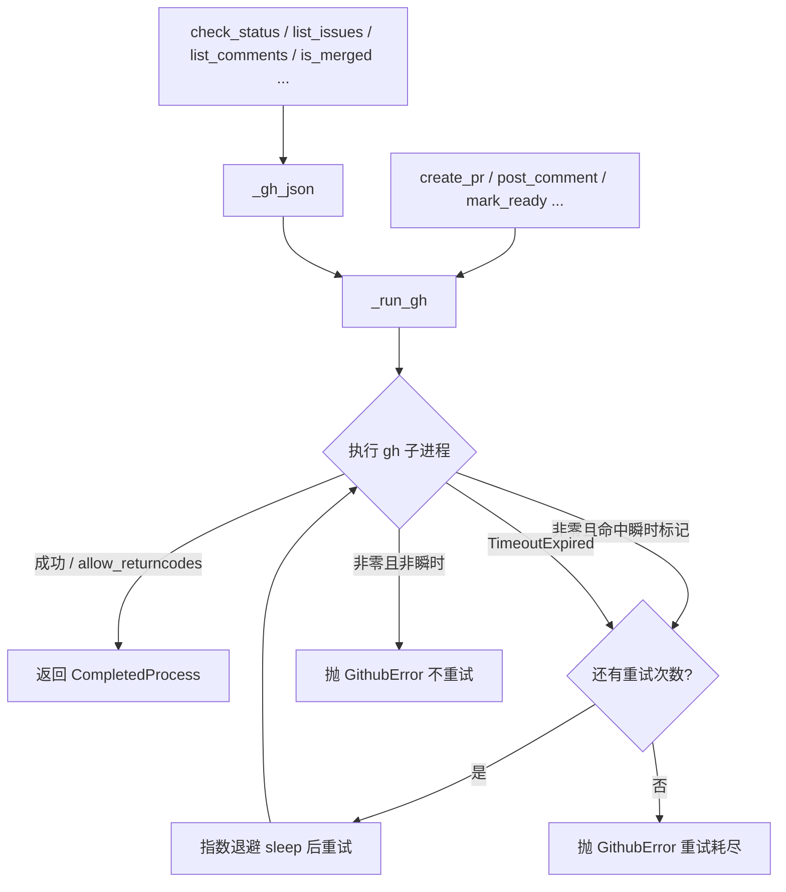
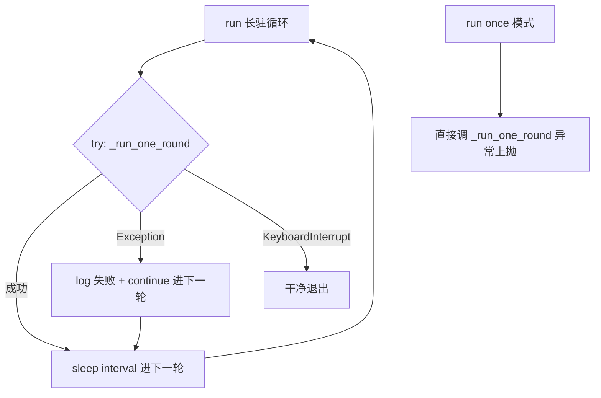
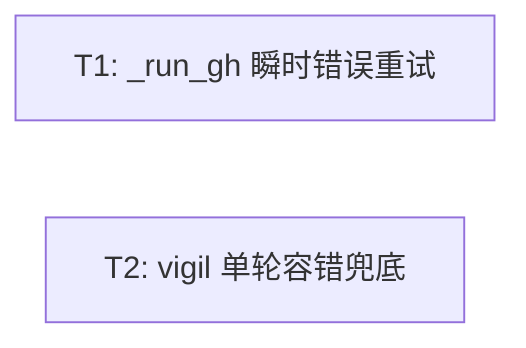

# RFC-0010: gh 瞬时错误重试 + 守夜循环单轮容错

- **状态**: draft
- **优先级**: P1
- **标签**: `reliability`, `cli`, `resilience`
- **影响模块**: `openagents/github.py`、`openagents/vigil.py`
- **负责人**: Curry09
- **创建日期**: 2026-06-05
- **更新日期**: 2026-06-05

## 摘要

无人值守跑 `openagents vigil` 一段时间后，守夜进程会被一次偶发的 `HTTP 504 Gateway
Timeout` 掀翻退出。根因是 `gh pr checks`（GraphQL `statusCheckRollup` 聚合查询）偶发服务端
慢/超时，而 `github._run_gh` **零重试**、`vigil.run` 单轮 **零容错**——单点偶发 × 零容错 ×
重复数百轮 = 近乎必然崩溃。本 RFC 在唯一收口点 `_run_gh` 加瞬时错误重试 + 指数退避（一处
覆盖所有 gh 调用），并给 `vigil.run` 的单轮加 try/except 兜底，使单轮失败不掀掉整个守夜进程。

## 动机

### 现象

```
… 守夜中，60s 后再扫一轮（Ctrl-C 停止）
✗ HTTP 504: 504 Gateway Timeout (https://api.github.com/graphql)
```

`✗ HTTP 504…` 由 cli.py 顶层异常处理（`cli.py:259`，`_run` 的
`except (OrchestratorError, GithubError, WorkspaceError, RuntimeError)`）打印。这意味着
`GithubError` 一路冒泡逃出 `vigil.run()`，**整个守夜进程退出**——不是某轮内部被忽略。

### 根因（已实测复现）

504 来自一个特定的重查询 **`gh pr checks`**（对应 `github.check_status()`，走 GraphQL 的
`statusCheckRollup`）。实测一个只有 1 个 open PR、5 个 check 的场景，逐个 gh 调用计时：

| 调用 | 典型耗时 | 备注 |
|---|---|---|
| `gh pr view --json state/labels/comments` | ~1s | 稳定 |
| `gh issue list` | ~1s | 稳定 |
| **`gh pr checks`** | 1.5–4s，偶发飙到 **12.7s → 504** | 元凶 |

排除项：

- **不是并发/请求量**：vigil 所有 gh 调用都是顺序子进程，瞬时并发 = 1。
- **不是限流**：GraphQL rate limit 实测剩 4925/5000。
- **不是查询太大**：PR 只有 5 个 check。纯粹是 GitHub GraphQL 后端对 `statusCheckRollup`
  聚合查询的偶发服务端慢/超时。

### 为什么「老是」碰上

`check_status` 每 60s 一轮、每轮必调，**零重试**。单次 504 概率 p 即便只有 ~1%，无人值守一晚
~480 轮，活过全部的概率 = 0.99^480 ≈ 0.8%——**近乎必崩**。

注：合并 `state/labels/comments` 等快请求对此 504 无效——元凶 `gh pr checks` 是独立端点
（独立子进程调用），且本就是最慢的那个，与其它请求是否合并无关。

## 设计

### 概述

两道相互独立、纵深防御的修复，落在两个不同模块：

1. **核心：瞬时错误重试**——所有 gh 调用都经由 `github._run_gh` 这一个收口点
   （`_gh_json` 调用 `_run_gh`；其余直接调用方亦然）。在 `_run_gh` 内部加一层重试循环：
   识别**瞬时错误**（`gh` stderr 含 `HTTP 502/503/504`、`Bad Gateway`、`Gateway Timeout`、
   `Service Unavailable`，以及 `subprocess.TimeoutExpired`）时，按指数退避重试，最多 3 次
   尝试；非瞬时错误（如 `not found`、`no checks reported`、pending 退出码 8）**立即按原样
   返回/抛出，绝不重试**。一处改动覆盖全部 gh 调用，元凶 `gh pr checks` 自然受益。

2. **兜底：守夜单轮容错**——`vigil.run` 把单轮「`discover_and_dispatch` + `poll()`」包一层
   try/except：守夜（长驻）模式下单轮失败记日志并进下一轮，不掀掉整个守夜进程；与发现段已有
   的「单 issue 失败跳过」（`vigil.py:85`，决策 8）同一容错风格。

两道是纵深防御：重试把偶发 504 的单点概率从 ~1% 压到可忽略；即便仍有极端瞬时错误穿透重试
（或来自 gh 以外的异常，如 git ls-remote、orchestrator），单轮兜底保证守夜进程「带病续命」
而非整夜阵亡。

### 关键设计决策

1. **重试落在 `_run_gh` 单一收口点，而非每个调用方**：`_run_gh` 是所有 gh 子进程的唯一
   出入口，一处加重试即覆盖 `check_status`/`list_issues`/`list_comments`/`is_merged` 等全部
   调用。符合 CLAUDE.md 理念 1（如无必要勿增实体）与理念 10（解耦：调用方对重试无感）。
   `_run_gh` 的对外签名与返回类型 **保持不变**，所有现有调用方零改动。

2. **瞬时错误判定要「窄」——只认服务端瞬时故障，绝不误伤业务错误**：仅当
   ① gh 返回非零且 stderr 命中瞬时标记串，或 ② 抛 `subprocess.TimeoutExpired` 时才重试。
   `not found`、`already exists`、`no checks reported`、pending 退出码 8（`allow_returncodes`
   放行）等都不算瞬时错误，必须立即返回/抛出。否则会把「确定性失败」反复重试，徒增 2–3 倍
   延迟还是同样的错。判定逻辑抽成一个纯函数 `_is_transient_gh_error(stderr=...)` 便于单测。

3. **指数退避 + 上限 3 次尝试，退避基数可在测试中 mock**：尝试序列为「1 次原始 + 最多 2 次
   重试」，退避 base·2^(n-1)（如 1s、2s）。实测「重试基本第二次就成功」，3 次足够。退避用
   `time.sleep`，测试中 monkeypatch 掉以零真实等待。重试次数/退避基数定义为模块级常量，
   不引入配置项（理念 1）。

4. **`TimeoutExpired` 归一化为 `GithubError`**：`subprocess.run(timeout=30)` 超时会抛
   `subprocess.TimeoutExpired`（非 `GithubError`），当前直接逃逸。重试耗尽后，把它转换成
   `GithubError`（携带可读原因），使上层异常类型保持单一——cli 顶层与 vigil 兜底只需认
   `GithubError` 一种类型。

5. **单轮兜底只在「长驻守夜」模式吞异常，`once` 模式照旧向上抛**：`run(once=True)` 服务于
   cron/CI 周期触发，其退出码是给调度器看的健康信号；若 `once` 模式也吞异常并返回 0，会把
   失败伪装成成功。故把单轮逻辑抽成 `_run_one_round()`：长驻循环里 `try/except` 包裹它、
   失败 log 后 `continue`；`once` 模式直接调用、不包裹，让异常照旧冒泡到 cli 顶层得到非零
   退出。这样把容错精确限定在「无人值守一晚」场景，不掩盖周期触发的真实失败。

6. **单轮兜底捕获 `Exception`，但放行 `KeyboardInterrupt`**：`KeyboardInterrupt` 不是
   `Exception` 子类，`except Exception` 天然不会捕获它——Ctrl-C 仍走 `run` 既有的干净退出
   分支（`vigil.py:60`，决策 8）。单轮兜底捕获范围比发现段（只认 `OrchestratorError`/
   `GithubError`）更宽，因为 `poll()` 段、`git ls-remote` 等也可能抛其它异常，守夜的第一要务
   是「活着进下一轮」。

### 接口契约

```python
# openagents/github.py —— 对外签名与返回类型不变，仅内部加重试

def _run_gh(
    args: list[str], *, allow_returncodes: set[int]
) -> subprocess.CompletedProcess[str]:
    """运行 gh 子命令；瞬时错误按指数退避重试，最多 _GH_RETRY_MAX_ATTEMPTS 次。
    非瞬时错误（返回非零且不在 allow_returncodes、且非瞬时标记）立即抛 GithubError。
    重试耗尽（含 TimeoutExpired）后抛 GithubError。"""

def _is_transient_gh_error(*, stderr: str) -> bool:
    """stderr 是否命中瞬时服务端故障标记（HTTP 502/503/504 / Bad Gateway /
    Gateway Timeout / Service Unavailable）。纯函数，便于单测。"""

# 模块级常量（不引入配置项）
_GH_RETRY_MAX_ATTEMPTS: int          # 总尝试次数上限（如 3）
_GH_RETRY_BACKOFF_BASE: float        # 退避基数秒（如 1.0），测试可 monkeypatch time.sleep
_GH_TRANSIENT_MARKERS: tuple[str, ...]  # 小写匹配的瞬时标记串
```

```python
# openagents/vigil.py —— run 行为契约

class Vigil:
    def run(self, *, interval: int, labels: list[str], base: str, once: bool) -> None:
        """长驻模式：每轮 try/except 包裹 _run_one_round()，单轮失败 log 后进下一轮，
        不抛出（Ctrl-C 仍干净退出）。once 模式：直接调 _run_one_round()，异常照旧上抛。"""

    def _run_one_round(self, *, labels: list[str], base: str) -> None:
        """单轮：discover_and_dispatch(labels, base) + messages.poll()。
        从既有 run 循环体中抽出，行为不变。"""
```

`_run_one_round` 是从现有 `run` 循环体中**机械抽取**的私有方法（参数显式传入，遵循 CLAUDE.md
「private 函数禁止默认值、调用方显式传参」）；`discover_and_dispatch`、`_messages.poll`、
`_dispatch_kind` 等其它接口契约 **不变**。

### 架构图

gh 调用收口与重试位置（一处覆盖全部）：



守夜单轮容错（纵深第二道）：



## 权衡取舍

### 考虑过的替代方案

1. **在 `vigil.run` 而非 `_run_gh` 加重试**：被否。守夜只是 gh 的众多调用方之一
   （`openagents issue`、`solve` 链路等同样会撞 504），在 vigil 加重试只能救守夜、漏掉其它
   入口，且把网络层关切泄漏进调度层（违背理念 10 解耦）。`_run_gh` 是天然收口点。

2. **只加 vigil 单轮兜底、不加重试**：被否。兜底能防进程崩，但每轮 `check_status` 仍 ~1%
   翻车，意味着无人值守一晚约 4–5 轮被整轮跳过（该轮 PR 不被推进、新 issue 不被发现），可观测
   性差。重试把单点概率压到可忽略才是治本，兜底是治标的纵深防御。两者都要。

3. **拉长 `_run_gh` 的 `timeout`（如 30→120s）**：被否。504 是服务端**已返回**的网关错误
   （gh 已退出、非客户端超时），拉长 timeout 对 504 无效；反而让真正卡死的调用拖更久。

4. **重试所有非零退出（不区分瞬时/业务错误）**：被否。会把 `not found`、`no checks
   reported` 这类确定性失败反复重试 3 次，徒增延迟且结果不变，还可能掩盖真实配置错误。
   决策 2 的「窄判定」是必须的。

5. **把重试次数/退避做成 CLI 配置项**：被否。无证据表明需要可调；引入配置违背理念 1。
   先用模块级常量，确有需要再开 RFC 提配置。

### 缺点

- **重试放大最坏延迟**：单次 gh 调用最坏耗时从 `timeout`(30s) 升到约
  `3·timeout + 退避(1+2)s` ≈ 93s。对 60s 一轮的守夜可接受（顺序、瞬时并发=1，且重试基本
  第二次即成功）；极端情况下单轮可能略超 `interval`，但不影响正确性。
- **单轮兜底 `except Exception` 较宽**：可能吞掉本应暴露的编程错误（如 None 解引用）。靠
  日志（打到 stderr，`vigil.py:117`）保证可观测，且 `once` 模式不吞、CI 能照常暴露。
- **瞬时标记靠 stderr 字符串匹配**：若未来 gh/GitHub 改了错误文案，可能漏判。标记串集中为
  单个常量、配套单测，改动面可控。

## 实现计划

### 子任务分解

> 两个子任务落在**完全不相交**的文件集合，且互无依赖——可在协同模式下并行实现。

#### 依赖关系图



（T1、T2 无依赖、文件不相交，可并行。）

#### 子任务列表

| ID | 标题 | 依赖 | 涉及文件 | 状态 |
|----|------|------|---------|------|
| T1 | `_run_gh` 瞬时错误重试 + 指数退避 | - | `openagents/github.py`、`tests/test_github.py` | pending |
| T2 | `vigil.run` 单轮 try/except 兜底 | - | `openagents/vigil.py`、`tests/test_vigil.py` | pending |

状态: `pending` | `in-progress`（代码修改中） | `implemented`（代码修改完毕） | `blocked`

> **并行提示**：T1 与 T2 文件清单互不重叠、无依赖，可在不同 Agent 会话中并行实现。

#### 子任务定义

**T1: `_run_gh` 瞬时错误重试 + 指数退避**
- **范围**：在 `_run_gh` 内部加重试循环；新增 `_is_transient_gh_error` 纯函数与模块级常量
  （`_GH_RETRY_MAX_ATTEMPTS`、`_GH_RETRY_BACKOFF_BASE`、`_GH_TRANSIENT_MARKERS`）；捕获并
  归一化 `subprocess.TimeoutExpired` 为 `GithubError`。对外签名/返回类型不变（决策 1–4）。
- **涉及文件**：
  - `openagents/github.py`（修改 `_run_gh`；新增 `_is_transient_gh_error` + 常量；
    `import time`；模块 docstring 补充 RFC-0010 重试说明）
  - `tests/test_github.py`（新增重试相关单测，沿用既有 `monkeypatch subprocess.run` 风格）
- **验收标准**：
  - stderr 含 `HTTP 504` / `Gateway Timeout` 等：首次失败、第二次成功 → 最终成功，
    `subprocess.run` 被调用 2 次，`time.sleep` 被调用 1 次（退避）。
  - 持续瞬时失败 → 重试 `_GH_RETRY_MAX_ATTEMPTS` 次后抛 `GithubError`。
  - `subprocess.TimeoutExpired` → 视为瞬时、重试，耗尽后抛 `GithubError`（非 TimeoutExpired）。
  - 非瞬时非零（如 `not found`）→ **不重试**，立即抛 `GithubError`，`subprocess.run` 仅调 1 次。
  - `allow_returncodes` 放行的退出码（如 pending=8）→ 不触发重试，行为与现状一致。
  - `time.sleep` 在测试中被 monkeypatch，零真实等待。
  - 既有 `tests/test_github.py` 全部用例仍通过（向后兼容）。

**T2: `vigil.run` 单轮 try/except 兜底**
- **范围**：把 `run` 循环体抽成 `_run_one_round(labels, base)`；长驻模式用 try/except 包裹、
  单轮 `Exception` 失败记日志并 `continue`；`once` 模式直接调用、异常上抛；`KeyboardInterrupt`
  仍走既有干净退出（决策 5/6）。
- **涉及文件**：
  - `openagents/vigil.py`（重构 `run`；新增 `_run_one_round`；docstring 补充 RFC-0010）
  - `tests/test_vigil.py`（新增单轮容错单测）
- **验收标准**：
  - 长驻模式（`once=False`）：第一轮 `discover_and_dispatch` 或 `poll` 抛 `GithubError`/通用
    `Exception` → 记日志、不抛出、进入下一轮（mock `time.sleep` 后让第二轮正常/或用计数终止）。
  - `once=True`：单轮抛异常 → 异常照旧向上传播（不被吞），便于 cron/CI 得到非零退出。
  - `KeyboardInterrupt`：仍打印「✓ 守夜人已停止」并干净返回，不被单轮兜底误捕。
  - 正常路径（无异常）：行为与现状逐字一致（发现+poll+sleep 续循环 / once 一轮返回）。
  - 既有 `tests/test_vigil.py` 全部用例仍通过。

## 测试方案

### 单元测试

- **T1（`tests/test_github.py`）**：沿用文件顶部既有的 `monkeypatch subprocess.run` /
  `_fake_run` 替身风格，新增：
  - 瞬时错误重试成功（首败次成，断言调用 2 次 + sleep 1 次）。
  - 瞬时错误重试耗尽抛 `GithubError`（断言调用 `_GH_RETRY_MAX_ATTEMPTS` 次）。
  - `TimeoutExpired`（让 `subprocess.run` 抛 `subprocess.TimeoutExpired`）→ 重试后归一化为
    `GithubError`。
  - 非瞬时错误不重试（`not found` → 1 次调用即抛）。
  - `_is_transient_gh_error` 纯函数对各标记串（502/503/504/Gateway Timeout/Bad Gateway/
    Service Unavailable）的命中与非命中（如 `not found`、`no checks reported`）判定。
  - monkeypatch `time.sleep` 断言退避被调用且参数符合指数序列。
- **T2（`tests/test_vigil.py`）**：用 fake orchestrator/messages/state（沿用既有测试夹具
  风格）注入异常：
  - 长驻模式单轮失败后续轮——构造第一轮抛异常、第二轮触发停止（如 mock `time.sleep` 抛
    `KeyboardInterrupt` 或用轮次计数），断言进程未崩、记录了失败日志。
  - `once=True` 单轮异常上抛断言。
  - `KeyboardInterrupt` 干净退出断言（保留现有行为）。

### 集成测试

- 不引入真实 gh 网络调用（与 `tests/test_github.py` 顶部约定一致：所有 gh 一律 mock）。
  端到端「真撞 504」不可稳定复现，故以单测覆盖瞬时错误分支即可。

### 手动验证

1. 安装本分支：`uv tool install --force --editable .`（CLI 是 uv tool 快照，改代码后须重装）。
2. 在含至少 1 个 open PR 的仓库跑 `openagents vigil`，正常守夜数轮、确认行为无回归。
3.（可选，构造瞬时错误）临时把 `_GH_TRANSIENT_MARKERS` 配成会命中某个稳定错误的串，或在测试
   中以 mock 验证重试路径——确认日志出现重试、且进程不退出。
4. `once` 模式撞错验证：`openagents vigil --once` 在故意失败下应得到非零退出码。

## 未解决的问题

（待与用户确认是否保留为 open question；当前无强制保留项。）

## 参考资料

- 本仓库 `openagents/github.py`（`_run_gh:75`、`check_status:299`）——重试收口点与元凶调用。
- 本仓库 `openagents/vigil.py`（`run:46`、单 issue 容错 `discover_and_dispatch:85`）。
- 本仓库 `openagents/cli.py`（顶层异常处理 `_run:255`–`260`，即 `✗ HTTP 504…` 打印处）。
- RFC-0004（vigil 守夜人模式）、RFC-0001 决策 3/11（gh 子进程封装与 check_status）。
- GitHub CLI `gh pr checks` 文档：走 GraphQL `statusCheckRollup` 聚合查询。
