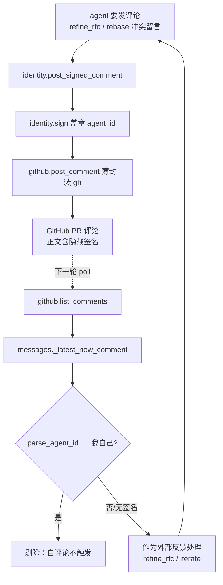
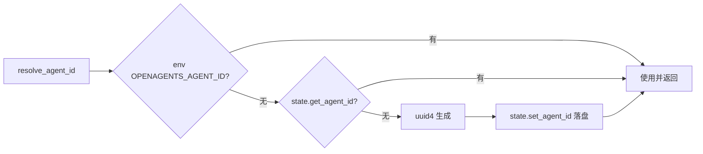
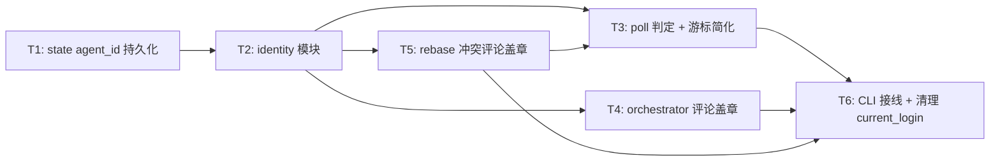

# RFC-0011: 本地 Agent 身份 + 评论签名（区分自评论与真人评论，根治 poll 自循环）

- **状态**: implemented
- **优先级**: P1
- **标签**: `architecture`, `protocol`, `dx`
- **影响模块**: `openagents/identity.py`（新增）、`openagents/state.py`、`openagents/messages.py`、`openagents/orchestrator.py`、`openagents/rebase.py`、`openagents/cli.py`、`openagents/github.py`
- **被取代 (Superseded-By)**: RFC-0019（仅**读侧**：评论驱动触发模型 + poll 读签名过滤；**身份解析 / 评论盖章写侧仍有效**）
- **负责人**: openagents（issue #28）
- **创建日期**: 2026-06-05
- **更新日期**: 2026-06-10

## 摘要

> ⚠️ **已被 RFC-0019 取代（评论驱动触发模型 + poll 读签名过滤）**：评论驱动自动触发已正式退役，
> `messages.poll` 不再读取任何 PR 评论，自动流转改由 RFC-0012 的 reviewer 闸驱动。本节描述的
> **读侧机制**（poll 读评论 → 按签名剔除自评论 → 触发 `refine_rfc`/`iterate`）不再生效。
> 身份解析（`resolve_agent_id`）与评论盖章（`sign` / `post_signed_comment`）**写侧仍有效**（用于溯源）。

poll / watch / vigil 在轮询 PR 评论时无法区分「agent 自己发的评论」和「别人（真人或其他 agent）发的评论」，会把自己的回贴当成新反馈再次触发 `refine_rfc` / `iterate`，形成自循环。本 RFC 引入**本地稳定 agent 身份**与**评论隐藏签名**，把判定粒度收敛为「自己 vs 非自己」：agent 发的每条评论盖上 `<!-- openagents:agent=<agent_id> -->` 标记，poll 据此剔除自己的回贴，同时把游标语义简化为「只推进到触发评论本身」，一并修掉崩溃自循环、误跳真人评论、同秒撞车三个缺陷。

## 动机

当前防自循环机制（RFC-0005 决策 6）完全没有「角色/身份」概念，只靠一个 per-PR 游标（上一条已处理评论的 `created_at`）。agent 回贴后，靠「把游标推进到 PR 最新评论」来吃掉自己的回贴（见 `messages._process_rfc_review` + `_newest_comment_id`）。这个 trick 很脆：

1. **崩溃自循环**：在 `github.post_comment` 与 `state.set_cursor` 之间崩溃 → 自己的回贴仍算「新」→ 重启后下一轮重新处理自己。
2. **误跳真人评论**：agent 干活期间真人发了评论 → 游标一推到「最新」，真人那条被静默跳过，永远不会被处理。
3. **同秒撞车**：agent 回贴与真人评论落在同一秒（`created_at` 相同），游标推到该秒后，真人那条 `> cursor` 为假被漏掉。

之所以历史上没用 `author == 当前登录名`（`github.current_login`）过滤，是因为人与 agent 可能共用同一个 GitHub 账号，按作者过滤会误杀真人评论。方案已与维护者对齐：用**本地身份 + 评论签名**取代「按作者过滤」与「推游标吃自评论」两个旧手段。

## 设计

### 概述

引入两个新概念，落在一个新模块 `openagents/identity.py`：

- **本地 agent 身份（agent_id）**：每个 OpenAgents 实例持有一个稳定字符串 `agent_id`，来源优先级为 **环境变量 `OPENAGENTS_AGENT_ID` > `.openagents/state.json` 已存值 > 首次自动生成并落盘**。生成后写回 state，保证跨进程（solve / poll / vigil / sync-prs）一致、跨重启稳定。
- **评论签名**：agent 通过 OpenAgents 发出的每条 PR 评论，正文末尾追加一行隐藏 HTML 注释标记 `<!-- openagents:agent=<agent_id> -->`。GitHub 渲染时不可见，但 `gh pr view --json comments` 返回的 `body` 里能解析出来。

判定与游标随之简化：

> ⚠️ **已被 RFC-0019 取代：评论驱动自动触发退役，poll 不再读评论；本节描述的读侧机制（Poll 判定 + 游标简化）不再生效。** 现状 `messages.poll` 改由 reviewer 闸（`ReviewDecision`）+ 标签 + CI 推进（RFC-0012）。身份/盖章写侧仍有效。

- **Poll 判定**：`messages._latest_new_comment` 在筛「游标后的新评论」时，额外剔除**带「我自己 agent=<my_id>」签名**的评论。别的 agent 的签名、以及无签名的（真人）评论都照常处理。
- **游标简化**：不再「推到最新评论吃掉自己回贴」。游标只推进到**触发本次处理的那条评论**的 `created_at`；agent 自己的回贴由签名过滤掉，不靠游标越过。删除 `_newest_comment_id` 这条特例路径。

三个旧缺陷据此根治：

| 缺陷 | 旧机制为何失败 | 新机制为何成立 |
|------|---------------|---------------|
| 崩溃自循环 | post 与 set_cursor 非原子，中间崩溃则自评论仍「新」 | 自评论带签名，重启后照样被签名过滤，与游标是否推进无关 |
| 误跳真人评论 | 游标推到「最新」会跨过期间到达的真人评论 | 游标只推到触发评论；真人评论 `> cursor` 且无签名 → 下一轮被处理 |
| 同秒撞车 | 游标推到自评论所在秒，同秒真人评论被 `>` 漏掉 | 游标不再落到自评论的秒上；自评论靠签名剔除，同秒真人评论仍 `> cursor` |

### 关键设计决策

1. **判定粒度是「自己 vs 非自己」，不是「agent vs 人」**：只过滤「带我自己 agent_id 签名」的评论。其他 agent 的签名评论与无签名评论（真人）都当作外部反馈处理。这样既根治自循环，又不依赖「按 GitHub 账号区分人/机」——人和 agent 共用账号也不受影响。

2. **agent_id 来源优先级 env > state > 自动生成**：`OPENAGENTS_AGENT_ID` 让运维显式命名实例（多 agent 协同时可读）；缺省时复用 state 已存值保证稳定；首次完全没有则自动生成一个并**立即落盘**，使后续进程拿到同一个 id。自动生成用 `uuid4` 的十六进制短串，无外部依赖（理念 1）。

3. **签名是隐藏 HTML 注释，盖在正文末尾**：`<!-- openagents:agent=<id> -->` 在 GitHub Markdown 中不渲染，对人类读者无干扰；`gh` 返回的原始 `body` 可被正则解析。agent_id 字符集限制为 `[A-Za-z0-9_-]`，使签名正则稳健、不可被正文内容意外撞匹配。

4. **盖章逻辑收口到 `identity` 模块，`github.py` 保持纯包装**：所有「agent 主动发评论」的调用方（`orchestrator.refine_rfc`、`rebase.rebase_open_prs` 的冲突留言）改为走 `identity.post_signed_comment(...)`，由它负责「盖章 + 调用 `github.post_comment`」。`github.post_comment` 维持「对 `gh pr comment` 的薄封装、不含业务逻辑」的定位（理念 10：解耦）。

5. **游标语义统一为「已处理到的触发评论」**：coding 阶段（`_process_coding`）本就把游标推进到触发评论，本 RFC 把 rfc-review 阶段（`_process_rfc_review`）也对齐成同一语义，删除 `_newest_comment_id` 特例。两条路径行为一致，更易推理（奥卡姆剃刀）。

6. **下线 `github.current_login`**：它是为「按作者过滤」而生（RFC-0005 决策 6），现已被签名机制取代且无任何生产代码调用（仅测试引用），随本 RFC 一并删除，避免留下误导性的死代码。

7. **`agent_id` 在 CLI 接线处解析一次、注入下游**：`cli` 在构造 `Orchestrator` / `Messages` 时调用 `identity.resolve_agent_id(state=...)` 解析出 id 并注入；`messages.poll` 再把它透传给 `rebase.rebase_open_prs`。`rebase` 保持无状态（理念 10），不自行读 state。

### 接口契约

#### `openagents/identity.py`（新增）

```
AGENT_ID_ENV = "OPENAGENTS_AGENT_ID"          # 环境变量名
# 签名标记模板：<!-- openagents:agent=<agent_id> -->

def resolve_agent_id(*, state: State) -> str
    # 解析本实例 agent_id：env > state.get_agent_id() > 自动生成并 state.set_agent_id 落盘。
    # 返回非空、字符集受限（[A-Za-z0-9_-]）的稳定 id。

def sign(*, body: str, agent_id: str) -> str
    # 在 body 末尾追加签名标记，返回带签名的新正文（纯函数）。

def parse_agent_id(*, body: str) -> str | None
    # 从 body 中解析签名里的 agent_id；无签名返回 None（纯函数）。

def post_signed_comment(*, pr_number: int, body: str, agent_id: str) -> None
    # 盖章后调用 github.post_comment。所有「agent 主动发评论」的唯一出口。
```

#### `openagents/state.py`（修改）

```
# state.json 顶层新增可选键 "agent_id": str
def get_agent_id(self) -> str | None        # 读已存 agent_id；缺失返回 None
def set_agent_id(self, *, agent_id: str) -> None   # 落盘 agent_id
```

#### `openagents/messages.py`（修改）

> ⚠️ **已被 RFC-0019 取代：评论驱动自动触发退役，poll 不再读评论。** 下列 `_latest_new_comment`「按签名剔除自评论」的读侧契约**从未在 poll 中落地、亦不再生效**（`messages.poll` 不读 PR 评论，由 reviewer 闸驱动）。保留于此仅作历史记录。

```
class Messages:
    def __init__(self, *, orchestrator: Orchestrator, state: State, agent_id: str) -> None
        # 新增 agent_id 形参（自己的身份）

    def _latest_new_comment(self, *, pr_number: int) -> github.Comment | None
        # 在「游标后的新评论」基础上，额外剔除 parse_agent_id(body) == self._agent_id 的评论

    def _process_rfc_review(self, *, record) -> dict | None
        # refine 后游标只推进到触发评论的 created_at（不再推到最新）

# 删除 _newest_comment_id
# poll 合并分支调用 rebase.rebase_open_prs(..., agent_id=self._agent_id)
```

#### `openagents/orchestrator.py`（修改）

```
class Orchestrator:
    def __init__(self, *, backend, state, work_dir, agent_id: str) -> None
        # 新增 agent_id 形参
    # refine_rfc 内：github.post_comment(...) → identity.post_signed_comment(..., agent_id=self._agent_id)
```

#### `openagents/rebase.py`（修改）

```
def rebase_open_prs(*, merged_pr_number: int | None = None, rebase: bool = False, agent_id: str) -> list[dict]
    # 新增必填 agent_id；冲突留言 github.post_comment(...) → identity.post_signed_comment(..., agent_id=agent_id)
```

#### `openagents/cli.py` / `openagents/github.py`（修改）

```
# cli：构造前 agent_id = identity.resolve_agent_id(state=state)
#      注入 Orchestrator(..., agent_id=agent_id) 与 Messages(..., agent_id=agent_id)
#      _cmd_sync_prs 调 rebase.rebase_open_prs(..., agent_id=agent_id)
# github：删除 current_login()（死代码，签名机制取代按作者过滤）
```

### 架构图

评论生命周期（数据流）：



身份解析优先级：



> **注意**: 本 RFC 只到接口与数据流层面，不含具体实现代码；实现细节在 Phase 3 细化。

## 权衡取舍

### 考虑过的替代方案

1. **按作者过滤（`author == current_login`）**：实现最简，但人与 agent 共用 GitHub 账号时会误杀真人评论——正是 issue 列出的禁忌，弃用（并据此下线 `current_login`）。
2. **post_comment 与 set_cursor 做成原子/事务**：可缓解崩溃自循环，但无法解决「误跳真人」「同秒撞车」，且本地 JSON 状态做不到真正原子，弃用。
3. **记录「自己发过的评论 id 集合」到 state**：需在 post 后持久化 id，仍有「post 与持久化之间崩溃」的同款竞态，且状态膨胀；签名把「身份」直接刻进评论正文，是无状态、抗崩溃的，更优。
4. **签名放在评论开头 / 用特殊文本前缀**：开头签名更易被人类编辑时破坏；HTML 注释置于末尾对渲染零干扰、最稳健。
5. **agent_id 仅来自环境变量（不自动生成）**：零配置场景（单机 vigil）下用户没设 env 就没有身份、退回旧缺陷；故保留「自动生成并落盘」兜底。

### 缺点

1. **历史评论无签名**：本 RFC 上线前 agent 发的旧评论没有签名，若此刻游标恰好落在它们之前，可能被当作外部反馈处理一次。属一次性、收敛的边界，且只会「多处理」不会「漏处理真人」，可接受。
2. **人类手动删除签名**：若有人编辑掉某条 agent 评论里的签名，该评论会被当作外部反馈。属人为破坏，非常规路径，不防御。
3. **两条 distinct 真人评论同秒**：游标用 `created_at` 且比较为 `>`，两条真人评论落在同一秒时仍可能漏后一条——此为与自循环无关的既有游标精度问题，本 RFC 不扩大范围处理（见未解决的问题）。

## 实现计划

### 子任务分解

> **范围约束**: 6 个子任务，未超上限。
>
> **文件分配约束**: 各子任务「涉及文件」互不重叠（含各自测试文件），满足协同模式并行前提。

#### 依赖关系图



#### 子任务列表

| ID | 标题 | 依赖 | 涉及文件 | 状态 |
|----|------|------|---------|------|
| T1 | state 层 agent_id 持久化 | - | `openagents/state.py`, `tests/test_state.py` | implemented |
| T2 | identity 模块（身份解析 + 评论签名） | T1 | `openagents/identity.py`, `tests/test_identity.py` | implemented |
| T3 | poll 判定剔除自评论 + 游标简化 | T2, T5 | `openagents/messages.py`, `tests/test_messages.py` | implemented |
| T4 | orchestrator 回贴评论盖章 | T2 | `openagents/orchestrator.py`, `tests/test_orchestrator.py` | implemented |
| T5 | rebase 冲突评论盖章 | T2 | `openagents/rebase.py`, `tests/test_rebase.py` | implemented |
| T6 | CLI 接线 + 下线 current_login | T3, T4, T5 | `openagents/cli.py`, `openagents/github.py`, `tests/test_cli.py`, `tests/test_github.py` | implemented |

状态: `pending` | `in-progress`（代码修改中） | `implemented`（代码修改完毕） | `blocked`

> **并行提示**: T2 完成后，T4、T5 可并行；T3 需待 T5 定下 `rebase_open_prs` 的新签名再接入。

#### 子任务定义

**T1: state 层 agent_id 持久化**
- **范围**: 在 `State` 上新增 `get_agent_id` / `set_agent_id`，state.json 顶层增可选键 `"agent_id"`；`_load` 容错（缺键返回不含 agent_id 的状态），保持既有 runs/cursors 不变。
- **涉及文件**: `openagents/state.py`（修改）、`tests/test_state.py`（新增用例）
- **验收标准**: set 后 get 取回同值；未设过时 get 返回 None；写入不破坏既有 runs/cursors；文件缺失/损坏仍容错为空状态。

**T2: identity 模块（身份解析 + 评论签名）**
- **范围**: 新建 `openagents/identity.py`，实现 `resolve_agent_id`（env > state > 生成落盘）、`sign`、`parse_agent_id`、`post_signed_comment`，及签名标记常量与字符集约束。
- **涉及文件**: `openagents/identity.py`（新增）、`tests/test_identity.py`（新增）
- **验收标准**: `sign` → `parse_agent_id` 往返一致；无签名/真人正文 `parse_agent_id` 返回 None；`resolve_agent_id` 三级优先级正确，自动生成时落盘且跨调用稳定；`post_signed_comment` 调 `github.post_comment` 且正文带签名（monkeypatch 断言）。

**T3: poll 判定剔除自评论 + 游标简化**

> ⚠️ **已被 RFC-0019 取代：评论驱动自动触发退役，poll 不再读评论。** 本子任务的读侧目标（poll 按签名剔除自评论）不再生效；现状 poll 由 reviewer 闸驱动（RFC-0012）。`Messages` 仍持有 `agent_id` 仅为透传给 `rebase` 盖章（写侧）。

- **范围**: `Messages.__init__` 增 `agent_id`；`_latest_new_comment` 额外剔除「我自己签名」的评论；`_process_rfc_review` 游标只推进到触发评论；删除 `_newest_comment_id`；`poll` 合并分支把 `agent_id` 透传给 `rebase.rebase_open_prs`。
- **涉及文件**: `openagents/messages.py`（修改）、`tests/test_messages.py`（改写相关用例，去掉对 `current_login` 的 monkeypatch）
- **验收标准**: 自己签名的评论不触发处理（含「post 后未推游标即崩溃重启」场景）；其他 agent 签名 / 无签名评论照常触发；refine 后游标等于触发评论的 `created_at`；干活期间到达的真人评论下一轮被处理。

**T4: orchestrator 回贴评论盖章**
- **范围**: `Orchestrator.__init__` 增 `agent_id`；`refine_rfc` 的回贴改走 `identity.post_signed_comment(..., agent_id=self._agent_id)`。
- **涉及文件**: `openagents/orchestrator.py`（修改）、`tests/test_orchestrator.py`（新增/改用例）
- **验收标准**: `refine_rfc` 发出的评论正文带本实例签名（monkeypatch `identity.post_signed_comment` 或 `github.post_comment` 断言）；其余流程（commit/push、状态流转）不变。

**T5: rebase 冲突评论盖章**
- **范围**: `rebase_open_prs` 增必填 `agent_id`；冲突留言改走 `identity.post_signed_comment(..., agent_id=agent_id)`。
- **涉及文件**: `openagents/rebase.py`（修改）、`tests/test_rebase.py`（改用例）
- **验收标准**: 冲突时留言带签名；`agent_id` 正确透传；错误隔离/结果分类行为不变。

**T6: CLI 接线 + 下线 current_login**
- **范围**: `cli` 解析 `agent_id` 并注入 `Orchestrator` / `Messages`，`_cmd_sync_prs` 透传 `agent_id`；删除 `github.current_login` 及其测试。
- **涉及文件**: `openagents/cli.py`（修改）、`openagents/github.py`（删除 current_login）、`tests/test_cli.py`（改用例、去 current_login 引用）、`tests/test_github.py`（删 current_login 用例）
- **验收标准**: poll / vigil / sync-prs 端到端拿到一致 agent_id；`current_login` 全仓无引用；ruff + 全量 pytest 通过。

## 测试方案

### 单元测试

- **identity**（T2）：`sign`/`parse_agent_id` 往返；无签名/异类正文解析为 None；`resolve_agent_id` 的 env / state / 自动生成三级优先级与落盘稳定性；`post_signed_comment` 盖章并下发。
- **state**（T1）：`get/set_agent_id`，缺失返回 None，不破坏 runs/cursors。
- **messages**（T3）：`_latest_new_comment` 剔除自签名、保留他人/无签名；游标只推进到触发评论；崩溃重启不重复触发自评论。
- **orchestrator**（T4）/ **rebase**（T5）：发出的评论带签名、agent_id 透传正确。
- **cli/github**（T6）：注入链路打通；`current_login` 删除后无残留引用。

### 集成测试

- 端到端模拟一轮 rfc-review poll（真实 `Messages` ↔ 真实 `Orchestrator`）：真人评论 → `refine_rfc` 经 `identity.post_signed_comment` 回贴带签名的自评论 → 下一轮 poll **不**因自评论再触发；其后追加一条真人评论 → 被正常处理（`tests/test_messages.py::test_integration_real_orchestrator_self_reply_does_not_self_loop`）。
- 模拟「post 评论后、推游标前崩溃」：游标仍停在触发评论前，重跑 poll 时自评论被签名过滤、不自循环（`tests/test_messages.py::test_rfc_review_self_comment_filtered_even_if_cursor_not_advanced`）。
- 一键启动脚本：`scripts/e2e-rfc-0011-agent-identity-signature.sh`，默认离线跑 ruff + pytest；设 `OPENAGENTS_E2E_REAL=1 E2E_PR=<PR编号>` 时在真实 PR 上演练「post_signed_comment → gh 取回 → parse_agent_id 解析」的签名往返。

### 手动验证

1. 不设 `OPENAGENTS_AGENT_ID`，跑一次 vigil/poll，确认 `.openagents/state.json` 出现自动生成的 `agent_id`。
2. 在某 draft PR 上以人类身份发一条评论，观察 agent `refine_rfc` 回贴；确认回贴源码含 `<!-- openagents:agent=... -->`、且下一轮不再被自身触发。
3. 设 `OPENAGENTS_AGENT_ID=alice` 重跑，确认签名使用 `alice` 且 state 中 agent_id 随 env 覆盖判定（env 优先）。

## 未解决的问题

（待与用户确认是否保留为 open question；当前先记录候选）

- 两条不同真人评论落在同一秒时，`created_at` + `>` 比较仍可能漏后一条——与自循环无关的既有游标精度问题，是否在本 RFC 范围内一并处理（如游标改记 `(created_at, id)` 复合）？倾向不处理，留作后续。

## 参考资料

- issue #28：poll 无法区分机器人自评论与人类评论
- RFC-0005 决策 6：原「按 created_at 游标 + 推到最新吃自评论」机制（本 RFC 取代）
- `openagents/messages.py`、`openagents/state.py`、`openagents/github.py`、`openagents/orchestrator.py`、`openagents/rebase.py`（现状代码）
</content>
</invoke>
