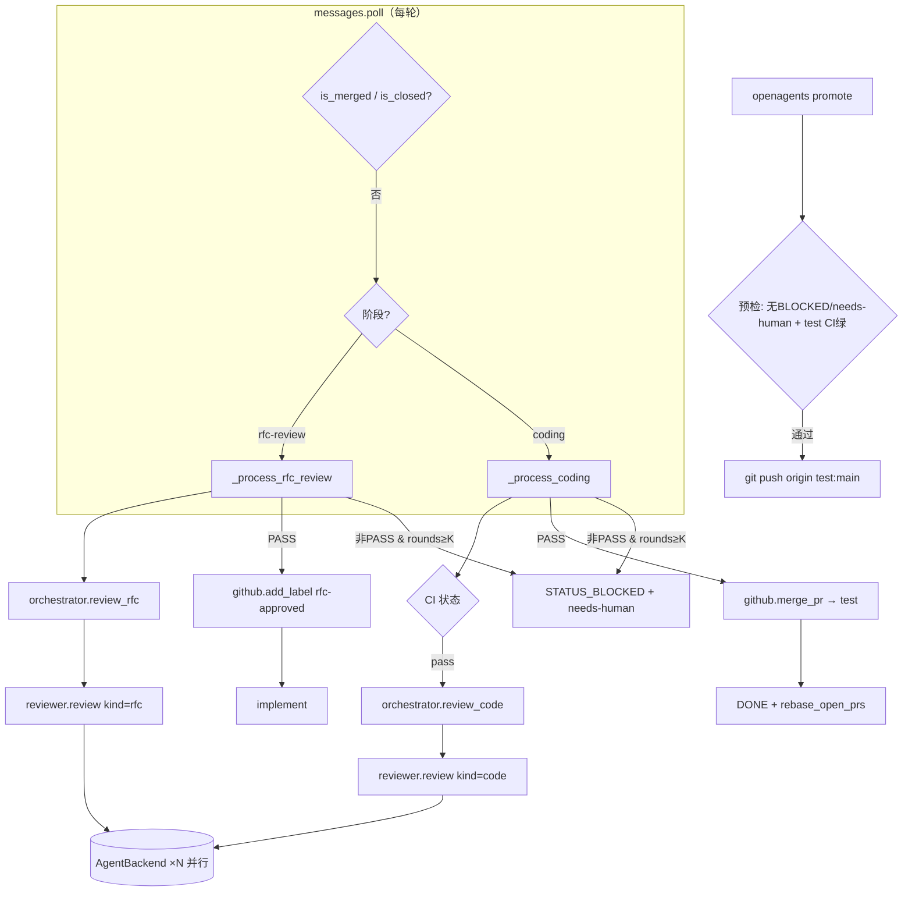
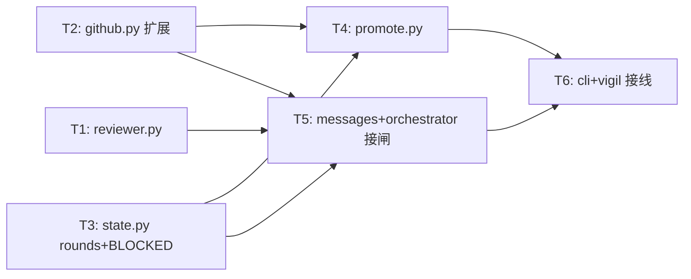

# RFC-0012: test 分支门控流程 —— 人只在「提 issue」与「promote」介入

- **状态**: implemented
- **优先级**: P1
- **标签**: `architecture`, `cli`, `dx`
- **影响模块**: `openagents/reviewer.py`(新增)、`openagents/promote.py`(新增)、`openagents/messages.py`、`openagents/orchestrator.py`、`openagents/github.py`、`openagents/state.py`、`openagents/cli.py`、`openagents/vigil.py`
- **负责人**: openagents (agent: issue-32)
- **创建日期**: 2026-06-08
- **更新日期**: 2026-06-08

## 摘要

把人类从「逐个审 PR diff」和「评审 RFC」中抽离出来。改造后人只有两个触点：**① 提 issue ② 跑 `openagents promote`**。中间的 RFC 评审、写码、代码评审、合入 `test` 全部自动化：质量闸从「人眼看代码」换成「**CI 全绿 + reviewer agent 全票 PASS**」。所有 PR 以 `test` 为 base、合回 `test`；`main` 只在人显式 `promote` 时被快进。卡住时（评审循环超 K 轮仍不过）打 `needs-human`、挂起、PR 不关，等人介入。

## 动机

当前流程（RFC-0005）在两个闸口要求人介入：

1. **RFC 评审闸**：draft PR 上要人打 `rfc-approved` 标签才转入实现（RFC-0005 决策 4，`messages._process_rfc_review`）。
2. **代码合入闸**：PR 转正后，`messages._process_coding` 只能「检 CI / 喂回评论」，**没有自动合入**——要人审 diff 并手动 merge。

这让人停留在「细节裁决」上，与 CLAUDE.md「设计理念 2/8」（人做宏观把控、面向成果而非代码层测试）相悖。本 RFC 用 reviewer agent 接管两个闸口的裁决，把人的触点收敛到「提 issue」与「promote」，让 `test` 成为不断累加的体验服。

## 设计

### 概述

引入一条长期 `test` 分支作为「集成/体验服」。issue → PR 的全过程在 `test` 上自动闭环，`main` 与 `test` 解耦，仅在 `promote` 时由 `test` 快进 `main`：

```
人提 issue
  └─ vigil 派单 → start_rfc：建 worktree（基线 test）→ 后端起草 RFC → 开 draft PR（base=test）
        │
   ┌────▼─────────────────  RFC 评审闸（reviewer，自动）──────────────────────┐
   │  reviewer.review(kind="rfc") 并行 N 个 → 聚合                           │
   │   ├ 全票 PASS → 自动打 rfc-approved → implement（PR 转正）              │
   │   └ 非 PASS  → rounds++；refine_rfc(用 reviewer 反馈)；超 K → BLOCKED  │
   └────┬──────────────────────────────────────────────────────────────────┘
        │ implement 后进入 coding 阶段（rounds 清零）
   ┌────▼─────────────────  代码评审闸（CI + reviewer，自动）─────────────────┐
   │  CI 失败 → iterate(ci)；CI pending → 等待                               │
   │  CI 全绿 → reviewer.review(kind="code") 并行 N 个 → 聚合               │
   │   ├ 全票 PASS → github.merge_pr(合入 test) → DONE → rebase 其余 PR     │
   │   └ 非 PASS  → rounds++；iterate(用 reviewer 反馈)；超 K → BLOCKED      │
   └─────────────────────────────────────────────────────────────────────────┘
        │
   test 体验服不断累加；人用 test、继续提 issue
        │  满意
   人跑 openagents promote → 预检（test CI 绿 + 无 needs-human/BLOCKED）→ git push origin test:main
```

关键在于：**复用 RFC-0005 已有的「按阶段路由」骨架**（`messages.poll → _process_rfc_review / _process_coding`），只把两处「等人」的判定换成「调 reviewer 闸 + 自动推进」。reviewer 的 agent 调用借道现有 `AgentBackend`（D6：reviewer 与解题 agent 同 backend），不新引入第二套 agent 运行机制（奥卡姆剃刀）。

### 关键设计决策

1. **D1 质量闸 = CI 全绿 ∧ reviewer 全票 PASS**：`_process_coding` 先查 `github.check_status`，仅当 `state=="pass"` 才调 `reviewer.review(kind="code")`；N 个 reviewer 全部 PASS 才 `merge_pr`。任一非 PASS → 不合入、走 iterate。RFC 闸同理：reviewer 全票 PASS 才自动打 `rfc-approved`。「全票」是聚合规则（理由：D6 默认 N=1 时退化为单票；上调 N 时取最严，防单点漏判）。

2. **D2 长期 test 分支拓扑**：`DEFAULT_BASE` 由 `main` 改为 `test`；PR 的 worktree 基线与 PR base 都锁 `test`（`create_pr` 新增 `base` 形参，`start_rfc` 透传）。`main` 不参与日常流转，只被 `promote` 快进。RFC-0009 的 `rebase_open_prs` 走 `gh pr update-branch`——它按各 PR 自己的 base（=test）更新，故 base 改为 test 后**自动正确**，无需改 rebase 层。

3. **D3 RFC 由 reviewer agent 批，人不参与**：`_process_rfc_review` 不再等人打标签，而是主动调 `reviewer.review(kind="rfc")`；全票 PASS → `github.add_label(name="rfc-approved")` 后 `implement`。保留「带 `rfc-approved` 标签即转实现」的既有入口（人/agent 谁打都认），实现向后兼容、且 reviewer 与人工批准走同一下游路径。

4. **reviewer 编排独立成模块 `reviewer.py`**：把现有 `vigil-reviewer` 的评审 rubric（输出 PASS / REWORK / RETHINK）固化为一段 review 任务模板，通过 `AgentBackend.run` 跑在解题同款 backend 上；`review()` 用线程池并行派 N 个、解析各自裁决、聚合成 `ReviewDecision(passed, feedback)`。理由：reviewer 是纯「输入 RFC/diff → 输出裁决」的无状态函数，与 git/state/编排解耦（CLAUDE.md 设计理念 10），便于单测打桩 backend。

5. **闸的触发权交给 Orchestrator，messages 保持薄**：`reviewer.review` 需要 worktree + backend，而这两者只有 `Orchestrator` 持有。故在 `Orchestrator` 上新增 `review_rfc(pr_number)` / `review_code(pr_number)` 两个方法（内部 `ensure` worktree 后调 `reviewer.review`），`messages` 只调这两个方法拿 `ReviewDecision` 再决策。保持 `messages` 仍是「事件→编排动作」的纯路由层。

6. **D5 卡住兜底：rounds 计数 + STATUS_BLOCKED**：`RunRecord` 新增 `rounds: int`（默认 0，兼容旧 state.json）。每次 `refine_rfc`/`iterate`（即一次评审未过的回合）令 `rounds++`；`implement`（RFC 闸→代码闸的阶段切换）把 `rounds` 清零，使 K 按「每个闸」独立计。`rounds >= K` 时：置 `STATUS_BLOCKED` + 打 `needs-human` 标签 + **PR 不关**。`STATUS_BLOCKED` 不在 `_OPEN_STATUSES`，故下一轮 poll 自动跳过（挂起），等人。

7. **D4 promote = 唯一宏观决策点**：新增 `openagents promote` 子命令与 `promote.py`。预检通过后执行 `git push origin test:main`（快进 main）。预检 = ①无 `STATUS_BLOCKED` 的 run、②无开着的 PR 带 `needs-human` 标签、③`test` 分支 CI 绿。理由：①②保证没有「悬而未决」的工作被跳过，③是 D4「预检 CI 绿」的显式兜底（即便 test 因 green-by-construction 通常已绿）。

8. **test 分支兜底创建**：当前远端尚无 `test`。`init` 与 `promote` 都先调 `github.ensure_branch(name="test", from_ref="main")`（幂等：存在即 no-op，不存在则从 main 建并推送），消除「首个 PR 找不到 base=test」的冷启动失败。

9. **旋钮与默认值（D6）**：N（reviewer 并发数，默认 1）、K（最大回合数，默认 3）从环境变量读取（`OPENAGENTS_REVIEWERS`、`OPENAGENTS_MAX_ROUNDS`），reviewer 复用解题 backend。env 缺省即取默认值，满足「全部可配」。完整配置文件 schema 留作后续（见未解决的问题）。

### 接口契约

> 仅定义模块边界与契约（签名 / 数据模型 / 返回语义），不含实现。

**新增 `openagents/reviewer.py`**

```python
@dataclass(frozen=True)
class ReviewDecision:
    passed: bool          # N 个 reviewer 是否全票 PASS（D1）
    feedback: str         # 聚合的非 PASS 反馈（喂给 refine/iterate）；passed=True 时为空

# kind ∈ {"rfc", "code"}：选择评审任务模板（评 RFC 文档 vs 评代码 diff）
def review(*, backend: AgentBackend, work_dir: Path, kind: str,
           pr_number: int, n: int) -> ReviewDecision: ...
```
- 行为：以 review 任务模板调 `backend.run` 共 `n` 次（线程池并行），从每次 `AgentResult.summary` 解析裁决 token（`PASS`/`REWORK`/`RETHINK`）；全为 `PASS` → `passed=True`；否则 `passed=False`、`feedback` 汇总各非 PASS 的反馈正文。

**改 `openagents/github.py`（新增/扩展，沿用 kwargs-only 风格）**

```python
def create_pr(*, branch: str, title: str, body: str,
              base: str = "test", draft: bool = False) -> PR: ...   # 新增 base 形参 → gh pr create --base
def merge_pr(*, pr_number: int, method: str = "merge") -> None: ...  # gh pr merge <n> --<method>（合入其 base=test）
def add_label(*, pr_number: int, name: str) -> None: ...             # gh pr edit <n> --add-label（用于 rfc-approved / needs-human）
def ensure_branch(*, name: str, from_ref: str) -> None: ...          # 幂等：远端无该分支则从 from_ref 建并推送
def branch_ci_green(*, branch: str) -> bool: ...                     # 查分支 HEAD 的 check-runs，全绿返回 True（promote 预检）
```

**改 `openagents/state.py`**

```python
STATUS_BLOCKED = "blocked"        # 评审超 K 轮挂起的终态；不在 _OPEN_STATUSES，poll 跳过；PR 不关

@dataclass
class RunRecord:
    ...                            # 既有字段不变
    rounds: int = 0                # 当前闸内已迭代回合数（默认 0，兼容缺该键的旧记录）

def increment_rounds(*, issue_number: int) -> int: ...  # rounds += 1，返回新值
def reset_rounds(*, issue_number: int) -> None: ...     # rounds = 0（阶段切换时调）
```

**改 `openagents/orchestrator.py`**

```python
DEFAULT_BASE = "test"             # 由 "main" 改为 "test"（D2）

def review_rfc(self, *, pr_number: int) -> ReviewDecision: ...   # ensure worktree → reviewer.review(kind="rfc")
def review_code(self, *, pr_number: int) -> ReviewDecision: ...  # ensure worktree → reviewer.review(kind="code")
# implement() 末尾增调 state.reset_rounds（进入 coding 闸前清零）
# start_rfc() 把 base 透传给 github.create_pr(base=base)
```

**新增 `openagents/promote.py`**

```python
@dataclass(frozen=True)
class PromoteResult:
    promoted: bool
    reason: str                   # 失败原因（被哪个预检拦下）或 "ok"

def promote(*, state: State, source: str = "test", target: str = "main") -> PromoteResult: ...
# 预检：无 STATUS_BLOCKED 的 run ∧ 无 needs-human 的 open PR ∧ github.branch_ci_green(branch=source)
# 通过 → ensure_branch(test) 兜底 → git push origin test:main（快进）；否则 promoted=False
```

**改 `openagents/messages.py`（路由层接闸，逻辑见架构图）**
- `_process_rfc_review`：去掉「等人评论 refine」为主路径，改为 `orchestrator.review_rfc` 驱动；PASS→加标签+implement，非 PASS→rounds++/refine 或 BLOCKED。
- `_process_coding`：CI 绿后增调 `orchestrator.review_code`；PASS→`merge_pr`+DONE+rebase，非 PASS→rounds++/iterate 或 BLOCKED。
- 新增模块常量 `MAX_ROUNDS`（读 `OPENAGENTS_MAX_ROUNDS`，默认 3）、`BLOCKED_LABEL = "needs-human"`。

**改 `openagents/cli.py` / `openagents/vigil.py`**
- `cli`：`rfc`/`vigil` 的 `--base` 默认值 `main`→`test`；`_cmd_init` 增调 `github.ensure_branch`；新增 `promote` 子命令 → `_cmd_promote` → `promote.promote`。
- `vigil`：`run(..., base)` 默认基线随 CLI 默认改为 `test`（仅默认值，签名不变）。

### 架构图



> 注：本 RFC 不含实现代码，签名仅作接口契约。具体实现在 Phase 3 细化。

## 权衡取舍

### 考虑过的替代方案

1. **不引入 test 分支，PR 直接合 main（reviewer 把关）**：被否。`main` 会随每个自动合入而漂移，人 `promote` 失去「快照式扬升」的语义；且体验服与生产线混在一起，回滚困难。长期 test 分支让「累加体验」与「人决定上线」解耦（D2）。
2. **reviewer 用独立 agent 框架（如直接起 `vigil:vigil-reviewer` 子 agent）**：被否。会新引入一套有别于 `AgentBackend` 的 agent 运行/解析机制，违背奥卡姆剃刀与「兼容多 cli-agent」。改为把 reviewer rubric 固化为 task 模板、复用现有 backend（D6 同 backend）。
3. **每轮 poll 都重新评审，无 rounds 上限**：被否。RFC/代码反复不过会无限烧 backend 调用且永不挂起。rounds + K + STATUS_BLOCKED 给出确定性兜底（D5），并把无解的工作显式交还给人（`needs-human`）。
4. **rounds 全局单计数器（不按闸清零）**：被否。RFC 闸耗掉的回合会挤占代码闸的预算，使「实现阶段刚开始就被判 BLOCKED」。改为 `implement` 时清零，让 K 对每个闸独立生效（D6）。
5. **promote 预检只查标签、不查分支 CI**：被否（部分）。虽然 test 在「全绿才合」的不变量下 green-by-construction，但合入后可能有人手推 test、或 flaky。显式 `branch_ci_green` 是 D4「预检 CI 绿」的低成本兜底。

### 缺点

- **每轮 poll 在闸口会触发 backend 调用（评审耗时/费用）**：reviewer 是 LLM 调用，比纯 `gh` 查询贵。缓解：N 默认 1；评审仅在「有进展」时发生（refine/iterate 改了内容才会进下一轮评审），不会对静止不变的 PR 空转出新结论（但仍会重复评审——见未解决的问题）。
- **reviewer 裁决依赖文本解析**（从 `AgentResult.summary` 抽 PASS/REWORK/RETHINK）：模板措辞不当会误判。缓解：模板强约束输出首行裁决 token + 单测覆盖解析。
- **STATUS_BLOCKED 是「软挂起」**：靠人看 `needs-human` 标签/board 发现，无主动通知。本 RFC 不做通知通道。

## 实现计划

### 子任务分解

> 6 个子任务，文件清单互不重叠（协同模式无冲突前提）。

#### 依赖关系图



#### 子任务列表

| ID | 标题 | 依赖 | 涉及文件 | 状态 |
|----|------|------|---------|------|
| T1 | reviewer 编排模块（N 并行 + 裁决聚合） | - | `openagents/reviewer.py`、`tests/test_reviewer.py` | implemented |
| T2 | github 扩展（base/merge/label/branch） | - | `openagents/github.py`、`tests/test_github.py` | implemented |
| T3 | state 扩展（rounds + STATUS_BLOCKED） | - | `openagents/state.py`、`tests/test_state.py` | implemented |
| T4 | promote 模块（预检 + 快进 main） | T2, T3 | `openagents/promote.py`、`tests/test_promote.py` | implemented |
| T5 | 闸接入（messages 路由 + orchestrator 评审/base） | T1, T2, T3 | `openagents/messages.py`、`openagents/orchestrator.py`、`tests/test_messages.py`、`tests/test_orchestrator.py` | implemented |
| T6 | CLI/vigil 接线（promote 命令 + base 默认 + init 兜底） | T4, T5 | `openagents/cli.py`、`openagents/vigil.py`、`tests/test_cli.py`、`scripts/e2e-rfc-0012-gated-flow.sh` | implemented |

状态: `pending` | `in-progress`（代码修改中） | `implemented`（代码修改完毕） | `blocked`

> **并行提示**: T1、T2、T3 无相互依赖且文件互不重叠，可在不同 Agent 会话并行实现。

#### 子任务定义

**T1: reviewer 编排模块**
- **范围**: 新建 `reviewer.py`：`ReviewDecision` 数据模型、`review()` 函数（线程池并行派 N 个 backend.run、解析每个 `AgentResult.summary` 的裁决 token、聚合「全票 PASS」）；内置 rfc/code 两套 review 任务模板（移植 vigil-reviewer 的 PASS/REWORK/RETHINK rubric）；N 从 `OPENAGENTS_REVIEWERS`(默认1) 读取。
- **涉及文件**: `openagents/reviewer.py`（新增）、`tests/test_reviewer.py`（新增）
- **验收标准**: 单测打桩 `AgentBackend`，覆盖：N=1 PASS→passed=True；N=3 含一个 REWORK→passed=False 且 feedback 含该反馈；RETHINK 同 REWORK 归为非 PASS；裁决 token 解析鲁棒（大小写/前后缀）。

**T2: github 扩展**
- **范围**: `create_pr` 增 `base` 形参（→ `--base`）；新增 `merge_pr`、`add_label`、`ensure_branch`（幂等）、`branch_ci_green`。复用 `_run_gh`/`_gh_json`（RFC-0010 重试）与既有 `_classify_checks`。
- **涉及文件**: `openagents/github.py`、`tests/test_github.py`
- **验收标准**: 单测打桩子进程，验证各函数拼出正确 `gh` 参数；`ensure_branch` 在分支已存在时不报错（幂等）；`branch_ci_green` 全绿→True、有失败→False；`create_pr(base=...)` 透传 `--base`。

**T3: state 扩展**
- **范围**: 新增 `STATUS_BLOCKED` 常量；`RunRecord` 加 `rounds: int = 0`（默认值保证 `RunRecord(**旧记录)` 不报错）；新增 `increment_rounds`/`reset_rounds`。
- **涉及文件**: `openagents/state.py`、`tests/test_state.py`
- **验收标准**: 单测：加载缺 `rounds` 键的旧 state.json 不抛错且 rounds=0；`increment_rounds` 返回递增值并落盘；`reset_rounds` 归零；`STATUS_BLOCKED` 不被 `all_runs` 误改。

**T4: promote 模块**
- **范围**: 新建 `promote.py`：`PromoteResult` + `promote()`，执行预检（无 `STATUS_BLOCKED` run ∧ 无 `needs-human` open PR ∧ `branch_ci_green(test)`），通过则 `ensure_branch` 兜底 + `git push origin test:main`。
- **涉及文件**: `openagents/promote.py`（新增）、`tests/test_promote.py`（新增）
- **验收标准**: 单测打桩 github/state/子进程：有 BLOCKED run→promoted=False 且 reason 指明；有 needs-human PR→False；CI 非绿→False；全通过→执行 push 并 promoted=True。

**T5: 闸接入（messages + orchestrator）**
- **范围**: `orchestrator`：`DEFAULT_BASE="test"`、`start_rfc` 透传 base 给 `create_pr`、新增 `review_rfc`/`review_code`、`implement` 末尾 `reset_rounds`。`messages`：`_process_rfc_review`/`_process_coding` 接入评审闸（PASS→加标签/merge、非 PASS→rounds++ 后 refine/iterate、超 K→BLOCKED+needs-human），新增 `MAX_ROUNDS`/`BLOCKED_LABEL`。
- **涉及文件**: `openagents/messages.py`、`openagents/orchestrator.py`、`tests/test_messages.py`、`tests/test_orchestrator.py`
- **验收标准**: 单测打桩 reviewer/github/state：rfc 闸 PASS→打 rfc-approved 并 implement；rfc 闸非 PASS 且 rounds<K→refine 且 rounds++；coding 闸 CI 绿+PASS→merge_pr+DONE+rebase；coding 闸非 PASS 超 K→STATUS_BLOCKED+needs-human 且 PR 不关；CI fail/pending 行为保持。

**T6: CLI/vigil 接线**
- **范围**: `cli`：`rfc`/`vigil` 的 `--base` 默认改 `test`；`_cmd_init` 调 `ensure_branch`；注册 `promote` 子命令 + `_cmd_promote`。`vigil`：默认基线随之为 test。补 e2e 脚本。
- **涉及文件**: `openagents/cli.py`、`openagents/vigil.py`、`tests/test_cli.py`、`scripts/e2e-rfc-0012-gated-flow.sh`（新增）
- **验收标准**: 单测：`promote` 子命令路由到 `promote.promote` 并按结果设退出码；`--base` 默认值为 `test`；`init` 触发 `ensure_branch`。e2e 脚本可独立运行（见测试方案）。

## 测试方案

### 单元测试
- 各子任务自带单测（见验收标准），全部打桩外部副作用（`gh`/`claude`/`git`/backend），保持 hermetic。
- 重点覆盖聚合规则（全票 PASS）、rounds/K 边界（K-1 不 block、K block）、旧 state.json 向后兼容、base=test 透传、merge 后 rebase 扇出。

### 集成测试
- `scripts/e2e-rfc-0012-gated-flow.sh`：在沙箱仓库串起全链路——
  1. `openagents init`（兜底建 test 分支）；
  2. 造一个 issue → `vigil --once`（或 `rfc`）起草 RFC（draft PR，base=test）；
  3. poll 驱动 RFC 闸（reviewer 桩返回 PASS）→ 自动 rfc-approved → implement；
  4. CI 桩返回绿 + reviewer 桩 PASS → 自动 `merge_pr` 合入 test；
  5. `openagents promote` → 预检通过 → `main` 快进到 `test`。
  - 断言：main 的 HEAD == test 的 HEAD；无 needs-human/BLOCKED。
  - 同时跑一个「非 PASS 超 K」分支断言：PR 仍 open、带 `needs-human`、run 为 `STATUS_BLOCKED`。

### 手动验证
- 真实仓库跑 `openagents vigil --once` 观察一个真 issue 走到「自动合入 test」；再 `openagents promote` 观察 main 快进。预期一行：`✓ main 已快进到 test（promoted）`。

## 未解决的问题

> 以下为起草阶段识别、建议保留待实现期或人工确认的开放问题（非最终决定）：

1. **评审「不重复空转」机制**：当前设计下，PR 内容未变时下一轮仍可能重复评审。是否引入「内容指纹（如最新 commit SHA）游标」，仅当 RFC/diff 变化才重评？建议留待实现期按成本权衡。
2. **配置面**：N/K 暂走环境变量。是否需要 `.openagents/config.toml` 统一 schema（含 reviewer backend 选择），还是环境变量足够？（D6 要求「全部可配」，env 已满足最小集。）
3. **`needs-human` 的恢复入口**：人修完后如何把 `STATUS_BLOCKED` 的 run 唤回流转（手动跑 `iterate`？复用 RFC-0007 resume？还是去标签即自动恢复）？建议在本 RFC 落地后单开小 RFC。
4. **`merge_pr` 合并方式**：`--merge` / `--squash` / `--rebase` 默认取哪个？默认 `--merge`，待确认是否需可配。

## 参考资料

- RFC-0005：solve 原子化拆分 + RFC-first 评审循环（本 RFC 复用其阶段路由骨架）
- RFC-0009：合并后自动 rebase 其他 open PR（base=test 下 `update_branch` 自动正确）
- RFC-0010：gh 瞬时错误重试 + 守夜循环单轮容错（github 新函数复用 `_run_gh`）
- RFC-0011：本地 Agent 身份 + 评论签名（reviewer 回贴/refine 自评论的签名过滤前提）
- `vigil:vigil-reviewer` agent：现有 PASS/REWORK/RETHINK 评审 rubric 的来源（移植为 `reviewer.py` 的 task 模板）
- 完整设计背景：`docs/superpowers/specs/2026-06-07-test-branch-gated-flow-design.md`（随实现 PR 一并入库）
