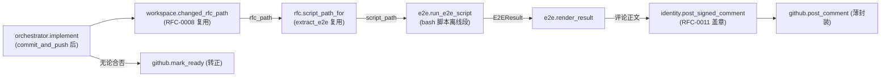
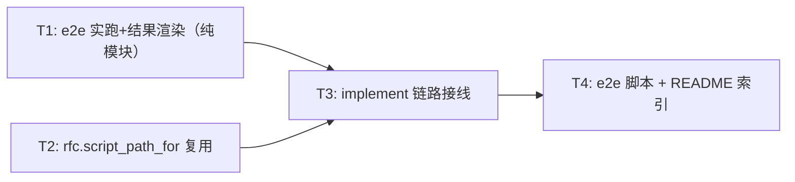

# RFC-0013: 实跑端到端脚本并把「合否 + 日志」作为 PR 评论（RFC-0008 指路牌 → 实跑结果延伸）

- **状态**: implemented
- **优先级**: P1
- **标签**: `dx`, `cli`
- **影响模块**: 新增 `openagents/e2e.py`、`openagents/rfc.py`、`openagents/orchestrator.py`
- **负责人**: openagents（issue #31）
- **创建日期**: 2026-06-08
- **更新日期**: 2026-06-08

## 摘要

RFC-0008 给每个 PR 正文加了「端到端验证」**指路牌**——告诉审阅者「跑哪个脚本、预期是什么」，
但它只是**指针**，不执行任何东西，且注入在开 draft PR 时（脚本尚未落地）。本 RFC 是 RFC-0008
的自然延伸：在 **`implement` 转正前、CI 之前**（脚本已落地、可真跑），由 agent 在 worktree 内
**实际执行**本分支 RFC 的 e2e 脚本，把「**合否（pass/fail + 退出码）+ 日志末尾若干行**」作为
一条**带签名的 PR 评论**发出。审阅者打开 PR 即可看到「模型已替我跑过、结果是 ✅/❌、日志在此」，
而不再只看到一张指路牌（CLAUDE.md 理念 8：以成果为中心，模型替人做端到端测试）。

脚本定位**单一来源于 RFC**（复用 RFC-0008 的 `workspace.changed_rfc_path` + `rfc.extract_e2e`，
不复制、不漂移，理念 1）；实跑逻辑独立成一个可单测的纯旁路模块 `openagents/e2e.py`，
不把 subprocess 塞进 `orchestrator` 编排或 `github` 网关（理念 10）；结果评论复用 RFC-0011 的
`identity.post_signed_comment` 盖章，**不触发 poll 自循环**。

## 动机

RFC-0008 把端到端验证信息从「埋在 238 行 RFC 底部」提到了「PR 门口的指路牌」，解决了**可发现性**。
但它止步于**指针**——指路牌只说「跑 `bash scripts/e2e-rfc-NNNN-*.sh`、预期是 X」，**全程没有任何人
或 agent 真的跑过一遍**，PR 上也没有「实际跑通 / 没跑通」的结果。审阅者（人）仍要自己 clone、
自己跑脚本，才知道这个 PR 到底跑不跑得起来。

这与 CLAUDE.md 设计理念 8「以成果为中心，人不再做代码层面的测试，而是面向成果测试」相悖：
端到端测试这件事应当由模型替人做掉，人只看结果。RFC-0008 的注入点（`start_rfc` 开 draft PR 时）
天然做不到这一点——彼时 RFC 刚起草，脚本和代码都还没落地，没有可跑的对象。

**真正可跑的时机是 `implement` 完成之后**：此刻后端已按 RFC 写完代码、`scripts/e2e-rfc-NNNN-*.sh`
已随 commit 落地，worktree 里就有一个确定可执行的对象。把「实跑 + 出结果」插在
`implement` 的 `commit_and_push` 之后、`mark_ready`（转正）之前、CI 之前，正好补上从
**指路牌（指针）→ 实跑结果（成果）**的最后一段。

## 设计

### 概述

在 `orchestrator.implement` 的尾段（`commit_and_push` 之后、`mark_ready` 之前）插入一段
**尽力而为的端到端旁路**：

1. **定位脚本（单一来源 RFC）**：复用 RFC-0008 的 `workspace.changed_rfc_path` 拿到本分支新增的
   RFC 文件，再经 `rfc` 模块从该 RFC 的 `集成测试` 段抽出 e2e 脚本相对路径。脚本路径只此一处来源，
   与指路牌同源、不复制。
2. **实跑脚本（独立可单测层）**：新增纯模块 `openagents/e2e.py`，在 worktree 内执行
   `bash <script_path>`，捕获退出码与合并输出（stdout+stderr），施加超时上限，截取日志末尾若干行。
   默认跑脚本的**离线段**（不设 `OPENAGENTS_E2E_REAL`，即 `ruff check` + `ruff format --check`
   + `pytest`，见现有 `scripts/e2e-rfc-*.sh` 两段式约定）——无需登录 gh / 联网，适合无人值守，
   即可给出确定性「合否」。脚本缺失 / 非常规文件 / 超时 / 非零退出 等情形都映射成结构化结果，
   **绝不抛错**。
3. **渲染并签名发评论**：`e2e.render_result` 把结果渲染成「## 端到端测试结果」Markdown，经
   RFC-0011 的 `identity.post_signed_comment` 盖上本实例签名后作为 PR **新评论**发出
   （与正文指路牌分开、留历史、不改写正文）。签名使下一轮 poll 据 `parse_agent_id` 剔除这条
   自评论，不触发自循环。
4. **不阻断转正**：无论 ✅/❌，评论照发、`mark_ready` 照常进行。e2e 结果是给人看的**成果**，
   CI 才是硬门禁；失败只在评论里显形，绝不把整条 `implement` 流程拖崩或卡在 draft。

四层关注点解耦（理念 10）：RFC 文档解析（`rfc.py`，纯函数）/ 脚本实跑与结果渲染（`e2e.py`，
纯旁路，只懂 subprocess + 文本）/ 评论盖章（`identity.py`，RFC-0011）/ 编排（`orchestrator.py`）
互不渗透；`github.py` 维持薄包装、零改动。

### 关键设计决策

1. **实跑层独立成纯模块 `openagents/e2e.py`，不塞进 orchestrator/github**：「跑一个脚本、截退出码与
   日志末尾、渲染结果」既不属于编排（`orchestrator`）也不属于 gh 网关（`github`），单独成模块、
   只依赖 `subprocess` 与文本处理、无 git / gh / RFC 语义，易于单测全分支（成功 / 失败 / 超时 /
   缺脚本）。符合理念 10（解耦）与理念 1（按职责最小切分）。

2. **脚本定位单一来源于 RFC，复用 RFC-0008 通路**：脚本路径来自 `workspace.changed_rfc_path` +
   `rfc.extract_e2e`，与指路牌同源。`e2e.py` **不自己解析 RFC**——它只接收一个 `script_path`
   字符串，保持对 RFC 文档语义的无知。RFC 改了脚本，下次 `implement` 自然跟随，不漂移
   （理念 1 奥卡姆剃刀，验收：内容单一来源于 RFC）。

3. **默认只跑离线段、不走真实演练**（解 issue 未决问题 1）：实跑默认**不设** `OPENAGENTS_E2E_REAL`，
   即只执行脚本的离线确定性段（ruff + pytest，全程 mock，不触达真实 gh）。离线段足以给出可信
   「合否」，且无人值守下稳定（无需 gh 登录 / 联网）。真实演练（`OPENAGENTS_E2E_REAL=1`）依赖联网与
   登录态、在自动转正链路里不稳，**不在本 RFC 自动触发**；保留为脚本里人工 opt-in 的能力与后续增量。

4. **结果作为「新评论」而非改写正文**（issue 维护者已对齐）：与 RFC-0008 的正文指路牌分工——指路牌是
   开 PR 时写入正文的**指针**、随正文持久；本 RFC 的实跑结果是 `implement` 时产生的**成果**，作为
   带时间戳的独立评论留历史，不污染、不覆盖正文，也便于多次 implement 留多条结果记录。

5. **结果评论复用 RFC-0011 签名、盖章不另造轮子**（解 issue 验收：不触发自循环）：经
   `identity.post_signed_comment(..., agent_id=self._agent_id)` 发出，正文末尾自带
   `<!-- openagents:agent=<id> -->`，poll 据签名剔除自评论。盖章逻辑收口在既有 `identity` 模块，
   `github.post_comment` 维持薄封装、零改动（理念 10）。本 RFC **不新增任何签名代码**，纯复用。

6. **失败不阻断转正、整条旁路尽力而为**（解 issue 未决问题 3）：e2e ❌ 时仅发评论、`mark_ready` 照常。
   理由：理念 8「人看结果」+ CI 才是硬门禁；阻断转正会把 PR 卡在 draft、与「绝不崩溃整条 implement
   流程」相悖。`run_e2e_script` 契约上**绝不抛错**；渲染/发评论一步若因 gh 故障抛错，只记进度并吞掉、
   `mark_ready` 仍继续（旁路不拖垮主流程）。

7. **日志末尾固定取尾部 N 行、单一旋钮**（解 issue 未决问题 2）：默认尾部 40 行（模块常量
   `DEFAULT_TAIL_LINES`）。ruff/pytest 的失败摘要天然落在输出末尾，尾部 40 行对「成功一行绿、
   失败看摘要」两种场景都够用；不做「失败时多取」的分支特例（奥卡姆剃刀），需要全量日志的人去 CI
   或本地复跑。行数是显式形参，调用方传入、可调。

### 接口契约

> 仅描述边界与签名（what），不含实现（how）。全部关键字参数（CLAUDE.md：禁止位置参数）；
> `_` 私有函数参数禁止默认值，调用方必须显式传参。

**新增 `openagents/e2e.py`**

```text
DEFAULT_TIMEOUT_SECONDS: int = 600   # 实跑离线段（ruff+pytest）的超时上限
DEFAULT_TAIL_LINES: int = 40         # 结果评论默认截取的日志末尾行数

@dataclass(frozen=True)
class E2EResult:
    outcome: str            # "passed" | "failed" | "skipped"
    exit_code: int | None   # 子进程退出码；skipped / 超时未取到时为 None
    script_path: str | None # 实跑的脚本相对路径；无脚本时为 None
    log_tail: str           # 合并 stdout+stderr 的末尾若干行；skipped 时为降级提示文本
    timed_out: bool         # 是否因超时被终止（outcome 随之为 "failed"）

def run_e2e_script(
    *, worktree: Path, script_path: str | None, timeout_seconds: int, tail_lines: int
) -> E2EResult
    # 在 worktree 内执行 `bash <script_path>`（默认环境，即脚本离线段），捕获退出码与
    # 合并输出，施加 timeout_seconds 上限，截取末 tail_lines 行。绝不抛错：
    #   - script_path 为 None / 文件不存在 / 非常规文件 → outcome="skipped"，不起子进程，
    #     log_tail 给出降级提示（指向 RFC 集成测试段手动验证）。
    #   - 退出码 0 → "passed"；非零 → "failed"；超时 → "failed" 且 timed_out=True。

def render_result(*, result: E2EResult, tail_lines: int) -> str
    # 渲染「## 端到端测试结果」评论 Markdown：脚本行 + 合否行（✅/❌/⚠️ + 退出码）
    # + 日志末尾代码块。纯函数，只读 result，不依赖 RFC 编号。
```

**`openagents/rfc.py` 新增便捷封装（复用既有 `extract_e2e`）**

```text
def script_path_for(*, rfc_path: Path) -> str | None
    # 读 rfc_path → extract_e2e → 返回 hints.script_path；文件不可读返回 None（不抛错）。
    # 与既有 signpost_for 对称：把「读文件 + RFC 语义解析」收在 rfc.py，orchestrator 不做文件 IO。
```

**`openagents/orchestrator.py` 改动（`implement` 尾段接线）**

```text
# implement 内，commit_and_push 之后、mark_ready 之前：
#   rfc_path = self._workspace.changed_rfc_path(worktree=worktree, base=DEFAULT_BASE)
#   script_path = rfc.script_path_for(rfc_path=rfc_path) if rfc_path else None
#   result = e2e.run_e2e_script(
#       worktree=worktree, script_path=script_path,
#       timeout_seconds=e2e.DEFAULT_TIMEOUT_SECONDS, tail_lines=e2e.DEFAULT_TAIL_LINES,
#   )
#   identity.post_signed_comment(            # 失败仅记进度并吞掉，不阻断 mark_ready
#       pr_number=pr_number,
#       body=e2e.render_result(result=result, tail_lines=e2e.DEFAULT_TAIL_LINES),
#       agent_id=self._agent_id,
#   )
#   github.mark_ready(pr_number=pr_number)    # 无论 ✅/❌ 照常转正
```

渲染产物（脚本存在、离线段通过时）形如：

````text
## 端到端测试结果
- 脚本：`bash scripts/e2e-rfc-0013-implement-e2e-comment.sh`
- 结果：✅ 通过（退出码 0）
- 日志末尾（最后 40 行）：
```
…最后 40 行输出…
```
````

失败 / 跳过时「结果」行降级为 `❌ 失败（退出码 1）` / `❌ 超时（>600s）` /
`⚠️ 跳过：本分支 RFC 未声明 e2e 脚本（或脚本尚未落地），见 RFC 集成测试段手动验证`。

### 架构图



## 权衡取舍

### 考虑过的替代方案

- **在 CI 全绿后再跑一次**：CI 通过后脚本与环境最终态，结果最权威。但本 issue 已定时机为
  「implement 后、CI 前」（与 CI 解耦、无需等 CI 编排），且 CI 后补跑需额外的事件触发与 PR 回查
  通路。收益与本 RFC 正交，**否决为本 RFC scope**，保留为后续增量（issue 未决问题 4）。
- **自动跑真实演练段（`OPENAGENTS_E2E_REAL=1`）**：能真正端到端演练 `openagents rfc/implement`。
  但需登录 gh + 联网、会真开 PR / 留副作用，无人值守下不稳，违背「适合无人值守」诉求，
  **否决**（决策 3）；保留为脚本内人工 opt-in 能力。
- **e2e ❌ 时阻断 `mark_ready` / 维持 draft**：能强约束「跑不通不转正」。但与「绝不崩溃整条
  implement 流程」「人看结果、CI 才是硬门禁」相悖，且会把待人处理的 PR 卡在 draft，
  **否决**（决策 6）。
- **把 subprocess 实跑逻辑写进 `orchestrator` 或 `github`**：耦合编排/网关与脚本执行，难单测、
  违背理念 10，**否决**，故单列 `e2e.py`。
- **结果改写进 PR 正文（替换/追加指路牌）**：与 RFC-0008 正文指针职责冲突、会覆盖历史、
  多次 implement 无法留多条记录，**否决**，改用独立评论（决策 4）。
- **复制一份测试说明到评论**：多一个与 RFC 双源易漂移的载体，违背验收「单一来源于 RFC」与
  理念 1，**否决**；评论只放「合否 + 日志末尾」，详细步骤仍指回 RFC。

### 缺点

- 默认只跑离线段，**不覆盖真实联网/gh 演练**——离线绿不等于真实跑通。属与「无人值守稳定」的
  自觉取舍；真实演练能力保留在脚本里供人工触发。
- 结果反映 `implement` 当下的快照；若其后 `iterate` 改了代码，已发评论不会自动重跑（除非将来引入
  「CI 后补跑」增量）。多次 implement/iterate 会留多条结果评论，靠时间戳区分。
- 日志只取尾部 40 行，长输出中部信息不入评论；需要全量者去 CI 或本地复跑。
- 实跑会给 `implement` 增加一段本地 ruff+pytest 耗时（受 `DEFAULT_TIMEOUT_SECONDS` 上限保护）。

## 实现计划

### 子任务分解

> **范围约束**: 4 个子任务（≤6）。各子任务「涉及文件」互不重叠，T1/T2 无依赖可并行。
>
> **签名盖章说明**: 「结果评论盖章」复用 RFC-0011 既有 `identity.post_signed_comment`，
> **无新增签名代码**，故不单列子任务——盖章作为 T3 接线的一次调用，由 T3 的 orchestrator
> 单测断言「结果评论经 `post_signed_comment` 发出 / 正文带签名」。`github.py` 零改动。

#### 依赖关系图



#### 子任务列表

| ID | 标题 | 依赖 | 涉及文件 | 状态 |
|----|------|------|---------|------|
| T1 | e2e 实跑封装 + 结果评论渲染（纯模块） | - | `openagents/e2e.py`、`tests/test_e2e.py` | implemented |
| T2 | rfc.script_path_for（复用 extract_e2e 定位脚本） | - | `openagents/rfc.py`、`tests/test_rfc.py` | implemented |
| T3 | implement 转正前实跑 + 签名结果评论接线 | T1, T2 | `openagents/orchestrator.py`、`tests/test_orchestrator.py` | implemented |
| T4 | 端到端脚本 + RFC 索引 | T3 | `scripts/e2e-rfc-0013-implement-e2e-comment.sh`、`docs/rfcs/README.md` | implemented |

状态: `pending` | `in-progress`（代码修改中） | `implemented`（代码修改完毕） | `blocked`

> **并行提示**: T1、T2 无依赖且文件清单互不重叠，可在不同 Agent 会话中并行实现。

#### 子任务定义

**T1: e2e 实跑封装 + 结果评论渲染（纯模块）**
- **范围**: 新建 `openagents/e2e.py`，实现 `E2EResult`、`run_e2e_script`、`render_result`
  及 `DEFAULT_TIMEOUT_SECONDS` / `DEFAULT_TAIL_LINES`（见接口契约）。在 worktree 内
  `bash <script_path>` 跑离线段、捕获退出码与合并输出、施加超时、截尾部 N 行；脚本缺失 /
  非常规文件 / 超时 / 非零退出 各自映射成结构化结果，**绝不抛错**。模块 docstring 与公开函数
  引用 `RFC-0013`。
- **涉及文件**: `openagents/e2e.py`（新增）、`tests/test_e2e.py`（新增）
- **验收标准**: 单测覆盖——退出码 0 → `passed`；非零 → `failed` 且退出码正确；超时 → `failed`
  且 `timed_out=True`；`script_path=None` / 文件不存在 → `skipped` 不起子进程；`render_result`
  对四种 outcome 各渲染对应「结果」行与日志块且不抛错。ruff + pytest 通过。

**T2: rfc.script_path_for（复用 extract_e2e 定位脚本）**
- **范围**: 在 `openagents/rfc.py` 新增 `script_path_for(*, rfc_path) -> str | None`：读文件 →
  `extract_e2e` → 返回 `hints.script_path`，文件不可读返回 `None`（不抛错），与既有
  `signpost_for` 对称。docstring 引用 `RFC-0013`（复用 RFC-0008 的 `extract_e2e`）。
- **涉及文件**: `openagents/rfc.py`（修改）、`tests/test_rfc.py`（新增用例）
- **验收标准**: 单测——含 `集成测试` 脚本的 RFC 抽出该脚本相对路径；无脚本段时返回 `None`；
  文件不可读返回 `None` 不抛错。不破坏既有 `extract_e2e` / `signpost_for` 用例。ruff + pytest 通过。

**T3: implement 转正前实跑 + 签名结果评论接线**
- **范围**: 改 `orchestrator.implement`：`import e2e`；在 `commit_and_push` 之后、`mark_ready`
  之前定位脚本（`changed_rfc_path` + `rfc.script_path_for`，`base=DEFAULT_BASE`）→
  `e2e.run_e2e_script` 实跑 → `e2e.render_result` 渲染 → `identity.post_signed_comment` 盖章发评论
  → `github.mark_ready` 照常转正。结果 ❌ 不阻断转正；发评论失败仅记进度并吞掉、不崩溃流程。
  新增/改动处注释引用 `RFC-0013`。
- **涉及文件**: `openagents/orchestrator.py`（修改）、`tests/test_orchestrator.py`（新增/改用例）
- **验收标准**: 单测（假 backend + 假 Workspace + monkeypatch `e2e.*` / `identity.post_signed_comment`
  / `github.mark_ready`）——`implement` 在 `mark_ready` 前调用 `run_e2e_script`、把渲染结果经
  `post_signed_comment`（带本实例 `agent_id`）发出；e2e `failed` 时仍调用 `mark_ready`；
  `changed_rfc_path` 返回 `None` 时走 `script_path=None`（skipped）仍发评论且不抛错；
  发评论抛错时 `mark_ready` 仍被调用。ruff + pytest 通过。

**T4: 端到端脚本 + RFC 索引**
- **范围**: 新增 `scripts/e2e-rfc-0013-implement-e2e-comment.sh`（沿用两段式：默认离线
  `ruff check` / `ruff format --check` / `pytest`；`OPENAGENTS_E2E_REAL=1` 时人工 opt-in 演练
  「implement 实跑 + 结果评论」路径）。在 `docs/rfcs/README.md` 的 RFC 列表追加 RFC-0013 行。
- **涉及文件**: `scripts/e2e-rfc-0013-implement-e2e-comment.sh`（新增）、`docs/rfcs/README.md`（修改）
- **验收标准**: 离线段在干净仓库通过；脚本可执行（`set -euo pipefail`、`chmod +x`）；
  README 列表含 RFC-0013 条目。

## 测试方案

### 单元测试

- `test_e2e`（T1）：`run_e2e_script` 四分支——成功（退出码 0 → passed）/ 失败（非零 → failed +
  退出码）/ 超时（failed + timed_out）/ 缺脚本（script_path=None 或文件不存在 → skipped 不起子进程）；
  `render_result` 对四种 outcome 的渲染与日志末尾截取，全程不抛错。
- `test_rfc`（T2）：`script_path_for` 命中脚本 / 无脚本段返回 None / 文件不可读返回 None。
- `test_orchestrator`（T3）：`implement` 在 `mark_ready` 前实跑并经 `post_signed_comment` 发带签名
  结果评论；e2e 失败仍 `mark_ready`；缺 RFC（changed_rfc_path=None）走 skipped 仍发评论且不抛错；
  发评论抛错时 `mark_ready` 仍被调用、流程不崩。

### 集成测试

- `scripts/e2e-rfc-0013-implement-e2e-comment.sh`：默认离线跑全套 `ruff check` +
  `ruff format --check` + `pytest`；`OPENAGENTS_E2E_REAL=1` 时（需 gh 登录 + 已有 rfc-approved 的
  draft PR）人工演练 `openagents implement <pr>`，断言 PR 新增一条含「## 端到端测试结果」且带
  agent 签名的评论。

### 手动验证

1. 对一个已 `rfc-approved` 的 draft PR 跑 `openagents implement <pr>` → PR 新增一条
   「## 端到端测试结果」评论，含脚本行、`✅ 通过（退出码 0）`/`❌ 失败（退出码 N）` 与日志末尾，
   且该 PR 已转正（mark_ready）。
2. 查看该结果评论源码，确认末尾带 `<!-- openagents:agent=... -->` 签名；再跑一轮 poll，
   确认这条自评论**不**触发自循环（延续 RFC-0011）。
3. 临时改名/移除本分支 RFC 使 `changed_rfc_path` 取不到（或 RFC 无 `集成测试` 脚本）→
   `openagents implement <pr>` → 评论「结果」行降级为 `⚠️ 跳过…`，命令不报错、PR 仍正常转正。

## 未解决的问题

issue #31 维护者列出的四个待定项已在设计阶段定下，无阻断性 open question：

1. **离线段 vs 真实演练** → 决策 3：默认只跑离线段（ruff+pytest），真实演练保留为脚本内人工
   opt-in，不自动触发。
2. **日志末尾取多少行** → 决策 7：默认尾部 40 行（`DEFAULT_TAIL_LINES`），不做失败多取特例。
3. **失败是否阻断转正** → 决策 6：不阻断，仅发评论、`mark_ready` 照常。
4. **是否与「CI 全绿后再跑」并存** → 权衡取舍：本 RFC 选定「implement 后、CI 前」，CI 后补跑
   作为正交后续增量，不在本 RFC scope。

如评审认为上述任一项需调整（如要求失败阻断转正、或纳入 CI 后补跑），在评审时一并提出即可。

## 参考资料

- issue #31 —— 本 RFC 的来源与验收标准（指路牌 → 实跑结果）
- RFC-0008（`docs/rfcs/0008-pr-e2e-signpost.md`）—— 指路牌现状、`rfc.extract_e2e` /
  `workspace.changed_rfc_path` 通路，本 RFC 的扩展基线
- RFC-0011（`docs/rfcs/0011-agent-identity-comment-signature.md`）—— 评论签名 +
  `identity.post_signed_comment`，结果评论复用以防自循环
- issue #22 —— RFC-0008 的来源（「PR 门口要有端到端验证导航」）
- issue #28 —— RFC-0011 的来源（poll 自循环根因）
- `scripts/e2e-rfc-*.sh` —— 现有 e2e 脚本两段式约定（默认离线 / `OPENAGENTS_E2E_REAL=1` 真跑）
- `CLAUDE.md` —— 设计理念 1（奥卡姆剃刀）、8（以成果为中心，模型替人做端到端测试）、10（模块解耦）
</content>
</invoke>
