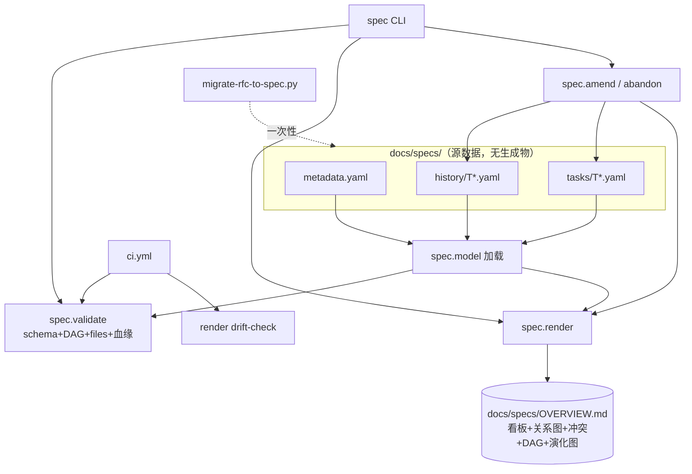
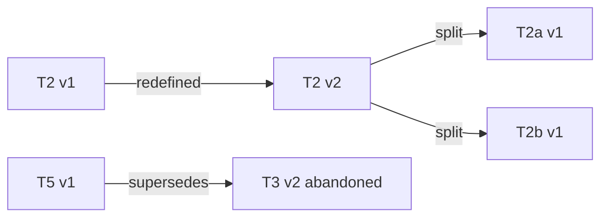
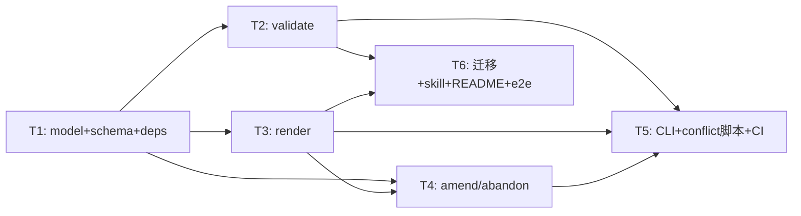

# RFC-0014: 用「Spec 活快照 + 演化历史」取代 RFC —— Spec 永远与代码一一对应，legacy 沉淀到历史

- **状态**: implementing
- **优先级**: P1
- **标签**: `architecture`, `dx`, `cli`, `tooling`
- **影响模块**: `openagents/spec/`（新增包：model / schema / validate / render / mutate / cli）、`pyproject.toml`、`scripts/`（migrate + check-spec-number-conflicts + e2e）、`.github/workflows/ci.yml`、`.claude/skills/spec-driven-development/`（新增，取代 rfc-driven-development）、`docs/specs/`（新增源数据树）
- **负责人**: openagents (agent: issue-35)
- **创建日期**: 2026-06-10
- **更新日期**: 2026-06-10

## 摘要

把现行 RFC 文档拆成两件本质不同的东西并各自归位：**当前规格**沉淀为「活快照」——一棵 `docs/specs/` 源数据树，基本单元是 **Task**（稳定 ID、自包含、和当前活着的代码一一对应）；**执行演化**（旧版本 / 废弃）沉淀为「历史」（追加式版本列表）。快照里永远没有 legacy——做完的 Task 留在快照（`status=done`），只有「被重构 Task 的旧版本」和「被废弃的 Task」进历史。配套一个 `spec` Python 工具（render / amend / abandon / validate）把所有人读视图派生到单一生成物 `docs/specs/OVERVIEW.md`（全局看板 + 跨 feature 关系图 + 文件冲突 + 每 feature 的 DAG / **演化图**）。一次性迁移脚本把现有 13 份 RFC 全转为 spec 组；`rfc-driven-development` skill / 注释约定 / 编号校验脚本同步更名。

## 动机

当前 RFC 把三件性质不同的东西塞进同一份 Markdown：

1. **设计理由**（摘要 / 动机 / 权衡）—— 天然历史性，只增不减；
2. **当前规格**（子任务表：涉及文件 + 状态）—— 本应是和代码一一对应的快照；
3. **执行演化**（子任务被重定义 / 拆分 / 废弃）—— 历史，却原地堆在文件里。

**核心痛点：改一个子任务时，旧子任务定义还遗留在 RFC 里，文件越来越像流水账，无法做到「RFC = 和代码一一对应的快照」。** 经典 RFC 本就是不可变的时间点提案（要改就 supersede），所以它不该再叫 RFC。

### 北极星

> **Spec 永远是仓库的快照。快照里的每一个 Task 都映射到当前活着的代码，因此快照里永远没有 legacy。**

- 基本单元是 **Task**（稳定 ID、自包含），每个 Task 带状态、和代码一一对应；
- **做完的 Task 不离开快照**（`status=done`，代码还活着）；Agent 读到 `in-progress` / `pending` 就接着干；
- **只有 legacy 进历史**，legacy 仅两种：① 被重构 Task 的旧版本定义；② 被废弃的 Task；
- 历史能还原每个 Task 的演化序列，并据此**自动画演化图**，让人直观看到设计怎么一步步长出来。

### 证据驱动：与 OpenSpec / spec-kit 的关系

调研了两个成熟仓库（均 MIT），**借其思想，不照搬**：

- 借鉴 [OpenSpec](https://github.com/Fission-AI/OpenSpec) 的 **delta 记法**（历史记「改了什么」而非整块复制）与**机器校验**；借鉴 [spec-kit](https://github.com/github/spec-kit) 的 **`[P]` 并行标记 + 依赖分组**、**clarify 阶段**。
- **「活快照」是本 RFC 自创的北极星概念**（见上「北极星」节），非借自 spec-kit——实地核验 spec-kit 文档仅自述「Spec-Driven Development」，未提出「活快照 / Living Spec」此术语，故不归属于它（理念 7 证据驱动）。
- **关键不同**：OpenSpec 快照装的是「需求」，且**做完的 task 会被 archive 搬出快照**（导致快照看不到已完成工作 + archive 堆旧 task）——这正是本设计要避免的 legacy 问题。**本设计快照装的是 Task 本身，做完的 task 留在快照，只有旧版本 / 废弃才进历史。**

| 维度 | OpenSpec | 本设计 |
|------|----------|--------|
| 快照装什么 | 需求 / 能力 | **Task 本身** |
| 做完的 task | 随 change 被 archive 搬出 | **留在快照**（done） |
| 历史单位 | 按 change | **按 Task 版本** |
| 演化图 | 无 | **脚本自动渲染**（核心增量） |
| 多 Agent | 单一驱动者 | change≈issue/PR、Agent 认领、文件分配 |

## 设计

### 概述

磁盘布局把**源数据**与**生成视图**彻底分离：`docs/specs/` 树只放源数据（纯结构化 YAML），无任何生成物；所有人读视图由 `spec render` 派生到唯一文件 `docs/specs/OVERVIEW.md`。没有 `group.md`——元数据下沉到 `metadata.yaml`、视图上浮到 `OVERVIEW.md`，源码树保持干净。

```
docs/specs/
├── OVERVIEW.md         # 唯一人读视图（spec render 生成，纯派生物）：
│                       #   全局看板 + 跨 feature 关系图 + 文件冲突 + 每 feature 的 DAG / 演化图
├── README.md           # specs 目录说明 + 编号规则（人写，静态）
├── 0009-auto-rebase.../
│   ├── metadata.yaml   # 组级元数据（纯数据，3-4 行）：title / issue / slug
│   ├── tasks/T*.yaml   # Task 当前版（快照，纯结构化数据）
│   └── history/T*.yaml # Task 历史版本列表（追加式）
└── 0012-test-branch.../ ...
```

`spec` 工具是一个纯函数式数据层 + 薄 CLI（理念 1 奥卡姆、理念 10 解耦）：

```
load 源数据 (model)  ──►  validate (schema + 语义)
        │                       │
        ├──► render ──► OVERVIEW.md（幂等，纯派生）
        └──► amend / abandon ──► 改快照 + append 历史 ──► 自动 render
```

`spec` 不感知 git / GitHub / orchestrator，只读写 `docs/specs/` 下的文件（与现有 `rfc.py` 同样定位为「只懂文档结构的纯模块」）。

### 关键设计决策

1. **D1 基本单元是 Task，从「文档级」下沉到「Task 级」**：旧 RFC 的全部元素都映射到 Task 字段（见下「RFC 元素 → Task 覆盖对照」），不丢任何信息。一个 spec 组 = 一个 issue/feature；组内是若干 Task。这样「改一个子任务」就是「改一个 Task 文件」，旧版本进 `history/`，快照里只剩当前版——根治流水账。

2. **D2 做完的 Task 留在快照（`status=done`），不 archive**：与 OpenSpec 最关键的分歧。done 的 Task 代码还活着，必须留在快照才能保证「快照 ↔ 活代码」一一对应。Agent 扫快照见 `pending`/`in-progress` 就接着干，见 `done` 就当背景知识读。**只有两类 legacy 进 `history/`**：① `amend` 产生的旧版本；② `abandon` 的整块 Task（末态 `abandoned`）。

3. **D3 源数据 / 生成视图彻底分离，OVERVIEW.md 是唯一派生物**：specs 树里没有任何手工维护的聚合视图（无 `group.md`、无看板 md）。所有跨文件 / 跨组的呈现都由 `spec render` 现算现生成到 `OVERVIEW.md`。好处：源数据无冗余、不会「看板与 task 不一致」；坏处：看视图前要先 render（用 CI drift-check 兜底，见 D9）。

4. **D4 Task 是纯结构化 YAML，prose 字段用块标量 `|`**：`status`/`priority`/`depends-on`/`files` 等是机器可校验的结构化字段；`summary`/`design`/`interface` 等长文用 YAML 块标量承载 Markdown（含内嵌 mermaid）。这样既能机器校验又能写富文本，且 `spec render` 能把结构化字段拼成看板、把 prose 字段原样铺进每 feature 段。

5. **D5 演化由「血缘字段」显式记录，演化图据此自动渲染（核心增量）**：每个 Task 版本带 `version` / `change-reason` / `supersedes` / `split-from` / `merged-from` / `derived-from`。`history/T*.yaml` 是版本对象的追加式列表。`spec render` 把（当前版 + 历史版）按血缘连成有向图：节点 = 某 Task 的某一版，按 `status` 着色，时间左→右，边类型来自血缘字段（redefined / split / merged / supersedes / derived）。这是相对 OpenSpec/RFC 的核心新增——让「设计怎么一步步长出来」可视化。

6. **D6 历史用追加式版本列表，不用整块复制**：借 OpenSpec 的 delta 思想——`amend` 时把**当前版**对象 append 进 `history/T*.yaml`，再把 `tasks/T*.yaml` 覆盖为新版（`version+1`）。历史天然只增不改，且能完整还原任一版本的全字段（每个历史项是一个完整 Task 快照对象，便于 render，无需 diff 重放）。

7. **D7 跨组关系分两类**：`depends-on`（阻塞依赖，实线，进**全局** DAG 无环校验，跨组用限定 ID 如 `0012/T2`）与 `relates-to`（非阻塞关联，虚线，标 `type`：extends/supersedes/note）。组内 `files` 必须互不重叠（**error**，协同模式无冲突前提）；跨组 `files` 重叠只**报告**（warning，协作信号，不强制禁止）——对齐 issue「文件冲突报告是协作信号」。

8. **D8 引入两个运行时依赖：`ruamel.yaml` + `jsonschema`**（项目当前 `dependencies = []`）。
   - `ruamel.yaml`：读写要**保留键序、块标量样式与注释**——这些 YAML 文件是人写人读的源数据，round-trip 保真是「源码树保持干净」的前提。PyYAML 默认会重排键、丢块标量样式，故弃用。
   - `jsonschema`：用声明式 Schema 校验 Task/metadata/history，比手写校验代码更少、更可靠，且 acceptance 明确要求「JSON Schema 校验」。
   - 两者均为 MIT/类似宽松许可、零传递依赖膨胀，违反「零依赖」现状但符合「如无必要勿增实体」的**必要**判断（YAML 解析与 Schema 校验是本 RFC 的本质需求，自造轮子代码更多）。

9. **D9 OVERVIEW.md 提交入库 + CI drift-check 守护幂等**：OVERVIEW.md 提交（而非 gitignore），以便在 GitHub 网页直接看到「成果视图」（理念 8 以成果为中心）。CI 新增一步：跑 `spec render` 后 `git diff --exit-code docs/specs/OVERVIEW.md`，有 diff 即判失败——既验证 render 幂等，又防止生成物过期。

10. **D10 `spec` 为独立 console_script，不挂在 `openagents` 下**：issue 工作流通篇用裸命令 `spec render` / `spec amend`，故注册 `[project.scripts] spec = "openagents.spec.cli:main"`。实现仍在 `openagents.spec` 包内（理念 10 解耦，单一代码库）。

11. **D11 编号沿用 `NNNN`，且 1:1 兼容旧 RFC 编号**：spec 组目录 `NNNN-slug/`。RFC-NNNN 迁移后 = spec 组 NNNN，编号不变。`check-rfc-number-conflicts.py` → `check-spec-number-conflicts.py`，匹配 `docs/specs/(NNNN)-slug/` 目录形态（本地 + open PR 并集取下一号）。

12. **D12 既有代码注释 `RFC-NNNN` 不做批量重写（grandfather）**：仓库 19 个源文件带 `RFC-00xx` 注释，批量改成 `Spec-NNNN/T*` 会触碰几乎每个模块、破坏子任务文件清单互不重叠，且收益低（因 D11，`RFC-NNNN` ≡ spec 组 NNNN，可读性与可溯源性不变）。故：**注释约定文档更新为「新代码用 `# Spec-NNNN/T*`」，存量注释原样保留**。本 RFC 自身实现的新代码即用新约定。

### RFC 元素 → Task 字段覆盖对照（不丢信息）

| 旧 RFC 元素 | Task 字段 |
|------------|----------|
| 状态 | `status` |
| 优先级 | `priority` |
| 标签 | `tags` |
| 影响模块 / 涉及文件 | `files` |
| 摘要 | `summary` |
| 动机 | `motivation` |
| 设计 / 关键决策 | `design`（可内嵌 mermaid 架构图） |
| 接口契约 | `interface` |
| 架构图 | `design` 内嵌 mermaid |
| 权衡 / 替代方案 / 缺点 | `tradeoffs` |
| 子任务范围 | `scope` |
| 验收标准 | `acceptance` |
| 测试方案 | `tests` |
| 未解决的问题 | `open-questions` |
| 参考资料 | `references` |
| 依赖关系（DAG） | `depends-on` + `relates-to` |
| 负责人 | （不单存——`status=in-progress` + PR/分支即可溯源） |

### 接口契约

> 仅定义模块边界与契约（签名 / 数据模型 / 文件 schema / 返回语义），不含实现。所有函数采用 kwargs-only（CLAUDE.md：禁止位置参数；私有函数禁止默认值）。

#### Task schema（`docs/specs/<NNNN-slug>/tasks/T*.yaml`）

```yaml
# ── 身份与状态 ──
id: T3                          # 组内简写 T3；全局限定 NNNN/T3
title: 标题
status: in-progress             # pending | in-progress | done | abandoned
priority: P1                    # P0 | P1 | P2 | P3
tags: [protocol, cli]           # 分类标签（可选）
# ── 关系 ──
depends-on: [T1, 0012/T2]       # 阻塞依赖；跨组用限定 ID
relates-to:                     # 非阻塞关联（跨 feature），画虚线
  - {ref: 0012/T2, type: extends}   # extends | supersedes | note
parallel: true                  # 可与同层任务并行（同组文件不重叠时）
files: [path/a.py, path/b.py]   # 同组内互不重叠
# ── 演化 / 血缘 ──
version: 2
updated: 2026-06-10
change-reason: 这一版为什么改
supersedes: []
split-from: T2
merged-from: []
derived-from: []
# ── 设计内容（prose，块标量 |）──
summary: |          # 摘要
motivation: |       # 动机
scope: |            # 范围：做什么 / 不做什么
design: |           # 设计概述 + 关键决策（可内嵌 mermaid）
interface: |        # 接口契约：签名 / 消息格式 / 数据模型（只 what 不 how）
tradeoffs: |        # 权衡：替代方案（及弃用原因）+ 当前方案缺点
acceptance: |       # 验收标准
tests: |            # 测试方案（可选）
references: |       # 参考资料 / 引用（证据驱动，带真实来源）
open-questions: |   # 未解决的问题（可选）
```

#### 组元数据 & 历史

```yaml
# metadata.yaml —— 纯数据
title: 自动 rebase 其他 open PR
issue: 24
slug: auto-rebase-open-prs-on-merge

# history/T3.yaml —— 版本对象列表，追加式（每项是一个完整 Task 快照对象）
- {id: T3, version: 1, status: done, updated: 2026-06-01, change-reason: 初版, ...}
- {id: T3, version: 2, status: in-progress, updated: 2026-06-10, change-reason: 拆出鉴权, ...}
```

#### `openagents/spec/model.py`（数据层，纯）

```python
@dataclass(frozen=True)
class RelatesTo:
    ref: str                      # 跨组限定 ID，如 "0012/T2"
    type: str                     # extends | supersedes | note

@dataclass
class Task:                       # 覆盖上表全部字段（结构化 + prose）
    id: str; title: str; status: str; priority: str; tags: list[str]
    depends_on: list[str]; relates_to: list[RelatesTo]; parallel: bool; files: list[str]
    version: int; updated: str; change_reason: str
    supersedes: list[str]; split_from: str | None; merged_from: list[str]; derived_from: list[str]
    summary: str; motivation: str; scope: str; design: str; interface: str
    tradeoffs: str; acceptance: str; tests: str; references: str; open_questions: str

@dataclass(frozen=True)
class Metadata:
    title: str; issue: int; slug: str

@dataclass(frozen=True)
class Group:
    number: str                            # "0009"
    metadata: Metadata
    tasks: list[Task]                      # 当前版快照
    history: dict[str, list[Task]]         # task_id -> 历史版本列表（旧→新）

def load_group(*, group_dir: Path) -> Group: ...
def load_all(*, specs_root: Path) -> list[Group]: ...
def dump_task(*, task: Task, path: Path) -> None: ...   # ruamel round-trip 写，保留块标量
def qualified_id(*, group: str, task_id: str) -> str: ...   # "0009/T3"
```

#### `openagents/spec/schema.py`（JSON Schema，单一真源）

```python
TASK_SCHEMA: dict        # draft 2020-12，覆盖 Task 全字段 + 枚举（status/priority/relates-to.type）
METADATA_SCHEMA: dict    # metadata.yaml
HISTORY_SCHEMA: dict     # history/T*.yaml（Task 对象数组）
```

#### `openagents/spec/validate.py`

```python
@dataclass(frozen=True)
class ValidationIssue:
    level: str            # error | warning
    where: str            # "0009/T3" 或文件路径
    message: str

@dataclass(frozen=True)
class ValidationReport:
    ok: bool              # 无 error 即 True（warning 不影响 ok）
    issues: list[ValidationIssue]

def validate(*, specs_root: Path) -> ValidationReport: ...
# 校验链（按序）：
#   1. JSON Schema 校验所有 task / metadata / history（结构 + 枚举）
#   2. status 合法且与 history 末态自洽
#   3. 同组 files 不重叠                         -> error
#   4. 全局 depends-on DAG（含跨组）无环          -> error
#   5. 血缘字段 / 跨组引用（depends-on/relates-to/supersedes/...）指向存在的 Task -> error
#   6. 跨组 files 重叠                            -> warning（协作信号，进 OVERVIEW 文件冲突报告）
```

#### `openagents/spec/render.py`

```python
def render(*, specs_root: Path) -> str: ...           # 返回 OVERVIEW.md 全文（纯函数，幂等）
def write_overview(*, specs_root: Path) -> Path: ...  # render + 写 docs/specs/OVERVIEW.md
# OVERVIEW.md 四块（全部派生）：
#   1. 全局看板表：组 | NNNN/T* | 标题 | 状态 | 依赖 | 涉及文件
#   2. 跨 feature 关系图（Mermaid，按 feature 分 subgraph）：depends-on 实线 + relates-to 虚线标 type
#   3. 文件冲突报告：跨组 files 重叠列表（来自 validate 的 warning）
#   4. 每 feature 段：组内看板 + 依赖 DAG + 演化图
```

#### `openagents/spec/mutate.py`

```python
def amend(*, specs_root: Path, group: str, task_id: str, reason: str) -> Task: ...
# 当前版 append 进 history/T*.yaml → tasks/T*.yaml 覆盖为新版（version+1，updated=今天，change_reason=reason）→ render
def abandon(*, specs_root: Path, group: str, task_id: str, reason: str) -> None: ...
# 当前 task append 进 history（末态 status=abandoned）→ 从 tasks/ 删除 → render
```

#### `openagents/spec/cli.py`（console_script: `spec`）

```python
def main(argv: list[str] | None) -> int: ...
# 子命令：
#   spec render
#   spec amend   <group> <task> --reason <text>
#   spec abandon <group> <task> --reason <text>
#   spec validate                 # 有 error → 退出码非 0；仅 warning → 0 并打印
```

#### `scripts/`（独立脚本）

```text
migrate-rfc-to-spec.py        # 一次性：docs/rfcs/NNNN-*.md → docs/specs/NNNN-slug/{metadata.yaml,tasks/,origin.md}（history 初始为空）
check-spec-number-conflicts.py# check-rfc 的 spec 版：匹配 docs/specs/(NNNN)-slug/，本地+open PR 并集查冲突
```

### 架构图



演化图示意（`spec render` 在每 feature 段生成）：



> 注：本 RFC 不含实现代码，上述签名仅作接口契约；实现在 Phase 3 细化。

## 权衡取舍

### 考虑过的替代方案

1. **保留单文件 RFC，只加「历史折叠区」**：被否。旧子任务定义仍堆在同一文件，治标不治本——无法做到「快照 ↔ 活代码」一一对应，也无法机器校验 / 自动画演化图。
2. **照搬 OpenSpec：做完的 task 随 change archive 搬出快照**：被否。这正是本 RFC 要消灭的 legacy 源头——快照会看不到已完成工作、archive 越堆越多（动机表格 D2）。
3. **`spec` 挂为 `openagents spec` 子命令而非独立 console_script**：被否（部分）。issue 工作流通篇用裸 `spec render`，独立入口更贴合（D10）；代价是多一个 console_script 条目，可接受。
4. **零依赖：手写 YAML 解析 + 手写校验**：被否。YAML 块标量 round-trip 与 Schema 校验自造轮子代码更多、更易错，违反「如无必要勿增实体」的**必要**判断（D8）。
5. **历史用 diff/delta 重放而非完整版本对象**：被否。完整版本对象让 `render` 直接取任一版全字段、无需重放，演化图渲染简单；存储冗余可接受（历史只增、量小）。
6. **OVERVIEW.md 进 .gitignore（不提交）**：被否。提交才能在 GitHub 网页直接看成果视图（理念 8）；用 CI drift-check 防过期（D9）。
7. **批量把存量 `RFC-NNNN` 注释改写为 `Spec-NNNN/T*`**：被否。触碰 19 个源文件、破坏子任务文件互不重叠、收益低（编号 1:1 兼容）。改为 grandfather + 新代码用新约定（D12）。

### 缺点

- **引入两个运行时依赖**（`ruamel.yaml`/`jsonschema`），打破「零依赖」现状。缓解：均为宽松许可、轻量、为本质需求。
- **看视图前要先 render**：OVERVIEW.md 是派生物，本地改完 Task 未 render 会过期。缓解：CI drift-check（D9）+ `amend`/`abandon` 自动 render。
- **Task YAML 比 Markdown 门槛略高**：prose 用块标量，缩进敏感。缓解：JSON Schema 校验 + 迁移脚本产出范例 + skill 提供模板。
- **存量 RFC 注释与新 Spec 注释并存一段时间**（D12 grandfather）：靠 D11「编号 1:1」保证可溯源，但风格不统一。可接受。

## 实现计划

### 子任务分解

> 6 个子任务，文件清单互不重叠（协同模式无冲突前提）。`pyproject.toml` 仅 T1 触碰（含运行时依赖 + `spec` console_script 条目）；`.github/workflows/ci.yml` 仅 T5 触碰。

#### 依赖关系图



#### 子任务列表

| ID | 标题 | 依赖 | 涉及文件 | 状态 |
|----|------|------|---------|------|
| T1 | 数据层 + JSON Schema + 依赖/入口声明 | - | `openagents/spec/__init__.py`、`openagents/spec/model.py`、`openagents/spec/schema.py`、`pyproject.toml`、`tests/test_spec_model.py` | implemented |
| T2 | spec validate（schema + 语义校验） | T1 | `openagents/spec/validate.py`、`tests/test_spec_validate.py` | implemented |
| T3 | spec render → OVERVIEW.md（看板/关系图/冲突/DAG/演化图） | T1 | `openagents/spec/render.py`、`tests/test_spec_render.py` | implemented |
| T4 | spec amend / abandon（历史追加 + 自动 render） | T1, T3 | `openagents/spec/mutate.py`、`tests/test_spec_mutate.py` | implemented |
| T5 | spec CLI + 编号校验脚本 + CI 接线 | T2, T3, T4 | `openagents/spec/cli.py`、`scripts/check-spec-number-conflicts.py`、`.github/workflows/ci.yml`、`tests/test_spec_cli.py` | implemented |
| T6 | 迁移脚本 + spec-driven skill + specs README + e2e | T2, T3 | `scripts/migrate-rfc-to-spec.py`、`tests/test_migrate_rfc_to_spec.py`、`.claude/skills/spec-driven-development/SKILL.md`、`.claude/skills/spec-driven-development/references/`、`docs/specs/README.md`、`scripts/e2e-spec-0014-spec-driven.sh` | in-progress |

状态: `pending` | `in-progress`（代码修改中） | `implemented`（代码修改完毕） | `blocked`

> **T6 实现备注（2026-06-10，PR #36 review rework）**：依 review 反馈，本次 rework 已**执行
> 全量迁移**——`docs/rfcs/` 全部 14 份 RFC（含本 meta-RFC 0014）迁移为 `docs/specs/NNNN-slug/`
> spec 组并提交：`spec validate` 全绿（仅跨组 `files` warning，属协作信号）、`spec render` 幂等、
> 379 单测 + e2e 全通过。依未解决问题 1 默认，`docs/rfcs/` 与 `check-rfc-number-conflicts.py`
> 保留为只读归档（每组正文存 `origin.md`）。**至此 review 第 2 条（「活快照为空」）已闭环。**
>
> 唯一未落盘项：`.claude/skills/spec-driven-development/`（SKILL.md + 4 篇 references）。内容
> 已全部就绪，但 worktree 对 `.claude/` 的写入需人工授权，本会话尝试 3 次均被 permission gate 拦下
> （`.claude/skills/` 目录本身已纳入 git 跟踪，与 `rfc-driven-development` 同级，故落盘后即随 PR
> 一并交付）。待授权后写入这 5 个文件、`spec validate`/`render` 复核、即可将 T6 翻 `implemented`。
> 故 T6 仍记 `in-progress`。

> **并行提示**: T1 完成后，T2、T3 无相互依赖且文件互不重叠，可并行；T4 需 T3（amend 调 render）；T6 仅需 T2、T3，可与 T4、T5 并行（文件互不重叠）。

#### 子任务定义

**T1: 数据层 + JSON Schema + 依赖/入口声明**
- **范围**: 新建 `openagents/spec/` 包；`model.py` 定义 `RelatesTo`/`Task`/`Metadata`/`Group` 与 `load_group`/`load_all`/`dump_task`/`qualified_id`（用 `ruamel.yaml` round-trip 读写，保留块标量与键序）；`schema.py` 定义 `TASK_SCHEMA`/`METADATA_SCHEMA`/`HISTORY_SCHEMA`（JSON Schema draft 2020-12，覆盖 Task 全字段 + 枚举）。`pyproject.toml`：`dependencies` 增 `ruamel.yaml`、`jsonschema`；`[project.scripts]` 增 `spec = "openagents.spec.cli:main"`。
- **涉及文件**: `openagents/spec/__init__.py`（新增）、`openagents/spec/model.py`（新增）、`openagents/spec/schema.py`（新增）、`pyproject.toml`（改）、`tests/test_spec_model.py`（新增）
- **验收标准**: 单测覆盖：往返 load→dump→load 保真（块标量、键序、`relates-to` 列表）；缺省可选字段（tags/tests/open-questions 等）有合理默认；`load_all` 聚合多组；`qualified_id` 拼出 `NNNN/T*`；`schema.py` 三个 schema 本身是合法 JSON Schema（`jsonschema` 可编译）。`pip install -e .` 后 `spec` 入口可解析（即便 cli 由 T5 落地，入口声明先就位）。

**T2: spec validate**
- **范围**: `validate.py`：`ValidationIssue`/`ValidationReport` + `validate()`，依序跑 JSON Schema 校验 → status 合法且与 history 末态自洽 → 同组 files 不重叠(error) → 全局（含跨组）depends-on DAG 无环(error) → 血缘/跨组引用存在(error) → 跨组 files 重叠(warning)。
- **涉及文件**: `openagents/spec/validate.py`（新增）、`tests/test_spec_validate.py`（新增）
- **验收标准**: 单测用临时 specs 树覆盖每条规则的正反例：schema 不合规→error；同组 files 重叠→error；构造环→检测到环 error；跨组 depends-on 指向不存在 Task→error；跨组 files 重叠→仅 warning 且 `ok=True`；全合规→`ok=True` 无 issue。
- **依赖**: T1

**T3: spec render → OVERVIEW.md**
- **范围**: `render.py`：`render()`（纯函数返回全文，幂等）+ `write_overview()`。生成四块：全局看板表、跨 feature 关系图（Mermaid subgraph，depends-on 实线 / relates-to 虚线标 type）、文件冲突报告（跨组 files 重叠）、每 feature 段（组内看板 + 依赖 DAG + 演化图：节点=Task版本、按 status 着色、血缘字段连边）。
- **涉及文件**: `openagents/spec/render.py`（新增）、`tests/test_spec_render.py`（新增）
- **验收标准**: 单测：固定输入两次 render 字节级一致（幂等）；输出含四块标题；看板行数 = 全部当前版 Task 数；关系图含跨组虚线边；演化图含某 Task 的 v1→v2 边与 abandoned 节点着色；空仓库不报错。
- **依赖**: T1

**T4: spec amend / abandon**
- **范围**: `mutate.py`：`amend()`（当前版 append 进 history/T*.yaml → 覆盖 tasks/T*.yaml 为新版 version+1/updated=今天/change_reason → 调 render）；`abandon()`（当前 task append 进 history 末态 abandoned → 从 tasks/ 删除 → render）。
- **涉及文件**: `openagents/spec/mutate.py`（新增）、`tests/test_spec_mutate.py`（新增）
- **验收标准**: 单测：amend 后 history 长度 +1 且含旧版完整快照、tasks 为新版且 version 自增、OVERVIEW.md 被重写；连续 amend 版本号单调；abandon 后 tasks/ 无该文件、history 末项 status=abandoned；amend 不存在的 task→报错不破坏文件。
- **依赖**: T1, T3

**T5: spec CLI + 编号校验脚本 + CI 接线**
- **范围**: `cli.py`：`main()` 路由 `render`/`amend`/`abandon`/`validate`（validate 有 error → 退出码非 0）。`scripts/check-spec-number-conflicts.py`：移植 `check-rfc-number-conflicts.py`，路径正则改为 `docs/specs/(NNNN)-slug/`，本地 + open PR 并集查冲突。`.github/workflows/ci.yml`：`rfc-conflicts` job → `spec-conflicts`（调新脚本）；新增 `spec validate` 步与 OVERVIEW drift-check（`spec render` 后 `git diff --exit-code`）；更新 `gate` job 的 `needs`/汇总。
- **涉及文件**: `openagents/spec/cli.py`（新增）、`scripts/check-spec-number-conflicts.py`（新增）、`.github/workflows/ci.yml`（改）、`tests/test_spec_cli.py`（新增）
- **验收标准**: 单测打桩文件系统：`spec render` 写出 OVERVIEW；`spec validate` 在有 error 时退出码非 0、仅 warning 时为 0；`spec amend/abandon` 路由到 mutate。`check-spec-number-conflicts.py` 对 `docs/specs/` 重复编号报冲突、唯一编号通过（打桩 `gh`）。ci.yml YAML 合法、含 spec-conflicts + validate + drift 步。
- **依赖**: T2, T3, T4

**T6: 迁移脚本 + spec-driven skill + specs README + e2e**
- **范围**: `scripts/migrate-rfc-to-spec.py`：每份 `docs/rfcs/NNNN-*.md` → 一个 spec 组（metadata.yaml + tasks/ + origin.md）；RFC 头部（优先级/标签/issue）+ 子任务表每行 → `tasks/T*.yaml`（status 映射 `implemented`→`done`、`blocked`→`pending`；files/depends-on 解析，**整 RFC 级依赖 `RFC-NNNN` 形态不构成 Task 依赖故丢弃**；每行的 `范围`/`验收标准` 从「子任务定义」块抽进 `scope`/`acceptance`）；设计/动机/接口契约/权衡/参考资料等组级正文整体留组内 `origin.md`（只读，render 不读取）。**迁移产出 `version: 1` 的当前版 Task，history 目录初始为空——首次 `amend` 才落 v1（与 amend「先 append 当前版再 bump」语义自洽，避免 history 出现重复 v1，见 D6）。** 改写 skill：`.claude/skills/spec-driven-development/`（SKILL.md + references，含 Task JSON Schema 说明、`# Spec-NNNN/T*` 注释约定、三阶段工作流：clarify→设计→实施验证）。`docs/specs/README.md`（目录说明 + 编号规则）。`scripts/e2e-spec-0014-spec-driven.sh`（端到端：迁移→validate→render→amend→再 validate/render 幂等）。
- **涉及文件**: `scripts/migrate-rfc-to-spec.py`（新增）、`tests/test_migrate_rfc_to_spec.py`（新增）、`.claude/skills/spec-driven-development/SKILL.md`（新增）、`.claude/skills/spec-driven-development/references/`（新增目录）、`docs/specs/README.md`（新增）、`scripts/e2e-spec-0014-spec-driven.sh`（新增）
- **验收标准**: 单测：用 1~2 份真实 RFC 跑迁移，断言产出通过 `spec validate`、Task 数 = 原子任务行数、`implemented` 映射为 `done`、`blocked` 映射为 `pending`、产出 `version: 1` 且 history 初始为空；全 13 份 RFC 迁移后 `spec validate` 全绿（仅跨组文件 warning）且 `spec render` 幂等（两次无 diff）。skill SKILL.md 含三阶段 + Task schema + 新注释约定；`docs/specs/README.md` 含编号规则。e2e 脚本可独立运行（见测试方案）。
- **依赖**: T2, T3

## 测试方案

### 单元测试

- 各子任务自带单测（见验收标准），全部用临时 specs 树 / 打桩外部副作用（`gh`/文件系统），保持 hermetic。
- 重点覆盖：model round-trip 保真（块标量/键序）；validate 每条规则正反例（schema/files 重叠/DAG 环/跨组引用/跨组重叠 warning）；render **幂等**（字节级两次一致）与演化图血缘连边；amend/abandon 的 history 追加语义与版本单调；迁移的 RFC→Task 字段映射与 `implemented→done`。

### 集成测试

- `scripts/e2e-spec-0014-spec-driven.sh`：在沙箱串起全链路——
  1. 跑 `migrate-rfc-to-spec.py` 把 `docs/rfcs/` 全转为 `docs/specs/`；
  2. `spec validate` 全绿（无 error）；
  3. `spec render` 生成 OVERVIEW.md，断言含四块（看板 / 关系图 / 文件冲突 / 每 feature DAG+演化图）；
  4. `spec amend <组> <task> --reason ...` → 断言 history +1、tasks 新版、OVERVIEW 重写；
  5. 再次 `spec render` 断言**幂等**（无 diff）、再 `spec validate` 仍全绿。
  - 断言：迁移后 Task 总数 = 原 RFC 子任务行总数；无非法 status。

### 手动验证

- 真实仓库跑 `spec render` 后在 GitHub 网页打开 `docs/specs/OVERVIEW.md`，确认看板 / 跨 feature 关系图 / 文件冲突 / 演化图渲染正常；跑 `spec amend` 观察某 Task 多一条历史并在演化图新增一个版本节点。

## 未解决的问题

> 以下为起草阶段识别、建议保留待实现期或人工确认的开放问题（非最终决定）：

1. **是否最终删除 `docs/rfcs/` 与 `check-rfc-number-conflicts.py`**：本 RFC 默认保留 `docs/rfcs/` 为只读归档（迁移只新增 `docs/specs/`，不删旧目录），并保留旧 CI 行为到 spec 链路稳定。是否在后续 PR 物理删除旧目录 / 旧脚本，待人确认。
2. **本 RFC（0014）自身是否也迁移为 spec 组**：迁移脚本默认处理运行时 `docs/rfcs/` 下全部文件（含本 RFC）。是否把这份 meta-RFC 一并转为 spec 0014，还是作为「过渡期最后一份 RFC」保留，待确认。
3. **Task schema 是否额外导出 `task.schema.json` 供编辑器/外部工具**：当前单一真源在 `schema.py`（Python dict）。若需 IDE 校验可由脚本导出 `.json`，是否纳入本 RFC 待定。
4. **`relates-to.type` 与血缘边类型的取值集合是否需要收敛/扩展**：当前 `extends|supersedes|note`（relates-to）与 `redefined|split|merged|supersedes|derived`（演化边）。是否够用、是否需可配，待实现期回看。

## 参考资料

- [OpenSpec](https://github.com/Fission-AI/OpenSpec)（MIT）：借鉴 delta 历史记法与机器校验；本设计与其「做完 task 被 archive 搬出快照」的关键分歧见动机表格。
- [spec-kit](https://github.com/github/spec-kit)（MIT）：借鉴 `[P]` 并行标记 + 依赖分组、clarify 阶段。（实地核验其文档仅自述「Spec-Driven Development」，未提出「活快照 / Living Spec」概念，故未据此归属——「活快照」为本 RFC 自创北极星，见摘要「北极星」节。）
- RFC-0008（`openagents/rfc.py`）：「只懂文档结构的纯模块」定位的先例，`spec` 包沿用其解耦风格。
- RFC-0012：「人只在『提 issue』与『promote』介入」的两 gate 模型——本 RFC 的工作流（clarify / 设计 / 实施验证）与之对齐。
- `scripts/check-rfc-number-conflicts.py`、`.github/workflows/ci.yml` `rfc-conflicts` job：编号校验脚本与 CI 接线的改造基线。
- 完整设计背景（本地）：`docs/superpowers/specs/2026-06-10-spec-driven-development-design.md`（随实现 PR 一并入库）。
