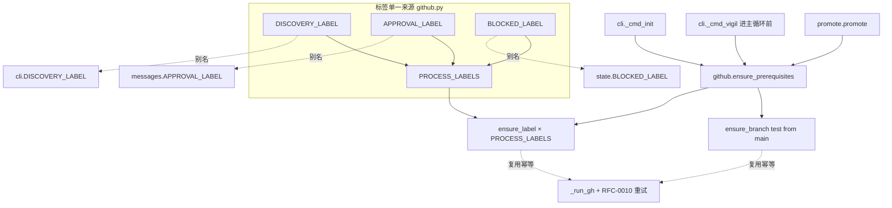
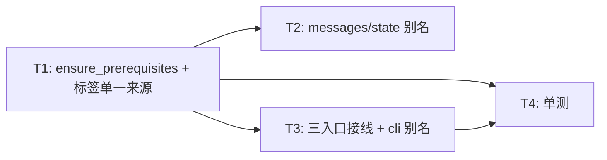

# RFC-0015: 冷启动兜底统一——`ensure_prerequisites` 自举 test 分支与流程标签（三入口幂等）

- **状态**: implemented
- **优先级**: P0
- **标签**: `architecture`, `cli`, `dx`, `reliability`
- **影响模块**: `openagents/github.py`、`openagents/cli.py`、`openagents/promote.py`、`openagents/messages.py`、`openagents/state.py`、`tests/`
- **负责人**: openagents-agent
- **创建日期**: 2026-06-10
- **更新日期**: 2026-06-10

## 摘要

把「流程运行所依赖的结构性 prerequisite（长期 `test` 分支 + 流程标签 `openagents` / `rfc-approved` / `needs-human`）」的兜底，从当前各入口零散且不完整的状态，收敛为 `github.py` 中**单一幂等函数 `ensure_prerequisites()`**，并在 `init` / `promote` / `vigil` 三个入口统一调用。根除两类同源的冷启动失败：(1) 缺 `test` 分支导致 `prepare` 的 `git fetch origin test` 永久报错、60s 重试循环永不恢复；(2) 缺 `needs-human` 标签导致 reviewer 超 K 轮兜底 `add_label` 报 `not found`、整轮守夜被掀翻。

## 动机

守夜实跑中连续撞到两个**同源**的冷启动失败：

1. **缺 `test` 分支** → `prepare` 的 `git fetch origin test` 永久报 `fatal: couldn't find remote ref test`。因是永久错误，RFC-0010 的瞬时错误重试不覆盖它，60s 重试循环**永远恢复不了**。
2. **缺 `needs-human` 标签** → reviewer 超 K 轮后 `Messages._block` 调 `add_label(name="needs-human")`，`gh pr edit --add-label` 报 `'needs-human' not found`，整轮守夜被掀翻。

**统一根因**：流程依赖的结构性 prerequisite 在各入口被**零散、且不完整地**兜底，而最主要的自主入口 `vigil` **什么都不兜底**。现状盘点：

| prerequisite | init | promote | vigil | 现状 |
|---|---|---|---|---|
| `test` 分支 | ✅ `ensure_branch`（cli.py:165） | ✅ `ensure_branch`（promote.py:65） | ❌ 无 | 不跑 init 直接 vigil 即永久失败 |
| `openagents` 标签 | ❌（仅 `_cmd_issue` 路径懒建，cli.py:227） | ❌ | ❌ | 侥幸存在 |
| `rfc-approved` 标签 | ❌ | ❌ | ❌ | **仅侥幸被建过**，下个全新仓库必爆 |
| `needs-human` 标签 | ❌ | ❌ | ❌ | **已实爆** |

且 `add_label`（github.py:359）只 `gh pr edit --add-label`，**不自举标签**，缺标签即 `not found`。

### 影响

- 全新仓库直接跑 `vigil`（不先 `init`）→ 永久死循环。
- 即便跑了 `init`，reviewer 闸打 `rfc-approved` / `needs-human` 时仍可能 `not found`，把「超阈值挂起」与「RFC 通过」这两条关键路径打断。

## 设计

### 概述

核心语义：**缺分支或缺标签就新建，已存在就 no-op（幂等兜底）**。单一兜底来源 + 三入口统一调用，根除零散兜底。

新增 `github.ensure_prerequisites()`：依次

1. `ensure_branch(name="test", from_ref="main")` —— 复用既有幂等函数（github.py:368），不新造容错；
2. 对全部流程标签 `PROCESS_LABELS = (openagents, rfc-approved, needs-human)` 逐个 `ensure_label(name=...)` —— 复用既有幂等函数（github.py:235，吞 "already exists"、不覆盖既有颜色/描述）。

三入口（`_cmd_init`、`promote()`、`_cmd_vigil` 进主循环前）各调用一次。vigil 自举后，全新仓库直接 `vigil` 也能跑通发现段——根除 bug 1 的永久死循环。

整个函数不引入任何新的容错/重试逻辑：幂等性、瞬时错误重试（RFC-0010）、`already exists`/`not found` 归一化全部由被复用的 `ensure_branch`/`ensure_label`/`_run_gh` 既有实现承担。

### 关键设计决策

1. **单一兜底来源 `ensure_prerequisites`（集中声明「流程需要哪些 prerequisite」）**
   - 把分散在 init/promote 的 `ensure_branch` 调用与各处缺失的标签兜底，合并为一个显式声明流程依赖的函数。三入口只调它一行，不各自拼 prerequisite 清单——新增/删除一个流程标签只改一处。

2. **流程标签常量的单一来源落在 `github.py`**
   - 三个标签常量现散在三处：`cli.DISCOVERY_LABEL="openagents"`（cli.py:25）、`messages.APPROVAL_LABEL="rfc-approved"`（messages.py:56）、`state.BLOCKED_LABEL="needs-human"`（state.py:41）。
   - **落点选 `github.py`**：它是依赖图的**叶子模块**（不 import 任何 openagents 内部模块），而 `state` 已 `from openagents.github import PR`、`messages` 已 `from openagents import github`、`cli` 懒 import `github`——三者引用 github 的常量**零循环依赖风险**。`ensure_prerequisites` 与标签同处一文件，引用最直接。
   - 既有公共名（`cli.DISCOVERY_LABEL` / `messages.APPROVAL_LABEL` / `state.BLOCKED_LABEL`）改为从 `github` **re-import 的别名**，所有现有调用点零改动（最小改动面），消除「同一字符串散落三处」的漂移风险。

3. **vigil 自举而非 fail-fast**
   - vigil 在进主循环前调一次 `ensure_prerequisites`，使无人值守的守夜进程自恢复——符合 vigil「无人值守自恢复」定位（RFC-0004）。详见权衡取舍。

4. **`add_label` 保持「不自举任意标签」语义**
   - 不让 `add_label` 隐式 `ensure_label`。缺哪些标签由 `ensure_prerequisites` 在入口处**显式声明**，`add_label` 仍是「给 PR 贴一个已声明的结构化信号」的纯操作。详见权衡取舍。

### 接口契约

新增（`openagents/github.py`）：

```
# 流程标签——单一来源（供 ensure_prerequisites 与各模块 re-import 别名引用）
DISCOVERY_LABEL: str = "openagents"     # issue 发现门控
APPROVAL_LABEL:  str = "rfc-approved"   # RFC 全票 PASS 的批准信号
BLOCKED_LABEL:   str = "needs-human"    # 超 K 轮兜底挂起、待人介入
PROCESS_LABELS: tuple[str, ...] = (DISCOVERY_LABEL, APPROVAL_LABEL, BLOCKED_LABEL)

def ensure_prerequisites() -> None:
    """幂等确保流程结构性 prerequisite 就位：test 分支 + 全部流程标签。
    重复调用对已存在者均 no-op，不报错、不覆盖既有颜色/描述。"""
```

行为契约：
- `ensure_branch(name="test", from_ref="main")` 先行；随后 `for label in PROCESS_LABELS: ensure_label(name=label)`。
- **幂等**：分支/标签已存在 → 各自 no-op（依赖 `ensure_branch` 的 ref 存在检查与 `ensure_label` 吞 `already exists`）。
- **不覆盖**：已存在标签的颜色/描述保持不变（沿用 `ensure_label` 既有语义）。
- **错误透传**：非「已存在」的 gh 错误（鉴权、瞬时穿透重试后仍败）照常抛 `GithubError`。

复用别名（向后兼容，三处既有公共名不变）：
- `cli.DISCOVERY_LABEL` = `github.DISCOVERY_LABEL`
- `messages.APPROVAL_LABEL` = `github.APPROVAL_LABEL`
- `state.BLOCKED_LABEL` = `github.BLOCKED_LABEL`

三入口接线点：
- `cli._cmd_init`：用 `github.ensure_prerequisites()` 取代当前裸 `ensure_branch(name="test", ...)`（cli.py:165）。
- `cli._cmd_vigil`：在 `_vigil_for(...).run(...)` 之前调一次 `github.ensure_prerequisites()`（cli.py:261，进主循环前一次，不进每轮循环）。
- `promote.promote`：用 `github.ensure_prerequisites()` 取代当前裸 `ensure_branch(name=source, ...)`（promote.py:65；`source="test"` / `target="main"` 默认与之等价）。

### 架构图



依赖方向始终从外层模块指向叶子 `github`，无环。

## 权衡取舍

### 考虑过的替代方案

1. **让 `add_label` 先 `ensure_label`**
   - 能防一切 `not found`，但会让 `add_label` 隐式创建**任意**标签——语义变脏（贴标签的操作不该有创建副作用，且会掩盖「贴了一个流程未声明的标签」这类拼写错误）。
   - → **不采**。改由集中式 `ensure_prerequisites` 显式声明「流程需要哪些标签」，`add_label` 保持纯粹。

2. **vigil 改为 fail-fast（检测缺失即退出并提示先跑 init）**
   - 体验差于自举（用户需先手动 `init`），且违背 vigil「无人值守自恢复」定位（RFC-0004）——守夜进程遇到可自愈的结构缺失就退出，与「整夜活着」的设计目标冲突。
   - → **不采**。vigil 进主循环前自举一次。

3. **标签常量落在新建的 `constants.py` 模块**
   - 多一个文件/实体，违背奥卡姆剃刀（CLAUDE.md 理念 1）。`github.py` 作为叶子模块已天然满足「无循环依赖的单一来源」，无需新模块。
   - → **不采**。落在 `github.py`。

4. **标签常量落在 `state.py`**
   - `state` 依赖 `github`，但 `ensure_prerequisites` 在 `github` 内需引用标签——若常量在 `state`，`github` 反向 import `state` 会成环。
   - → **不采**。

### 缺点

- `ensure_prerequisites` 每次入口调用都会发起若干 gh 请求（1 次 ref 查 + 至多 3 次 label 查/建）。但 init/promote 为低频人触发；vigil 仅进主循环前调一次（非每轮），开销可忽略。
- 三个标签的颜色/描述沿用 `ensure_label` 默认（灰底、空描述）。若想要语义化配色需后续单独处理（见未解决的问题）。

## 实现计划

### 子任务分解

> 文件分配互不重叠：T1=`github.py`，T2=`messages.py`+`state.py`，T3=`cli.py`+`promote.py`，T4=`tests/`。

#### 依赖关系图



#### 子任务列表

| ID | 标题 | 依赖 | 涉及文件 | 状态 |
|----|------|------|---------|------|
| T1 | `github.py`：标签常量单一来源 + `PROCESS_LABELS` + `ensure_prerequisites` | - | `openagents/github.py` | implemented |
| T2 | `messages`/`state` 标签常量改为从 `github` re-import 别名 | T1 | `openagents/messages.py`, `openagents/state.py` | implemented |
| T3 | 三入口接线 + `cli.DISCOVERY_LABEL` 改别名 | T1 | `openagents/cli.py`, `openagents/promote.py` | implemented |
| T4 | 单测：`ensure_prerequisites` 幂等 + 三入口各调一次 | T1, T3 | `tests/` | implemented |

> **并行提示**：T2、T3 无相互依赖且文件清单不重叠，可在不同 Agent 会话中并行实现。

#### 子任务定义

**T1: `github.py` 标签单一来源 + `ensure_prerequisites`**
- **范围**: 在 `github.py` 定义 `DISCOVERY_LABEL` / `APPROVAL_LABEL` / `BLOCKED_LABEL` / `PROCESS_LABELS` 常量；新增幂等函数 `ensure_prerequisites()`（`ensure_branch(test←main)` + 逐个 `ensure_label(PROCESS_LABELS)`）。函数体只编排既有幂等函数，不新造容错。注释引用 RFC-0015。
- **涉及文件**: `openagents/github.py`（新增常量 + 新函数）
- **验收标准**: `ensure_prerequisites` 依次调 `ensure_branch` 一次、`ensure_label` 三次（标签集 == `PROCESS_LABELS`）；重复调用对已存在分支/标签 no-op；`ruff check/format` 绿。

**T2: `messages`/`state` 常量改别名**
- **范围**: 把 `messages.APPROVAL_LABEL`、`state.BLOCKED_LABEL` 的字面量定义改为从 `github` re-import（保留同名公共符号，向后兼容），消除字符串重复。注释引用 RFC-0015。
- **涉及文件**: `openagents/messages.py`、`openagents/state.py`
- **验收标准**: `messages.APPROVAL_LABEL is github.APPROVAL_LABEL`、`state.BLOCKED_LABEL is github.BLOCKED_LABEL`；无循环 import（模块可正常导入）；既有引用这两个名的代码零改动；`ruff` 绿。

**T3: 三入口接线 + `cli` 常量别名**
- **范围**: `_cmd_init` 与 `promote()` 把裸 `ensure_branch` 调用替换为 `github.ensure_prerequisites()`；`_cmd_vigil` 在 `run(...)` 前插入一次 `github.ensure_prerequisites()`；`cli.DISCOVERY_LABEL` 改为从 `github` re-import 别名。注释引用 RFC-0015。
- **涉及文件**: `openagents/cli.py`、`openagents/promote.py`
- **验收标准**: 三入口各调用 `ensure_prerequisites` 恰一次（vigil 在进主循环前、非每轮）；`cli.DISCOVERY_LABEL is github.DISCOVERY_LABEL`；promote 默认 `source=test/target=main` 行为与原 `ensure_branch(test←main)` 等价；`ruff` 绿。

**T4: 单测**
- **范围**: 新增 `test_ensure_prerequisites`（monkeypatch `github._run_gh`，断言建 test 分支 + 全部流程标签，再跑一次断言幂等 no-op）；`test_{init,promote,vigil}_bootstraps`（断言三入口各调用一次 `ensure_prerequisites`）。
- **涉及文件**: `tests/`（新增测试文件，不改源文件）
- **验收标准**: 新增测试全绿；全量 `pytest` 通过；`ruff` 绿。

## 测试方案

### 单元测试

- `test_ensure_prerequisites`：monkeypatch `github._run_gh`（或更细地 patch `ensure_branch`/`ensure_label`），断言：
  - 调一次 `ensure_branch(name="test", from_ref="main")`；
  - 对 `PROCESS_LABELS` 中每个标签各调一次 `ensure_label`；
  - 第二次调用对已存在分支/标签均 no-op，不抛错、不覆盖颜色/描述。
- `test_init_bootstraps` / `test_promote_bootstraps` / `test_vigil_bootstraps`：patch `github.ensure_prerequisites`，断言三入口各调用恰一次（vigil 在进主循环前一次）。
- 别名一致性：断言 `cli.DISCOVERY_LABEL is github.DISCOVERY_LABEL`、`messages.APPROVAL_LABEL is github.APPROVAL_LABEL`、`state.BLOCKED_LABEL is github.BLOCKED_LABEL`。

### 集成测试

- 验收标准 1（核心）：全新仓库（无 `test` 分支、无任何流程标签）**不先跑 init**，直接 `vigil --once` 能跑通发现段，不再永久失败。以 fake gh / 录制响应模拟「分支/标签缺失→自举→存在」。
- reviewer 超 K 轮打 `needs-human`、RFC 全票打 `rfc-approved` 均不再 `not found`（标签已被 `ensure_prerequisites` 预建）。

### 手动验证

1. 在一个全新远端仓库（仅有 `main`）直接 `openagents vigil --once --label openagents`，观察日志：先自举 `test` 分支与三标签，再进发现段，无 `couldn't find remote ref test` / `not found`。
2. 重复执行一次 `vigil --once`，确认对已存在的分支/标签 no-op，不报错。
3. `ruff check . && ruff format --check . && pytest`。

## 未解决的问题

> 以下为候选 open question，待与用户确认是否保留为「实现期再定」或现在拍板。

1. 三个流程标签是否需要语义化的颜色/描述（如 `needs-human` 用醒目红）？当前沿用 `ensure_label` 默认灰底空描述即可满足修复目标，配色可作独立小改动。
2. `ensure_prerequisites` 是否需要把 `from_ref`（`main`）参数化？当前三入口语义固定为 `test←main`，硬编码最简；若未来支持非 main 主干再参数化。

## 参考资料

- Issue #37：冷启动兜底不完整：vigil 不自举 test 分支、init/promote 漏建 rfc-approved/needs-human 标签 → 守夜整轮失败
- RFC-0004：openagents vigil 守夜人模式（无人值守自恢复定位）
- RFC-0010：gh 瞬时错误重试 + 守夜循环单轮容错（`_run_gh` 重试不覆盖永久错误）
- RFC-0012：test 分支门控流程（`ensure_branch` / `add_label` / `rfc-approved` / `needs-human` 的引入处）
- 代码：`openagents/github.py`（`ensure_branch`:368、`ensure_label`:235、`add_label`:359）、`openagents/cli.py`（`_cmd_init`:160、`_cmd_vigil`:258）、`openagents/promote.py`（`promote`:40）
