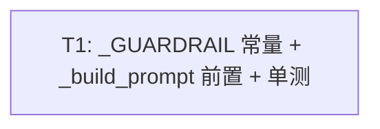

# RFC-0016: 后端 prompt 全局硬约束——禁止 agent 改动 Claude Code 自身配置（`.claude/`）

- **状态**: implemented
- **优先级**: P1
- **标签**: `backend`, `dx`, `protocol`
- **影响模块**: `openagents/backends/claude_code.py`、`tests/test_backend_claude_code.py`
- **负责人**: TBD
- **创建日期**: 2026-06-10
- **更新日期**: 2026-06-10

## 摘要

在 Claude Code 后端拼装 prompt 的唯一入口 `_build_prompt` 中，前置一条**全局硬约束**：禁止改动 Claude Code 自身的任何配置（`.claude/` 下的 skills / hooks / settings / commands 等）。agent 遇到看似需要写 `.claude/` 的任务时，应跳过并说明原因，绝不尝试写入。借此根治无人值守后端循环因触发 Claude Code 权限门（"you haven't granted it yet"）而卡死的问题。

## 动机

issue #35 的 PR #36 因子任务 T6（把 `spec-driven-development` skill 写进 `.claude/skills/`）反复失败：

- `.claude/` 是 Claude Code **自身**的配置树（skills / hooks / settings / commands）。
- 对该目录的写入受 Claude Code 权限门控；无人值守的后端 agent 拿不到交互授权，CLI 返回 "you haven't granted it yet"。
- 结果 implement 步骤卡死，reviewer 持续判 REWORK，整条 issue→PR 自举循环无法收敛。

根因不在某个具体子任务，而在于**后端缺少一条全局边界**告诉 cli-agent「`.claude/` 不可碰」。在无人值守场景下，任何走到写 `.claude/` 的路径都会撞上权限门并阻塞。需要一条对所有原子操作（起草 / 精炼 / implement / iterate）都生效的硬约束，从源头避免 agent 走向该路径。

## 设计

### 概述

OpenAgents 的 Claude Code 后端把任务派发给 `claude -p` 子进程，所有原子操作（起草 / 精炼 / implement / iterate）下发的指令都在 `openagents/backends/claude_code.py` 的 `_build_prompt(*, task, context)` 处汇集成单条 prompt。这是注入全局约束的**唯一收敛点**——在此处前置约束，等价于对所有后端调用一次性生效。

设计要点：

```
所有原子操作（起草/精炼/implement/iterate）
        │  task + context
        ▼
  _build_prompt(task, context)
        │  前置 _GUARDRAIL
        ▼
   "<硬约束>\n\n任务：…\n\n上下文：…"
        │
        ▼
   claude -p <prompt>   ← agent 一进场就读到「不可改 .claude/」
```

- 新增模块级常量 `_GUARDRAIL`：一段中文硬约束文本，明确「禁止修改 Claude Code 自身配置 / 不写入 `.claude/`（skills/hooks/settings/commands 等）」，并指示 agent 遇到此类任务时跳过并说明、绝不尝试写入。
- `_build_prompt` 把 `_GUARDRAIL` **前置**到任务与上下文之前，使约束出现在每条 prompt 的开头。
- 不改 `_build_prompt` 的签名（仍 `(*, task, context) -> str`），不改任何调用方——约束对所有现有调用透明生效。

### 关键设计决策

1. **单一注入点：`_build_prompt`**。所有原子操作的 prompt 都经此汇集，是 RFC-0001 决策 1「业务逻辑下沉、prompt 组装归后端」的天然延伸。在此处注入一次即对全后端生效，无需改动任何调用方，符合奥卡姆剃刀。理由：避免在每个原子操作处重复注入（多处易漏、易不一致）。

2. **约束做成模块级常量 `_GUARDRAIL`，而非内联字符串**。理由：便于单测直接 `import` 并断言其内容、便于后续维护与复用；与本文件既有的 `_PERMISSION_MODE`、`_STREAM_ARGS` 等模块级常量风格一致。

3. **前置（prepend）而非追加（append）**。验收标准要求「prompt **开头**含该约束」。前置让边界在 agent 读到具体任务之前就确立，优先级语义更强；也使单测可用 `startswith` 之类断言定位。

4. **不放开 `.claude/` 写入权限**。这是 issue 的核心取舍：放开权限会给无人值守循环开一个权限缺口（agent 可改动自身运行所依赖的 skills/hooks/settings，风险面大且难回滚）。改用 prompt 约束在「不降低安全边界」的前提下解决卡死问题。

5. **约束为「软引导」性质，依赖 agent 遵从；权限门仍是兜底硬墙**。prompt 约束降低 agent 走向 `.claude/` 的概率；即便 agent 仍尝试，Claude Code 的权限门依旧拦截（只是会卡死）。两者叠加：prompt 负责「不去碰」，权限门负责「碰了也写不进」。本 RFC 只负责前者。

### 接口契约

> 仅描述边界契约（what），不含实现（how）。

**`openagents/backends/claude_code.py`**

- 新增模块级常量 `_GUARDRAIL: str` —— 全局硬约束文本（中文）。语义契约：文本必须明确表达
  - 禁止修改 Claude Code 自身配置；
  - 不得写入 `.claude/`（涵盖 skills / hooks / settings / commands 等）；
  - 遇到看似需要改 `.claude/` 的任务时，跳过并说明原因，绝不尝试写入。
- `_build_prompt(*, task, context) -> str` —— **签名不变**。新契约：返回值以 `_GUARDRAIL` 开头（前置），其后接原有的 `任务：… / 上下文：…` 结构。对所有调用方透明，无需改动 `run` / `_run_claude_streaming` 等。

> 注释挂 `RFC-0001`（该 RFC 本就拥有这段 prompt 组装逻辑），并在新增常量与前置逻辑处补注本 RFC 编号 `RFC-0016` 以便追溯设计来源。

### 架构图

见上文「概述」数据流图。本变更不引入新模块、不改变模块边界，仅在既有单一函数内前置常量。

> **注意**: 本 RFC 不含具体实现代码（不写出 `_GUARDRAIL` 的最终措辞）；约束文本的精确措辞在 Phase 3 实施时定稿，只要满足上文「接口契约」的语义即可。

## 权衡取舍

### 考虑过的替代方案

1. **增补进 RFC-0001 而非新开 RFC**（issue 备注提出的选项）：本变更确实落在 RFC-0001 拥有的 prompt 组装范围内。但 RFC-0001 状态已是 `implemented`，且本约束有独立的动机（无人值守权限门卡死）、独立的验收标准与端到端场景，单列一篇便于评审与追溯。折中：代码注释同时挂 `RFC-0001`（归属）与 `RFC-0016`（本次变更来源）。

2. **放开 `.claude/` 写入权限**（在后端调用里加 `--add-dir` / 调整 `--permission-mode` 放行 `.claude/`）：能让 T6 这类任务跑通，但给无人值守循环开权限缺口，agent 可改动自身运行所依赖的配置，安全面与可回滚性都差。已否决（即 issue 的核心决策）。

3. **在 orchestrator / 各原子操作处分别注入约束**：可行但需在多个调用点重复，易漏、易不一致；违背单一收敛点原则。已否决，改在 `_build_prompt` 一处注入。

4. **用过滤/拦截层在落盘前阻断对 `.claude/` 的写入**（如包一层文件系统钩子）：实现重、与 Claude Code 子进程边界耦合深，且权限门本就是这层兜底，重复造轮子。已否决。

### 缺点

- 约束是「软引导」，最终仍依赖 agent 遵从 prompt；理论上 agent 可能无视约束并撞上权限门（回到卡死）。缓解：约束前置、措辞为硬性禁止；权限门作为兜底硬墙仍在。
- prompt 每次都多出一段固定文本，轻微增加 token 开销（可忽略）。
- 仅覆盖 Claude Code 后端；未来接入 codex/nexau 等后端时，需各自在其 prompt 组装处补等价约束（本 RFC 不涉及，留作后续后端落地时处理）。

## 实现计划

### 子任务分解

> **范围约束**: 子任务数量不得超过 6 个。
> **文件分配约束**: 各子任务的「涉及文件」互不重叠。

本变更为后端 prompt 行为的最小改动，逻辑上不可再拆（常量定义 + 前置 + 对应单测属同一原子单元，遵循 TDD 同进同出）。故仅一个子任务。

#### 依赖关系图



#### 子任务列表

| ID | 标题 | 依赖 | 涉及文件 | 状态 |
|----|------|------|---------|------|
| T1 | `_GUARDRAIL` 常量 + `_build_prompt` 前置约束 + 单测 | - | `openagents/backends/claude_code.py`, `tests/test_backend_claude_code.py` | implemented |

状态: `pending` | `in-progress`（代码修改中） | `implemented`（代码修改完毕） | `blocked`

#### 子任务定义

**T1: `_GUARDRAIL` 常量 + `_build_prompt` 前置约束 + 单测**
- **范围**:
  1. 在 `openagents/backends/claude_code.py` 新增模块级常量 `_GUARDRAIL`（中文硬约束文本，满足「接口契约」语义）；
  2. 修改 `_build_prompt`，把 `_GUARDRAIL` 前置到任务与上下文之前，保持签名 `(*, task, context) -> str` 不变；
  3. 在新增/修改处补 `RFC-0016` 注释（保留既有 `RFC-0001` 归属注释）；
  4. 在 `tests/test_backend_claude_code.py` 新增/更新单测，断言约束生效。
- **涉及文件**: `openagents/backends/claude_code.py`（修改）、`tests/test_backend_claude_code.py`（修改）。
- **验收标准**:
  1. 任一后端调用拼出的 prompt 开头都含「禁止修改 Claude Code 自身配置 / 不写入 `.claude/`」的硬约束（单测断言 `_build_prompt` 输出以约束开头且包含 `.claude/` 关键字）；
  2. `ruff check` 与 `ruff format --check` 全绿；
  3. 新增/更新单测断言 `_build_prompt` 输出包含该约束，全量 `pytest` 通过；
  4. 代码内含 `RFC-0016` 引用注释。

## 测试方案

### 单元测试

在 `tests/test_backend_claude_code.py` 新增/更新（外部子进程仍一律 mock）：

- `test_prompt_starts_with_guardrail`：`_build_prompt(task=..., context=...)` 的返回值以 `_GUARDRAIL` 开头（前置）。
- `test_prompt_contains_claude_config_guardrail`：返回值包含「不写入 `.claude/`」「禁止修改 Claude Code 自身配置」等关键语义片段（断言关键字，如 `.claude/`）。
- `test_guardrail_does_not_drop_task_and_context`：约束前置后，原有的 `task` 与 `context` 仍完整出现在 prompt 中（回归保护——不破坏 RFC-0001 既有契约）。
- 既有用例 `test_invokes_claude_stream_json_in_work_dir`（断言 prompt 含 `task`/`context`）保持通过，证明前置约束不影响下游拼装。

### 集成测试

无需新增集成测试模块——本变更不跨模块、不改变 `run`/`poll`/`solve` 行为路径；既有后端单测即覆盖回归。

### 手动验证（端到端）

1. 在目标仓库构造一个「需写 `.claude/`」类任务（如「把某 skill 写进 `.claude/skills/`」）。
2. 用本后端在无人值守模式下派发该任务。
3. 期望：agent 读到 prompt 开头的约束后，**不再尝试写入 `.claude/`**，转而跳过并在输出中说明原因，**不再触发权限门**（无 "you haven't granted it yet"），implement 步骤不再卡死。

## 未解决的问题

无。

## 参考资料

- [RFC-0001](./0001-mvp-issue-to-pr-loop.md) —— MVP 自举闭环；本 RFC 在其决策 1/2（CLI 下沉、后端 prompt 组装）拥有的 `_build_prompt` 上增补全局约束。
- issue #35 / PR #36 —— 因子任务 T6 写 `.claude/skills/` 触发权限门卡死的实例（本 RFC 的动机来源）。
- [CLAUDE.md](../../CLAUDE.md) —— 设计理念 1（奥卡姆剃刀）、理念 6（单 issue 派发一个 agent，无人值守循环）。
