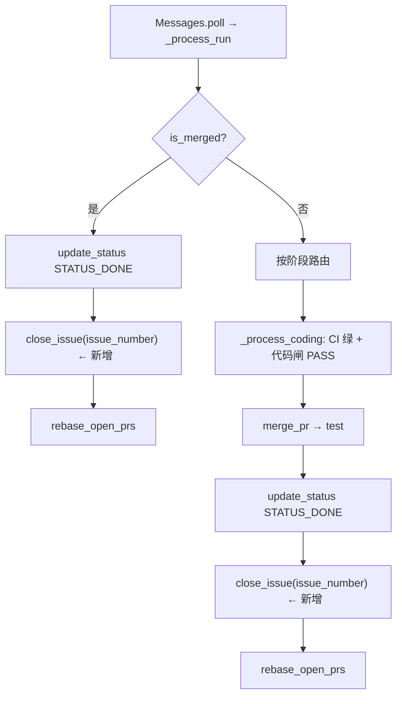
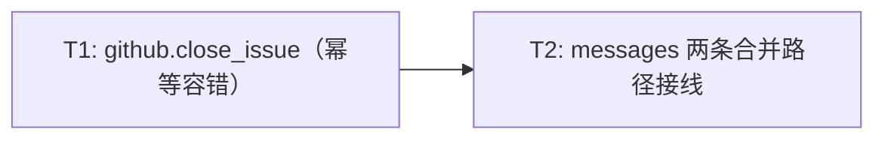

# RFC-0017: PR 合进 test 后框架显式关 issue（`Closes #N` 对非默认分支失效的补偿）

- **状态**: implemented
- **优先级**: P1
- **标签**: `architecture`, `workflow`, `dx`
- **影响模块**: `openagents/github.py`、`openagents/messages.py`、`tests/`
- **负责人**: openagents-agent
- **创建日期**: 2026-06-10
- **更新日期**: 2026-06-10

## 摘要

RFC-0012 把 issue→PR 流程改为「PR 合入长期 `test` 分支（非默认分支）」。但 GitHub 的
`Closes #N` 关键字**只在 PR 合入默认分支（本仓库为 `main`）时**才会自动关闭关联 issue，
因此合进 `test` 的 PR 永不触发自动关闭，框架自身在 `STATUS_DONE` 时也从不主动关 issue——
导致 issue **永远停留在 OPEN**。本 RFC 给 `github` 层补一个幂等的 `close_issue`，并在
`messages` 层「PR 合并 → `STATUS_DONE`」的两条路径上显式调用它，使「工作落进 test」与
「issue 关闭」恢复一致。

## 动机

### 现象

PR 合进 `test` 分支后，关联 issue 仍处于 OPEN，不自动关闭。

### 根因

1. **`Closes #N` 仅对默认分支生效**：PR 正文里的 `Closes #N`（`orchestrator.py:292`，
   `_pr_body`）依赖 GitHub 的自动关闭语义，而该语义**只在 PR 合入默认分支时触发**。
   RFC-0012 起 PR 以 `test` 为 base、合回 `test`（非默认分支），关键字永不触发。
2. **框架从不主动关 issue**：`github.py` 现有 issue 能力只有 `get_issue` / `list_issues` /
   `create_issue`，**没有任何关闭 issue 的函数**；`messages.py` 两条把 run 置 `STATUS_DONE`
   的路径也只更新本地 State，从不回写 GitHub 关 issue。
3. **`promote` 救不了**：`promote` 是 `git push origin test:main` 的快进，带过去的 commit
   message（如 `feat: implement issue #N per RFC`）**不含** `Closes/Fixes/Resolves` 关键字，
   推到 `main` 同样不会自动关。

**结论**：当前流程下，关联 issue **永远不会**自动关闭。

### 为什么「合进 test 即关」是正确时机

RFC-0012 已确立 `test` 是体验服、`STATUS_DONE` 的语义是「工作已落进体验分支即视为完成」。
issue 的生命周期应与这一既有语义对齐：**工作落进 `test` 即关 issue**。`promote`（push
`test:main`）是「人决定上线」的动作，不是单个 issue 是否完成的关口，故**不**作为 issue
生命周期的关闭时机——否则会把「issue 完成」与「整个体验服上线」错误耦合。

## 设计

### 概述

最小补偿：合并目标既然是非默认分支、GitHub 不会替我们关 issue，那就由框架**显式关**。

1. 在 `github` 层（依赖图叶子、对 `gh` CLI 的薄封装）新增一个幂等的
   `close_issue(*, number)`，底层走 `gh issue close <n>`。
2. 在 `messages` 层把 run 推进到 `STATUS_DONE` 的**两条**路径上，紧接 `update_status`
   之后调用 `close_issue(number=record.issue_number)`。

不触碰 `orchestrator.py` 的 `Closes #N`：保留它在「未来某天 PR 直接合 `main`」或人手动
操作时的兜底价值，框架侧的显式关闭与之并不冲突（关一个已关的 issue 是幂等 no-op）。

### 关键设计决策

1. **决策 1 —— 关闭能力落在 `github.py`，走 `gh issue close`**：与既有所有 GitHub 操作
   一致「一律走 `gh` CLI 子进程」（RFC-0001 决策 3），复用唯一收口点 `_run_gh`（自带
   RFC-0010 的瞬时错误重试），零额外依赖、零新数据类型（CLAUDE.md 理念 1）。

2. **决策 2 —— 幂等容错，吞「已关闭 / 不存在」**：`close_issue` 对「issue 已关闭」与
   「issue 不存在」必须容错为成功 no-op，与既有 `ensure_label` 吞 `already exists`、
   `check_status` 吞 `no checks reported`、`update_branch` 吞 `already up to date` 完全同一
   风格。理由：两条合并路径都可能对同一 issue 重复触发（已合并检测会在多轮 poll 命中），
   重复 `close_issue` 不能抛错把守夜循环打断。**只吞这两类业务性结果，其它 gh 错误
   （鉴权、瞬时穿透重试后仍败）照常抛 `GithubError`**——容错判定要「窄」。

3. **决策 3 —— 在两条 `STATUS_DONE` 路径上各调一次，而非抽公共出口**：
   `messages.py` 有两处把 run 置 `STATUS_DONE`——`_process_run` 的「检测到已合并」分支
   （line 121–126）与 `_process_coding` 的「代码闸 PASS 后 `merge_pr`」分支（line 173–176）。
   二者已各自重复 `update_status + rebase_open_prs` 一段逻辑；本 RFC 只在每处紧随
   `update_status` 之后插入一行 `close_issue`，**不顺手重构合并出口**——保持改动面最小、
   可被两条独立单测分别钉死（验收标准 3）。是否抽公共出口留作未来独立清理，不在本 RFC 范围。

4. **决策 4 —— 关闭时机即合进 `test`，不挂到 `promote`**：见「动机 / 为什么」。`promote`
   路径不新增任何 issue 操作。

### 接口契约

```
github.close_issue(*, number: int) -> None
```

- **行为**：底层执行 `gh issue close <number>`，把指定 issue 置为 CLOSED。
- **幂等容错**：issue 已是 CLOSED，或 issue 不存在 → 视为成功，静默返回（no-op）。
- **错误**：其它 `gh` 失败（鉴权失败、瞬时故障重试后仍败等）抛 `GithubError`。
- **无返回值**：与同层的 `post_comment` / `merge_pr` / `add_label` 等「命令式」封装对称。

调用契约（`messages.py`）：在每条把 `record` 置 `STATUS_DONE` 的路径上，于
`self._state.update_status(... status=STATUS_DONE)` 之后调用
`github.close_issue(number=record.issue_number)`。`RunRecord.issue_number` 为已有字段。

### 架构图



## 权衡取舍

### 考虑过的替代方案

1. **把 PR 的 base 改回默认分支 `main`，让 `Closes #N` 自动生效** —— 否决。直接推翻
   RFC-0012 确立的「`test` 为体验服、`main` 仅由 `promote` 快进」的核心架构，代价远超
   「自动关 issue」这一诉求；本 RFC 的目标是在既有架构下补齐缺口，而非改架构。

2. **在 `promote`（push `test:main`）时再关 issue** —— 否决。会把「单个 issue 完成」错误
   耦合到「整个体验服上线」；且 `promote` 带过去的 commit message 不含关闭关键字，仍需
   显式关——时机更晚、语义更差，没有任何收益。

3. **在 `promote` 的 commit message 里补 `Closes #N`** —— 否决。`promote` 是对一批已合并
   commit 的快进，无法、也不应在事后改写历史去拼关闭关键字；且只解决 `promote` 那一刻，
   合进 `test` 到 `promote` 之间 issue 仍长期 OPEN。

4. **在 `orchestrator` 写完 PR 正文后用 GitHub「自动关闭」之外的其它原生机制** —— 无此
   机制：GitHub 对非默认分支的合并不提供任何 issue 自动关闭钩子，显式调用 API 是唯一路径。

### 缺点

- `close_issue` 失败（非「已关闭/不存在」类的真错误）会抛 `GithubError`，落在 `poll` 单轮
  内——与既有 `merge_pr` / `add_label` 抛错行为一致，由守夜循环的单轮容错（RFC-0010）兜底，
  不会丢失：下一轮 poll 仍会命中「已合并」分支重试 `close_issue`（幂等，安全）。
- issue 与 PR 的关闭不是事务性的：合并成功但 `close_issue` 真失败时，会出现「PR 已合、
  issue 仍 OPEN」的短暂不一致窗口，靠下一轮 poll 自愈。可接受。

## 实现计划

### 子任务分解

> 仅 2 个子任务，文件清单互不重叠：`github.py` 侧能力（含其单测）与 `messages.py` 侧接线
> （含其单测）各自独立实现、独立验证。T2 依赖 T1 提供的 `close_issue` 符号。

#### 依赖关系图



#### 子任务列表

| ID | 标题 | 依赖 | 涉及文件 | 状态 |
|----|------|------|---------|------|
| T1 | `github.close_issue` —— `gh issue close` + 幂等容错 | - | `openagents/github.py`, `tests/test_github.py` | implemented |
| T2 | `messages` 两条 `STATUS_DONE` 路径显式调 `close_issue` | T1 | `openagents/messages.py`, `tests/test_messages.py` | implemented |

状态: `pending` | `in-progress`（代码修改中） | `implemented`（代码修改完毕） | `blocked`

#### 子任务定义

**T1: `github.close_issue` —— `gh issue close` + 幂等容错**
- **范围**: 在 `github.py` 新增 `close_issue(*, number: int) -> None`：经唯一收口点
  `_run_gh` 执行 `gh issue close <number>`；捕获 `GithubError`，命中「已关闭」/「不存在」
  类标记则吞为成功 no-op，其它错误照常上抛。注释引用 `RFC-0017`，并说明容错与既有
  `ensure_label`（吞 `already exists`）同风格、容错判定要「窄」。
- **涉及文件**:
  - `openagents/github.py`（修改：新增 `close_issue`；如需，新增一个窄的「已关闭/不存在」
    识别辅助判定，紧邻既有 `_is_not_found` / `_is_already_up_to_date`）。
  - `tests/test_github.py`（修改：新增针对 `close_issue` 的单测——正常关闭、已关闭吞错、
    不存在吞错、其它 gh 错误照常抛）。
- **验收标准**:
  - `close_issue(number=N)` 正常时调用 `gh issue close N` 且不抛。
  - 对「已关闭」「不存在」的返回幂等吞错、不抛（验收标准 2）。
  - 非该两类的 gh 失败仍抛 `GithubError`。
  - `ruff check/format` 全绿；新增单测通过。

**T2: `messages` 两条 `STATUS_DONE` 路径显式调 `close_issue`**
- **范围**: 在 `messages.py` 把 run 置 `STATUS_DONE` 的**两处**——`_process_run` 的
  「已合并」分支与 `_process_coding` 的「代码闸 PASS → `merge_pr`」分支——于
  `update_status(... STATUS_DONE)` 之后各插入一行
  `github.close_issue(number=record.issue_number)`（在 `rebase_open_prs` 扇出之前或之后均可，
  二者无依赖）。注释引用 `RFC-0017`，说明「合进 test 即关」与 `STATUS_DONE` 语义一致。
- **涉及文件**:
  - `openagents/messages.py`（修改：两条路径各加一行 `close_issue` 调用）。
  - `tests/test_messages.py`（修改：两条合并路径的单测各断言 `github.close_issue` 被以
    正确 `issue_number` 调用一次；monkeypatch `github.close_issue`）。
- **验收标准**:
  - PR 合进 `test`（两条路径：检测到已合并 / 代码闸 PASS 后 `merge_pr`）后，单测均断言
    `close_issue(number=record.issue_number)` 被调用（验收标准 1、3）。
  - `ruff check/format` 全绿；全量 `pytest` 通过。

## 测试方案

### 单元测试

- **`tests/test_github.py`（T1）**：monkeypatch `_run_gh` / `subprocess`，覆盖
  `close_issue` 的四类分支——正常关闭、`gh` 报「已关闭」吞错、报「不存在」吞错、其它
  错误照常抛 `GithubError`。
- **`tests/test_messages.py`（T2）**：两条合并路径各一个用例，monkeypatch
  `github.is_merged` / `github.merge_pr` / `github.check_status` / `github.close_issue` /
  `rebase.rebase_open_prs`，断言 `close_issue` 以 `record.issue_number` 被调用恰一次，
  且 run 状态置为 `STATUS_DONE`。

### 集成测试

不新增重型集成测试（与同类小改保持一致）；端到端正确性由守夜循环既有路径 + 上述单测
覆盖。手动验证见下。

### 手动验证

1. 触发一条 issue→PR→合进 `test` 的完整流转（或对一个已合进 `test` 的 PR 跑一轮 `poll`）。
2. 确认对应 issue 在 GitHub 上转为 CLOSED。
3. 对同一已关闭 issue 再跑一轮 `poll`（或直接重复调 `close_issue`），确认不报错（幂等）。
4. `ruff check . && ruff format --check . && pytest` 全绿。

## 未解决的问题

（暂无；待用户评审时确认是否保留 open question。）

## 参考资料

- GitHub Docs —— *Linking a pull request to an issue using a keyword*：关闭关键字仅在 PR
  **合入仓库默认分支**时自动关闭关联 issue。
  <https://docs.github.com/en/issues/tracking-your-work-with-issues/using-issues/linking-a-pull-request-to-an-issue>
- `gh issue close` CLI 手册：<https://cli.github.com/manual/gh_issue_close>
- RFC-0012：test 分支门控流程（确立 PR 合入非默认分支 `test` 的架构前提）。
- 代码定位：`openagents/orchestrator.py:292`（`_pr_body` 的 `Closes #N`）、
  `openagents/messages.py:121-126`（已合并 → `STATUS_DONE`）、
  `openagents/messages.py:173-176`（代码闸 PASS → `merge_pr` → `STATUS_DONE`）。
