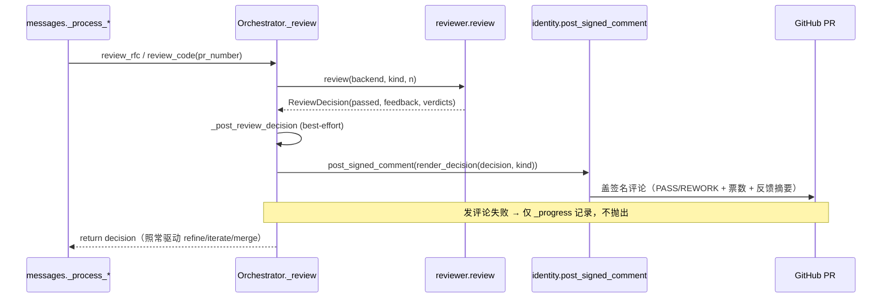
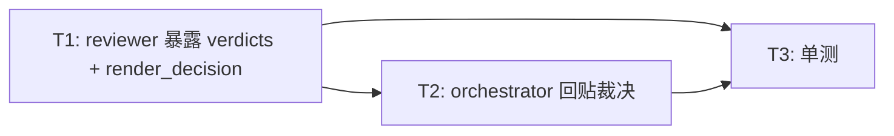

# RFC-0018: reviewer 闸裁决回贴 PR——把每轮 PASS/REWORK + 反馈作为签名评论（人的可观测性）

- **状态**: draft
- **优先级**: P1
- **标签**: `observability`, `architecture`
- **影响模块**: `openagents/orchestrator.py`、`openagents/reviewer.py`、`tests/`
- **负责人**: openagents-agent
- **创建日期**: 2026-06-10
- **更新日期**: 2026-06-10

## 摘要

让 RFC-0012 的 reviewer 评审闸在每轮裁决后，把结果（kind、PASS/REWORK、票数、聚合反馈摘要）
作为**签名评论**回贴到对应 PR，使人盯着 GitHub 就能看见自动评审闸的每一步判定与依据，
恢复 CLAUDE.md 理念 8（以成果为中心、人要可观测）。

## 动机

当前 reviewer 闸（RFC-0012）的裁决只活在进程内：`reviewer.review` 返回
`ReviewDecision(passed, feedback)`，`feedback` 仅被 `messages._process_rfc_review` /
`_process_coding` 喂给 `refine_rfc` / `iterate` 的 backend 任务（`messages.py:155/181`），
**从不回贴 GitHub**。

后果：人盯着 PR 只能看到标签（rfc-approved / needs-human）、commit、e2e/refine 评论，
**看不到 reviewer 每轮判了 PASS 还是 REWORK、依据是什么**。这与理念 8 直接冲突——
人失去了对自动评审闸这个关键决策点的可观测性，BLOCKED（超 K 轮挂起）时也无从复盘
究竟卡在哪条验证标准上。

本 RFC 把 reviewer 裁决变成一条**可观测产出**回贴 PR：复用 RFC-0013 `_post_e2e_result`
已验证的「尽力而为、失败仅记进度不阻断闸」旁路模式，并复用 RFC-0011 的签名机制——
这也让 RFC-0011 的签名首次获得「评论驱动」之外的真实消费者。

### 与 #42 的关系

#42 在纠结「接回评论驱动 poll vs 废弃 RFC-0011」。本 RFC 是**第三条路**：评论作为
**可观测产出**而非触发器——`poll` 仍不读评论（无自循环风险），但人能看见 reviewer 的
每一步。若将来重新接回评论驱动 poll，这些评论会被 RFC-0011 的签名过滤剔除、不致自循环。
两者关联，但本方案可独立先落地以恢复可观测性。

## 设计

### 概述

裁决回贴发生在编排层 `Orchestrator._review`（`review_rfc` / `review_code` 的共用骨架）
内、`reviewer.review` 返回 `ReviewDecision` 之后、`return decision` 之前。整段为旁路
（best-effort）：渲染 + 发评论一步若因 gh 故障抛错，只记进度并吞掉，绝不阻断评审闸
本身与下游 refine/iterate/merge——与 `_post_e2e_result` 完全同款（RFC-0013 决策 6）。

`messages` 路由层保持不变：它仍只拿 `ReviewDecision.passed` / `.feedback` 做推进决策，
不感知回贴这件事（保持 messages 薄路由层）。回贴是编排层在「拿到裁决」这一时机的
副作用，天然落在 `_review` 内（messages 已通过 `review_rfc/review_code` 委托给它）。

为了让评论体含「reviewer 票数（N）」这类结构化信息，`ReviewDecision` 需暴露每个
reviewer 的裁决 token（当前聚合后即丢弃）。因此 `reviewer` 模块承担两件新增职责：
1. `ReviewDecision` 携带 `verdicts`（各 reviewer 解析出的裁决 token 序列）；
2. 提供一个纯函数 `render_decision`，把 `ReviewDecision` + `kind` 渲染成评论 Markdown
   正文（不含签名——签名由 `identity.post_signed_comment` 统一盖）。

`render_decision` 是纯字符串函数、不依赖 github/identity，故放在 `reviewer` 模块内
不破坏其「只依赖 `AgentBackend` 协议、不碰 git/state/github」的解耦定位（理念 10）——
与 RFC-0013 把 `render_result` 放在 `e2e` 模块同构。

### 关键设计决策

1. **回贴落在 `Orchestrator._review`、复用 `_post_e2e_result` 旁路模式**：
   `_review` 是 `review_rfc`/`review_code` 唯一共用骨架，且持有 `kind`、`pr_number`、
   `_agent_id`——回贴所需上下文齐备。新增私有方法 `_post_review_decision`（结构与
   `_post_e2e_result` 镜像：`try: identity.post_signed_comment(...) except: self._progress(...)`）。
   理由：单点收口、与既有旁路一致、不污染 messages 路由层。

2. **回贴尽力而为、绝不阻断闸**：发评论失败（gh 故障）只 `_progress` 记一行警告并吞掉，
   `_review` 照常 `return decision`，messages 照常据 `passed` 推进 refine/iterate/merge。
   理由：可观测性是增益而非闸的前置条件，不能因 GitHub 抖动卡死自动流转（验收标准 2）。

3. **`ReviewDecision` 新增 `verdicts` 字段（带默认 `()`）以暴露结构化票数**：
   `reviewer.review` 在聚合时把已解析的各 reviewer 裁决 token（`None` 归一化为
   `"UNPARSED"`）填入 `verdicts`。默认空元组保证既有构造点（如 `tests/test_messages.py`
   的 `ReviewDecision(passed=..., feedback=...)`）无需改动即向后兼容。
   理由：「reviewer 票数（N）/ N 中几票 PASS」需要逐 reviewer 粒度，而当前聚合后即丢弃；
   带默认值的新字段是最小侵入的扩展（奥卡姆剃刀）。

4. **渲染逻辑放在 `reviewer.render_decision`（纯函数）**：评论体由 reviewer 模块负责，
   因为票数语义（PASS/REWORK/RETHINK/UNPARSED 的计数与展示）属于 reviewer 的领域知识；
   纯字符串函数不引入 github 依赖，保持模块解耦。
   理由：与 RFC-0013 `e2e.render_result` 同构；orchestrator 只做「渲染→盖章→发」编排。

5. **签名复用 RFC-0011 `post_signed_comment`**：评论经 `<!-- openagents:agent=<id> -->`
   盖章，让 RFC-0011 的签名机制获得真实消费者；若将来接回评论驱动 poll，这些评论会被
   签名过滤、不致自循环。理由：复用既有唯一出口，不新增评论发送路径（理念 1/10）。

### 接口契约

**`openagents/reviewer.py`**

```
@dataclass(frozen=True)
class ReviewDecision:
    passed: bool
    feedback: str
    verdicts: tuple[str, ...] = ()   # 新增：各 reviewer 解析出的裁决 token，
                                     # None 归一化为 "UNPARSED"；默认 () 向后兼容

def render_decision(*, decision: ReviewDecision, kind: str) -> str:
    """把裁决渲染成 PR 评论 Markdown 正文（不含签名）。
    含：kind（rfc/code）、整体 PASS/REWORK、票数（N 中几票 PASS）、
    passed=False 时附聚合 feedback 摘要。纯函数，无副作用、不依赖 github。"""
```

`review(...)` 行为不变（签名、聚合规则、`passed`/`feedback` 语义保持），仅在返回的
`ReviewDecision` 上额外填充 `verdicts`。

**`openagents/orchestrator.py`**

```
def _review(self, *, pr_number: int, kind: str) -> ReviewDecision:
    # ... ensure worktree → decision = reviewer.review(...)
    self._post_review_decision(pr_number=pr_number, kind=kind, decision=decision)  # 旁路
    return decision

def _post_review_decision(self, *, pr_number: int, kind: str, decision: ReviewDecision) -> None:
    """渲染裁决 → 盖章发评论（尽力而为）。失败仅 _progress 记录、绝不抛出。"""
```

`review_rfc` / `review_code` 的对外签名与返回值不变；`messages` 调用方无感知。

### 架构图



## 权衡取舍

### 考虑过的替代方案

1. **在 `reviewer.review` 内直接发评论**：被否。`reviewer` 模块刻意解耦——只依赖
   `AgentBackend`，不碰 github/identity（RFC-0012 理念 10）。在其中发评论会引入 github
   依赖、破坏 hermetic 单测，且 reviewer 不持有 `agent_id`。

2. **在 `messages._process_rfc_review/_process_coding` 内发评论**：被否。messages 是薄
   路由层，且不持有 worktree/agent_id 上下文之外只拿 `ReviewDecision`；让它发评论会把
   「副作用」散落到路由层，违背「拿到裁决即回贴」的单点收口。编排层 `_review` 才是
   裁决产生地，回贴落在此处最内聚。

3. **不扩展 `ReviewDecision`，仅用 `passed` + `configured_reviewers()` 渲染**：被否。
   聚合是全有全无（`passed=True` 即 N 票全 PASS），但 `passed=False` 时无法得知 N 票里
   几票 PASS、各是 REWORK 还是 RETHINK——票数展示会失真。暴露 `verdicts` 才能给出真实
   票型，代价仅是一个带默认值的新字段。

4. **新建独立的「评论渲染」模块**：被否。违反奥卡姆剃刀；渲染是 reviewer 的领域知识，
   与 RFC-0013 把 `render_result` 放进 `e2e` 模块同构，无需新实体。

### 缺点

- 每轮评审多一次 `gh` 调用（发评论），增加少量墙钟与 API 配额消耗；旁路设计保证其
  失败不影响主流程。
- 多轮 REWORK 会在 PR 上累积多条裁决评论；这是可观测性/审计轨迹的预期产物（每轮一条），
  不做去重或折叠（保持最简，后续如需折叠另起 RFC）。

## 实现计划

### 子任务分解

> 文件分配互不重叠：T1 改 `reviewer.py`，T2 改 `orchestrator.py`，T3 改 `tests/` 下两个
> 测试文件。三者文件清单互不重叠（messages.py 不在范围内——路由层无感知）。

#### 依赖关系图



#### 子任务列表

| ID | 标题 | 依赖 | 涉及文件 | 状态 |
|----|------|------|---------|------|
| T1 | reviewer 暴露 `verdicts` + `render_decision` | - | `openagents/reviewer.py` | pending |
| T2 | orchestrator `_review` 回贴签名裁决评论（旁路） | T1 | `openagents/orchestrator.py` | pending |
| T3 | 单测：渲染/票数 + 回贴调用 + 失败不阻断 | T1, T2 | `tests/test_reviewer.py`、`tests/test_orchestrator.py` | blocked |

状态: `pending` | `in-progress`（代码修改中） | `implemented`（代码修改完毕） | `blocked`

#### 子任务定义

**T1: reviewer 暴露 `verdicts` + `render_decision`**
- **范围**: 给 `ReviewDecision` 增加 `verdicts: tuple[str, ...] = ()` 字段；在 `review`
  聚合处把各 reviewer 解析出的裁决 token（`None` 归一化为 `"UNPARSED"`）填入；新增纯函数
  `render_decision(*, decision, kind)` 渲染评论正文（kind 中文化、整体 PASS/REWORK、
  N 中几票 PASS、非 PASS 时附 feedback 摘要）。`review` 的对外行为/签名不变。
- **涉及文件**: `openagents/reviewer.py`（修改）
- **验收标准**: `review` 返回的 `ReviewDecision.verdicts` 与传入 N 等长且元素为合法 token；
  `render_decision` 对 PASS / REWORK / 含 UNPARSED 三种输入产出含 kind、总裁决、票数、
  （非 PASS 时）反馈摘要的非空字符串；代码注释引用 `RFC-0018`。

**T2: orchestrator `_review` 回贴签名裁决评论（旁路）**
- **范围**: 在 `_review` 中 `reviewer.review` 返回后、`return decision` 前调用新增私有
  方法 `_post_review_decision`；该方法镜像 `_post_e2e_result`：`reviewer.render_decision`
  渲染 → `identity.post_signed_comment(pr_number, body, agent_id)` 发出，整体 try/except
  尽力而为，失败仅 `_progress` 记一行、不抛出。`review_rfc`/`review_code` 对外不变。
- **涉及文件**: `openagents/orchestrator.py`（修改）
- **验收标准**: `review_rfc`/`review_code` 在返回裁决前调用了 `post_signed_comment`，
  正文由 `render_decision` 生成且经签名；`post_signed_comment` 抛错时 `_review` 仍正常
  返回原 `ReviewDecision`；代码注释引用 `RFC-0018`（并标注复用 RFC-0011/0013）。

**T3: 单测：渲染/票数 + 回贴调用 + 失败不阻断**
- **范围**: `test_reviewer.py` 增 `render_decision` 与 `verdicts` 填充的断言（PASS/REWORK/
  UNPARSED 票型）；`test_orchestrator.py` 增「`review_rfc`/`review_code` 裁决后调用
  `post_signed_comment`（断言 body 含 PASS/REWORK 与票数、含签名）」及「`post_signed_comment`
  抛错时 `_review` 仍返回原裁决、不阻断」两类用例（monkeypatch `identity.post_signed_comment`）。
- **涉及文件**: `tests/test_reviewer.py`（修改）、`tests/test_orchestrator.py`（修改）
- **验收标准**: 新增用例通过；`ruff check`/`ruff format --check` 全绿；全量 `pytest` 通过。

## 测试方案

### 单元测试

- `test_reviewer.py`：
  - `review` 返回的 `verdicts` 与 reviewer 数等长，PASS/REWORK/RETHINK/无法解析分别映射
    到对应 token（`None`→`"UNPARSED"`）。
  - `render_decision`：PASS 输入产出含「rfc/code + PASS + N/N」的正文；REWORK 输入额外
    含 feedback 摘要；含 UNPARSED 的混合票型票数渲染正确。
- `test_orchestrator.py`：
  - `review_rfc` / `review_code` 在返回前调用 `post_signed_comment`，body 含整体裁决与
    票数（验收标准 1）。
  - monkeypatch `identity.post_signed_comment` 抛异常 → `_review` 仍返回原 `ReviewDecision`、
    不抛出（验收标准 2，对齐 `_post_e2e_result` 既有的失败吞没用例）。

### 集成测试

无需新增端到端脚本：本变更是评审闸的旁路增强，既有 `test_messages.py` 的闸路由用例
（PASS→implement/merge、REWORK→refine/iterate、超 K→blocked）应保持全绿，证明回贴不
改变路由行为。

### 手动验证

1. 在一个真实仓库跑一轮 RFC 评审（`OPENAGENTS_REVIEWERS>=1`），确认对应 PR 出现一条带
   `<!-- openagents:agent=... -->` 签名、含 PASS/REWORK + 票数 + 反馈摘要的 reviewer 裁决评论。
2. 制造 `gh` 故障（如临时改 PATH 让 `gh` 不可用）确认评审闸与后续 refine/iterate/merge
   不被阻断，仅 stderr 出现一行「裁决评论发送失败（已忽略）」。

## 未解决的问题

（待与用户确认是否保留为 open question。）

## 参考资料

- RFC-0011: 本地 Agent 身份 + 评论签名（`docs/rfcs/0011-agent-identity-comment-signature.md`）
- RFC-0012: test 分支门控流程 / reviewer 评审闸（`docs/rfcs/0012-test-branch-gated-flow.md`）
- RFC-0013: 实跑 e2e 并把结果作为 PR 评论——`_post_e2e_result` 旁路模式来源
  （`docs/rfcs/0013-implement-e2e-run-result-comment.md`）
- Issue #44、关联 issue #42
- CLAUDE.md 理念 8（以成果为中心、人要可观测）、理念 10（模块解耦）
