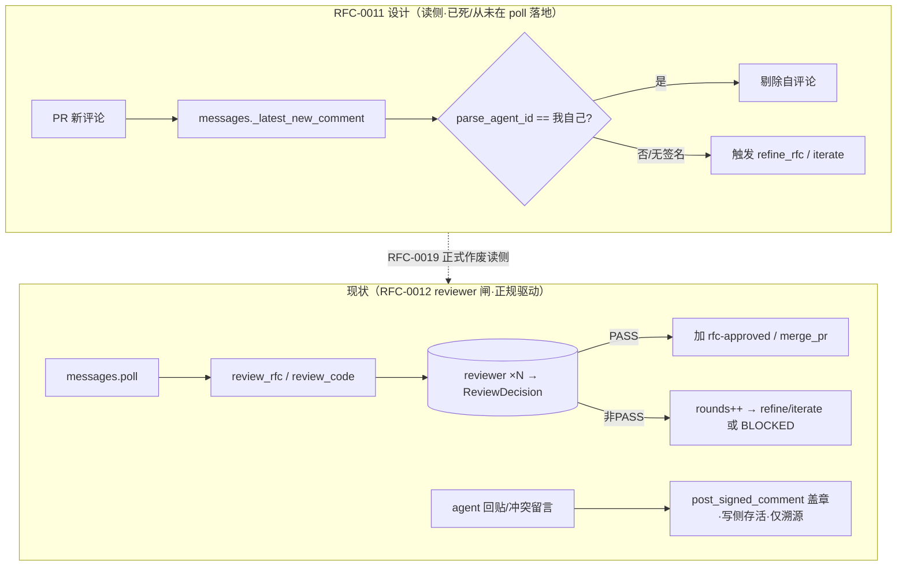
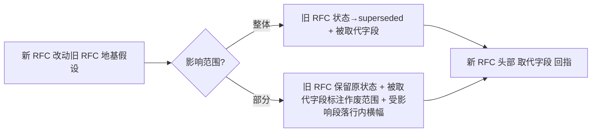
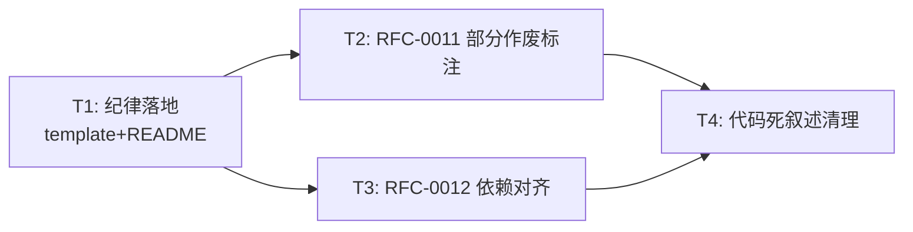

# RFC-0019: 评论驱动触发模型正式作废 + 补全 RFC supersession 纪律（对齐 RFC-0011 与 RFC-0012）

- **状态**: implemented
- **优先级**: P1
- **标签**: `architecture`, `process`, `dx`
- **影响模块**: `docs/rfcs/0011-agent-identity-comment-signature.md`、`docs/rfcs/0012-test-branch-gated-flow.md`、`docs/rfcs/README.md`、`openagents/identity.py`、`openagents/cli.py`（`rfc-template.md` 样例字段裁定为非阻塞 follow-up，见 T1 收口裁定，不在本 RFC 交付范围）
- **取代 (Supersedes)**: RFC-0011 —— 仅其「评论驱动触发模型 + poll 读签名过滤」一端（读侧）；RFC-0011 的身份解析与评论盖章（写侧）继续生效
- **被取代 (Superseded-By)**: —
- **负责人**: openagents（issue #42）
- **创建日期**: 2026-06-10
- **更新日期**: 2026-06-10

## 摘要

RFC-0011（本地 Agent 身份 + 评论签名）与 RFC-0012（test 分支门控流程）在「评论是否驱动自动流转」上**立场相反**，且实现已完全倒向 RFC-0012：`messages.poll` 不再读取任何 PR 评论，改由 reviewer 闸（`ReviewDecision`）+ 标签 + CI 推进。结果是 RFC-0011 假设的「读 PR 评论 → 剔除自签名 → 触发 `refine_rfc`/`iterate`」这条**读侧**链路成为死代码：`parse_agent_id` 全仓库零生产调用、`_latest_new_comment` 从未落地，而 RFC-0012 第 289 行仍把 RFC-0011 整体列为「生效依赖」，既无 `Supersedes` 标记、也未声明自己已掏空 RFC-0011 的读签名理由。

本 RFC **不改任何运行时行为**，只做三件事并补一条流程纪律：① 正式确认 reviewer 闸取代评论驱动（采纳 issue 选项 B），把 RFC-0011 的**评论驱动触发模型**显式标记为被本 RFC 取代（partial supersession），同时**保留**其身份/盖章写侧；② 对齐 RFC-0011、RFC-0012 两份文档的状态与依赖叙述，并清理 `identity.py`/`cli.py` 里声称「poll 读签名过滤」的误导性注释（保留 `sign`/`parse_agent_id`/`post_signed_comment` API 不删）；③ 在 RFC 模板与 README 中引入最小可用的 **supersession 纪律**（`取代`/`被取代` 字段 + 部分作废规则），使「新 RFC 动了旧 RFC 的地基假设时必须向前追溯并显式标注作废范围」成为制度。深层的「Spec 活快照取代 RFC」结构性改造与本 RFC 同源，留给 issue #35。

## 动机

### 矛盾的根因（RFC 流程缺陷，非代码 bug）

- **RFC-0011 假设「评论驱动」**：poll 读 PR 评论 → 剔除自己签名的 → 剩下的触发 `refine_rfc`/`iterate`；`_latest_new_comment` / 游标 / `parse_agent_id` 皆为此服务（RFC-0011 第 36/100/101 行）。
- **RFC-0012 改为「reviewer 闸驱动」**：第 142 行明确「去掉『等人评论 refine』为主路径，改为 `review_rfc` 驱动」；poll 改按 `ReviewDecision` + 标签 + CI 推进。
- **RFC-0012 第 289 行仍把 RFC-0011 列为生效依赖**（「自评论的签名过滤前提」），却未声明自己已掏空 RFC-0011 读签名那一端的存在理由，也没有任何 `Supersedes RFC-0011` 标记。

### 实现现状（证据，2026-06-10 复核）

| 断言 | 验证方式 | 结果 |
|------|---------|------|
| `messages.poll` 不读 PR 评论 | `grep -n "cursor\|list_comments\|comment" openagents/messages.py` | 零命中；`_process_rfc_review`/`_process_coding` 仅调 `orchestrator.review_rfc`/`review_code` |
| `_latest_new_comment` 从未落地 | 全仓库 grep | 仅存在于 RFC-0011 文本；代码中无此函数 |
| `parse_agent_id` 无生产调用 | `grep -rn parse_agent_id openagents/ tests/` | 生产代码零调用；仅 `identity.py` 自身定义 + 测试断言「盖章往返」 |
| 评论盖章（写侧）仍存活 | grep `post_signed_comment` | `orchestrator.py`（refine 回贴）、`rebase.py`（冲突留言）、`cli.py`（`resolve_agent_id` 接线）均在用 |
| 仅存的评论读取不按身份过滤 | `cli._latest_comment_body` | 只取 `max(created_at)` 一条，供**手动** `refine_rfc`/`iterate` 用；其 RFC-0011 注释声称「与 messages 自动 poll 同样按签名区分自/非自」——而 poll 根本不读评论，叙述失真 |

**后果**：人在 PR 上的评论不再触发任何自动流转，与 CLAUDE.md 理念「Agent 间通过 PR/comment 传消息」表面冲突（实际改由 reviewer 闸接管裁决，但从未在文档层对账）；同时遗留误导性死叙述，后续 agent 读代码会误以为评论驱动仍然在线。

### 关键观察：RFC-0011 是「两半」，只死了一半

- **写侧（存活）**：`resolve_agent_id`（env > state > 自动生成落盘）、`sign`、`post_signed_comment`。agent 主动发的评论仍盖 `<!-- openagents:agent=<id> -->` 签名 —— 现在的价值是**溯源/审计**与「未来若复活评论驱动则零成本接回」，而非原设计的「防 poll 自循环」（已无自循环，因 poll 不读评论）。
- **读侧（已死）**：评论驱动触发模型 + 游标简化 + `parse_agent_id` 作 poll 过滤器。被 RFC-0012 的 reviewer 闸整体取代。

把「整份 RFC-0011 作废」是错的——会误伤仍在生产的写侧；正确动作是**部分作废（partial supersession）**：只作废读侧/评论驱动触发模型。

## 设计

### 概述

本 RFC 是一份**对账 + 制度**型 RFC，运行时零行为变更。它把「实现已经发生、但文档没跟上」的既成事实补录入 RFC 体系，并立一条规矩防止再犯。三条工作线：

1. **方向定论（采纳 issue 选项 B）**：reviewer 闸是自动流转的**唯一**正规驱动；评论驱动自动触发**正式退役**。`messages.poll` 维持现状（不读评论）。
2. **文档对账**：给 RFC-0011 标 `被取代`（仅读侧）、给 RFC-0012 修正第 289 行依赖叙述；清理 `identity.py`/`cli.py` 声称「poll 读签名过滤」的注释，使代码叙述与现状一致。保留写侧全部 API。
3. **流程纪律**：在 `rfc-template.md` 增 `取代`/`被取代` 头部字段，在 `README.md` 增「向前追溯 + 部分作废」规则，使 supersession 成为可执行制度。

### 关键设计决策

1. **D1 采纳选项 B：评论驱动正式作废，不接回（不选 A，不选混合）**
   - 理由：① 实现早已倒向 reviewer 闸，接回评论驱动等于**新增第二套并行的自动驱动**，违背奥卡姆剃刀（理念 1）与 RFC-0012「把人触点收敛到提 issue + promote」的核心目标；② 维护两套驱动会带来「评论闸 vs reviewer 闸谁说了算」的裁决冲突面；③ CLAUDE.md「Agent 间通过 PR/comment 传消息」的理念由 reviewer 闸 + 盖章回贴满足（agent 仍通过带签名的 PR 评论交换状态），并未因作废评论**触发**而失守。
   - 可逆性：写侧（盖章 + `parse_agent_id`）完整保留，未来若要复活选项 A，只需把读侧重新接进 poll，无需重建身份层。

2. **D2 partial supersession：只作废 RFC-0011 读侧，保留写侧**
   - RFC-0011 文档**状态不整体翻成 `superseded`**（那会误导成「身份/盖章也没了」）。改为：保留 `implemented`，新增 `被取代` 头部字段，并在受影响段落（摘要、设计「Poll 判定/游标简化」、接口契约 `_latest_new_comment`/`messages` 部分、子任务 T3）打 `⚠️ 已被 RFC-0019 取代（评论驱动触发模型）` 行内横幅。
   - 理由：精确表达「哪一部分死了」比粗粒度的整体作废更诚实，也是本 RFC 要立的纪律本身的示范。

3. **D3 保留写侧签名 API，不删 `parse_agent_id`（盖章保留）**
   - `sign` 与 `parse_agent_id` 是一对纯函数互逆：`sign` 在生产路径（盖章）使用，`parse_agent_id` 作为其**验证逆函数**被测试用例使用（`test_orchestrator`/`test_rebase`/`test_identity` 断言「回贴确实带本实例签名」），并作为**公开 API** 留给未来复活读侧。
   - 因此 issue 选项 B 里的「清理 `parse_agent_id` 等死代码」在「盖章保留」前提下收敛为：**清理死叙述（注释/docstring），而非删函数**。真正误导的是「poll 读签名过滤 / `_latest_new_comment`」这套从未落地的叙述，不是这对 API 本身。
   - 备选（未采纳）：连写侧一并删除，见权衡取舍。这是 issue 标注「盖章是否保留另议」的那一项，本 RFC 默认保留并把彻底下线留作可选后续。

4. **D4 RFC-0012 依赖叙述对齐，而非反向作废**
   - RFC-0012 第 289 行重写为：reviewer 闸**取代**了 RFC-0011 的评论驱动触发模型；RFC-0011 现存的依赖关系仅剩「reviewer/refine 自评论仍走 `post_signed_comment` 盖签名以**溯源**」，**不**再是「poll 读签名过滤的前提」（poll 不读评论）。同时在 RFC-0012 头部补 `取代` 关联指向本 RFC 承载的对账结论（避免在两处重复声明，单一事实源）。

5. **D5 supersession 纪律最小落地，深层改造留给 #35**
   - 本 RFC 只引入**纪律**（向前追溯 + 部分作废标注），不引入新机制/新模块（解耦、理念 1）。具体：
     - `README.md` 增一段规则：**新 RFC 若改动旧 RFC 依赖的地基假设，必须在旧 RFC 头部补 `被取代` 字段并指明被作废的范围（可为部分作废），并在受影响段落打行内横幅**；并**内联** `取代 (Supersedes)` / `被取代 (Superseded-By)` 两可选字段（值为 `RFC-NNNN（作废范围说明）`）的格式作为单一事实源。
     - `rfc-template.md` 头部同款样例字段属「文档化样例」，因 `.claude/` 写授权约束裁定为非阻塞 follow-up（见 T1 收口裁定），单独 issue 跟踪，不阻塞本 RFC。
   - issue #42 附带的「Spec 活快照取代 RFC」结构性方案与 issue #35 同源 —— 本 RFC 明确**不**实现活快照，只在关联里指向 #35，避免范围蔓延。

### 接口契约

> 本 RFC 不改任何函数签名、不改运行时行为。下列为「文档/叙述契约」与「保留不变的代码 API 契约」。

#### 文档契约

**`docs/rfcs/README.md`（修改）**
- 「RFC 状态」表保持不变；新增「Supersession 纪律」小节，规定向前追溯 + 部分作废标注义务，并**内联**两个**可选**字段（缺省可省略）的格式作为单一事实源：
  ```
  - **取代 (Supersedes)**: RFC-NNNN（作废范围说明） | —
  - **被取代 (Superseded-By)**: RFC-NNNN（作废范围说明） | —
  ```
- 「RFC 列表」新增 RFC-0019 行；RFC-0011 行状态标注补「（评论驱动部分 superseded-by RFC-0019）」。

**`.claude/skills/rfc-driven-development/references/rfc-template.md`（非阻塞 follow-up，不在本 RFC 交付）**
- 头部同款可选字段样例，因 `.claude/` 写授权约束裁定为非阻塞 follow-up（见 T1 收口裁定），单独 issue 跟踪。README 内联格式已为单一事实源，模板补齐后与之一致即可。

**`docs/rfcs/0011-agent-identity-comment-signature.md`（修改，文档标注）**
- 头部增 `被取代 (Superseded-By): RFC-0019（评论驱动触发模型 + poll 读签名过滤）`。
- 摘要 / 设计「Poll 判定 + 游标简化」/ 接口契约（`_latest_new_comment`、`messages` 块）/ 子任务 T3 处加行内横幅：`⚠️ 已被 RFC-0019 取代：评论驱动自动触发退役，poll 不再读评论；本节描述的读侧机制不再生效。身份/盖章写侧仍有效。`

**`docs/rfcs/0012-test-branch-gated-flow.md`（修改，文档标注）**
- 头部增 `取代 (Supersedes): RFC-0011（评论驱动触发模型 —— 经 RFC-0019 对账确认）`。
- 第 289 行参考资料条目重写为依赖现状（见 D4）。

#### 代码 API 契约（保持不变，仅更正注释/docstring）

**`openagents/identity.py`（修改：仅注释/docstring）**
- `sign` / `parse_agent_id` / `post_signed_comment` / `resolve_agent_id` 的**签名与行为不变**。
- 删除/更正声称「poll 用 `parse_agent_id` 判定自评论并剔除」的 docstring（该路径不存在）；改述为：`parse_agent_id` 是 `sign` 的验证逆函数，用于测试与未来读侧复活；写侧盖章服务于溯源。引用 `RFC-0019` 说明现状。

**`openagents/cli.py`（修改：仅注释）**
- `_latest_comment_body` 的注释删除「与 messages 自动 poll 同样按签名区分自/非自」这句失真描述（poll 不读评论）；改述为「仅供**手动** `refine_rfc`/`iterate` 取最近一条评论作上下文；自动流转由 reviewer 闸驱动，见 RFC-0012/RFC-0019」。`resolve_agent_id` 接线注释保持。

### 架构图

作废前后的「自动流转触发源」对照：



supersession 纪律（制度）：



> **注意**：本 RFC 不含实现代码；上述均为接口/叙述契约，实施细节在 Phase 3 细化。

## 权衡取舍

### 考虑过的替代方案

1. **选项 A：接回评论驱动，与 reviewer 闸并存**（未采纳）。把 `_latest_new_comment` + `parse_agent_id` 过滤接进 poll，使人/他 agent 评论也能触发 refine/iterate。被否：新增第二套自动驱动，带来双驱动裁决冲突、违背 RFC-0012「收敛人触点」目标与奥卡姆剃刀。CLAUDE.md「PR/comment 传消息」由「reviewer 闸 + 盖章回贴」已满足。
2. **混合：评论仅作 reviewer 闸的旁路补充输入**（未采纳）。poll 读「非自签名」新评论，喂给 refine/iterate 但不改变闸的裁决权。被否：实现复杂度居中却仍需重建读侧 + 游标，收益（人可临时插话）不足以抵消「再引入一条可触发副作用的路径」的认知与测试成本；若确有需求，应另开 RFC 评估，而非在本对账 RFC 里夹带。
3. **整份 RFC-0011 标 `superseded`**（未采纳）。会误导成身份/盖章写侧也作废，而写侧仍在生产路径。partial supersession 更诚实。
4. **连写侧一并删除（删 `sign`/`parse_agent_id`/`post_signed_comment`/`resolve_agent_id`）**（未采纳，留作可选后续）。代码最简，但：① 触及 `orchestrator`/`rebase`/`cli` 多处，为「零行为收益」做大改面；② 丢失评论溯源/审计能力；③ 关上选项 A 低成本复活的门。这正是 issue 标注「盖章是否保留另议」的项 —— 本 RFC 默认保留，彻底下线交由用户在后续显式决定。
5. **本 RFC 直接实现「Spec 活快照取代 RFC」（issue #35 方案）**（未采纳）。范围过大、与 #35 重叠；本 RFC 只立最小 supersession 纪律，结构性改造解耦给 #35。

### 缺点

1. **盖章成为「只写不读」的写侧**：保留签名但 poll 不读，属刻意的「为可逆性/溯源付的低成本」。若长期不复活读侧，写侧近似惰性元数据——已在 D3 接受，并以「彻底下线」作为可选后续兜底。
2. **纪律靠人/agent 自觉执行**：`取代`/`被取代` 字段无机器强校验（CI 仅校验编号冲突）。本 RFC 不引入校验器（解耦、控范围）；可作为 #35 或后续小 RFC 的增量。
3. **文档与 issue #35 存在概念重叠**：supersession 纪律是 #35「活快照」的退化前身。已在关联里显式指向 #35，避免两处各搞一套。

## 实现计划

### 子任务分解

> **范围约束**：4 个子任务，未超 6 上限。
>
> **文件分配约束**：各子任务「涉及文件」互不重叠，满足协同模式并行前提。

#### 依赖关系图



#### 子任务列表

| ID | 标题 | 依赖 | 涉及文件 | 状态 |
|----|------|------|---------|------|
| T1 | supersession 纪律落地（README 规则 + 字段格式单一事实源 + 0019 行） | - | `docs/rfcs/README.md`（模板样例字段裁定为非阻塞 follow-up，见下方说明） | implemented |
| T2 | RFC-0011 partial supersession 标注 | T1 | `docs/rfcs/0011-agent-identity-comment-signature.md` | implemented |
| T3 | RFC-0012 依赖叙述对齐（第 289 行 + 取代字段） | T1 | `docs/rfcs/0012-test-branch-gated-flow.md` | implemented |
| T4 | 代码层死叙述清理（保留 API，不改行为） | T2, T3 | `openagents/identity.py`、`openagents/cli.py`、`openagents/orchestrator.py`、`openagents/rebase.py`（见下方 Phase 3 修正） | implemented |

> **T1 收口裁定（2026-06-10，PR #46 review 二轮）**：review 指出 T1 验收标准原写「`rfc-template.md` 含两新字段」未满足、致 RFC 悬置在 `implementing`。根因是仓库对 `.claude/` 目录的写入需显式授权（真实环境约束），`rfc-template.md` 不在本 PR 可写范围内。**裁定**（采纳 review 提供的收口选项）：**README「Supersession 纪律」小节的内联字段格式为该格式的唯一单一事实源**；`rfc-template.md` 的同款样例字段降级为「文档化样例」性质的**非阻塞 follow-up**，单独开 issue 跟踪、待 `.claude/` 写授权后补齐，**不再阻塞 T1 与本 RFC 的交付**。据此 T1 验收标准已相应收敛（见下），T1 与 RFC-0019 置 `implemented`，消除「implementing」悬置。

状态: `pending` | `in-progress`（代码修改中） | `implemented`（代码修改完毕） | `blocked`

> **并行提示**：T1 完成后，T2、T3 文件互不重叠可并行；T4 待 T2/T3 把文档结论敲定后再对齐代码注释（单一事实源）。

#### 子任务定义

**T1: supersession 纪律落地**
- **范围**：在 `README.md` 增「Supersession 纪律」小节（向前追溯 + 部分作废标注义务），**内联** `取代 (Supersedes)` / `被取代 (Superseded-By)` 两个可选字段的格式作为单一事实源；在「RFC 列表」加 RFC-0019 行、给 RFC-0011 行补「（评论驱动部分 superseded-by RFC-0019）」。`rfc-template.md` 的同款样例字段裁定为非阻塞 follow-up（见上方「T1 收口裁定」），不在本 RFC 交付范围内。
- **涉及文件**：`docs/rfcs/README.md`（修改）
- **验收标准**：README 纪律小节内联两可选字段格式并标注「可选」、明确「部分作废」也需标注，且该小节自洽不悬空指向尚不存在的模板字段；README 表格含 0019 行、RFC-0011 行带评论驱动作废注记；Markdown 渲染无破损。（模板样例字段的补齐由 follow-up issue 跟踪，非本验收项。）

**T2: RFC-0011 partial supersession 标注**
- **范围**：RFC-0011 头部加 `被取代 (Superseded-By): RFC-0019（评论驱动触发模型 + poll 读签名过滤）`；在摘要、设计「Poll 判定/游标简化」、接口契约（`_latest_new_comment`/`messages` 块）、子任务 T3 处加行内横幅，明确读侧作废、写侧（身份/盖章）仍有效。不删除原内容（保留历史可读性）。
- **涉及文件**：`docs/rfcs/0011-agent-identity-comment-signature.md`（修改）
- **验收标准**：头部 `被取代` 字段使用 T1 约定格式；每处受影响段落均有 `⚠️ RFC-0019` 横幅且**未误伤写侧**（明确写侧继续生效）；文档无矛盾叙述残留。

**T3: RFC-0012 依赖叙述对齐**
- **范围**：RFC-0012 头部加 `取代 (Supersedes): RFC-0011（评论驱动触发模型 —— 经 RFC-0019 对账）`；重写第 289 行参考资料条目为 D4 描述（reviewer 闸取代评论驱动；签名依赖仅剩溯源，非 poll 过滤前提）。
- **涉及文件**：`docs/rfcs/0012-test-branch-gated-flow.md`（修改）
- **验收标准**：第 289 行不再声称「自评论的签名过滤前提」；头部 `取代` 字段格式与 T1 一致；与 RFC-0011 的 `被取代` 标注互相指向、无冲突表述。

**T4: 代码层死叙述清理（保留 API）**
- **范围**：更正 `identity.py` 中声称「poll 用 `parse_agent_id` 剔除自评论」的 docstring，改述为「`parse_agent_id` 是 `sign` 的验证逆函数 / 写侧盖章服务于溯源」并引用 RFC-0019；更正 `cli._latest_comment_body` 注释中「与 messages 自动 poll 同样按签名区分」的失真句，改述为「仅供手动 refine/iterate；自动流转由 reviewer 闸驱动」。**不删除** `sign`/`parse_agent_id`/`post_signed_comment`/`resolve_agent_id`，**不改任何签名或行为**。
- **涉及文件**：`openagents/identity.py`（修改注释）、`openagents/cli.py`（修改注释）、`openagents/orchestrator.py`（修改注释，Phase 3 修正补入）、`openagents/rebase.py`（修改注释，Phase 3 修正补入）、`tests/test_orchestrator.py`（修改注释，PR #46 review 修订补入）
- **验收标准**：全仓 grep 无残留声称「poll 读评论/读签名过滤/`_latest_new_comment`/防自循环」的注释；`ruff check` + `ruff format --check` 通过；现有 `pytest` 全绿（行为零变更，签名往返测试仍作为写侧 API 的契约存在）。

> **Phase 3 修正（2026-06-10）**：起草期 T4 文件清单只列了 `identity.py`/`cli.py`，但全仓 grep 发现同款「下一轮 poll 据签名剔除自评论（防自循环）」的死叙述也存在于 `orchestrator.py`（refine 回贴处）与 `rebase.py`（冲突留言处）。为满足「全仓 grep 无残留」验收标准，将这两个文件补入 T4 范围，仅改注释、不改任何签名或行为。两处改述为「盖章用于溯源/审计；poll 不读评论，自动流转由 reviewer 闸驱动」，与 identity/cli 的改述口径一致。
>
> **PR #46 review 修订（2026-06-10）**：review 复核指出 `rebase.py:55`、`cli.py:247` 两处「防自循环」死叙述仍残留（首轮只改了 docstring/部分注释，漏改这两行），且与 `rebase.py` 已更新的 docstring 自相矛盾——T4 被过早标 implemented。本轮已把两行改为统一口径；同时全仓复查发现 `tests/test_orchestrator.py` 亦有同款「下一轮 poll 据此剔除（防自循环）」注释，一并补入 T4 范围并清理。复核命令 `grep -rn "防自循环\|据此剔除\|读签名过滤\|按签名过滤\|_latest_new_comment" openagents/ tests/` 现为空，T4「全仓 grep 无残留」验收标准达成。

## 测试方案

### 单元测试

- 本 RFC 运行时零行为变更，**不新增功能单测**。约束：现有 `tests/test_identity.py`、`tests/test_orchestrator.py`、`tests/test_rebase.py`（`sign`/`parse_agent_id`/`post_signed_comment` 往返与盖章断言）必须保持全绿——它们正是「写侧 API 被保留」的回归护栏。

### 集成测试

- 文档/制度型变更，无端到端运行链路新增。以「文档自洽 + 代码叙述自洽」为验收：
  - `grep -rn "_latest_new_comment" openagents/` 仍为空（确认从未也不会落地读侧）；
  - `grep -rn "poll.*评论\|读签名\|按签名过滤" openagents/identity.py openagents/cli.py` 无误导性残留；
  - RFC-0011 `被取代` ↔ RFC-0019 `取代` ↔ RFC-0012 `取代` 三处交叉引用一致。
- 复用既有 `scripts/e2e-rfc-0012-gated-flow.sh` 作为「reviewer 闸仍是唯一驱动」的现状回归（本 RFC 不改其行为，仅确认未回归）。

### 手动验证

1. 渲染 RFC-0011/0012/0019 与 README，确认 `取代`/`被取代` 字段与行内横幅显示正常、相互指向正确。
2. 阅读 `identity.py`/`cli.py` 改后注释，确认不再有「poll 读评论/读签名过滤」的误导叙述，且 API 未被删除。
3. 跑一次 `openagents poll`（或既有 e2e 桩），确认自动流转行为与改动前一致（评论驱动确属退役、reviewer 闸照常工作）。

## 未解决的问题

> 以下为起草阶段识别、建议保留待实现期或人工确认的开放问题（非最终决定）：

1. **写侧是否最终彻底下线**：本 RFC 默认保留盖章/身份写侧（可逆 + 溯源）。是否在确认长期不复活评论驱动后，另开小 RFC 删除 `sign`/`parse_agent_id`/`post_signed_comment`/`resolve_agent_id`？（issue 标注「盖章是否保留另议」。）
2. **supersession 纪律是否需机器校验**：当前仅靠文本字段与人工自觉。是否在 CI 增「`取代`/`被取代` 双向一致性」校验（类似现有编号冲突校验）？建议留待 #35 评估，避免与「活快照」方案重复造轮子。
3. **与 issue #35 的边界**：本 RFC 的纪律是 #35「Spec 活快照取代 RFC」的退化前身。#35 落地后，本 RFC 引入的字段/规则应被吸收还是并存？建议在 #35 设计时统一裁定。
4. **`rfc-template.md` 样例字段补齐（非阻塞 follow-up）**：因 `.claude/` 目录写入需显式授权，本 RFC 未在 `rfc-template.md` 落地 `取代`/`被取代` 样例字段。已裁定 README「Supersession 纪律」小节为格式单一事实源，模板补齐降级为单独 issue 跟踪（待 `.claude/` 写授权后补齐并与 README 保持一致）。属文档化样例，不影响纪律生效。

## 参考资料

- issue #42：RFC-0011 与 RFC-0012 立场相反——评论驱动 + 身份签名被 reviewer 闸架空成死代码，且 RFC-0011 未被显式作废
- issue #35：Spec 活快照取代 RFC（supersession 纪律的结构性同源方案，本 RFC 仅做最小落地并指向之）
- RFC-0011：本地 Agent 身份 + 评论签名（本 RFC 取代其评论驱动触发模型/读侧；保留其身份/盖章写侧）
- RFC-0012：test 分支门控流程（reviewer 闸取代评论驱动；本 RFC 对账其第 289 行依赖叙述）
- 现状代码证据：`openagents/messages.py`（poll 不读评论）、`openagents/identity.py`（写侧存活、`parse_agent_id` 无生产调用）、`openagents/cli.py`（`_latest_comment_body` 仅手动用）
