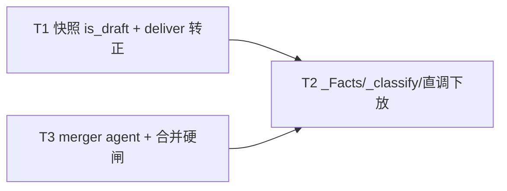

# 0017 · PR 生命周期(create/ready/merge)下放 agent：draft 升为一等事实、level-triggered 自愈转正 + 合并硬闸兜底

<!-- 本文件由 spec 工具维护：frontmatter 为结构化源数据（含 tasks DAG），正文为组级 rust-RFC 9 段总览。 -->

## Summary

守夜（`recipes.vigil`）在 Spec-0064「recipe 纯控制流 / agent 零逻辑」的分工下，已把一切**需要判断**的活（写 RFC、写代码、解冲突、回评论、审查）下放 agent。但**三个 PR 生命周期动作仍是确定性代码直调**，且形态是「一次性」的——开 PR 那一瞬间补一枪，脱靶就再无第二次机会：

- `create_pr(draft=True)`（`vigil.py` `_do_solve`）
- `github.mark_ready(...)`（`_do_solve`，紧跟耗时数分钟的 deliver agent 之后补的一枪）
- `github.merge_pr(...)`（`stages.merge`，经 `_do_merge`）

本 spec 把 **mark_ready / merge 下放 agent**，并把 **draft 升为 `_Facts` 的一等事实**，让 level-triggered reconcile 每 tick 都复检它——天然幂等、天然自愈，不再有「一次性动作脱靶就永久卡死」的不可复位死角。`merge` 不可逆，故下放后仍由一道确定性硬闸（全绿 + `review-approved:<head sha7>`@head）把守红线，agent 只能在闸放行后落合并动作。

`create_pr` **不在下放之列**——它本就已自愈（`_classify` 分支④「无 PR → solve」每 tick 重开），不是死角，见 Rationale。

## Motivation

### 触发场景（就地复述，单 spec 自包含）

PR #168（issue #163 的成果）代码 DONE、CI 六项全绿、`mergeable=CLEAN`、无 `needs-human` label，却始终合不了——因为它一直是 **draft**。人不手动 `gh pr ready` 就永远卡住，守夜也不会自己解开。这不是个案，而是「一次性确定性动作制造不可复位死角」的又一实例（同类：#157 阶段咽喉、#140 git 责任真空）。

### 根因：生命周期动作漏在确定性代码里，且是「一次性」的

问题不只是**归属**，更是**形态**。`mark_ready` 是 `_do_solve` 竖切里开 PR 那一瞬间补的一次性动作，紧跟在耗时数分钟的 deliver agent 之后。这一枪一旦脱靶（deliver 段进程被中断 / 跑的是旧 CLI 快照 / 任何异常），PR 就永久停在 draft，因为**两头都不管**：

- **agent 不补**——deliver agent 的提示词只到 `git push` 为止，一个字没提转正，转正不在它职责里；
- **稳态也不看**——`_classify` 分支表没有 draft 这个维度，`_Facts` 十几个字段里根本没有 `is_draft`，所以后续每一轮 tick 都「看不见」这个 PR 还是 draft，永不复检补标。

只要把 draft 补进 `_Facts`（每 tick 复检）+ 把转正写进「每轮都会被派上来跑的 agent」的职责，脱靶就只是「下一轮再补一次」，死角自然消失。这正是 level-triggered reconcile（Spec-0065）的核心红利：**状态量升为一等事实，纠偏就是它的纯函数结果**。

### merge 为何必须留一道确定性硬闸

三个动作里 `create_pr`、`mark_ready` 风险低（可逆/幂等），直接处理即可。唯独 `merge_pr` **不可逆**——当初把它留在确定性层，就是防 LLM「觉得可以合了」就合掉一份没审过的代码。下放给 agent 后，「判断（这版能不能合）」早已是 reviewer agent 的活（它打 `review-approved:<sha7>` label），「动作（落合并）」下放 merger agent；但**「可不可以合」这条不可逆红线仍由确定性硬闸把守**：agent 只能在闸放行后才被派上来落合并动作，且闸绑 head sha，head 一动裁决自动作废。

## Guide-level explanation

改动后，一个 issue 从被求解到合并，PR 的 draft/ready/merge 状态这样流转：

1. **开 PR（不变，确定性）**：`_do_solve` 仍 `create_pr(draft=True)` 开草稿 PR——它已自愈（脱靶 → 下轮分支④重开），无需下放。
2. **转正（下放 deliver agent + level-triggered 安全网）**：deliver agent push 完代码后**顺手 `gh pr ready`**，其完成判据从「push 到 head」扩为「push 到 head **且 PR 非 draft**」。`_do_solve` 不再确定性直调 `mark_ready`。万一 deliver 那一枪脱靶，PR 残留 draft——`_Facts.is_draft` 现在是一等事实，`_classify` 每 tick 复检，在 merge 之前插一支自愈分支把它转正。
3. **审查、CI、e2e（不变）**：这些闸在 draft PR 上照常跑（`gh pr checks` / 我方 reviewer agent 都不看 draft 状态）。
4. **转正自愈分支（新，排在 merge 前）**：当一个 PR 已「全绿 + `review-approved`@head」但仍 `is_draft` 时，`_classify` 判 `ACTIONABLE: ready` 而非 merge → 转正 → 下一 tick 才 merge。**置于 merge 前**保证两件事：任何 PR 都不会在 draft 态被合；`merge: human` 时人拿到的是已转正、可一键合的 PR（直闭 #168 的人被 draft 墙挡住）。
5. **合并（下放 merger agent + 确定性硬闸）**：`_classify` 判 `merge` 时，`_do_merge` 先经确定性 `gates.assert_merge_allowed(pr_number, head_sha)` 实时复读 CI + label 兜底（不放行即抛，决不派 agent），放行后派 merger agent 执行 `gh pr merge`。merger 也带 `needs-human` 一等出口。

对 agent 作者：deliver 的完成判据多了「非 draft」一条；新增一个极小的 merger agent（闸已放行，执行合并）。对 reconcile：`_Facts` 多一个 `is_draft` 字段、`_classify` 多一支 ready 分支。

## Reference-level explanation

### 技术方案（按 Task 分解）

#### T1 — draft 升为 PR 快照事实 + deliver agent 承接转正职责

- `openagents/utils/github.py`：`pr_snapshot` 的 `gh pr view --json` 追加 `isDraft`；`PRSnapshot` 加 `is_draft: bool`，**置于末位、默认 `False`**——现有 `pr_snapshot` 构造点与各测试 fake 都无须逐点改（避开 Spec-0031 式 fake 破裂），且与其余现态字段**同源一次 `gh pr view` 往返**读入。注意：仓库已有独立的 `github.is_draft(pr_number)`（Spec-0042，单独一次 `gh pr view`）——`_sense` 不复用它，否则每 tick 多一次网络往返（规模上 5000 req/h 配额敏感）；draft 与 state/head/mergeable 属同一 head 的同源现态，必须一次读齐。
- `openagents/agents/deliver.py`：`PROMPT` 在 `git push` 步骤之后追加 `gh pr ready $pr_number`（幂等：已非 draft 时 `gh` 非零退出，视作无副作用），完成判据扩为「push 到 head 且 PR 非 draft」。`OUTPUT_SCHEMA` 不变。

#### T3 — 合并动作下放 merger agent + 确定性合并硬闸兜底

- `openagents/agents/merger.py`（新）：零逻辑 `string.Template`——告知「硬闸已放行」，执行 `gh pr merge $pr_number --merge`，带 `needs-human` 一等出口；`OUTPUT_SCHEMA = {"merged": bool, "summary": str}`。
- `openagents/runtime/gates.py`：新增 `assert_merge_allowed(*, pr_number, head_sha)`——实时复读 CI（`check_snapshot`）+ labels（`pr_snapshot`），非「全绿 ∧ `review-approved:<head sha7>` 存在且 sha 匹配当前 head」即抛 `GateError`。这是不可逆红线的确定性兜底：既防 `_sense→_act` 之间 head 前移的 TOCTOU，也防 merger agent 被误派而合并未审代码。纯读客观事实、零业务判断（承 gates 分层锚点）。
- `openagents/recipes/stages.py`：`merge` 阶段从确定性 `github.merge_pr` 改为「先 `gates.assert_merge_allowed` 放行、再 `engine.run_agent(merger)` 落合并」，显式收参 `backend / pr_number / head_sha / work_dir / context_text`（关键字-only、无位置参数、private 无默认值，符合 CLAUDE.md 约定）。

#### T2 — draft 升为 `_Facts` 一等事实 + `_classify` 自愈分支 + 生命周期直调下放

- `openagents/recipes/vigil.py`：
  - `_Facts` 加 `is_draft`（末位默认 `False`，自动进 `_fingerprint` 全集哈希——转正使 `True→False` 改 fp、记为真进展，故护栏一不误触）；`_sense` 从 `snapshot.is_draft` 读入。
  - `_classify` 在 merge 前插一支：`is_draft` 且其余全部就绪（全绿 + `review-approved`@head）→ `ACTIONABLE: ready`（新 `_ACT_READY`）；非 draft 才落 `merge`。
  - `_act` 增 `_ACT_READY` → `_do_ready`：确定性 `github.mark_ready`（level-triggered，见 Rationale 为何此支留确定性）。
  - `_do_solve` 删除 `github.mark_ready` 一次性直调。
  - `_do_merge` 改调 `stages.merge(backend=…, pr_number=…, head_sha=facts.head_sha, work_dir=…, context_text=_NEEDS_HUMAN_CONTRACT)`。

### 分支表变更（`_classify` 顺序即硬依赖）

```
① merged / closed / needs-human ............... TERMINAL
② 最新评论是人发的 ............................ ACTIONABLE: reply
③ 依赖未全关闭 ................................ QUIET(awaiting-blockers)
④ 还没有 PR ................................... ACTIONABLE: solve        （create_pr 已自愈于此）
⑤ mergeable = UNKNOWN / null .................. QUIET(awaiting-mergeability)
⑥ 冲突（dirty） ............................... ACTIONABLE: rebase
⑦ CI = pending / 零 check ..................... QUIET(awaiting-ci)
⑧ CI = failure ................................ ACTIONABLE: fix-ci
⑨ e2e 证据缺失 / 陈旧 ......................... ACTIONABLE: e2e
⑩ 无 review-approved@head / changes-requested . ACTIONABLE: review-or-fix
⑪ 全绿 + approved@head + **is_draft** ......... ACTIONABLE: ready   ← 新增（自愈转正，排在 merge 前）
⑫ 全绿 + approved@head + **非 draft** ......... ACTIONABLE: merge   （下放 merger agent + 硬闸）
```

**⑪ 必须排在 ⑫ 前**是正确性依赖：draft PR 合不了（GitHub 拒合 draft），且 `merge: human` 时人也会被 draft 墙挡住——所以转正必须先于（无论 agent 还是 human 的）合并动作发生。

### DAG + 文件分配

| Task | depends-on | 文件（两两不相交） |
|---|---|---|
| **T1** | — | `openagents/utils/github.py`、`openagents/agents/deliver.py`、`tests/test_utils_github_vigil.py`、`tests/test_agents_deliver.py` |
| **T3** | — | `openagents/runtime/gates.py`、`openagents/agents/merger.py`、`openagents/recipes/stages.py`、`tests/test_runtime_gates.py`、`tests/test_recipe_stages.py`、`tests/test_agents_merger.py` |
| **T2** | T1, T3 | `openagents/recipes/vigil.py`、`tests/test_recipe_vigil.py`、`tests/test_recipe_vigil_act.py`、`scripts/e2e-spec-0017-pr-lifecycle-delegated-to-agent.sh` |



T1（`PRSnapshot.is_draft`）、T3（新 `stages.merge` 签名 + merger + 硬闸）互不相干、可并行；T2 消费两者的产物（读 `is_draft`、调新 `stages.merge`），故 depends-on 二者。

### e2e 脚本路径

`scripts/e2e-spec-0017-pr-lifecycle-delegated-to-agent.sh`（离线确定性，见 frontmatter `e2e.method`），被 PR e2e signpost 采集。

## Drawbacks

- **`_Facts` 又多一个字段**：每加一个 fact 都要过「worker 收工会不会顺手改到它」的自毁检验。`is_draft` 会被转正动作改（`True→False`），但那**正是预期进展**（与 push 改 `head_sha` 同类），不是护栏一自毁——转正没成功则 `is_draft` 不变、fp 不变、attempt 戳照常兜底。
- **两处转正职责并存**（deliver agent happy-path + `_do_ready` 确定性安全网）看似冗余：但这份冗余就是「一等出口 + 兜底」的标准形态（Spec-0065 同构）——happy-path 由 agent 顺手做，脱靶由 level-triggered 兜。删掉任一个都会重新打开一个死角。
- **merger agent 是一次「几乎零判断」的 LLM 调用**：闸放行后它基本只跑一条 `gh pr merge`。这笔成本换来的是架构一致性（动作全归 agent 层）+ 一个最后关头的 `needs-human` 出口。见 Rationale 备选。

## Rationale and alternatives

### 为何 `create_pr` 不下放

issue 期望三个动作全下放，但**验收标准只钉 mark_ready 与 merge**，且明说 create_pr 风险低。按奥卡姆（理念 1）：`create_pr` 根本不是死角——`_classify` 分支④「`pr_number is None` → solve」本就每 tick 复检，create_pr 脱靶下一轮自动重开。下放它反而要让 deliver agent 建 PR、recipe 再回读 PR 号（`pr_for_branch`），把竖切结构复杂化却换不来任何自愈增益。故保留确定性 `create_pr`，仅在正文点明它已自愈。

### 为何转正自愈支（⑪）留确定性 `github.mark_ready`、而非派 agent

issue 描述的自愈机制是「下一轮被 agent 顺手转正」。但在 reconcile 模型里，一个「已交付、无待办代码工作」的残留 draft PR，没有任何自然分支会把 deliver agent 再派上来（deliver 的 `assert_head_advanced` 硬闸会因无新提交而失败）。要「被 agent 转正」只能新造一个 promoter agent 或放松 deliver 硬闸，两者都比一行 `github.mark_ready` 重得多。

关键洞察：**issue 要消除的是「一次性」，不是「确定性」**。把 `is_draft` 升为每 tick 复检的一等事实后，转正支已是 level-triggered（幂等、自愈），此时其动作是不是 LLM 调用与死角是否复现无关。而「把一个已交付的 draft PR 转正」是**零判断的机械动作**（客观对 `delivered ∧ draft` 完全决定该做什么），按 Spec-0064 分界（机械段→确定性）本就该留确定性。故 happy-path 转正归 deliver **agent**（满足验收①），自愈安全网留确定性 `mark_ready`（满足验收②「稳态路由能自愈」），既闭死角又不为一行 `gh pr ready` 烧 LLM。

- **备选 A（派新 promoter agent 转正）**：完全贴合「被 agent 转正」字面，但为一条幂等 shell 命令新增一个 agent 模块 + 每次自愈一次 LLM 调用，违背理念 1；本 spec 采纳时可改。留作 refine 选项。

### 为何 merge 下放 agent 而非保留确定性 `merge_pr`

- **备选 B（保留确定性 `merge_pr`，仅靠 `_classify`⑫ 门控）**：`_classify`⑫ 已是绑 sha 的确定性门控，合并动作本身零残留判断，保留确定性最省。但 issue 验收③明确要求「合并动作下放 agent」，且下放后 merger 能提供最后关头的 `needs-human` 出口（察觉门控没覆盖的异常）。本 spec 采纳「下放 + `assert_merge_allowed` 确定性兜底」以贴合验收；备选 B 记此备查。真正守住「不合未审代码」的是那道确定性硬闸，不是 agent——这点两方案一致。

### 状态量落处（承 Spec-0065 分工）

draft 是 **GitHub 自己的事实**，故读原生（进 `pr_snapshot`）、不复制成 label——复制就是造第二份真相要对账。与 Spec-0065「我们做的决定打 label、GitHub 的事实读原生」一致。

## Prior art

- **Spec-0065（图驱动并行守夜）**：确立 level-triggered reconcile + 「`_Facts` 字段集 ≡ 分支表输入集 ≡ fp 哈希输入集」不变式、以及 `needs-human` 一等出口 + 两条护栏。本 spec 给 `_Facts` 加 `is_draft` 正是在这套不变式下操作。
- **Spec-0064（声明式 stages 收敛）**：确立「recipe 纯控制流 / agent 零逻辑」分工与「机械段→确定性、判断段→agent」分界——本 spec 的「转正安全网留确定性、合并动作下放 agent + 确定性硬闸」都据此分界落子。
- **Spec-0060（agents/recipes 核心）**：`runtime.gates` 最小硬闸（`assert_head_advanced` / `assert_evidence_stamp`）范式——`assert_merge_allowed` 是同一范式的新成员（只验客观事实、不判对错）。
- **#140（git 责任真空）/ #157（阶段咽喉）**：同类「一次性确定性动作制造不可复位死角」的先例；本 spec 是第三个实例的收口。
- [rust-lang/rfcs](https://github.com/rust-lang/rfcs)：本总览的 9 段结构来源。

## Unresolved questions

- **转正自愈支的动作形态**：确定性 `mark_ready`（本 spec）vs 新 promoter agent（备选 A）——留待人审定夺。二者对「消除死角」等价，分歧只在是否为字面「agent 转正」再花一个 agent + 每次一次 LLM 调用。
- **⑪ 自愈支的触发前置**：本 spec 让它落在「全绿 + approved@head」之后（与 merge 同前置，最小扰动）。是否要更早转正（PR 一交付就转正，让人/GitHub 更早把它当正式 PR、请求 reviewer）？更早转正会与 CI/review 支争派单顺序，且 happy-path deliver 本就已早转正，故本 spec 取「merge 前兜底」。若实战发现「draft 期评审被拖」，可前移。

## Future possibilities

- **draft 期主动请求 reviewer**：转正后可顺带 `gh pr edit --add-reviewer`，让人类评审更早介入（当前依赖人主动看 PR）。
- **合并方法可配**：merger 现固定 `--merge`；未来可由 `openagents.yml` 声明 squash/rebase（承 `github.merge_pr` 的 `method` 参数与其 Unresolved）。
- **生命周期动作统一到一个 lifecycle agent**：若后续再有 PR 生命周期动作（如 auto-close stale draft），可考虑收拢成单一 lifecycle agent，避免每个动作各起一个 agent 模块。

