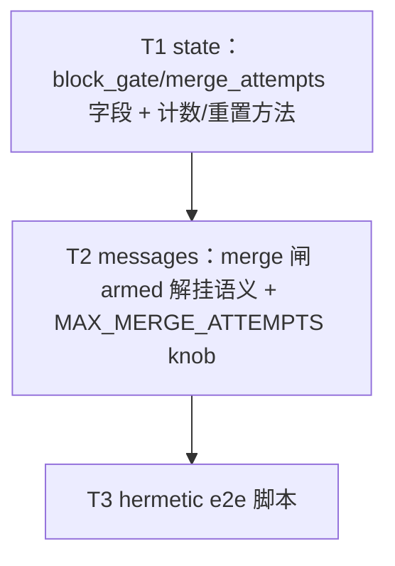

# 0031 · merge 闸解挂语义重设计：人解挂后派 agent 主动解冲突、有界重试再挂起

<!-- 本文件由 spec 工具维护：frontmatter 为结构化源数据（含 tasks DAG），正文为组级 rust-RFC 9 段总览。 -->

## Summary

重设计 merge 闸（`gate=merge`，PR 与 base 真冲突）的「解挂」语义。今天人摘掉 `needs-human`
标签想让 agent 重试，下一轮 poll 回到代码闸又被**被动可合并性预检**判 `CONFLICTING`、**立即
重新 `_block` 打回 `needs-human`**——「撕标签 → 解挂 → 即时重挂」，等于空操作，陷入死循环。

本组把「人主动解挂 merge 冲突」与「系统首次发现冲突」区分成两个入口：**首次发现**保留现状
（试一次 agent 解冲突，解不了即提示 + 挂起，留人工兜底）；**人解挂后**进入 **armed（武装）模式**
——给 agent 一个**有界重试预算**（新 knob `OPENAGENTS_MAX_MERGE_ATTEMPTS`，默认 3），每轮 poll
派一次 agent 主动解冲突（rebase/语义解冲突/push，复用 Spec-0028 的 `conflict.make_resolver`），
预算用尽且仍冲突才重新 `_block`。这样「撕标签」真正等于「让 agent 去试着解决」，而不再是「重置
计数后被动重检、同轮焊死」。改动只落在 messages 路由层与 state 计数层，**不重写 git 解冲突逻辑、
不改 `needs-human` 字面量、严格保留人工兜底**。

## Motivation

**背景（就地复述，不靠裸引用承载）**：OpenAgents 是 RFC/spec 驱动的多 agent 框架，守夜人
（`messages.Messages.poll`）每隔一段时间扫描所有 open 状态的 run，按阶段路由 GitHub 事件：
合并/关闭优先 reconcile，再按 run 所处阶段走 **rfc 评审闸**（draft PR 承载 RFC）或 **代码闸**
（`coding` 阶段）。两道评审闸的「卡住兜底」共用 `_block`：累计若干轮仍不过 → 置 `STATUS_BLOCKED`
+ 打 `needs-human` 标签（`= BLOCKED_LABEL`，字面量 `"needs-human"`，单一来源在 `github.py`）
+ **PR 不关**。`STATUS_BLOCKED` 不在 `_OPEN_STATUSES`，故下一轮 poll 跳过该 run（软挂起），等人
据标签介入。

**解挂其实已支持**：blocked 的 run 仍被纳入每轮扫描（issue #49）。`_process_run` 的 blocked 分支
里——若 PR 仍 open 但人已摘掉 `needs-human`（语义：「我处理好了，继续跑」），则 `reset_rounds`
清零、按是否已过 RFC 闸恢复到 `pr-open` / `rfc-review` 阶段重新流转（返回事件 `"resumed"`）；
标签仍在则保持挂起。

**问题出在 merge 闸这条路径**。代码闸 `_process_coding` 跑 reviewer 前先做**可合并性预检**
（Spec-0022）：`github.mergeability` 返回 `DIRTY` 或 `CONFLICTING` 即判真冲突。Spec-0028 在此处
补了一层 **agent 语义解冲突**：撞冲突时先试注入的 `resolve = self._make_resolver()`（成功则本轮不
block、等下一轮 CI 重排），**只试一次**；`resolve=None` 或失败才贴 `rebase.CONFLICT_COMMENT`
+ `_block(gate="merge")`。

于是死循环长这样：人摘掉 `needs-human` → 这一轮 poll 的 blocked 分支 `reset_rounds` + 恢复
`pr-open`（返回 `"resumed"`）→ **下一轮 poll** 回到 `_process_coding`，**第一步又是被动 mergeability
预检** → 冲突没人解、仍 `CONFLICTING` → `resolve` 试一次（解不了 / 未注入）→ **立即
`_block` 重新打 `needs-human`**。人感觉「我刚撕掉它又自己贴回来了」。

**为什么唯独 merge 闸如此**：rfc / code 评审打回类是**攒满 `MAX_ROUNDS`（默认 3）轮**才挂——摘
标签后 `reset_rounds` 清零，还能跑好几轮；而 merge 冲突是**即时挂、即时重挂**——它根本不吃
`rounds` 预算，`resolve` 只试一次就 `_block`。所以对 merge 闸而言，「摘标签 → reset_rounds」是
**空操作**（merge 路径不读 rounds），解挂语义形同虚设。

**期望**：撕掉 `needs-human` 对 merge 冲突应意味着「**让 agent 主动去试着解决**」，而不仅「重置
计数再被动重检」。即解挂后应**派 agent 主动尝试解冲突**（rebase 到最新 target、语义解决可解
冲突、push），再回到正常闸；只有 agent 自己尝试**若干次**仍解不掉，才重新挂起等人。

**实例来源**：实跑中三个并行 spec PR 因共享 `docs/specs/OVERVIEW.md`（`spec render` 整表重渲的
聚合索引）互相冲突，被打 `needs-human` 后撕标签即被即时加回，无法让 agent 自行重试——正是这个
issue 的直接触发场景。

## Guide-level explanation

落地后，人对一个被 merge 冲突挂起的 PR 撕掉 `needs-human` 标签，体验变成：

1. **本轮 poll**：blocked 分支发现标签已摘 + 该 run 是被 merge 冲突挂起的（`block_gate == "merge"`）
   → 解挂并**武装（arm）**：把 merge 解冲突预算 `merge_attempts` 清零、恢复到 `pr-open`、**保留
   `block_gate="merge"` 作为 armed 标记**。返回事件 `"resumed"`。本轮**不**做被动预检、**不**重挂。
2. **下一轮 poll**：回到代码闸 `_process_coding`，预检仍判 `CONFLICTING`。因 `block_gate == "merge"`
   且状态已是 `pr-open`（这个组合只可能由「merge 解挂」产生，见 Reference-level 的状态机论证）
   → 进入 **armed 模式**：派一次 agent 解冲突（复用 Spec-0028 `resolve`）。
   - **解决了** → push，本轮返回 `"resolved"`，清除 armed（`block_gate=""`、`merge_attempts=0`）；
     下一轮 CI 因 `synchronize` 重排，PR 自然推进。
   - **没解决** → `merge_attempts += 1`；若 **未达** `MAX_MERGE_ATTEMPTS`（默认 3）→ 返回非阻塞
     事件 `"merge-retry"`、**保持 `pr-open`、不重挂**，等下一轮 poll 再派一次（跨轮有界重试，给
     agent「若干次」真正动手的机会）；若 **已达上限** → 才贴 `CONFLICT_COMMENT` + `_block(gate="merge")`
     重新挂起等人（人工兜底不取消）。

对比今天：解挂后第一轮就被动预检 → 即时重挂。新行为下，解挂确确实实把「**主动解冲突的若干次
尝试**」交给了 agent，只有 agent 反复解不掉才回到人。

**首次发现冲突**（即 run 此前从未被 merge 挂起，`block_gate != "merge"`）的体验**保持不变**：试一次
`resolve`，解不了即提示 + 挂起——快速把第一现场交还给人决定（人可据此选择「撕标签让 agent 多试
几次」，即上面的 armed 入口）。

环境旋钮 `OPENAGENTS_MAX_MERGE_ATTEMPTS`（默认 3）控制 armed 模式下的解冲突重试上限；与
`OPENAGENTS_MAX_ROUNDS`（评审回合）、`OPENAGENTS_MAX_REVIEW_RETRIES`（评审无效重试）并列，
三者预算彼此独立。

## Reference-level explanation

### 核心机制：用 `block_gate` 区分入口、用 `merge_attempts` 做有界重试

引入两个 `RunRecord` 字段（均带默认值，向后兼容缺键的旧 `state.json`）：

| 字段 | 类型 | 含义 |
|---|---|---|
| `block_gate` | `str = ""` | 上一次 `_block` 是哪道闸挂起的（`"rfc"`/`"code"`/`"merge"`/`*-unparseable`）。merge 闸据此判「armed」，兼作可观测性。 |
| `merge_attempts` | `int = 0` | armed 窗口内已用的 agent 解冲突重试次数（类比 `rounds`/`review_invalid`，独立预算）。 |

**关键不变式（无需额外布尔标志）**：`block_gate == "merge"` 且 `status == pr-open` 的组合**只可能
由「人解挂一个 merge 冲突挂起的 run」产生**。论证：

- 普通新 run 进 `pr-open` 时 `block_gate == ""`（从未 block 过）。
- `_block(gate="merge")` 把 `block_gate` 置 `"merge"`**同时**把 status 置 `blocked`——blocked 不在
  `_OPEN_STATUSES`，poll 永不把它路由进 `_process_coding`，故「`block_gate=="merge"` 且仍 blocked」
  这态绝不会触发 armed 逻辑。
- 唯一能让 `block_gate=="merge"` 的 run 回到 `pr-open` 的路径，就是 blocked 分支里「人摘标签 →
  解挂」。

所以 merge 闸里 `record.block_gate == "merge"`（此时必为 `pr-open`）即「armed」，**状态机本身保证
无歧义，不需要再加一个 `armed` 布尔字段**（理念 1 奥卡姆）。

### 改动点（按文件）

**`openagents/state.py`**（T1）：

- `RunRecord` 增 `block_gate: str = ""`、`merge_attempts: int = 0`（默认值保证 `RunRecord(**旧记录)`
  不报错）。
- 新增 `set_block_gate(*, issue_number, gate)`：落盘某 run 的 `block_gate`（供 `_block` 记账、解挂
  分支判入口）；`gate=""` 即清除（解 armed 时用）。
- 新增 `increment_merge_attempts(*, issue_number) -> int`：镜像 `increment_rounds`，把
  `merge_attempts += 1` 落盘并返回新值（`record.get("merge_attempts", 0)` 兜底旧记录）。
- `reset_rounds` 同点把 `merge_attempts` 一并归零（与 `rounds`/`review_invalid` 同生命周期：解挂 /
  implement 时清；三者预算独立）。**注意：`reset_rounds` 不动 `block_gate`**——`block_gate` 是
  armed 标记，由解挂分支与 merge 闸经 `set_block_gate` 显式管理（见下）。

**`openagents/messages.py`**（T2）：

- **新 knob**：`OPENAGENTS_MAX_MERGE_ATTEMPTS`（默认 3），新增 `_configured_max_merge_attempts()`
  + 模块常量 `MAX_MERGE_ATTEMPTS`，逐字镜像既有 `_configured_max_rounds` 的读取/兜底/可
  monkeypatch 约定。
- **`_block`**：在打标签 + 置 blocked 的同时调 `state.set_block_gate(gate=gate)` 落盘入口（沿用
  issue #47「GitHub 副作用先行、state 后行」：`add_label` → `update_status(blocked)` →
  `set_block_gate`）。
- **`_process_run` blocked 分支**（解挂）：人摘标签后，读 `record.block_gate`——
  - `== "merge"`：**arm**。`reset_rounds`（顺带清 `merge_attempts`，给满预算）、恢复
    `pr-open`、**保留 `block_gate="merge"`**。返回 `"resumed"`。
  - `!= "merge"`：现状行为（`reset_rounds` + 按 APPROVAL_LABEL 决定恢复到 `pr-open`/`rfc-review`），
    并 `set_block_gate(gate="")` 清残留（避免 `"rfc"`/`"code"` 误判后续 merge 入口）。返回 `"resumed"`。
- **`_process_coding` 可合并性预检冲突分支**：判 `block_gate == "merge"`（armed）分两支——
  - **armed**：先试 `resolve`（注入时）。成功 → `set_block_gate(gate="")` + `reset` 预算 → 返回
    `"resolved"`。失败 / `resolve is None`：
    - 若 `resolve is None`（无 backend，重试无意义）→ 直接 `CONFLICT_COMMENT` + `_block(gate="merge")`
      （回落人工，不空转）。
    - 否则 `n = increment_merge_attempts()`；`n < MAX_MERGE_ATTEMPTS` → 返回 `"merge-retry"`、保持
      `pr-open`、**不重挂**（跨轮重试）；`n >= MAX_MERGE_ATTEMPTS` → `CONFLICT_COMMENT` +
      `_block(gate="merge")`（重新挂起，`block_gate` 再次置 "merge"，下次人解挂可再 arm）。
  - **非 armed（首次发现）**：**逐字节保持 Spec-0028 现状**——试一次 `resolve`，成功 `"resolved"`，
    失败 `CONFLICT_COMMENT` + `_block(gate="merge")`（此 `_block` 把 `block_gate` 置 "merge"，为将来
    人解挂铺好 armed 入口）。

新增 poll 事件 `reason` 取值：`"merge-retry"`（armed 模式本轮重试、未挂、等下一轮）。`"resolved"`
（Spec-0028 已有）、`"resumed"`、`"unmergeable"`/`"blocked"` 语义不变。

### 严格零回归不变式

- `block_gate` 始终为 `""` 的全新 run（从未被 merge 挂起）→ 走「非 armed / 首次发现」分支，行为
  **逐字节同 Spec-0028 今天**。
- `MAX_MERGE_ATTEMPTS` 不影响 rfc/code 闸的 `MAX_ROUNDS` 与评审无效重试逻辑（独立预算、独立 knob）。
- `needs-human` 字面量、其在 release 预检中的门控含义、`_block` 的「PR 不关 + 软挂起」语义均不变。
- `resolve is None`（手动 `sync-prs` 不注入 backend、老测试夹具）→ armed 模式直接回落 `_block`，
  与首次发现一致，不会凭空空转重试。

### DAG + 文件分配

| Task | 标题 | files | 依赖 |
|---|---|---|---|
| T1 | state：`block_gate`/`merge_attempts` 字段 + 计数/重置方法 | `openagents/state.py`, `tests/test_state_merge_unblock.py` | — |
| T2 | messages：merge 闸 armed 解挂语义 + `MAX_MERGE_ATTEMPTS` knob | `openagents/messages.py`, `tests/test_messages_merge_unblock.py` | T1 |
| T3 | hermetic e2e 脚本（无网络、不触真实 LLM/gh） | `scripts/e2e-spec-0031-merge-unblock-agent-resolve.sh` | T1, T2 |

`files` 同组互斥（单一 writer 所有权，理念 6）。**特意只新增专属测试文件**（`test_state_merge_unblock.py`
/ `test_messages_merge_unblock.py`），不改既有 `tests/test_state.py` / `tests/test_messages.py` /
`tests/test_messages_resolve.py`——既保持组内 `files` 互斥，又把跨并行 PR 的共享文件冲突面降到最小
（本 issue 正是被共享文件冲突触发，理应身体力行）。`openagents/conflict.py`（Spec-0028）**复用不改**
——本组不在 messages 层重写 git 解冲突逻辑（边界，理念 10 解耦）。

**e2e 脚本路径**：`scripts/e2e-spec-0031-merge-unblock-agent-resolve.sh`（hermetic，两段：① ruff
check + format --check + pytest 离线确定性验证；② 用 fake `github.has_label`/`mergeability` +
fake `resolve` 闭环演练「首次发现→挂起→人解挂 arm→armed 有界重试→用尽重挂」整条状态轨迹，全程
不触网、不调真实 LLM、不碰真实 gh）。

每层新代码注释按代码注释规范标注本组 spec id（`Spec-0031/Tn`）。

## Drawbacks

- **多一个 knob 与两个 state 字段**：增加状态面与配置面。缓解：字段带默认值向后兼容、knob 镜像
  既有两个 `_configured_*` 完全同构，认知成本低；用 `block_gate` 一字段 + 状态机不变式替代「再加
  一个 armed 布尔」，已把新增实体压到最小（理念 1）。
- **armed 模式多烧 token**：每轮 poll 派一次 coding agent 解冲突，最多 `MAX_MERGE_ATTEMPTS` 次。
  缓解：① 有界（默认 3）；② 仅在**人显式解挂**后触发（人主动表达「让 agent 去试」），不是系统自发
  无限重试；③ `resolve is None`（手动 sync-prs 不注入 backend）时不空转。
- **agent 反复解错的风险**：解冲突可能解错。缓解：复用 Spec-0028 `conflict.resolve_branch` 既有的
  「ruff+pytest 自测门控 + 残留冲突标记双查，解不了即 `merge --abort` 回落」——宁可不解、不可解错
  后静默 push；本组不放松该门控。
- **跨轮重试拉长「解挂→真正推进」的墙钟**：armed 重试按 poll interval 跨轮进行，最坏要等
  `MAX_MERGE_ATTEMPTS` 个 interval 才挂回人。缓解：这是「给 agent 真正机会」与「快速回到人」的
  权衡；首次发现路径仍快速挂起，只有人显式解挂才进入慢速重试，符合人的意图。

## Rationale and alternatives

**为何用 `block_gate == "merge"` 作 armed 标记，而非新增 `armed` 布尔字段**：状态机不变式已保证
「`block_gate=="merge"` 且回到 `pr-open`」只可能由 merge 解挂产生（见 Reference-level 论证），再加
布尔是冗余实体（理念 1）。且 `block_gate` 记录「哪道闸挂的」本身有可观测性价值（日志/看板可读），
一字段两用。

**为何独立 knob `MAX_MERGE_ATTEMPTS` 而非复用 `MAX_ROUNDS`**：issue 明确「复用/**类比** MAX_ROUNDS」。
选「类比」（独立 knob）而非「复用」（同一计数）的理由：merge 解冲突重试与评审回合是**不同性质**的
预算（一个是 agent 解 git 冲突的尝试，一个是 reviewer 打回的迭代），混用会让两者互相偷预算、且无法
分别调参。codebase 已有 `MAX_ROUNDS` + `MAX_REVIEW_RETRIES` 两个独立 knob 的先例，第三个同构 knob
是一致的最小延伸。**备选**：① 复用 `rounds` 计数——否决（merge 路径本不吃 rounds，复用会与评审回合
纠缠，且摘标签 `reset_rounds` 的语义会变脏）；② 写死常量不给 knob——否决（与既有两个可调 knob 不
一致，且不同仓库冲突复杂度不同，需可调）。

**为何首次发现仍即时挂起、只有人解挂才 armed 重试**（备选：首次发现也直接 armed 有界重试）——
否决直接 armed 的理由：issue 明确要「区分两入口」「保留人工兜底」，且首次发现时人可能**想第一时间
知道并自己决定**（撞了哪个文件、要不要换设计）；把「多试几次」做成人的**显式 opt-in**（撕标签）
更符合「人负责宏观把控」（理念 2）。而且首次发现保持现状 = 严格零回归，风险最低。

**为何跨轮（每 poll 一次）而非同轮循环重试**：同轮 `for` 循环连派多次 agent 会在一轮 poll 内长时间
占用、且 base 在同轮不变、重试价值低；跨轮重试让每次尝试间 base/CI 有机会变化，且天然不阻塞其它 run
的本轮处理——与既有 `review-invalid`「本轮返回、下一轮重评」的节奏一致。

## Prior art

- **Spec-0028（issue #79）`openagents/conflict.py`**：本组直接复用其 `make_resolver` / `resolve_branch`
  agent 语义解冲突能力（临时 worktree + 注入 IO + 自测门控 + 异常吞成 False 安全降级）；本组只在
  messages 路由层加「解挂入口区分 + 有界重试预算」，不碰解冲突本体（理念 10 解耦）。
- **issue #49 解挂机制**：blocked run 纳入扫描、摘 `needs-human` 即 `reset_rounds` 恢复流转——本组
  在其上为 merge 闸补「armed 主动解冲突」语义。
- **Spec-0021/T2 `MAX_REVIEW_RETRIES` + `review_invalid`**：本组 `MAX_MERGE_ATTEMPTS` +
  `merge_attempts` 逐字镜像其「独立 knob + 独立计数 + 与 rounds 同生命周期但预算独立」的成熟模式。
- **Spec-0022 可合并性预检**：本组改的正是它在 `_process_coding` 里的冲突分支。
- **rust-lang/rfcs**（https://github.com/rust-lang/rfcs）：9 段总览形态来源。

## Unresolved questions

- `MAX_MERGE_ATTEMPTS` 默认值取 3（对齐 `MAX_ROUNDS`）是否合适，需实跑观察 OVERVIEW 索引类冲突的
  agent 解决成功率后再调。
- armed 重试期间若 base 又前进（别的 PR 又合并了），是否需要在每次重试前显式 `fetch` 最新 base？
  （初定：复用 `make_resolver` 内既有的 `fetch origin base branch`，每次重试本就取最新 base，无需
  额外处理；列此存档以便实现时复核。）

## Future possibilities

- 把「armed 重试若干次仍失败」时 agent 的尝试摘要回贴到 PR，提升人工兜底时的可观测性（与 Spec-0028
  的同名 Future 合流）。
- 把首次发现也做成可配置的「直接 armed」开关（默认关，保留现状），让信任 agent 的仓库省掉一次人工
  解挂往返。
- 把 `block_gate` 推广为统一的「挂起原因」结构化字段，供看板/release 预检按原因分类展示与处置。

