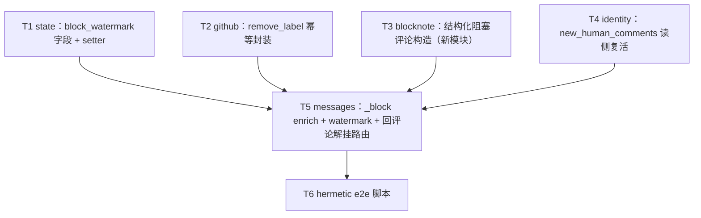

# 0032 · needs-human 全程在 GitHub 闭环：阻塞留足信息 + 人回新评论即自动解挂喂内容重试

<!-- 本文件由 spec 工具维护：frontmatter 为结构化源数据（含 tasks DAG），正文为组级 rust-RFC 9 段总览。 -->

## Summary

把 `needs-human`（卡住兜底标签）的「挂起」与「解挂」全部收进 GitHub PR 评论里闭环，跨**所有
闸**（rfc / code / merge / `*-unparseable`）：

1. **挂起即留足信息**——`_block` 时按挂起的闸（gate）组织**一条结构化签名评论**（为啥挂、agent
   试过什么、具体卡在哪、人能怎么做），取代今天「只有 merge 闸留一句话、其余闸只甩一个标签」的
   半张嘴体验。
2. **人回新评论 = 解挂信号**——框架在每轮 poll 里读 PR 评论，只认**晚于「挂起水位线」(watermark)
   的、无 OpenAgents 签名的人类评论**；命中即**自动摘掉 `needs-human`** + 把评论正文当 `detail`
   **喂给对应闸的 agent**（rfc→`refine_rfc`、code→`iterate`、merge→交由 armed 解冲突路径），恢复
   流转。

改动落在 messages 路由层 + 两个叶子原语（state 加一个 watermark 字段、github 加 `remove_label`
封装）+ 两个解耦小模块（结构化评论构造 `blocknote`、新人类评论读取 `identity` 读侧复活）。
**不改 `needs-human` 字面量与其在 release 预检中的门控含义**，**不取消人工兜底**（agent 拿到指导
仍解不掉，可再次挂回 `needs-human` 并附一条新的信息充分评论），**不引入 GitHub 之外的任何沟通渠道**。

## Motivation

**背景（就地复述，不靠裸引用承载必要信息）**：OpenAgents 是 RFC/spec 驱动的多 agent 框架，守夜人
`messages.Messages.poll` 每隔一段时间扫描所有 open 状态的 run，按阶段路由 GitHub 事件：合并/关闭
优先 reconcile，再按 run 所处阶段走 **rfc 评审闸**（draft PR 承载 RFC）或 **代码闸**（`coding`
阶段，先做可合并性预检再跑 reviewer）。两道评审闸的「卡住兜底」共用私有方法 `_block`：累计若干轮
仍不过 → 置 `STATUS_BLOCKED` + 给 PR 打 `needs-human` 标签（`= BLOCKED_LABEL`，字面量
`"needs-human"`，单一来源在 `github.py`）+ **PR 不关**。`STATUS_BLOCKED` 不在 `_OPEN_STATUSES`，
故下一轮 poll 跳过该 run（软挂起），等人据标签介入。挂起原因（gate）已持久化在 `RunRecord.block_gate`
字段（值 ∈ `""`/`"rfc"`/`"code"`/`"merge"`/`"rfc-unparseable"`/`"code-unparseable"`，由 `_block`
经 `set_block_gate` 落盘——这是已落地能力，本组**直接复用**，不再新造）。

**今天 `needs-human` 是个「半张嘴」，两个毛病：**

- **挂起信息太薄**：只有 `gate=merge`（可合并性预检判真冲突）会在 `_block` 前贴一条评论，且只是一句
  话 `rebase.CONFLICT_COMMENT`（「存在无法自动解决的冲突，请手动 rebase」）。`gate=rfc` / `code` /
  `rfc-unparseable` / `code-unparseable` 的 `_block` **根本不留任何解释性评论**——人打开 PR 只看到
  一个 `needs-human` 标签，既不知道为啥挂、也不知道 agent 试过什么、更不知道自己该怎么让它继续。
- **解挂方式与「在 GitHub 上交流」脱节**：今天唯一的解挂入口是**人手动摘掉 `needs-human` 标签**
  ——`_process_run` 的 blocked 分支发现标签已摘，才 `reset_rounds` + 按 gate 恢复流转（返回事件
  `"resumed"`）。**评论完全不参与解挂**。于是人想表达「我看了你的卡点，按这个思路继续」时，得先在
  评论里写一段、再**记得手动去摘标签**，两步、易漏、且评论里的指导内容**不会被喂给 agent**（agent
  解挂后只是重置计数重跑，拿不到人的判断）。

**为什么评论不参与解挂——历史约束 RFC-0019**：RFC-0011 原设计有「读侧」（poll 读 PR 评论 → 按
签名剔除自评论 → 触发 `refine_rfc`/`iterate`），但 RFC-0019 出于**防自循环**的顾虑特意让自动流转
**不读评论**（怕 agent 读到自己发的评论触发无限自我迭代），把自动流转改由 reviewer 闸驱动；
`identity.parse_agent_id`（签名解析）因此退化为「只写不读」的审计工具。本 issue 正是要**定向解除**
这条限制：**只读「block 之后」的新评论 + 只认人类（无 OpenAgents 签名）评论**——两道硬约束精确
化解 RFC-0019 的自循环顾虑（agent 自己的评论带签名被滤掉、历史评论被 watermark 滤掉，不可能自触发）。

**期望（与 issue 对齐）**：

- **挂起即留足信息（所有 gate）**：评论含 ① 挂起原因/gate 类型；② agent 试过什么（如按 reviewer
  反馈迭代了 N 轮仍 REWORK / 已派 agent 解冲突但失败）；③ 具体卡点（reviewer 反馈原文 / 冲突提示 /
  CI 失败日志摘要）；④ 人可以怎么做（回复一条评论给指导即可继续，无需手动摘标签）。
- **人回新评论 = 解挂信号（所有 needs-human 类型）**：框架检测到 block 之后的新人类评论 → 自动摘
  `needs-human` + 把评论内容当 `detail` 喂给对应闸 agent → 恢复对应闸流转。

**实例来源**：实跑中多个 spec PR 因评审反复 REWORK / 共享索引文件冲突被挂 `needs-human`，运维只看到
标签、不得不去翻 reviewer 日志才知所以然，且每次都要「评论 + 手动摘标签」两步——正是本 issue 的
直接触发场景。

## Guide-level explanation

落地后，一个被任意闸挂起的 PR，人的体验变成「**全程只在 PR 评论里**」：

**① 挂起——agent 自动留一条信息充分的评论。** 任意闸累计兜底挂起时，PR 上自动出现一条结构化签名
评论（模板，细节见 Reference-level）：

```markdown
🤖 OpenAgents 卡住了，需要你的判断

**原因**：<gate=code / 代码评审第 3 轮仍 REWORK>
**我试过**：<按 reviewer 反馈迭代了 3 轮，仍未通过>
**卡在哪**：
> <reviewer 反馈原文 / 冲突提示 / CI 失败日志摘要>

**你可以怎么做**：直接在本 PR **回复一条评论**给出指导，我会据此继续；无需手动摘标签。

<!-- openagents:agent=<id> -->
```

人一眼看清：哪道闸、试过几轮、卡在哪、怎么继续。

**② 解挂——人直接回一条评论。** 人在该 PR 下回复一条评论（如「这里别动 messages，改去 state 加个
字段」）。下一轮 poll：

- 框架读到这条**晚于挂起水位线、且无 OpenAgents 签名**的人类评论 → 判定为解挂信号。
- **自动摘掉 `needs-human` 标签** + `reset_rounds`（清回合预算）。
- **把评论正文当 `detail` 喂给对应闸的 agent**，按持久化的 `block_gate` 路由：
  - `rfc` / `rfc-unparseable` → `orchestrator.refine_rfc(detail=<评论正文>)`，状态恢复 `rfc-review`；
  - `code` / `code-unparseable` → `orchestrator.iterate(reason="human", detail=<评论正文>)`，状态恢复 `pr-open`；
  - `merge` → 不直接喂解冲突器，按既有 **armed** 语义恢复（状态 `pr-open`、保留 `block_gate="merge"`、
    清 `merge_attempts`），把「人已表态、去试着解冲突」交给 merge 闸的 armed 解冲突路径（issue #84）。
- 返回事件 `"resumed"`。再下一轮 poll，agent 带着人的指导继续跑对应闸；若仍解不掉，会**再次挂回**
  `needs-human` 并附**一条新的**信息充分评论（人工兜底不取消）。

**与手动摘标签并存**：人若仍想老办法——直接手动摘 `needs-human` 标签——照旧支持（走既有 resumed
路径，只是没有 `detail` 注入）。新增的「回评论解挂」是**更省事的主路径**，不取代手动兜底。

**防自循环的两道硬约束（化解 RFC-0019 顾虑）**：

- **只读 block 之后的新评论**：挂起时记一个 **watermark**（block 时刻最新评论的 `createdAt`），
  只考虑 `createdAt` 严格晚于它的评论——历史评论、上一次解挂前的评论都不会误触发。
- **只认人类评论**：用 `identity` 的隐藏签名（`<!-- openagents:agent=<id> -->`）区分——**任何带
  OpenAgents 签名的评论（含本实例自己刚贴的那条挂起评论、reviewer 回贴、解冲突回贴）一律忽略**，
  只有无签名的人类评论才算解挂信号。两道约束叠加 → agent 不可能读到自己的评论自触发。

## Reference-level explanation

### 核心机制

复用已落地的 `RunRecord.block_gate`（Spec-0031 已持久化挂起 gate），**新增两件事**：

1. **watermark**：`RunRecord` 新增 `block_watermark: str = ""`（默认值向后兼容缺键旧 `state.json`）。
   `_block` 落盘前把它设为「挂起时刻 PR 上最新评论的 `createdAt`」（ISO 8601 字符串，字典序即时序；
   含本实例刚贴的那条挂起评论，故其后续读取天然从挂起评论之后起算）。解挂判定只认 `createdAt`
   **严格大于** watermark 的评论。无任何评论时为 `""`（任何真实 `createdAt` 都大于空串 → 之后第一条
   人类评论即可触发，符合预期）。
2. **新人类评论读取**：在 `identity` 复活「读侧」——新增纯函数
   `identity.new_human_comments(*, pr_number, since) -> list[Comment]`：调 `github.list_comments`，
   返回 `created_at > since` **且** `parse_agent_id(body) is None`（无 OpenAgents 签名）的评论，按
   时间升序。这正是 RFC-0019「只新评论 + 只人类签名过滤」的定向解禁实现。

### 改动点（按文件 / Task）

**`openagents/state.py`（T1）**：
- `RunRecord` 增 `block_watermark: str = ""`（默认值保证 `RunRecord(**旧记录)` 不报错）。
- 新增 `set_block_watermark(*, issue_number, watermark)`：落盘某 run 的 `block_watermark`
  （镜像既有 `set_block_gate` 的写法）。

**`openagents/github.py`（T2）**：
- 新增 `remove_label(*, pr_number, name)`：`gh pr edit <n> --remove-label <name>` 的薄封装（与既有
  `add_label` 对称）。**幂等容错**：标签本就不在时 gh 报「not found / does not have label」之类——
  吞掉视为成功 no-op（与 `ensure_label` 吞 "already exists"、`close_issue` 吞 "already closed" 同一
  容错风格），使「人已先手动摘了标签、框架又摘一次」不报错。

**`openagents/blocknote.py`（T3，新模块——解耦理念 10）**：
- 纯函数 `build(*, gate, tried, blocker) -> str`：按 gate 把「原因 / 我试过 / 卡在哪 / 你可以怎么做」
  四段拼成上面模板的 markdown 正文（**不**含签名——签名由调用方经 `identity.post_signed_comment` 盖）。
- `gate` → 人类可读「原因」短语的映射（如 `code`→「代码评审未通过」、`merge`→「与目标分支存在冲突」、
  `rfc-unparseable`→「评审输出无法解析」）；`tried` / `blocker` 由 messages 层据上下文组装后传入
  （`blocker` 用 markdown 引用块包裹 reviewer 反馈原文 / 冲突提示 / CI 日志摘要）。
- 把「结构化评论长什么样」收敛在一个可单测的纯函数里，messages 只负责取数据 + 调它 + 盖签名贴出。

**`openagents/identity.py`（T4）**：
- 新增 `new_human_comments(*, pr_number, since) -> list[Comment]`（读侧复活，见上）。复用既有
  `parse_agent_id` 做签名过滤；`since` 为 watermark 字符串，`""` 表示「任何评论都算新」。

**`openagents/messages.py`（T5，整合）**：
- **`_block` enrich**：签名扩展为 `_block(*, record, gate, blocker="")`——在打标签 + 置 blocked +
  `set_block_gate` 的同时：① 用 `blocknote.build(gate=gate, tried=<据 gate+rounds 组装>, blocker=blocker)`
  造正文，经 `identity.post_signed_comment` 贴一条结构化签名评论（**取代** merge 闸今天在
  `_process_coding`/`_process_armed_conflict` 里单独贴 `CONFLICT_COMMENT` 的做法，统一到 `_block`
  里按 gate 出评论）；② 贴完后 `list_comments` 取当前最新 `createdAt`，`set_block_watermark` 落盘。
  调用方按闸传 `blocker`：rfc/code 闸传 `decision.feedback`；merge 闸传冲突提示文案。
- **`_process_run` blocked 分支（解挂）**：人摘标签的既有路径**保留**为兜底；在其**之前**新增
  「回评论解挂」主路径——
  - `news = identity.new_human_comments(pr_number=…, since=record.block_watermark)`；
  - `news` 非空（有新人类评论）→ **解挂**：`github.remove_label(needs-human)`（幂等）、`reset_rounds`、
    取最后一条人类评论正文 `detail`，按 `record.block_gate` 路由喂给 agent + 恢复状态（见下表），
    返回 `"resumed"`；
  - `news` 为空 → 退回既有逻辑：标签已摘 → 现状 resumed（无 detail 注入）；标签仍在 → `return None`
    （保持挂起）。
- **解挂路由表**（按持久化 `block_gate`）：

  | `block_gate` | 喂 detail 的动作 | 恢复状态 | 备注 |
  |---|---|---|---|
  | `rfc` / `rfc-unparseable` | `orchestrator.refine_rfc(detail=评论正文)` | `rfc-review` | 同时 `set_block_gate("")` 清残留 |
  | `code` / `code-unparseable` | `orchestrator.iterate(reason="human", detail=评论正文)` | `pr-open`（iterate 内部置 iterating） | 同时 `set_block_gate("")` 清残留 |
  | `merge` | 不直接喂（交 armed 路径） | `pr-open` | 保留 `block_gate="merge"` 作 armed 标记（issue #84） |
  | `""`（理论兜底） | 不喂 | 按 `APPROVAL_LABEL` 决定 `pr-open`/`rfc-review` | 退化为既有 resumed 行为 |

- `orchestrator.iterate` 的 `reason` 形参原取 `{"ci","review","comment"}`，本组新增取值 `"human"`
  （仅影响喂给 agent 的 task 文案前缀，无结构性改动）。

### 防自循环不变式（化解 RFC-0019）

- **历史评论不触发**：watermark = 挂起时刻最新评论 `createdAt`；本实例刚贴的挂起评论也在水位线之内，
  故只有**挂起之后**新增的评论才被考虑。
- **机器评论不触发**：`new_human_comments` 滤掉一切带 OpenAgents 签名的评论（挂起评论、reviewer
  回贴、refine/iterate 回贴、解冲突回贴全带签名）→ agent 永远读不到自己的评论 → 无自循环。
- 二者**叠加**：解挂只可能由「人在挂起之后新写的、无签名评论」触发，精确还原 RFC-0011 读侧的安全
  子集，且比当年范围更收敛（当年读全部评论，现在只读 block 之后）。

### DAG + 文件分配



| Task | 标题 | files | 依赖 |
|---|---|---|---|
| T1 | state：`block_watermark` 字段 + setter | `openagents/state.py`, `tests/test_state_needs_human_unblock.py` | — |
| T2 | github：`remove_label` 幂等封装 | `openagents/github.py`, `tests/test_github_remove_label.py` | — |
| T3 | blocknote：结构化阻塞评论构造（新模块） | `openagents/blocknote.py`, `tests/test_blocknote.py` | — |
| T4 | identity：`new_human_comments` 读侧复活 | `openagents/identity.py`, `tests/test_identity_new_human_comments.py` | — |
| T5 | messages：`_block` enrich + watermark + 回评论解挂路由 | `openagents/messages.py`, `tests/test_messages_needs_human_unblock.py` | T1, T2, T3, T4 |
| T6 | hermetic e2e 脚本（无网络、不触真实 LLM/gh） | `scripts/e2e-spec-0032-needs-human-comment-unblock.sh` | T5 |

`files` 同组互斥（单一 writer 所有权，理念 6）。T1–T4 互不依赖、可并行（四个叶子改动），T5 汇总集成，
T6 验证。**特意为每个被改模块新增专属测试文件**（不改既有 `tests/test_state.py` / `tests/test_messages.py`
等），既保持组内 `files` 互斥，又把跨并行 PR 的共享测试文件冲突面降到最小（本 issue 谈的正是评论闭环，
不该自己制造共享文件冲突）。`openagents/conflict.py`、`openagents/orchestrator.py`、`openagents/rebase.py`
**复用不改**——本组不在 messages 之外重写解冲突/迭代/评论能力（边界，理念 10 解耦）。

**e2e 脚本路径**：`scripts/e2e-spec-0032-needs-human-comment-unblock.sh`（hermetic，两段：① ruff
check + format --check + pytest 离线确定性验证；② 用 fake `github.list_comments` / `has_label` /
`remove_label` + fake orchestrator 闭环演练「任意闸挂起→贴结构化评论+记 watermark→人写新评论→
下一轮自动摘标签+喂 detail+恢复状态」整条轨迹，全程不触网、不调真实 LLM、不碰真实 gh）。

每层新代码注释按代码注释规范标注本组 spec id（`Spec-0032/Tn`）。

## Drawbacks

- **定向解除 RFC-0019「不读评论」的限制**：重新引入 poll 读评论，理论上是自循环风险面的回归。
  缓解：两道硬约束（仅 block 之后 + 仅无签名人类）叠加使 agent 不可能读到自己的评论；读评论只在
  **blocked 分支**发生（非每个 run 每轮都读），范围最小。
- **多一个 state 字段 + 一次额外 gh 往返**：挂起时多一次 `list_comments`（取 watermark）+ 解挂判定
  多一次 `list_comments`（仅对 blocked run）。缓解：blocked run 通常是少数；`list_comments` 已是既有
  薄封装、自带 RFC-0010 瞬时重试；字段带默认值零迁移成本。
- **解挂后多烧一次 token**：回评论解挂会直接触发一次 `refine_rfc`/`iterate`（喂人的指导）。缓解：这
  正是人**显式表达「按这个继续」**的意图，不是系统自发；merge 闸还沿用 armed 有界重试预算，不无限跑。
- **人误回一条与解挂无关的闲聊评论也会触发解挂**：任何 block 之后的人类评论都被当解挂信号。缓解：
  挂起评论已明确告知「回复即继续」，语义对齐人的预期；且 agent 解不掉会再次挂回并附新评论，最坏只是
  多一轮往返，不会丢状态。列入 Unresolved 供实跑校准（是否需要「仅特定指令前缀才触发」）。

## Rationale and alternatives

**为何复用 `block_gate` 而非新存一个 gate**：Spec-0031 已把挂起 gate 持久化进 `RunRecord.block_gate`
（值含 rfc/code/merge/`*-unparseable`），issue 的「持久化 gate」诉求**已被满足**——本组直接消费它
做解挂路由（Spec-0031 只用它判 merge-armed，本组把它推广到「据此决定喂给哪条路径」），不新增冗余
字段（理念 1 奥卡姆）。

**为何 watermark 存「最新评论 createdAt」而非「墙钟时间戳」**：脚本/测试环境无稳定墙钟、且
`Comment.created_at` 本就是 GitHub 权威时序源（ISO 8601 字典序即时序，state 既有 cursor 也用它）；
取「挂起时刻最新评论的 createdAt」可纯由 `list_comments` 得到、无需读系统时钟，hermetic 可测。
**备选**：复用既有 `state.cursors`（RFC-0005 留下的、按 pr_number 存 createdAt 的 dormant 游标）。
否决——cursors 语义是「已处理到的评论」，与「挂起水位线」概念不同；且 cursors 是顶层 dict、与 run
生命周期解耦，挂起/解挂多次后语义会含混。新增 run 级 `block_watermark` 字段语义单一、与 `block_gate`
/`merge_attempts` 同住 `RunRecord`，一致且自解释。

**为何把评论构造独立成 `blocknote` 模块**：issue 边界明确「复用既有 `identity` 签名做人/机区分、不在
messages 层重写」。把「结构化评论长什么样」抽成纯函数模块，messages 只取数+调用+盖签名，符合理念 10
解耦、且评论模板可独立单测（断言四段齐全、gate→原因短语映射正确）。**备选**：把模板字符串直接写在
messages 里。否决——会让 messages 路由层混入展示逻辑，且模板难独立测试、易与路由改动互相牵连。

**为何解挂时「直接调 refine_rfc/iterate 喂 detail」而非「存 detail 等下一轮闸自取」**：直接调最贴合
issue「把评论内容当 detail 喂给 agent → 恢复对应闸流转」的措辞，且复用 orchestrator 既有原子操作
（refine_rfc 已收 detail、iterate 已收 reason+detail），零新接口。**备选**：在 state 存一个
`pending_detail`，让 `_process_rfc_review`/`_process_coding` 下一轮取出拼进 reviewer 反馈。否决——
要给两道闸都加「先看有没有 pending_detail」的分支，污染主路径、多一个需清理的状态字段，复杂度更高。

**为何「回评论解挂」与「手动摘标签解挂」并存而非替换**：issue 明确「不取消人工兜底」。手动摘标签是
既有、零成本的逃生口；回评论是更省事的主路径。两者在 blocked 分支按「有无新人类评论」自然分流，无
冲突。

## Prior art

- **Spec-0031（issue #84）merge 闸 armed 解挂**：本组直接复用其 `block_gate` 持久化字段与「人解挂
  merge 冲突 → armed 有界重试解冲突」语义；本组负责**解挂的触发与信息通道**（跨所有 gate），#84 负责
  **merge 闸解挂后的解冲突行为**（仅 merge）。二者正交、可独立合入：本组给出「已解挂 + 人的指导内容」，
  #84 决定「merge 闸据此如何动手解冲突」。
- **RFC-0011 `identity` 评论签名**：本组复用 `post_signed_comment`（盖章贴评论）与 `parse_agent_id`
  （签名解析），并**复活其当年被 RFC-0019 冻结的读侧**于一个安全子集（仅 block 之后 + 仅人类）。
- **RFC-0019 不读评论决策**：本组以「仅新评论 + 仅人类签名过滤」两道硬约束**定向解除**该限制，是其
  直接的、有意识的反向操作（非推翻——自动流转主路径仍由 reviewer 闸驱动，读评论只用于 blocked 解挂）。
- **Spec-0021/T2 `*-unparseable` 升级语义**：本组的解挂路由把 `rfc-unparseable`/`code-unparseable`
  归到 rfc/code 同路喂 detail，与其 gate 命名一脉相承。
- **rust-lang/rfcs**（https://github.com/rust-lang/rfcs）：9 段总览形态来源。

## Unresolved questions

- **解挂触发是否需要指令前缀过滤**：当前「任意 block 之后的人类评论」即触发解挂；是否需要只在评论含
  特定前缀（如 `@openagents` / `/continue`）时才触发，以免人无意闲聊误解挂？初定**不加**（保持最简、
  贴合「回复即继续」的承诺），列此待实跑观察误触发率后再定。
- **多条人类评论时喂哪条**：当前取**最后一条**人类评论正文作 detail。是否应把 watermark 之后的多条
  人类评论**拼接**喂给 agent？初定取最后一条（最贴近人的最新意图），存档待校准。
- **merge 闸是否也该把人的评论正文传进解冲突器**：当前 merge 解挂只 arm、不喂 detail（解冲突由 #84
  的 resolver 跑，其接口不收人类指导）。未来若 resolver 支持接收「人对解冲突的指导」，可把评论正文也
  透传过去（与 #84 协同演进）。

## Future possibilities

- **挂起评论里带「冲突文件清单 / CI 失败日志全文链接」**：当前 merge 闸 blocker 段用冲突提示文案，
  未来 work_dir 可用时可由解冲突器列出真实冲突文件清单填进 `blocker`，进一步「留足信息」。
- **把 `block_watermark` + 解挂事件汇入成果看板**：让看板按「挂起原因 / 已等待时长 / 是否有人回评论」
  分类展示待人处置的 PR，把「人负责宏观把控」（理念 2）落到一个可视面板。
- **把「回评论解挂」推广到非 blocked 场景的人机对话**：在安全约束（仅人类 + 仅新评论）成熟后，可谨慎
  评估让人随时通过评论给运行中的 agent 追加指导，而非仅在挂起时——需重新评估 RFC-0019 的自循环边界。

