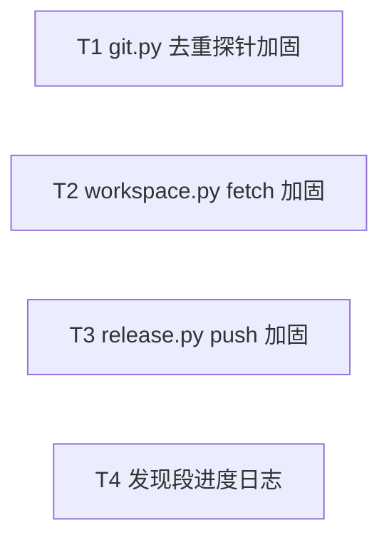

# 0035 · 裸 git 网络调用统一硬超时（fail-open）+ 发现段慢检查进度日志

<!-- 本文件由 spec 工具维护：frontmatter 为结构化源数据（含 tasks DAG），正文为组级 rust-RFC 9 段总览。 -->

## Summary

给所有走网络的**裸 `git` 子进程调用**统一加子进程硬超时，并按 **fail-open** 收口，让守夜（vigil）在
单点网络抖动下永远「活着进下一轮」而非无限阻塞整轮；同时给发现段的慢检查补 stderr 进度日志，让任一
检查卡住时输出明确停在对应那行。手段对齐仓内既有 `github.py` 的 `_GH_TIMEOUT_SECONDS` 做法：给三个仍在
跑网络 git 的模块（`utils/git.py` / `utils/workspace.py` / `utils/release.py`）各一个模块级常量
`_GIT_NET_TIMEOUT_SECONDS`，收敛到各自的 `_git` helper 上传 `timeout=`，再在各网络调用边界处理
`subprocess.TimeoutExpired`——去重探针超时**保守返回 True**（视作「可能在途」→ 本轮跳过、下轮重试），
fetch/push 超时**抛既有 `WorkspaceError` / `RuntimeError`**（由既有 per-issue / per-round `try/except`
隔离）。默认（网络正常）路径行为逐字节不变，超时只在真卡住时触发；不引入任何网络库 / 重试框架。

## Motivation

**现状：`openagents vigil` 会完全无输出地卡死。** 进程还活着，但一整轮不打任何日志、不再前进。根因是
发现段某个走网络的**裸 `git` 子进程调用没有超时**——底层 TLS 连接被网络抖动（网络切换 / 睡眠唤醒 /
VPN flap 留下的半开 socket）挂死后，git 在 `poll()` 里**无限等待**。该调用同步跑在守夜主循环里，于是
整轮冻死；且这道检查**过程无任何日志**，卡住时看不出停在哪。

排查后确认这不是孤例——**所有走网络的裸 `git` 子进程调用都没有传 `timeout=`**，任何一个都能以同样
方式挂死 vigil / CLI。对比之下，只有 `gh` 封装设了超时：`utils/github.py` 有模块级
`_GH_TIMEOUT_SECONDS = 30`，其唯一收口点 `_run_gh` 对 `subprocess.run` 传 `timeout=`、并 `except
subprocess.TimeoutExpired` 归一化处理（见该文件决策 4 / RFC-0010）。裸 git 缺的正是这一层。

**证据（本仓当前无超时的网络 git 调用点）。** issue #147 的原始行号引用的是**收敛前的扁平层**
（`openagents/vigil.py` / `workspace.py` / `conflict.py` / `conflictdiag.py` / `release.py`）；
Spec-0062–0065 的收敛弧线（recipes 6→3、图驱动并行 vigil、flat 层删除）已把这些搬迁/删除。下表按
**当前收敛后的真实代码**列出仍在跑网络 git 的调用点（证据驱动，理念 7/8——已逐一 `grep` 核对）：

| # | 当前位置 | git 操作 | 走网络 | 归属 helper |
|---|---|---|---|---|
| 1 | `utils/git.py::remote_branch_exists`（`git.py:55`） | `ls-remote --heads origin <branch>` | 是（去重探针，issue 原文点名的卡死点） | `git.py::_git` |
| 2 | `utils/workspace.py::Workspace.remote_branch_exists`（`workspace.py:138`） | `ls-remote --heads origin <branch>` | 是（去重探针） | `Workspace._git` |
| 3 | `utils/workspace.py::Workspace.prepare`（`workspace.py:55`） | `fetch origin <base>` | 是 | `Workspace._git` |
| 4 | `utils/workspace.py::Workspace.ensure`（`workspace.py:75`） | `fetch origin <branch>` | 是 | `Workspace._git` |
| 5 | `utils/workspace.py::Workspace.assert_delivered`（`workspace.py:95`） | `fetch origin <branch>`（`check=False`） | 是 | `Workspace._git` |
| 6 | `utils/release.py::_materialize_release`（`release.py:151`） | `push origin <source>:refs/heads/release/<version>` | 是 | `release.py::_git` |
| 7 | `utils/release.py::_materialize_release`（`release.py:155`） | `push origin <version>`（tag） | 是 | `release.py::_git` |

**与 issue 原表 10 行的对账（诚实映射，不凭空编造）：** 原 #1 `vigil.py:249` ls-remote → 本表 #1
（收敛后落到 `git.remote_branch_exists`，仍是 `__all__` 导出的稳定 git import 面函数）；原 #2 → 本表 #2；
原 #3/#4 workspace fetch → 本表 #3/#4/#5；原 #5 `workspace push -u`、原 #6/#7 `conflict.py`、原 #8
`conflictdiag.py` 的调用点**已随收敛删除**（`commit_and_push` 于 Spec-0056/T4 删除、`conflict.py` /
`conflictdiag.py` 整文件在 0062–0065 收敛中删除，harness 不再代 agent push）；原 #9/#10 release push →
本表 #6/#7。**不在此列的本地 git**（不走网络）：`git.py::head_sha`（rev-parse）/ `porcelain`（status）、
`workspace` 的 worktree add / rev-parse / diff / branch -D、`release._list_version_tags`（tag --list）、
`config.py` rev-parse / init / remote add、`backends/claude_code.py` status --porcelain——本地操作不挂死，
不加超时处理（只会随共享 `_git` 拿到一个无害的时间上限）。

**收敛后去重探针的现状（重要事实，避免读者误解）：** 图驱动的并行 vigil（Spec-0065）的每-tick 派单
去重已改由 **SQLite 认领队列 + `ready`/claim label**，`remote_branch_exists` 当前在 recipe 里**无活跃
调用方**（`grep` 仅命中定义与 `__all__`）。但它仍是 issue 点名的卡死点、仍在稳定 git import 面上导出、
一旦被接回热路径就会以同样方式挂死，故一并加固（超时 + fail-open + 进度面包屑），是「据实反推 + 面向
未来最小加固」的取舍，而非编造调用。

**可观测性缺口。** 发现段目前只在**结果**出来时才打日志，网络 / LLM 过程全哑（`_intake` 拉带标签
issue、`_admit` 调 triager LLM 分诊都无「检查中…」进度）。任一道检查卡住时，最后一行日志停在上一步的
**结果**行，看不出正卡在哪一步。

## Guide-level explanation

站在跑 `openagents vigil` 的人视角，这个改动改变的是「卡住时会发生什么」与「卡住时你看得见什么」。

**改动前。** 一次网络抖动就能让守夜整轮无声冻死：终端最后一行可能是上一轮的「守夜中，Ns 后再扫一轮」，
之后再无输出、进程活着但永不前进，只能 `Ctrl-C`。

**改动后。**

1. **超时兜底（可靠性）。** 任何一条网络 git 调用卡满 `_GIT_NET_TIMEOUT_SECONDS`（30s，与 gh 同款）
   就会被子进程超时中断，绝不无限等：
   - 若卡住的是**去重探针**（`remote_branch_exists`），超时按「保守可能在途」返回 `True`——本轮**跳过**
     这个 subject、下一轮重试，绝不误判成「远端没这个分支」而重复派单。
   - 若卡住的是 **fetch / push**，超时抛既有的 `WorkspaceError` / `RuntimeError`，被既有的 per-issue /
     per-round `try/except` 兜住——**跳过 + 下轮重试**，整个守夜进程照常活着进下一轮。
2. **进度日志（可观测性）。** 发现段的慢检查现在会先打一行「检查中…」到 stderr，卡住时输出会明确停在
   对应那行，一眼定位。典型一轮：

   ```
   ▶ 发现段：拉取带标签 issue…
   … issue #147 自检分诊方向(LLM)…
   ✓ issue #147：过准入门控，已打 openagents:ready
   ```

   若卡在拉 issue，输出停在第一行；若卡在 LLM 分诊，停在第二行——不再是「最后一行是上一步的结果」。

**逐字节不变的承诺。** 网络正常时，`timeout=` 永不触发、返回值 / 退出码一字不改；新增的只是几行 stderr
进度面包屑，不改任何业务返回值。

## Reference-level explanation

### 1. 超时常量（三模块各一份，对齐 github.py）

每个仍跑网络 git 的模块新增一个模块级常量，紧挨其 `_git` helper：

```python
# 子进程网络 git 超时秒数（对齐 github._GH_TIMEOUT_SECONDS = 30；只在真卡住时触发）。
_GIT_NET_TIMEOUT_SECONDS = 30
```

**为何不抽成一份共享常量：** `utils/git.py` 已 `from openagents.utils.workspace import Workspace,
WorkspaceError`（`git.py:23`），若把常量放 `git.py` 再让 `workspace.py` 反向 import 会成**循环依赖**；
放 `workspace.py` 又让与 worktree 无关的 `release.py` 去 import 它，语义别扭。三份 `= 30` 的重复是奥卡姆
下的最小代价（与 `github._GH_TIMEOUT_SECONDS` 同为模块局部常量，风格一致），换来零 import 耦合、零新模块
（备选见 Rationale）。

### 2. 收敛点 + fail-open 矩阵

**收敛点：** 每个模块的 `_git` helper 在 `subprocess.run(...)` 上多传一个 `timeout=_GIT_NET_TIMEOUT_SECONDS`
——这是每模块**唯一**加超时的地方（issue 要求的「收敛到 helper、避免逐点散设」）。本地 git 也经同一
helper，拿到的只是一个永不触发的无害上限。

**fail-open 动作按调用类别分（动作天生不同，故必须落在各调用边界，这不算「散设 timeout 值」）：**

| 类别 | 调用点 | 超时动作 | 依据 |
|---|---|---|---|
| 去重探针 | `git.remote_branch_exists` / `Workspace.remote_branch_exists` | `except subprocess.TimeoutExpired: return True` | 误判「无分支」会重复派单（不可接受）；保守判「可能在途」→ 跳过本轮、下轮重试（可接受） |
| fetch | `Workspace.prepare` / `ensure` / `assert_delivered` | `Workspace._git` `except TimeoutExpired: raise WorkspaceError(…超时)` | 转既有错误 → 落既有 per-issue / per-round `try/except` 隔离，不掀翻整轮 |
| push / tag push | `release._materialize_release` | `release._git` `except TimeoutExpired: raise RuntimeError(…超时)` | 转既有错误 → CLI 层转成干净一行提示，不掀翻进程 |

**workspace 的精确处理（唯一需要说明的细节）：** `Workspace._git` 在 `except TimeoutExpired` 时 `raise
WorkspaceError`——这一步同时覆盖 `prepare`（`check=True`）/ `ensure` / `assert_delivered`（`check=False`）
三个 fetch 调用方，全部转成 `WorkspaceError` 落既有隔离。而 `Workspace.remote_branch_exists`（`check=False`）
需要的是超时→`True` 而非抛错，故它**自己**包一层 `try: … except WorkspaceError: return True`：因为
`check=False` 时 `_git` 的 `WorkspaceError` **唯一来源就是这次超时转换**（普通非零退出在 `check=False` 下
正常返回 CompletedProcess、不抛），所以这层 catch 精确等价于「超时→True」，不会误吞真实 git 失败（真实
失败仍走 `bool(stdout)=""` → `False` 的既有路径）。此不变量是本设计的关键前提，写进验收断言。

`git.remote_branch_exists`（自由函数，`git.py::_git` 不做 `check`）则直接 `except
subprocess.TimeoutExpired: return True`。

### 3. 发现段进度日志（stderr，与既有 `_log` 一致）

`recipes/vigil.py` 已有 `_log(*, message)`（`print(message, file=sys.stderr, flush=True)`，`vigil.py:3081`）。
在发现段两个 LIVE 慢检查点各补一行进度：

- `_intake` 拉带标签 issue 前（`github.list_issues(labels=config.labels)`，`vigil.py:1605`）：
  `▶ 发现段：拉取带标签 issue…`
- `_admit` 调 triager LLM 分诊前（`stages.triage(...)`，`vigil.py:1629`）：
  `… issue #{issue.number} 自检分诊方向(LLM)…`

去重探针的第三点：收敛后 recipe 不在发现段内联跑 ls-remote（见 Motivation），故把它的「查远端分支去重…」
面包屑落在 `git.remote_branch_exists` 内部（T1，跑 ls-remote 前打 stderr）——该函数一旦被接回热路径即自
announce，卡住时输出停在这行。这是对 issue「三个慢点」意图的忠实落地，而非编造一个不存在的 recipe 调用。

### 4. Task DAG + 文件分配

四个 Task 各占一组不相交文件，彼此无依赖、可完全并行（协同模式单一 writer 所有权，理念 6）：



| Task | 拥有文件 | 干什么 |
|---|---|---|
| T1 | `openagents/utils/git.py`, `tests/test_utils_git.py` | `_GIT_NET_TIMEOUT_SECONDS` + `_git` 传 `timeout=` + `remote_branch_exists` 超时 fail-open 返回 True + 跑 ls-remote 前 stderr 面包屑 |
| T2 | `openagents/utils/workspace.py`, `tests/test_workspace.py` | `_GIT_NET_TIMEOUT_SECONDS` + `Workspace._git` 传 `timeout=` 且超时 `raise WorkspaceError` + `remote_branch_exists` 超时 fail-open 返回 True |
| T3 | `openagents/utils/release.py`, `tests/test_release.py` | `_GIT_NET_TIMEOUT_SECONDS` + `_git` 传 `timeout=` 且超时 `raise RuntimeError`（覆盖 push 分支 + push tag） |
| T4 | `openagents/recipes/vigil.py`, `tests/test_recipe_vigil_discovery.py` | `_intake` 拉 issue 前 + `_admit` 调 LLM 前两行 stderr 进度日志（新增聚焦测试文件，与既有 vigil 测试文件不相交） |

### 5. e2e 脚本路径

纯内部可靠性改动（无 UI），e2e 为 hermetic 离线脚本 `scripts/e2e-spec-0035-git-net-timeout.sh`——打桩
`subprocess.run` 抛 `TimeoutExpired`，跑 T1–T4 的定向 pytest 子集，断言三类 fail-open 分支 + 两行进度
日志落 stderr，不触真实 git / 网络（frontmatter `e2e:` 块声明 intent + method）。

## Drawbacks

- **常量三份重复。** `_GIT_NET_TIMEOUT_SECONDS = 30` 在三个模块各写一次（DRY 小代价，为换零 import 耦合）。
- **本地 git 拿到无害上限。** 本地操作也经共享 `_git`、也带上 30s ceiling——正常永不触发，但一个真卡死的
  本地 rev-parse（损坏仓库）会在 30s 后被中断，语义上是把「本地也不无限等」当作副带收益，非本 issue 目标。
- **去重超时→True 会拖慢一轮派单。** 网络抖动瞬间恰好落在 `remote_branch_exists` 上时，一个**真的不存在**
  的分支也会被判「可能在途」→ 该 subject 本轮被跳过、下轮才派——用一轮的派单延迟换「绝不重复派单」的安全，
  是刻意取舍。
- **`git.py` 打 stderr 面包屑。** 「只懂 git」的确定性层里出现一行 stderr 进度输出，是轻微的分层让步（面包屑
  仅是 `print(..., file=sys.stderr)`，与业务判断无关，可接受）。

## Rationale and alternatives

**为何这样做。** issue 的约束是「奥卡姆：不引入网络库 / 重试框架，只在现有 git helper 上加 `timeout=` +
`TimeoutExpired` 处理，常量与 github.py 同款」。本设计逐条照做：三个模块局部常量镜像 `_GH_TIMEOUT_SECONDS`、
timeout 收敛到各 `_git`、fail-open 动作按类别落在调用边界。守夜第一要务是「活着进下一轮」，故超时一律转成
「跳过 + 重试」，绝不无限阻塞。

**备选 1：抽一个共享 `_GIT_NET_TIMEOUT_SECONDS`（单一真源）。** 更 DRY，但 `git.py` 已 import
`workspace.py`，反向 import 成循环依赖；新开一个 `utils/git_constants.py` 又是为一个 int 增实体（违奥卡姆）。
取舍：接受三份重复，换零耦合零新模块。与 github.py 的模块局部常量风格也一致。

**备选 2：像 gh 那样加指数退避重试（`_GH_RETRY_*`）。** 拒绝。git 网络操作（fetch 半程、push）盲目
重试不安全、且 issue 明确「不引入重试框架」。守夜循环本身就是天然的重试粒度——fail-open「跳过 + 下轮
再来」等价于「在 vigil tick 尺度上重试」，无需在 git 层再叠一层。

**备选 3：用线程 / 信号 / async 看门狗做超时。** 拒绝。`subprocess.run(timeout=)` 是标准库内建、零依赖、
与 github.py 已验证的做法完全一致；自造看门狗是增实体。

**为何去重探针 fail-open 到 `True` 而非 `False`。** 两种误判的代价不对称：判 `False`（无分支）→ 重复派
单，多个 agent 抢同一个 issue（不可接受）；判 `True`（可能在途）→ 本轮跳过、下轮重试（只损失一轮延迟）。
守夜宁可慢一轮，不可重复干活。

## Prior art

- **同仓 `utils/github.py`（RFC-0010 决策 4）。** `_GH_TIMEOUT_SECONDS = 30` + `_run_gh` 的
  `subprocess.run(timeout=)` + `except subprocess.TimeoutExpired` 归一化——本 spec 是把这套已验证的做法
  从 gh 平移到裸 git，常量名 / 值 / 处理风格刻意同款。
- **k8s level-triggered reconcile（Spec-0065 已引为守夜模型）。** 「本轮读不到就下轮再来」是 reconcile
  循环的原生语义；fail-open 跳过 + 下轮重试正是这一模型下的自然容错，无需边沿捕获。
- **Python 标准库 `subprocess` 文档。** `run(..., timeout=N)` 到点杀子进程并抛 `TimeoutExpired`，是本
  设计唯一依赖的机制，无第三方库。

## Unresolved questions

- **30s 是否对所有网络 git 都合适？** 这些操作是浅 fetch / ls-remote / 推小 ref（非全量 clone），30s
  远够；但极慢链路下的大 fetch 理论上可能触碰上限（届时 fail-open 跳过 + 下轮重试，不致命）。是否需要
  可配置留待观察（见 Future）。
- **`Workspace.remote_branch_exists` catch `WorkspaceError` 的不变量。** 依赖「`check=False` 时 `_git` 的
  `WorkspaceError` 唯一来源是超时转换」——本 spec 将其固化为验收断言；若未来给 `check=False` 增加别的抛错
  路径，需同步复核这层 catch（备选是直接 catch `subprocess.TimeoutExpired`，代价是 `_git` 不能在 helper 里
  转换 timeout，转换点要下放到各 fetch 调用方）。
- **`claude_code.py` 的 `claude -p` 流式 `Popen` 无超时**——issue 附注明确**不在本 spec 内**：它是长时
  运行的 agent 调用，不能用硬超时，需要的是 idle/stall 超时（一段时间无输出才判死），机制不同，留作单独
  issue（见 Future）。

## Future possibilities

- **合并三个 `_git` helper 为单一共享确定性 git 运行器**（收敛后的清理）——届时 `_GIT_NET_TIMEOUT_SECONDS`
  自然归一为一份，本 spec 的三份重复随之消解。
- **给长时 agent `Popen` 加 idle/stall 超时**（issue 附注的单独议题）：一段时间无 stdout 输出才判死并杀树，
  与本 spec 的硬超时机制互补。
- **超时值可配置**（`.openagents/openagents.yml`）——若出现极慢链路用户，把 30s 提到声明式配置里；当前按
  奥卡姆先硬编码常量。

