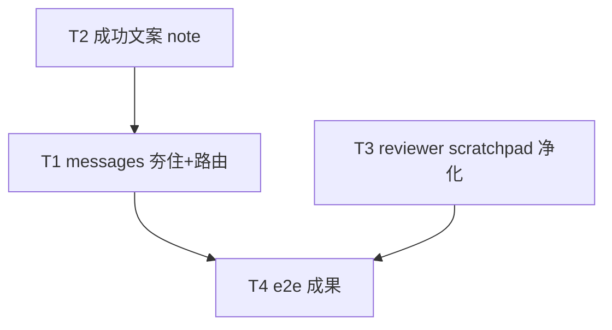

# 0041 · hold-merge PASS 后夯住待合并：已通过的 PR 冻结成 needs-human，消除同码复审震荡

<!-- 本文件由 spec 工具维护：frontmatter 为结构化源数据（含 tasks DAG），正文为组级 rust-RFC 9 段总览。 -->

## Summary

在 vigil 的代码评审闸 `_process_coding`（`openagents/messages.py`）里，当框架带 `--hold merge`（`hold.at_merge`）运行、reviewer 对某 PR 给出 PASS 时，当前实现只 `return {"reason": "hold-merge"}`——**不合并、不改状态、不打标签**的一次性空操作。PR 状态仍停在 `pr-open`，而 `pr-open` 在 `_OPEN_STATUSES` 里，于是下一轮 poll 又**从头把这个已 PASS 的 PR 重跑一遍代码闸**（可合并性 → CI → reviewer）。因为 reviewer 是非确定性的 LLM，同一份没变的代码会被反复审出不同结论，PASS↔REWORK 来回震荡，攒满 `MAX_ROUNDS` 后被 `_block` 打上 `needs-human`——一个本可直接合并的健康 PR 被永久卡死。

本 spec 把 hold-merge 分支从「空操作」改成「**夯住**」：reviewer PASS 且 `hold.at_merge` 时，复用既有冻结机制置 `STATUS_BLOCKED` + 打 `needs-human` 标签（`STATUS_BLOCKED` 不在 `_OPEN_STATUSES`，poll 自动跳过 → **不再重审**），但贴一句「✅ 已通过评审，待你合并」的**成功文案**（而非 `_block` 的失败文案），并把解挂 gate 设成能让「人回评论 → iterate、人撕标签 → resume、人点合并 → done」三个出口都走通的值。附带净化 `_block` 挂起评论里逐字透传的 reviewer `scratchpad`（内心独白不该当成给人的求救信息）。

## Motivation

**现状（就地复述，无需外读）。** OpenAgents 是 RFC/spec 驱动的多 Agent 框架，`vigil`（守夜人）每隔 interval 秒 poll 每个在途 run。单个 run 的处理入口是 `messages.py` 的 `_process_run`：先看 `github.is_merged`（已合并 → 置 `STATUS_DONE` + 关 issue）、`is_closed`（已关 → `STATUS_CLOSED`）、`status == STATUS_BLOCKED`（走解挂 `_process_blocked`），其余按阶段路由到 RFC 评审闸 `_process_rfc_review` 或代码评审闸 `_process_coding`（`messages.py:216-249`）。

**代码评审闸 `_process_coding`（`messages.py:374-452`）的流程**：可合并性预检（DIRTY/CONFLICTING → merge 闸；UNKNOWN → 本轮不动；BEHIND → `update_branch` 拉式同步后等下一轮）→ CI（fail → `iterate(reason="ci")`；pending → 等）→ CI 全绿则调 `review_code` 拿 `ReviewDecision`。裁决为 PASS 时（`messages.py:426-439`）：

```python
if decision.passed:
    if hold.at_merge:
        return {"pr_number": pr_number, "reason": "hold-merge"}   # ← 空操作，bug 所在
    github.merge_pr(pr_number=pr_number)
    self._state.update_status(issue_number=record.issue_number, status=STATUS_DONE)
    github.close_issue(number=record.issue_number)
    return {"pr_number": pr_number, "reason": "merged"}
```

`hold merge`（`openagents/hold.py` 的 `Hold.at_merge`）的设计意图是「reviewer 评审照跑，但 PASS 后不自动合并，把最后一下留给人」（Spec-0020/T3 引入的人类监督闸）。但它的实现只是「这轮别合并」的**一次性空操作**——**没有把 run 夯住**。它把「不自动合并」和「继续处理」混为一谈：PR 状态没变，仍是 `pr-open`。

**为什么这是 bug——`_OPEN_STATUSES` 让它被反复重审。** `_OPEN_STATUSES = {STATUS_RFC_REVIEW, STATUS_PR_OPEN, STATUS_ITERATING}`（`messages.py:64`）。`pr-open` 在其中，所以下一轮 poll 仍把这个 PR 当「在途、需推进」，再次进 `_process_coding`，再次 `review_code`。`review_code` 背后是**非确定性 LLM reviewer**（`openagents/reviewer.py`：`review()` 以任务模板调 `backend.run` 若干次聚合裁决，`reviewer.py:116-158`）。同一份没变的代码，这一轮 PASS、下一轮可能挑出新点判 REWORK：

- 真 REWORK（`decision.actionable`）→ `rounds++`；未超 `MAX_ROUNDS`（默认 3，`messages.py:75,90`）→ `iterate(reason="review")` 让写码 agent 追着改；
- 下一轮又 PASS → 又空转 hold-merge；再下一轮又 REWORK……
- `rounds` 攒满 → `_block(gate="code")` 打 `needs-human`（`messages.py:442-446`）。

**铁证（issue #106 的 PR #103，裁决时间戳对齐 commit 时间戳，同一 commit 先 PASS 后 REWORK）**：

- commit `975e7e1`：12:37 PASS → 期间无新 commit → 18:01 REWORK
- commit `6e3d95b`：18:14 PASS → 无新 commit → 20:06 REWORK
- commit `a5c954e4`：20:20 PASS → 无新 commit → 20:54 REWORK（卡死处）

同一份代码 34 分钟内一次 PASS 一次 REWORK，reviewer 甚至自相矛盾（一轮说「离线 e2e 是本仓库既定惯例、没问题」，另一轮又因「端到端脚本完全离线」打 REWORK）。PR #103 本身 `OPEN + MERGEABLE + CLEAN + rfc-approved`，却停在 `needs-human`——一个只差人点一下合并的健康 PR 被永久卡死。注意：#103 的 `needs-human` 是 REWORK 震荡耗尽 `rounds` 后 `_block` 打的，**hold-merge 那条路从头到尾没冻结过任何东西**。

**根因一句话**：`hold-merge` 是「这轮别合并」的空操作，没有夯住 run；一个 PASS 完只差人点合并的健康 PR，被当成活跃 PR 反复重新审判，追着非确定性评审员每轮的新意见改，永远收敛不了。

**附带小脏（一并修）。** `_block` 打 `needs-human` 时贴的结构化挂起评论（`openagents/blocknote.py` 的 `build`）把「卡在哪」段填成 `decision.feedback`——而 `decision.feedback` 是各非 PASS reviewer 的 `backend.run(...).summary` **逐字拼接**（`reviewer.py:147-155`），未做任何净化（`blocknote.py:40,50-52` 只逐行加 `> ` 前缀）。于是 reviewer 的**内心独白 / scratchpad**（如 `All 32 tests pass. I have enough to finalize. Let me capture...`）被当成给人的求救信息原样贴出，噪声淹没真正的卡点。

## Guide-level explanation

改动后，带 `--hold merge` 跑 vigil 的体验变成：

- **reviewer 对一个可合并的 PR 判 PASS** → 框架**冻住它**：置 `blocked`、打 `needs-human` 标签、贴一条「✅ 已通过评审，待你合并」的评论。因为 `blocked` 不在 `_OPEN_STATUSES`，**下一轮起 poll 直接跳过这个 PR，不再重审**。震荡从根上消失。
- **人点了合并**（GitHub 上手动 merge）→ 下一轮 poll 的 `is_merged` 分支（在 blocked 分支**之前**被检查，`messages.py:224` vs `:243`）reconcile 成 `done` + 关 issue。出口现成。
- **人回一条评论说要改** → 既有「回评论解挂环」（issue #89 / Spec-0032）读到 block 水位线之后的新人类评论 → 按 gate 喂 `iterate(reason="human")` 让写码 agent 据评论迭代。出口现成。
- **人手撕 `needs-human` 标签** → 既有「摘标签解挂」兜底路径（`_unblock_by_label`）→ resume 回 `pr-open`。出口现成。

关键：**三个出口全部复用既有机制，无需新写**（`is_merged` reconcile、Spec-0032 解挂环、`_unblock_by_label`）。本 spec 只把 hold-merge 分支从「空操作」换成「调用既有冻结原语 + 贴一条成功文案 + 设对解挂 gate」。

一次典型时序（引入本方案后）：

1. PR 就绪（MERGEABLE、CI 绿），reviewer 判 PASS，`hold.at_merge` 为真。
2. 框架冻住：`blocked` + `needs-human` + 贴「✅ 已通过评审，待你合并」。
3. 下一轮 poll：run 是 `blocked`，走 `_process_blocked`；无新人类评论、`needs-human` 仍在 → `return None`，**不重审**。
4. 人点合并 → 下轮 `is_merged` → `done`；或人回评论要改 → `iterate`；或人撕标签 → resume。

对比修复前：第 2 步会是「空操作、状态仍 `pr-open`」，第 3 步会「再审一遍」→ 震荡。

**成果可视化（理念 8）。** OpenAgents 已有本地成果看板：`openagents/results.py` 的 `board(state)` 把各 `RunRecord` 渲染成单页静态 `templates/board.html`（Issue / 状态 / PR / 摘要 四列表格，无 JS），`oa board` 命令用标准库 `webbrowser` 打开。本 spec 的可见成果是：一个 hold-merge PASS 的 PR 在看板上**从 `pr-open` 一次性转成 `blocked` 后就稳定不动**——连续多轮 poll 后看板那一行状态/摘要不再翻动（修复前会看到 rounds 攀升、状态在 open 与 blocked 间反复、评论越贴越多）。e2e 用浏览器导航 `board.html` 对「冻结后稳定、无震荡」做断言 + 截图（详见 Reference-level）。

## Reference-level explanation

### 决策 A：hold-merge PASS 分支改为「夯住」（`openagents/messages.py`）

把 `_process_coding` 的 PASS 分支（`messages.py:426-439`）里的 hold-merge 子分支从空操作改为调用一个新的私有收口 `_hold_merge_freeze`：

```python
if decision.passed:
    if hold.at_merge:
        return self._hold_merge_freeze(record=record)   # 夯住：blocked + needs-human + 成功文案
    github.merge_pr(pr_number=pr_number)
    ...
```

`_hold_merge_freeze(record)` 复用 `_block` 的冻结骨架（次序沿用 `_block`：先贴评论 → `add_label` → `update_status(BLOCKED)` → `set_block_gate` → `set_block_watermark`，`messages.py:535-553`），但两处不同：

1. **贴成功文案，不贴失败文案**：调 T2 在 `blocknote` 里新增的「✅ 已通过评审，待你合并」纯函数生成正文（而非 `blocknote.build` 的「🤖 卡住了」四段模板），再经 `identity.post_signed_comment` 盖签名贴出（盖签名 → 解挂读侧 `new_human_comments` 按签名滤掉它、不自触发，与 `_block` 同理）。
2. **设自描述的解挂 gate = `"merge-hold"`**（不复用 `"code"`——见下）：`set_block_gate(gate="merge-hold")`，使运维看 `block_gate` 即知「这条 blocked 不是评审失败、而是通过后待合并」（理念 8 可观测性，与 `reviewer.py:178-183` 区分 REWORK/评审无效 同精神）。`set_block_watermark` 落挂起时刻最新评论 createdAt（含刚贴的成功评论），供解挂环只认水位线之后的新人类评论。

### 决策 B：`merge-hold` gate 的解挂路由（`openagents/messages.py`）

三个出口里，`is_merged`（人点合并）与 `_unblock_by_label`（人撕标签）**无需改动**即对 `merge-hold` 正确：

- **人点合并** → `_process_run` 的 `is_merged` 分支先于 blocked 分支被检查（`messages.py:224`）→ `done` + 关 issue。✅ 现成。
- **人撕标签**（无评论）→ `_process_blocked` 发现无新评论且 `needs-human` 已被摘 → `_unblock_by_label`（`messages.py:320-339`）：`block_gate != "merge"` → 落 else 分支 resume 回 `pr-open`（有 `rfc-approved` 标签）+ 清 `block_gate`。✅ 现成（`merge-hold` 天然落 else，无需新分支）。

唯一需要新增的路由：**人回评论要改** → `_process_blocked` → `_unblock_with_comment`（`messages.py:267-308`）。当前该函数按 gate 分 `rfc*`→refine、`code*`→iterate、`merge`→armed、else→resume。为让 `merge-hold` 的评论解挂喂 `iterate(reason="human")`（人在健康 PR 上回评论 = 想让写码 agent 据评论改），加一条分支：`gate == "merge-hold"` 与 `code*` 同款处理（`iterate(reason="human", detail)` + 清 `block_gate` + `_post_comment_reply` 引用原评论贴回应）。

> **为何不直接复用 `gate="code"`（备选，见 Rationale）**：复用能零新增路由（`code*` 已 iterate），但会让一个健康、已通过的 PR 的持久化状态显示 `block_gate="code"`（评审失败），误导运维与未来的按 gate 分流；理念 8 看重可观测性，故付一条 `elif` 的代价换自描述状态。

### 决策 C：净化 reviewer scratchpad（`openagents/reviewer.py`）

附带小脏的根在**反馈聚合处**（`reviewer.py:147-155` 把各非 PASS reviewer 的 `.summary` 逐字拼进 `feedback`），而非展示处（`blocknote` 无从分辨哪段是 scratchpad）。在 `reviewer.py` 加一个纯函数 `_distill_feedback(summary) -> str`，在拼接 `feedback` 前对每个 summary 施用：抽出 reviewer 给人看的「可操作反馈」段、剥掉内心独白 / scratchpad（如以 `Let me`、`I have enough`、`All N tests pass` 等第一人称过程叙述开头、且不含裁决结论的行/段）。净化后为空则回落到既有占位「（reviewer 未给出可解析的裁决，按疑罪从严视为未通过）」。净化只作用于**喂给人的 `feedback`**；`verdicts`/`actionable` 判定与 `render_decision` 票型渲染不变（零回归）。具体启发式规则与阈值属实现细节，验收以「给定含 scratchpad 的样本 summary，净化后 `feedback` 不含内心独白、保留可操作反馈」断言。

### 决策 D：无需新增 state 字段

冻结全程复用既有 `State` 方法（`update_status` / `set_block_gate` / `set_block_watermark` / `add_label`），`block_gate` 是自由字符串、容纳 `"merge-hold"` 无需迁移。**不引入 `reviewed_sha` 之类的评审缓存字段**（见 Rationale 备选 1）——夯住机制已让每个 commit 在 hold-merge 路径下只审一次，无需额外的 per-sha 缓存表。

### DAG 与文件分配

| Task | 标题 | files（单一 writer 所有权，组内互斥） | depends-on |
|---|---|---|---|
| T1 | hold-merge 夯住 + merge-hold 解挂路由 | `openagents/messages.py`, `tests/test_messages_hold_merge_freeze.py` | T2 |
| T2 | 「✅ 已通过评审，待你合并」成功文案 | `openagents/blocknote.py`, `tests/test_blocknote_hold_merge.py` | — |
| T3 | 净化 reviewer scratchpad | `openagents/reviewer.py`, `tests/test_reviewer_feedback_distill.py` | — |
| T4 | 端到端成果测试（含浏览器看板「冻结后稳定」断言） | `scripts/e2e-spec-0041-hold-merge-freeze.sh`, `tests/test_hold_merge_freeze_integration.py` | T1, T2, T3 |



T2、T3 无相互依赖，可并行（协同模式，各持不相交 `files`）；T1 依赖 T2 的 note 纯函数；T4 汇合三者。

### e2e 成果脚本（PR 指路牌拾取）

**路径：`scripts/e2e-spec-0041-hold-merge-freeze.sh`**，沿用本仓库 e2e 两段式约定（默认离线确定性验证；`OPENAGENTS_E2E_REAL=1` 时追加真实冒烟）：

**阶段 1——离线确定性（默认，全程 mock）**：ruff lint/format + pytest；核心集成用例 `tests/test_hold_merge_freeze_integration.py`：

1. **反震荡断言（bug 的核心回归）**：构造一个 `hold.at_merge=True` 的 `Poller`，PR 桩为 MERGEABLE/CLEAN、CI 绿，reviewer 桩恒返回 PASS（并计数被调次数）。第一次 `poll()` → 断言 run 转 `blocked`、`needs-human` 标签已打、恰贴一条「✅ 已通过评审，待你合并」评论（**不含**「🤖 卡住了」失败文案、**不含** scratchpad）、`block_gate == "merge-hold"`。**第二次 `poll()`** → 断言 reviewer 桩调用次数**未增加**（没重审）、状态仍 `blocked`、无新评论、`rounds` 未增。此即「同码不再复审震荡」的确定性证据。
2. **三出口断言**：（a）把 PR 桩改成 `is_merged=True`，poll → `done` + 关 issue；（b）在水位线后注入一条人类新评论，poll → `iterate(reason="human")` 被调、resume；（c）摘掉 `needs-human` 标签，poll → resume 回 `pr-open`。
3. **scratchpad 净化断言**：给一个含内心独白的 reviewer summary，`_distill_feedback` 后 `feedback` 不含独白、保留可操作反馈（T3 单测，e2e 引用）。

**阶段 1 浏览器成果断言（理念 8，用 Playwright / chrome-devtools MCP）**：用上面构造的 `State` 分别在「第一次 poll 后」「第二次 poll 后」调 `results.render` 写出两份 `board.html`，浏览器 `navigate` 到 `file://.../board.html`：

- 在冻结后的看板 `snapshot` + `take_screenshot`，**断言该 PR 恰好一行、状态列为 `blocked`**（不是 `pr-open`，不是消失）。
- 对「第一次 poll 后」与「第二次 poll 后」两份看板**断言该行完全一致**（状态、摘要、PR 号不变）——即「冻结后跨轮稳定、无震荡」的可见成果（修复前两份会不同：rounds/状态翻动）。两张截图留档对比。
- `list_console_messages` / `list_network_requests` 断言无报错、无失败请求（看板为纯本地静态页，不应有网络失败）。
- **降级**：若运行环境无浏览器 MCP，此步降级为对渲染出的 `board.html` 做 HTML 文本断言（grep PR 行、比对两份 HTML 该行一致），不跳过成果验证。

**阶段 2——真实冒烟（`OPENAGENTS_E2E_REAL=1`，会真实开 PR）**：在 scratch 仓库真实开一个可合并 PR，带 `--hold merge` 跑一轮 vigil，验证 PR 被打上 `needs-human`、评论是成功文案；随后连跑两轮验证无重复评审评论堆积。

## Drawbacks

- **`needs-human` 从此一词两义**——既表示「失败卡住，救我」，也表示「健康，等你点合并」；看板/按标签筛时两者混在一起分不出。为保持简洁**接受**这个信号冲淡（**不新增** `awaiting-merge` 专用标签）。`block_gate="merge-hold"` 在 state 层面可区分二者（决策 B），但 GitHub 标签层面不区分。
- **冻住的 PR 不会自己跟 main 集成**。本仓库当前是**拉式同步**（Spec-0023/0038：合并后不再 push 扇出，各 open PR 轮到自己时在 `_process_coding` 的 BEHIND 分支由 `update_branch` 跟上集成，`messages.py:404-414`）。`blocked` 不在 `_OPEN_STATUSES`，poll 跳过它 → 它**不会**自动 `update_branch`。若在冻结期间 main 前进，人点合并时可能撞到 GitHub 合并按钮层面的落后/冲突（人此刻在场，可手动 rebase 或回评论触发解挂）。此取舍在拉式同步下比 issue 原文假设的 eager 扇出下更需明示，故记于此（issue 原文按 eager 扇出描述，与当前代码不符——以代码为准，理念 7）。
- **人撕标签但不合并 → 会重审一次**。撕标签走 `_unblock_by_label` resume 回 `pr-open` → 下轮重进 `_process_coding` → 又 PASS → 又冻结。这是**人主动触发**的一次重审（非自动震荡），有界、可接受；但意味着「撕标签」不是「放行合并」的正确操作（正确操作是点合并）。
- **scratchpad 净化是启发式**，可能误删真正的可操作反馈或漏删某些独白格式。回落占位保证不会把 `feedback` 净化成空导致人一无所知；且净化只影响展示、不影响 `actionable`/裁决，风险被限制在「给人看的文案质量」。

## Rationale and alternatives

**为什么是「夯住 + 复用既有出口」。** 震荡的根是「PASS 完只差人合并的健康 PR 仍被当活跃 PR、被 `_OPEN_STATUSES` 拉回反复重审」。最小的根治是让它**离开 `_OPEN_STATUSES`**——而 `STATUS_BLOCKED` 正是既有的「poll 自动跳过」状态，`needs-human` 是既有的「求救/待人」标签，`is_merged`/解挂环/撕标签三条恢复路径也都现成。于是本方案不新建状态机、不加 state 字段、不写新出口，只把一个空操作换成「调既有冻结原语 + 贴成功文案 + 设对 gate」（奥卡姆，理念 1）。

**备选 1——按 commit sha 缓存评审结论（issue 标题的字面方案）。** 给 `RunRecord` 加 `reviewed_sha` + 缓存该 sha 的裁决；下一轮若 HEAD sha 未变则跳过 `review_code` 直接复用缓存裁决，避免同码重审。**为何不取为主修**：（a）它是更重的机制——要新增持久化字段、定义缓存失效（新 commit、rebase、force-push、base 前进后集成态变化都改变「该审什么」）、还要决定「缓存 PASS 后该做什么」（若仍停 `pr-open` 则照样被 `_OPEN_STATUSES` 拉回、只是不重审但也不前进，问题没根治）；（b）issue 明确判定「反复重审直到翻盘」本身就是 bug、不是待优化的 feature，夯住后**每个 commit 只审一次**已达到「按 sha 只审一次」的等价效果，无需显式缓存表；（c）夯住直接解决了「PASS 后卡在 open 空转」，而 sha 缓存只解决「重复审」不解决「空转」。故 sha 缓存留作 Future（若将来去掉 hold、或有非 hold 路径也出现同码重审时再引入）。**本 spec 采纳 issue 正文的「夯住」建议修法，把 sha 缓存作为记录在案的备选。**
- **接口不变的可替换性**：即使将来引入 sha 缓存，它作用于 `_process_coding` 调 `review_code` 之前的短路，与本 spec 的「PASS 后夯住」正交、可叠加。

**备选 2——用评审员多签 / 复核对抗非确定性。** 让多个 reviewer 投票、多数 PASS 才算 PASS，降低单次翻案概率。**不取**：issue 明确「不建议用多签复核作为本 issue 主修」——夯住后每个 commit 只审一次（正常评审波动，人能兜），追着「反复重审直到翻盘」本身就是这个 bug，不能当 feature；多签只是降低震荡频率、不消除「PASS 后仍空转被拉回」的结构性根因。（注：`reviewer.configured_reviewers` 已支持 n 个 reviewer，本 spec 不改其语义。）

**备选 3——hold-merge PASS 后用 `pr-open` 之外的新状态（如 `awaiting-merge`）而非复用 `blocked`。** 语义最干净（不冲淡 `needs-human`），但要新增状态常量、把它排除出 `_OPEN_STATUSES`、给它配全套解挂/reconcile 出口、看板加新状态展示——一整套新实体。issue 明确**接受** `needs-human` 一词两义以换简洁，故**不取**，仅在 state 层用 `block_gate="merge-hold"` 做轻量区分。

**备选 4（决策 B 内）——复用 `gate="code"` 而非新 `merge-hold`。** 零新增路由，但持久化状态把健康 PR 标成「代码评审失败」，误导可观测性。付一条 `elif` 换自描述状态，**取 `merge-hold`**。

## Prior art

- **本仓库既有冻结/解挂骨架**：`_block` 置 `STATUS_BLOCKED` + `needs-human`（Spec-0032）、回评论解挂环（issue #89 / Spec-0032 `_unblock_with_comment` + Spec-0036 引用原评论回应）、撕标签解挂 `_unblock_by_label`（issue #49 / Spec-0031）、`is_merged` reconcile（RFC-0017）。本 spec 全程复用这套既有原语，只新增「成功文案 note」与「`merge-hold` gate 的一条 iterate 路由」。
- **人类监督闸 `hold`**（Spec-0020/T3）：`--hold spec` / `--hold merge` 把某道闸的最后一下留给人。本 spec 修的是 `hold merge` 分支「留给人」却没「夯住」的缺陷——把它做成真正的「停下来等人」。
- **CI 系统的「同 commit 结果缓存」范式**（如 GitHub Actions/Buildkite 对同一 SHA 不重跑已成功的 check）：备选 1 的 sha 缓存即此范式的移植；本 spec 用「夯住」达到等价「每 commit 审一次」而不引入缓存表，是同一目标的更轻实现。
- **可观测性区分同名状态的先例**：`reviewer.render_decision` 把「REWORK」与「评审无效（裁决无法解析）」分开渲染（`reviewer.py:178-183`）——本 spec 的 `block_gate="merge-hold"` 沿用同一「同名结果、底层可区分」精神。

## Unresolved questions

- **scratchpad 净化的启发式边界**：以什么规则判定一行/一段是「内心独白」而非「可操作反馈」？初版用保守启发式（第一人称过程叙述 + 无裁决结论），实测样本后再调；是否值得让 reviewer 任务模板**结构化输出**（如强制 `## 可操作反馈` 段）从源头免净化，留作 Future。
- **人撕标签重审一次是否需要抑制**：撕标签 resume → 重审一次（有界，见 Drawbacks）。是否要在 resume 时对「未变的 HEAD sha」短路重审（即备选 1 的轻量版），或接受这一次人触发的重审？初版接受。
- **拉式同步下冻结 PR 的落后处理**：冻结期间 main 前进，人点合并时若 GitHub 报落后/冲突，是否需要在成功文案里提示「合并前可能需 rebase」？初版不提示，观察真实使用后再定。
- **`merge-hold` 是否该进 `render_decision`/看板文案**：state 层已可区分，但看板仍显示 `blocked`。是否值得在看板对 `block_gate="merge-hold"` 的行加一个「待合并」轻标注（不新增 GitHub 标签）？留待观察，初版不改看板。

## Future possibilities

- **按 commit sha 的通用评审缓存**（备选 1）：若将来出现非 hold-merge 路径的同码重审，或要在 resume 后免重审，引入 `reviewed_sha` + 裁决缓存 + 失效规则；接口对 `_process_coding` 正交、可叠加在本 spec 之上。
- **reviewer 结构化输出**：让评审任务模板强制输出「裁决 + 可操作反馈」分段，从源头消除 scratchpad 泄漏，`_distill_feedback` 退化为直接取结构化段。
- **`awaiting-merge` 专用信号**：若「一词两义」的 `needs-human` 在真实看板使用中造成明显困扰，再引入专用标签/状态，把 `block_gate="merge-hold"` 提升为一等公民（含看板展示、按标签筛）。
- **冻结 PR 的自动跟随集成**：拉式同步下给 `blocked`（`merge-hold`）的 PR 一条「仅 `update_branch`、不重审」的轻路径，让它冻结期间也能跟 main 集成，减少人点合并时的落后概率。

