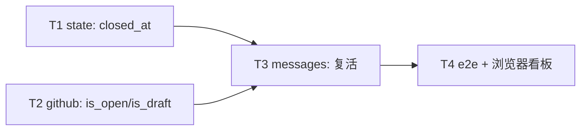

# 0042 · PR close→reopen 后复活被冻死的 run：closed 不是真终态

<!-- 本文件由 spec 工具维护：frontmatter 为结构化源数据（含 tasks DAG），正文为组级 rust-RFC 9 段总览。 -->

## Summary

守夜人（vigil）的 poll 循环里，PR 被 close 后本地 run 被置成 `STATUS_CLOSED` 这个**单向终态**——poll 每轮在循环入口把非 open、非 blocked 的 run 直接 `continue` 略过，从此不再查它的 GitHub 状态与评论。但 GitHub 的 PR **close 不是不可逆的**：它可以被 reopen 重新变回 `OPEN`。当前实现没有「reopen → 复活 run」这条反向路径，于是一个 close 过、又被 reopen 的 PR 上，后续的人类评论 / CI / 阶段流转全部空转。

本 spec 给本地 `closed` 的 run 补上**「重开复活」**：poll 发现某 `closed` run 对应的 PR 在 GitHub 上又变回 `OPEN`（reopened）时，按 PR 现状推断阶段复活它——**draft PR → `rfc-review`；已转正 / 带 `rfc-approved` → `pr-open`（走代码闸）**——清掉 `closed`、续跑既有流程。成本用一个 **`closed_at` 复活窗口**上界住：只有「近期 close 的」run 才每轮花一次 `gh` 查 reopen，超出窗口的老 `closed` run **硬化成真终态**、永不再查（避免对所有历史 `closed` run 无界增长地发 `gh`）。`is_merged` 仍是不可逆真终态，**不参与复活**。

## Motivation

**现状（就地复述，无需外读）。** OpenAgents 是 RFC/spec 驱动的多 Agent 框架，`vigil`（守夜人）每隔 interval 秒 poll 每个在途 run（`openagents/messages.py` 的 `Messages.poll`，`messages.py:172`）。poll 遍历 `state.all_runs()`，在循环入口有一道**跳过守卫**（`messages.py:189`）：

```python
for record in self._state.all_runs():
    # issue #49：blocked 也纳入扫描（用于解挂/reconcile），其余非 open 状态照常跳过。
    if record.status not in _OPEN_STATUSES and record.status != STATUS_BLOCKED:
        continue
    ...
    event = self._process_run(record=record, hold=hold)
```

其中 `_OPEN_STATUSES = {STATUS_RFC_REVIEW, STATUS_PR_OPEN, STATUS_ITERATING}`（`messages.py:64`）。通过守卫的 run 进 `_process_run`（`messages.py:216`），它按优先级 reconcile：

```python
# 1. 已合并优先于一切：置 done 并关 issue（决策 8）。
if github.is_merged(pr_number=pr_number):
    self._state.update_status(issue_number=record.issue_number, status=STATUS_DONE)
    github.close_issue(number=record.issue_number)
    return {"pr_number": pr_number, "reason": "merged"}
# 1b. RFC-0006：人主动关闭（未合并）也是终止信号 → 置 closed 并跳过。
if github.is_closed(pr_number=pr_number):
    self._state.update_status(issue_number=record.issue_number, status=STATUS_CLOSED)
    return {"pr_number": pr_number, "reason": "closed"}
# 1c. blocked → 两层解挂（回评论 / 撕标签）。
if record.status == STATUS_BLOCKED:
    return self._process_blocked(record=record)
# 2. 其余按阶段路由 rfc-review / coding。
```

`STATUS_CLOSED`（`state.py:37`）的注释写得很直白：「PR 被关闭但未合并的终态（人主动放弃）；不在 `messages._OPEN_STATUSES` 内，故置 closed 后该 run 不再被守夜人轮询处理」。`github.is_closed`（`github.py:689`）就是 `gh pr view <n> --json state` 判 `state == "CLOSED"`；`is_merged`（`github.py:634`）判 `state == "MERGED"`；GitHub 的 PR `state` 是 `OPEN / CLOSED / MERGED` 三态互斥。

**根因——`closed` 被当成了不可逆终态，但它可逆。** 一旦 `_process_run` 走过 `is_closed` 分支把 run 置 `STATUS_CLOSED`，这个 run 就**永久掉出 poll 的处理范围**：下一轮 poll 在入口守卫处直接 `continue`，压根不会再调 `_process_run`、不会再查它的 GitHub `state`、也不会再读它的评论。问题是：**GitHub 上 close 的 PR 可以被 reopen 重新变回 `OPEN`**，而框架没有「`is_reopened` → 复活 run」这条反向恢复路径——`is_merged` 与 `is_closed` 都被当成一次性终态处理了。于是本地 run 永远停在 `closed` → poll 永远跳过 → reopen 之后的评论 / CI / 阶段流转全部到不了它。

**铁证（受害 PR #105）**：19:01 挂 `needs-human` → 07-02 06:22 被 close（守夜人置本地 run `closed`）→ 之后被 reopen（现 `state=OPEN`）→ 07-02 08:00 人留新评论「解一下冲突」（无签名人类评论）。守夜人**没捕获这条评论、在空转**——因为该 run 已被 `closed` 冻死、退出了 poll 的处理范围。

**为什么已有的解挂环救不了它。** issue #89 / Spec-0032 引入了「人在 block 之后回新评论 → 自动摘 `needs-human` + 把评论喂给对应闸」的回评论解挂环，但它只在 `_process_blocked`（`messages.py:251`）里生效，而 `_process_blocked` 只对**仍被 poll 扫描的 `blocked` run**（`status == STATUS_BLOCKED`，通过了入口守卫）触发。PR #105 的 run 已经是 `closed` 而非 `blocked`——它在入口守卫处就被 `continue` 掉了，读侧根本轮不到它，Spec-0032 的解挂逻辑无从执行。

**为什么 `closed` 可逆而 `merged` 不可逆。** GitHub 上 merge 是不可逆的（合并后 `state` 恒为 `MERGED`，无法「un-merge」），所以 `is_merged → done` 作为终态完全合理，**不参与复活**。但 `close` 只是「这条 PR 现在不活跃」，随时能 reopen 回 `OPEN`——把它当成和 `merged` 一样的永久终态，是把「暂时不活跃」误当成「彻底放弃」。这是与 #106（Spec-0041，已 PASS 的 PR 被反复重审震荡）**相关但独立的另一个状态机缺陷**：#106 是「活跃 run 收敛不了」，本 issue 是「已冻死的 run 复活不了」。

**成本约束（必须在设计里解决）。** 简单地「把所有 `closed` run 也纳入 poll 扫描、每轮各发一次 `gh` 查 reopen」会导致**无界增长**：随着项目累积历史 `closed` run（放弃的实验、重复 PR……），每轮 poll 的 `gh` 调用数会线性膨胀，而其中绝大多数永远不会被 reopen。所以复活必须**有界**——只对「近期 close 的」run 花 `gh` 成本，老 `closed` run 要能硬化成真正的终态。

## Guide-level explanation

改动后，守夜人对 close→reopen 的 PR 的行为变成：

- **PR 被 close（未合并）** → 和现在一样：本地 run 置 `closed`，poll 后续轮次跳过。**额外地**，reconcile 到 `closed` 的这一刻会**记下 close 时间戳 `closed_at`**（复活窗口的起点）。
- **PR 被 reopen（`closed` 之后又变回 `OPEN`）** → 只要它还在**复活窗口**内（默认 close 后 7 天内），poll 就会把它纳入扫描、发一次 `gh pr view` 发现它已 `OPEN` → **复活它**：
  - PR 仍是 **draft**（RFC 还没批、代码还没写完）→ 复活到 `rfc-review`，继续走 spec 评审闸；
  - PR **已转正 / 带 `rfc-approved` 标签**（RFC 已批、代码 PR）→ 复活到 `pr-open`，继续走代码闸（可合并性预检 → CI → reviewer）。
  - 复活即清掉本地 `closed` 状态与 `closed_at`，run 重新进入既有流程。**下一轮 poll 起**，这个 run 就是一个正常的 open run：PR #105 的「解一下冲突」场景——复活到 `pr-open` 后，代码闸的可合并性预检发现 `DIRTY / CONFLICTING`，自然落到既有的解冲突 / merge 闸路径去处理，评论也重新被既有机制读到。**不空转了**。
- **PR 一直没被 reopen**，close 超过复活窗口（默认 7 天）→ 这个 `closed` run **硬化成真终态**，poll 不再对它发任何 `gh` 查询（成本有界）。
- **PR 被 merge** → 走既有 `is_merged → done` 分支，**永不复活**（merge 不可逆）。

从人的视角：**「reopen 一个 PR」这个 GitHub 上的自然动作，本身就是叫守夜人回来接着干的信号**——不需要额外评论、不需要手动改 label。

## Reference-level explanation

### 技术方案

三处协同改动，各自独占文件（单一 writer，理念 6）：

1. **`openagents/state.py`（T1）——`closed_at` 字段 + setter。** `RunRecord` 新增 `closed_at: str = ""`（ISO8601 字符串；默认值向后兼容缺键的旧 `state.json`，镜像 Spec-0032 `block_watermark` 的加法）。新增 `set_closed_at(*, issue_number, when)`：按 issue 定位 run、只改 `closed_at` 单字段、整体落盘（镜像既有 `set_block_watermark` / `set_block_gate` 写法）。`when=""` 表示清除（复活时用）。`STATUS_CLOSED` / `_OPEN_STATUSES` 等常量不动。

2. **`openagents/github.py`（T2）——`is_open` + `is_draft` 只读薄封装。** 与既有 `is_closed` / `is_merged` 对称：
   - `is_open(*, pr_number) -> bool`：`gh pr view <n> --json state`，判 `state == "OPEN"`（识别 reopen）。
   - `is_draft(*, pr_number) -> bool`：`gh pr view <n> --json isDraft`，判 `isDraft` 为真（区分「draft→rfc-review」与「转正→pr-open」）。
   - 复用既有 `has_label(pr_number=..., name=APPROVAL_LABEL)`（`github.py:395`，`APPROVAL_LABEL="rfc-approved"`）作为「已转正」的旁证。不改既有函数（零回归）。

3. **`openagents/messages.py`（T3）——复活窗口守卫 + 复活 reconcile。** 引入模块常量 `REOPEN_REVIVE_WINDOW_SECONDS`（默认 `7 * 24 * 3600`，注释标可调）。
   - **入口守卫（`messages.py:189`）放行「复活候选」**：`closed` 且 `closed_at` 在窗口内的 run 也纳入扫描。改成：
     ```python
     if (record.status not in _OPEN_STATUSES
             and record.status != STATUS_BLOCKED
             and not self._revive_eligible(record=record)):
         continue
     ```
     `_revive_eligible(*, record)`：`status == STATUS_CLOSED` 且 `closed_at` 非空且 `now - closed_at <= REOPEN_REVIVE_WINDOW_SECONDS`（`now` 取 `datetime.now(timezone.utc)`；时间逻辑集中在 messages）。超窗口 / 无 `closed_at` → `False`（真终态，仍跳过）。
   - **`closed` reconcile 时打时间戳**：`_process_run` 的 `is_closed` 分支（`messages.py:236`）在置 `STATUS_CLOSED` 的同时 `set_closed_at(when=<now iso>)`。**仅在 open→closed 这一次转移时打戳**，对「已经是 closed、本轮复查仍 closed」的 run **绝不重打戳**（否则窗口永远刷新 → 退化成无界，成本约束失效）。
   - **复活分支**：`_process_run` 在 `is_merged` 之后、`is_closed` 之前插入对本地 `closed` run 的专属处理（只有复活候选能走到这里）：
     ```python
     if record.status == STATUS_CLOSED:
         return self._revive_if_reopened(record=record)
     ```
     `_revive_if_reopened(*, record)`：
     - `not github.is_open(pr_number)` → 仍是 closed（或已 merged，已在上分支收口）→ `return None`（保持跳过、**不重打戳**）。
     - 已 `OPEN`（reopened）→ 推断阶段：`github.is_draft(pr_number)` 为真 → `STATUS_RFC_REVIEW`；否则（已转正 / `has_label(APPROVAL_LABEL)`）→ `STATUS_PR_OPEN`。`update_status(status=<stage>)` + `set_closed_at(when="")` 清戳，`return {"pr_number", "reason": "reopened", "stage": <stage>}`。
   - 复活只做「状态归位」，**当轮返回 `reopened` 事件、不立即续跑闸逻辑**；下一轮 poll 这个 run 已是正常 open run，走既有 rfc-review / coding 路径（评论 / CI / 冲突全部由既有机制处理，零新增读侧逻辑）。`poll` 的 reason 集合文档串补上 `"reopened"`。

**状态机不变式**：`merged` 恒为终态（不参与复活）；`closed` 在复活窗口内可逆、窗口外硬化为真终态；复活只把 `closed → {rfc-review | pr-open}`，绝不凭空造别的状态。

**范围边界——为什么只改 `messages.py`、不碰 `vigil.py`。** vigil 的派单发现段（`vigil.py` 的 `_dispatch_kind`）对「已存在 run（含 `closed`）的 issue」返回 `None`、**不重新派单**——这是正确的：本 spec 的复活是**对既有 run 的状态归位（poll 侧 reconcile）**，不是「重新派一个 agent 从头解 issue」。run 被 poll 复活到 `pr-open`/`rfc-review` 后，既有阶段路由会接手推进；vigil 的「不重复派单」语义反而是我们要保持的（复活 ≠ 重开一个求解流程）。故 `vigil.py` 无需改动，改动面收敛在 `messages.py` 的 poll 一处（理念 1 奥卡姆 + 理念 10 解耦）。

### DAG + 文件分配

| Task | 标题 | files（独占） | depends-on |
|---|---|---|---|
| T1 | state：`closed_at` 字段 + `set_closed_at` setter | `openagents/state.py`, `tests/test_state_closed_at.py` | — |
| T2 | github：`is_open` / `is_draft` 只读薄封装 | `openagents/github.py`, `tests/test_github_is_open_draft.py` | — |
| T3 | messages：复活窗口守卫 + reopen 复活 reconcile | `openagents/messages.py`, `tests/test_messages_reopen_revive.py` | T1, T2 |
| T4 | 端到端成果测试（含浏览器看板「close→reopen 复活」断言） | `scripts/e2e-spec-0042-reopen-revive-closed-run.sh`, `tests/test_reopen_revive_integration.py` | T1, T2, T3 |



T1、T2 无相互依赖可并行；`files` 集合两两不相交（协同模式无冲突，理念 6）。

### e2e 脚本路径

`scripts/e2e-spec-0042-reopen-revive-closed-run.sh`（被 PR 指路牌 Spec-0008 拾取）。沿用本仓库既定两段式（默认离线确定性 + 可选真实冒烟 `OPENAGENTS_E2E_REAL=1`），并在离线段用真实 `State` + 内存 GitHub 世界驱动 `Messages.poll` 演练完整时间线：**首轮 close→置 closed 打戳 → 次轮仍 closed 跳过（不重打戳、不复活）→ 第三轮 reopen（GitHub state 翻 OPEN）→ 复活到 pr-open/rfc-review → 第四轮正常处理**；另断言「超窗口的 closed run 不发 gh、不复活」。

**浏览器成果测试（理念 8，本仓库已具备 Playwright + chrome-devtools MCP，沿用 Spec-0041/T4 看板范式）**：每轮 poll 后用 `openagents/results.render(runs=...)` 渲染 `board.html` 到临时文件，agent 用浏览器 MCP `navigate` 到 `file://…/board.html`、`snapshot` + `take_screenshot`、断言该 PR 行状态随时间线正确翻转（`closed` → 复活后 `pr-open`/`rfc-review`），并检查 console / network 无报错；无浏览器 MCP 时**降级为 `board.html` HTML 文本断言，不跳过成果验证**。

## Drawbacks

- **每轮多花 `gh` 调用**：复活窗口内的每个 `closed` run，每轮 poll 多一次 `gh pr view --json state`（reopen 后再多 `isDraft` / `labels`）。虽被窗口上界住，但比「closed 一律跳过」多了固定开销。缓解：窗口默认 7 天、超窗口即硬化零成本；且 close→reopen 是低频人为动作。
- **新增一个可调参数**（`REOPEN_REVIVE_WINDOW_SECONDS`）与一个持久化字段（`closed_at`）：给状态机与 `state.json` schema 增了实体（与理念 1 奥卡姆相悖的一点点），但这是把「成本有界」这条软约束**硬化**成机制所必需的最小新增。
- **窗口是「墙钟」判定**：依赖本机时间与 `closed_at` 时间戳；若时钟大幅回拨可能误判窗口。可接受（同类 daemon 通用假设），且误判只影响「是否再花一次 gh 查」，不影响正确性上限。
- **复活当轮不续跑闸**：reopen 后要**下一轮**才真正推进阶段（多等一个 interval）。换来的是复活路径极简、与既有闸逻辑零耦合（reconcile 只做状态归位）。

## Rationale and alternatives

**为什么用 `closed_at` 复活窗口。** 它把 issue「注意点/取舍」里点名的成本约束（不能对所有历史 `closed` run 每轮都发 `gh`）**硬化成机制**：窗口内才花成本、窗口外硬化真终态，成本被时间上界住且随时间自然清零。相比之下它需要的新增最小（一个字段 + 一个常量），且与既有 `block_watermark` 的加字段范式同构，团队已熟悉。

**备选 1：按 run 计一个「复活复查次数上限」（cap N 次），不引时间戳。** 每个 `closed` run 最多复查 N 轮就放弃。优点：不依赖墙钟、无需 `closed_at`。缺点：poll 间隔可长可短，「N 轮」对应的真实时长不稳定（interval=5min 时 N=100 才 8 小时，PR #105 隔夜 reopen 就会漏掉）；且 N 次用完后 reopen 仍救不了，语义比「7 天窗口」更难向人解释。**未采用**——时间窗口更贴合「近期 close 的才管」的人类直觉。

**备选 2：事件驱动——只对「有新事件（新评论 / reopen webhook）的 closed run」复查。** 最省 `gh`。缺点：本仓库守夜人是**纯 poll 架构**（无 webhook 接入、无事件总线），要新引入事件源属于大改，违背理念 1 的最小化；且「查有没有新事件」本身也要发 `gh`，没省下调用。**未采用**——留作 Future possibilities。

**备选 3：干脆把所有 `closed` run 无条件纳入每轮扫描（不设界）。** 实现最简（只删守卫里的一个条件）。但正是 issue 明确否决的「无界增长」，历史 `closed` run 越攒越多会把每轮 poll 的 `gh` 调用数拖垮。**未采用**。

**为什么复活当轮不续跑闸、而是返回 `reopened` 让下一轮处理。** 与既有 `is_merged → done` / `blocked → _process_blocked` 的「reconcile 分支各自 return、不 fall-through」风格一致；复活只负责状态归位，把「怎么推进」完全交回既有阶段路由，新增逻辑最少、回归面最小。

## Prior art

- **本仓库 Spec-0006（issue-termination）**：最早把 `is_closed` 识别为终止信号、置 `STATUS_CLOSED`——本 spec 正是给它补上「可逆」的另一半。
- **本仓库 Spec-0032（needs-human-comment-unblock-loop，issue #89）**：把 `blocked` run 从「死胡同」改成「纳入扫描 + 回评论解挂」，并引入 `block_watermark` 持久化字段。本 spec 的 `closed_at` 字段与「把某类终态 run 重新纳入 poll 扫描」的做法直接借鉴它。
- **本仓库 Spec-0041（hold-merge-freeze，issue #106）**：同为 poll 状态机缺陷修复、同样用「渲染 `board.html` + 浏览器 MCP 断言状态跨轮正确」的成果测试范式（Spec-0041/T4），本 spec 的 T4 沿用其看板断言骨架。
- **GitHub PR 生命周期**：PR `state` 为 `OPEN / CLOSED / MERGED` 三态，`closed` 可 reopen、`merged` 不可逆——`gh pr view --json state,isDraft,labels`（[gh pr view 文档](https://cli.github.com/manual/gh_pr_view)）。

## Unresolved questions

- **复活窗口默认取多久？** 暂定 7 天（`7 * 24 * 3600`）。是否够覆盖「隔几天才想起来 reopen」的真实场景，还是该缩短（省 `gh`）/延长（多兜底）？先上默认值、按实际观测调；是否要暴露成 CLI/env 可配留待需要时再加。
- **复活到 `pr-open` 后是否要主动重置 `rounds` / 清 `block_gate` 残留？** reopen 前若该 run 曾在 `blocked` 攒过 `rounds` 或带 `block_gate`，复活后是否该视作「重新开始」清零。倾向清零（reopen = 重来），但需确认不与既有 armed（`block_gate=="merge"`）语义打架——待 T3 实现时以测试钉死。
- **同一 PR 反复 close→reopen 抖动**是否需要防抖 / 复活次数上限？暂不做（低频人为动作），若观测到滥用再加。

## Future possibilities

- **事件驱动复查**：若将来引入 GitHub webhook / 事件总线，可把「窗口内每轮盲查」升级成「仅 reopen 事件触发复查」，把 `gh` 成本降到近乎零（本 spec 备选 2）。
- **统一「可逆终态」抽象**：目前 `closed` 可逆、`merged` 不可逆是分别硬编码的分支；未来若出现更多「暂时性终态」，可抽一个 `RevivableTerminal` 概念集中管理复活窗口与复查策略。
- **复活可观测性**：把「复活了哪个 run、从 closed 到哪个阶段」写进看板 / 日志的事件流，让人能看到「守夜人把某个被误关的 PR 接回来了」。

