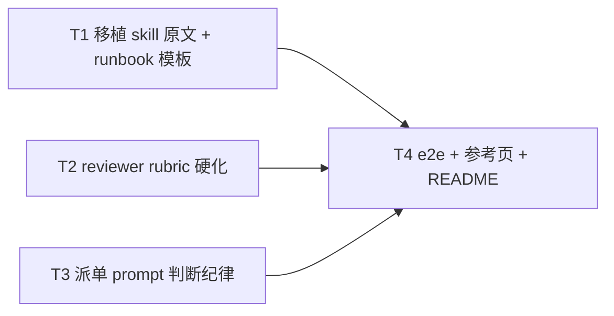

# 0044 · 「端到端跑真 app 并截图」验证 skill：UI/产品行为改动须有真实运行证据

<!-- 本文件由 spec 工具维护：frontmatter 为结构化源数据（含 tasks DAG），正文为组级 rust-RFC 9 段总览。 -->

## Summary

给 OpenAgents 引入一条「端到端跑真 app 并截图」的**判断/纪律**层，专治「宣称跑了 e2e / 截了图，其实没有」。做三件事：（1）把一份已在本地反复打磨、踩坑收敛的反惰性 skill **原文移植**进仓库（`SKILL.md` + 项目专属 runbook 范例 + 一份 runbook 模板），不重写；（2）把这套判断的**核心纪律硬化进 OpenAgents 自己派单/审核的 in-code 面**——派单 prompt 让被派 agent 继承「产品对外行为改动必须真 app 跑出来取证」的判断，reviewer rubric 明列「宣称验证过但仓库无 tracked 证据 = REWORK」这条**结构化检查项**，把「靠 reviewer 撞运气」变成「rubric 逐条对照」；（3）交付一条**自演示**的浏览器端到端脚本——用真浏览器走一遍 skill 规定的「导航→交互→截图→console/network 断言」闭环，产出一张 tracked 截图作为「合格证据长什么样」的样例，让「引入反造假证据 skill」的这个 PR 自己就带真运行证据。

## Motivation

OpenAgents 派 agent 解 issue，凡涉及 **UI / 产品对外行为**的改动，验证环节现在基本靠「agent 自觉 + reviewer 事后查证」，很容易出**「宣称跑了 e2e / 截了图，其实没有」**。

**实证（wind-palace PR #14，背景就地复述）**：被派的 agent 在 PR 正文写「截图与结论已贴到本 PR 评论」，但仓库里 `docs/e2e/` 目录根本不存在、无任何截图、PR 评论里也无留痕。reviewer 在 REWORK 意见里明确点出「**没有任何证据这套 e2e 曾被运行并通过**」，逼 REWORK 之后 agent 才去真跑 Playwright + 真截图。也就是说：真把关全靠 reviewer 恰好较真，一旦 reviewer 放过就漏。

而框架自带的自动「端到端测试」步（Spec-0013 的实跑封装：在 PR 转正前 `bash <script>` 跑一遍、把合否+日志作为签名评论贴出）在 **RFC/spec 没声明脚本时只贴一句 `⚠️ 跳过`**——这不构成任何验证，那一步在没脚本时是空转。Spec-0030 已经往派单 prompt / reviewer rubric 注入了一条**条件式** browser-e2e 引导（「具备浏览器工具→优先设计前端浏览器 e2e」），但它只是「优先设计」的软提示，既没说清**何时必须要证据、什么才算合格证据、为什么测试/日志不能顶替**，也没有任何一条「宣称测过但没证据就打回」的**硬检查**。

缺的正是这一层：**判断（这个改动要不要真 app 证据、要哪种证据）+ 纪律（不许拿自动化测试/后端日志顶替真 app 证据、不许拿『LLM 慢/flaky/投入产出比』当跳过借口、真跑不起来就诚实报阻塞而不是假称已验证）**。这层判断已经有一份成熟实现（源在本地 `~/.claude/skills/end-to-end-ui-screenshots/`），本 spec 的任务是把它**原样搬进仓库**、并把其中最能防「宣称测过但没测」的那条纪律**硬化**进 OpenAgents 会注入给被派 agent 的 in-code 面，使判断可继承、检查可执行，而不是又一段容易被绕过的软约定。

## Guide-level explanation

落地后，一个被 OpenAgents 派去解 issue 的 agent 会经历这样一条链：

- **派单时**：它拿到的实现 prompt 里会带上一段判断纪律（Spec-0030 那条条件式 browser-e2e 引导的**加强版**）：你要改的行为是不是「产品对外行为」？
  - **UI 直接看得到**（工具集 / 报错 / 状态 / 页面渲染…）→ 把真 app 跑起来、真操作到那个点、**截下那个可视化结果**，截图入 tracked 证据目录；
  - **UI 看不到但确实改变产品对外行为**（如某配置真生效）→ 真 app 触发它，提交**真实运行日志文本 + 触发它的真 app 上下文**为证；
  - **纯内部实现细节**（重构等，不改产品对外做什么）→ 用相称的自动化测试即可，不套这套重流程。
  纪律部分明说：自动化测试 / 后端日志**替代不了**真 app 证据；不许用「LLM 慢 / flaky / 投入产出比差」当跳过理由；**真跑不起来就诚实报「因 X 未验证」的阻塞项，绝不假称已验证**。prompt 里同时指向仓库内这份 skill 原文的位置（`docs/skills/end-to-end-ui-screenshots/`），让 agent 需要细则时能翻到完整的反惰性 rationalization 表与通用流程。

- **审核时**：reviewer agent 的 rubric 里多一条**硬检查项**：若这个 PR 声称验证过某个产品对外行为（PR 正文/评论出现「已端到端 / 已截图 / 已验证」类措辞），但**仓库里找不到对应的 tracked 证据**（截图文件 / 运行日志文本）、PR 评论里也没有实跑留痕 → 直接判 **REWORK**，理由写明「宣称验证过但无证据」。这正是 wind-palace PR #14 里 reviewer 手动做过、现在被固化成 rubric 一条的检查——从「撞运气」变「必查」。

- **想知道『合格证据长什么样』**：仓库里带一个**自演示样例**——`docs/skills/end-to-end-ui-screenshots/examples/reference-app.html` 是一个自包含的最小参考页面；本 spec 的 e2e 用真浏览器（playwright / chrome-devtools MCP）对它走一遍「打开页面 → 交互触发一个可见状态变化 → 截图 → 检查 console 无报错 / network 无失败请求」，把截图存进 `docs/evidence/spec-0044/`。这张图既是「合格证据」的活样例，也让「引入反造假证据 skill」的这个 PR 自己就**带着真运行证据**落地——自证其道。

对**目标仓库维护者**：每个被 OpenAgents 服务的目标仓库照着 `references/_runbook-template.md` 的思路，为自己的仓库补一份 runbook（端口 / 起服务 / 驱动 UI 的具体命令），范例见随原文一起搬来的 `references/north-coder.md`。通用方法（SKILL.md）不动，项目专属命令各写各的。

## Reference-level explanation

本 feature 分解为 4 个 Task（DAG 见文末；`files` 全组互斥，各 Task 单一 writer）。

**关于 `.claude/` 写入边界（关键设计约束）**：本环境有一条不可违反的硬约束——agent 禁止写入或改动 `.claude/` 下任何内容。issue 的原始落点是「把 skill 放进 `.claude/skills/end-to-end-ui-screenshots/`」，但那对被派 agent 不可实现（它同样受此约束）。Spec-0030 已确立本仓库的既定处理方式：**方法论落 in-code 面，不写 `.claude/`**。因此本 spec 采取同款路线并把它讲透：

- skill 原文搬进 **tracked、agent 可写**的 `docs/skills/end-to-end-ui-screenshots/`（版本受控、可 review、可被 e2e grep 校验），这是「原样移植、别重写」的落点；
- 真正让被派 agent **继承判断**、让 reviewer **执行检查**的那层，落在 OpenAgents 会注入的 **in-code prompt / rubric**（`orchestrator.py` / `reviewer.py`）——**不依赖任何 `.claude/` 写入**即可生效；
- 若某个仓库/使用者希望 `claude` 直接把它当作项目 skill 加载，则「把 `docs/skills/end-to-end-ui-screenshots/` 安装/拷贝进 `.claude/skills/`」是一步**人工操作**（`cp -r docs/skills/end-to-end-ui-screenshots .claude/skills/`），写进 README 说明，不由 agent 执行。

这样既忠实交付了 issue 要的 skill 原文，又把「宣称测过但没测」的真正闸门放在 agent 能实现、且不受 `.claude/` 边界限制的地方。

### Task 分解

1. **T1 移植 skill 原文 + runbook 模板（P1，无依赖）** — 把源 `~/.claude/skills/end-to-end-ui-screenshots/` 的 `SKILL.md`（核心原则 + 反惰性 rationalization 表 + red flags + 工具无关通用流程 + 完成判据）与 `references/north-coder.md`（项目专属 runbook 范例）**逐字搬进** `docs/skills/end-to-end-ui-screenshots/`，不改写、不删减纪律条目；另加一份 `references/_runbook-template.md`，把「通用方法（SKILL.md）vs 项目专属命令（起服务 / 端口 / 驱动 UI）」的拆分固化成填空模板，方便每个目标仓库照抄结构补自己的 runbook。
2. **T2 reviewer rubric 硬化（P1，无依赖）** — 在 `reviewer.py` 的 rubric 里加一条**结构化检查项**：PR 若声称验证过某产品对外行为却无对应 tracked 证据（截图 / 运行日志）且 PR 评论无实跑留痕 → 判 REWORK，理由「宣称验证过但无证据」。这是把 wind-palace PR #14 里 reviewer 的人工判断固化为 rubric 常驻条目（软约定硬化：从「reviewer 自觉」变「rubric 必查」）。
3. **T3 派单 prompt 判断纪律（P1，无依赖）** — 在 `orchestrator.py` 的派单/实现类 prompt 模板里，把 Spec-0030 那条**条件式** browser-e2e 引导**加强为完整判断纪律**：三分类判断（UI 可见→截图 / UI 不可见但改产品行为→运行日志文本 / 纯内部→相称测试）+ 反测试顶替 + 反「慢/flaky/投入产出比」借口 + 真跑不起来诚实报阻塞，并指向仓库内 `docs/skills/end-to-end-ui-screenshots/` 原文位置。措辞保持条件式、由 agent 自检（不宣告「OpenAgents 检测到你有浏览器」）。**不改 `claude_code.py`、不耦合具体 MCP 生态、不写 `.claude/`**。
4. **T4 e2e 脚本（离线断言 + 浏览器自演示）+ 参考页面 + README/索引（P2，依赖 T1/T2/T3）** — 见下「端到端验证」。

### 端到端验证（脚本路径 = 本组 e2e 脚本）

**脚本**：`bash scripts/e2e-spec-0044-e2e-screenshot-skill.sh`

- **离线确定性段（默认执行，hermetic，无网络/无真 claude）**：`ruff check` / `ruff format --check` / `pytest -q` 全套；再 grep 断言——(a) `docs/skills/end-to-end-ui-screenshots/SKILL.md` 存在且含核心纪律锚点字符串（如「反惰性」「rationalization」表头、「诚实报阻塞」等关键条目，证明是原文移植而非空壳）；(b) `openagents/reviewer.py` 含「宣称验证过但无证据 → REWORK」检查项字样；(c) `openagents/orchestrator.py` 派单模板含三分类判断字样。
- **浏览器自演示段（成果测试，理念 8；具备 browser MCP 时执行）**：由 agent 用 playwright / chrome-devtools MCP 驱动，对 tracked 的自包含参考页 `docs/skills/end-to-end-ui-screenshots/examples/reference-app.html`（`file://` 打开，**不碰任何生产端口/数据**）走 skill 规定的闭环——`navigate` 打开页面 → `snapshot` 取元素 → `click`/`fill` 触发一次可见状态变化（如点击按钮后出现一段「已生效」文案）→ `wait_for` 等该文案出现 → `take_screenshot` 截图 → `list_console_messages` 断言无 error、`list_network_requests` 断言无失败请求 → 截图存入 tracked `docs/evidence/spec-0044/`。**RED 反验对照**：临时把参考页那处状态变化关掉（改成不出现「已生效」）跑一遍，`wait_for` 应超时 / 截图显示旧态，证明这套证据非空过（红/绿闭环）；反验脚手架事后 revert、不进 PR。若本环境客观无 browser MCP / 无显示，则按 skill 的诚实纪律**明写「因无浏览器自动化，浏览器自演示段未执行」阻塞项，不用离线段顶替声称已跑**。

### 依赖 DAG

`T1 → T4`、`T2 → T4`、`T3 → T4`；T1 / T2 / T3 三者彼此无依赖，可并行（`files` 互斥：`docs/skills/**` vs `reviewer.py` vs `orchestrator.py`，无重叠）。

## Drawbacks

- **skill 原文与源的漂移**：`docs/skills/` 里是源 `~/.claude/skills/end-to-end-ui-screenshots/` 的一份拷贝，源日后更新不会自动同步，需人工 re-移植；e2e 只能 grep 锚点字符串证明「是原文而非空壳」，不能保证逐字等同最新源。
- **`.claude/` 激活是人工步**：因硬约束，被 agent 直接当项目 skill 加载需人工 `cp` 进 `.claude/skills/`；未安装时，判断只经由 in-code prompt/rubric 生效，而非 `claude` 原生 skill 触发（`description` 关键词匹配）——覆盖面略窄于原生 skill。
- **reviewer 的「宣称/证据」判定基于文本启发式**：靠匹配 PR 措辞 + 探测 tracked 证据目录，存在误判（把内部重构的 PR 也要求证据）或漏判（措辞不含关键词）的空间；本 spec 把三分类判断写进纪律以降低误伤，但无法做到零误差。
- **浏览器自演示段依赖环境有 browser MCP**：headless / 无显示 / 无 MCP 的 CI 上只能跑离线段，浏览器段降级为「诚实报阻塞」，此时本 PR 自带真截图这件事得靠有 browser 的环境执行一次并入库。

## Rationale and alternatives

- **为什么原文移植而非重写**：源 skill 的判断/边界/反惰性纪律都是踩过坑（连问两次「你一张截图没补」）收敛出来的；重写极易丢掉「case2 vs case3 判据」「rationalization 表」这类来之不易的细则。逐字搬 + grep 锚点校验，最省且最保真（理念 1 奥卡姆）。
- **为什么把纪律硬化进 in-code prompt/rubric，而不是只放一份 skill 文档**：文档是软约定，容易被「宣称测过但没测」绕过——wind-palace PR #14 正是软约定失效的实证。把「宣称验证过但无证据 = REWORK」写进 reviewer rubric，是**软约定硬化**（同 `files` 组内互斥把「别抢写同一文件」变成 validate error 的思路）：让「没证据」在审核面**难以蒙混**，而不只是「希望 agent 自觉」。
- **备选一：直接把 skill 写进 `.claude/skills/`（issue 原始落点）**。否决：本环境硬约束禁止 agent 写 `.claude/`，Spec-0030 已确立「落 in-code 方法论面」的既定路线；强行声明 `.claude/` 路径会让 Task 对 agent 不可实现。改为「tracked docs 移植 + in-code 硬化 + 人工安装说明」，既忠实又可落地。
- **备选二：只加 reviewer rubric 检查，不移植 skill 原文 / 不加派单 prompt**。否决：只做审核侧闸门、缺「判断」这层，agent 不知道**何时该取证、什么算合格证据**，容易被「看起来像证据」（如搬旧截图、贴自动化测试绿）糊弄；issue 落点 #2 明说 skill 提供判断、gate 提供门控，二者互补，缺判断则光有 gate 也易被绕。
- **备选三：给本 spec 只写 shell e2e、跳过浏览器自演示**。否决：本环境具备 playwright / chrome-devtools MCP，且 issue 主题正是「反对拿脚本声明顶替真 app 证据」；一个引入该纪律的 spec 若自己就跳过真浏览器取证，等于自我否定（理念 8 成果测试）。故设计一条自包含、hermetic 的浏览器自演示段，用真浏览器产出 tracked 截图样例。

## Prior art

- **Rust RFC 流程**（[rust-lang/rfcs](https://github.com/rust-lang/rfcs)）：本 spec 正文即 9 段总览的形态来源。
- **本仓库既有 e2e 谱系**：Spec-0008（PR 正文「端到端验证」指路牌，从 spec 自动抽脚本路径）、Spec-0013（转正前实跑脚本 + 把合否/日志作为签名评论）、Spec-0030（init 环境体检 + 条件式 browser-e2e 方法论引导）。本 spec 是 Spec-0030 那条软引导缺失的「判断/纪律 + 硬检查」层，与 Spec-0013 的实跑闸互补：0013 跑「声明了的脚本」，本 spec 治「该不该有证据、没证据要不要打回」。
- **业界实践**：把「如何验证 / 截图为证」纳入 PR 审核 checklist 是常见的 code review 实践（GitHub PR template 的 "How to test" 小节、要求附截图的前端 PR 规范）；差异点是本 feature 把这条从人工 checklist 固化成 reviewer agent rubric 里的结构化检查项。

## Unresolved questions

- **reviewer「宣称/证据」判定的具体启发式边界**：认哪些 PR 措辞为「宣称验证过」、探测哪些路径为「tracked 证据」（`docs/evidence/**`？`docs/e2e/**`？截图后缀？），需在 T2 实现时定一组够用但不过拟合的规则，避免对纯内部重构 PR 误伤——初版建议：仅当 PR 明确出现「端到端/e2e/截图/已验证 UI」类措辞才触发该检查。
- **skill 原文与源仓库的同步机制**：暂定人工 re-移植 + e2e grep 锚点；是否需要一个校验源/仓库副本一致性的脚本，留待后续按需再加（YAGNI）。
- **`.claude/skills/` 自动安装**：是否提供一个 `make install-skills` / init 步把 `docs/skills/**` 同步进 `.claude/skills/`——受硬约束限制不能由 agent 执行，是否值得做成人工命令留待确认。

## Future possibilities

- reviewer 消费 Spec-0013 的实跑评论 + 本 spec 的证据探测，自动在 PR 上标注「证据齐全 / 缺证据」的结构化状态，供人机双方一眼判读。
- 把浏览器自演示段沉淀成一个可复用的「evidence capture」小工具（导航→交互→截图→console/network 断言→入库一条龙），让每个目标仓库的 runbook 只需填「起服务命令 + 驱动步骤」即可复用取证闭环。
- 与未来的证据闸（#104 / PR #105 谱系）合流：判断层（本 spec）产出「该有哪种证据」的结构化期望，门控层据此在 merge 前做硬闸，形成「判断→取证→门控」完整链。

