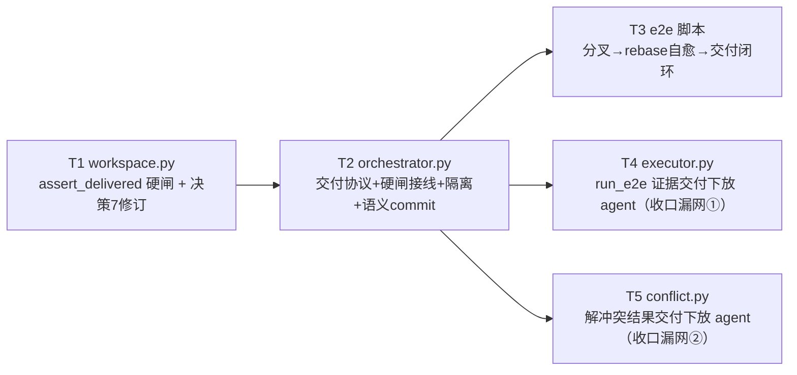

# 0056 · vigil：git 交付/冲突下放 agent（rebase 自愈）+ harness head 前移硬闸（修订决策 7）

<!-- 本文件由 spec 工具维护：frontmatter 为结构化源数据（含 tasks DAG），正文为组级 rust-RFC 9 段总览。 -->

## Summary

在 OpenAgents 自主环里，git 目前**全部由 harness（Python subprocess）死写**：agent 只在 worktree
里写文件、完全不碰 git，交付与冲突解决卡在「agent 以为完成、harness 静默失败」的**职责真空**里。
本组按职责重新划线：把「把成果真正推上远端」这件事——commit → 记 fetch **前**的远端基点 `BASE`
→ `git fetch` → 分叉则 `git rebase` 自解冲突 → `git push --force-with-lease=<branch>:$BASE`——**下放
给 agent**（写进 task prompt 的交付协议，软约束）；harness 只保留**一道不可绕过的硬闸**（死代码，
非 prompt）：agent 交付后断言 `git rev-parse origin/<branch>` == 本地 HEAD，不等即「没交付」→ 打
`needs-human` 交人工。同时**修订决策 7**：由「绝不 force-push」改为「绝不**裸** force-push；允许
`--force-with-lease`，且**仅限 agent 自己的 issue 分支**，不得作用于 main / 受保护分支 / 他人分支」，
并顺手堵住两个连带缺陷：`WorkspaceError` 逃逸 per-issue 隔离、起草永远堆同名 `docs: draft spec` commit。

## Motivation

**现状（背景就地复述，不依赖任何外部 spec）。** OpenAgents 是一个 RFC 驱动的多 agent 框架：守夜人
`vigil` 每轮从 GitHub 拉带标签的 open issue，逐个派 `orchestrator.start_rfc` 起草 spec、开 draft PR，
再由 `messages.poll` 按标签/评论/CI 推进 refine→implement→iterate。每个 issue 跑在自己的隔离 worktree
里（`.openagents/worktrees/issue-<n>`）。git 机制收敛在只懂 git 的 `workspace.py`（RFC-0005）：
`prepare()` 建 worktree 并从 `origin/<base>` 拉分支，`commit_and_push()` 做 `git add -A → commit →
push -u origin <branch>`（普通 push，`check=True`）。全仓一条铁律写死在 `workspace.py:9,65` 的
**决策 7：绝不 force-push**。agent（coding 后端）在 worktree 内只写文件，**从不碰 git**——交付这一步
全由 harness 的 `commit_and_push` 兜底。

**症状：像死循环的冻结。** issue #123 / PR #127（"补齐 e2e 完整闭环"）自 2026-07-03 08:35 冻结 3 天，
本地对同一分支反复重新起草，成果永远到不了 PR head，从外部看像死循环。复现证据：

- PR #127：OPEN，head=`6a3d678`，`updatedAt=2026-07-03T08:35:44Z`；两个 commit 消息**完全相同**
  （`2a49ba5`/`6a3d678` 均为 `docs: draft spec for issue #123`）。
- 本地 `openagents/issue-123`(`3eb6213`) 领先远端 `0abc835`(7-06，同名) + `3eb6213`。
- `git merge-base --is-ancestor 6a3d678 3eb6213` → **否**（本地与远端已**分叉**）。
- `git branch -r --contains 0abc835` → 空（7-06 那次重写**从未 push 上去**）。

**根因（代码级，逐条）。**

1. **分叉后无自愈路径。** `commit_and_push` 是普通 `push` + `check=True`（`workspace.py:64-72`），
   一旦本地与远端分叉，非快进 push 被 git 拒绝、`check=True` 抛错；全仓策略「绝不 force-push」
   （`workspace.py:9,65`）又不给任何 rebase/reconcile 兜底——于是每轮重跑都在同一个非快进点上撞墙。
2. **异常击穿 per-issue 隔离。** `WorkspaceError` 是**裸 `Exception`**（`workspace.py:26`），不是
   `OrchestratorError` 子类；而 vigil 发现段的 per-issue 兜底只 `except (OrchestratorError,
   GithubError)`（`vigil.py:173`）。于是一次 push 失败会**掀翻整轮守候**、饿死其后所有 issue——
   违反 vigil「单 issue 失败不拖垮整轮」的隔离约定（RFC-0004 决策 8）。
3. **交付判据错位。** 现设计把「工作区干净 / push 幂等空操作」当「已交付」，等同把「无未提交改动」
   偷换成「成果已到 PR head」——分叉场景下这两者恰恰背离（本地干净、远端没收到）。
4. **同名 commit 掩盖重试。** `start_rfc` 每次硬编码提交 `docs: draft spec for issue #<n>`
   （`orchestrator.py:283`），重跑堆同名 commit，无法从历史区分首稿与第 N 次重写；`backfill_rfc`
   同病——硬编码 `docs: backfill spec for <path>`，且交付亦全由 harness `commit_and_push` 兜底
   （与四条派单/迭代路径同构的「agent 被挡在 git 之外」，一并下放，见 Reference-level ②）。

**为什么现在改。** 上述 4 条让「重新起草」这类**正常重试**在分叉后彻底空转，且失败无声无息。
issue #123 / PR #127 正是被这个 bug 卡在闭环外；修复本 issue **同时解冻 #127**。根子在职责划线：
真正需要「读冲突、语义解决、决定怎么 reconcile」的交付/冲突自愈，被交给了一个只会跑固定 subprocess
的 harness，而唯一有语义能力的 agent 却被挡在 git 之外。

## Guide-level explanation

**一句话：谁有语义能力，谁负责把成果落地。** 交付（尤其分叉后的 rebase 解冲突）需要读 `<<<<<<<`
标记、判断双方意图、跑自测——这是 agent 的活；harness 只留一道机械的「到没到」硬闸。

**下放给 agent 的交付协议（写进 task prompt，软约束）。** 派单/迭代的 task prompt 追加如下一段，
让 agent 对「把改动落到远端 `<branch>`」负责到底：

```
你负责把改动落到远端 <branch>，直到成果真的推上去：
1. git add -A && git commit -m "<语义化信息>"      # 首稿 draft / 后续 refine 用不同措辞，别再用固定 draft-spec 消息
2. 记下远端基点 BASE=$(git rev-parse origin/<branch>)；git fetch origin <branch>   # BASE 必须取 fetch 之前
3. 分叉 → git rebase origin/<branch>；有冲突你自己解，git add -A && git rebase --continue，
   直到 rebase 完成（不许停、不甩 needs-human）
4. git push --force-with-lease=<branch>:$BASE origin <branch>
5. 禁止裸 git push --force（无 lease）；force-with-lease 仅限本分支 <branch>
完成判据：git rev-parse origin/<branch> == 你的 HEAD，不等就继续处理
```

**harness 的硬闸（死代码，不可绕过）。** agent 交付后，harness 调 `Workspace.assert_delivered`：
`git fetch origin <branch>` 后断言 `git rev-parse origin/<branch>` == 本地 HEAD。相等 = 已交付，
放行；不等 = agent 自判完成却没推上去（**正是本 issue 的复现场景**）→ 打 `needs-human` 标签 + 贴一条
署名说明评论，并抛 `OrchestratorError` 让 vigil per-issue 兜底跳过该 issue（不拖垮整轮）。

**常态路径体验不变。** 远端没有该分支、或本地可快进推上去时，上面的协议退化成一次普通 `push`
（force-with-lease 对「不存在 / 与 BASE 一致」的远端 ref 就是快进推送，git 层结果**逐字节等价**于今天
的 `push -u`），硬闸也天然通过。只有**分叉**这条今天会静默卡死的路径，行为才改变：从「静默卡死」
变成「agent 一轮内 rebase 自愈并 force-with-lease 推上」。

**安全网。** rebase 冲突 agent 自解、不甩 needs-human——安全网是**开出的 PR 仍需人审** + 上面那道
**head 前移硬闸**（agent 解错/没推上 → head 不前移 → 硬闸拦下）。这样既拿回自愈能力，又不因「解冲突
是概率活」而每次都惊动人。

## Reference-level explanation

### 职责重新划线（谁做什么、附理由）

| git 动作 | 归属 | 理由 |
|---|---|---|
| commit / rebase / 解冲突 / `push --force-with-lease`（派单/迭代/backfill 交付） | 🟢 **下放 agent**（prompt 软约束） | 分叉后 reconcile 要语义能力（读冲突标记、判意图、跑自测），只有 agent 有 |
| run_e2e 证据 commit + push（T4）、merge 闸解冲突结果 commit + push（T5） | 🟢 **下放 agent**（prompt 软约束） | 收口「除只读检查外，agent turn 后的 git 全下放 agent」的最后两处漏网；executor/resolve agent 才是「执行完这步 git」的人 |
| worktree add/remove/prune、`branch -D`、`fetch`、`git init`、release tag/push（编排） | 🔴 留 harness | agent 在 worktree 内运行，无法创建自己将要运行的沙箱（先有鸡蛋） |
| `changed_spec_group` 的 diff、`remote_branch_exists`、conflictdiag、backend `status --porcelain`（只读内省） | 🟠 留 harness | 结果是 harness 自己路由要用的 |
| gh：PR/label/comment/merge/update-branch（`github.py`） | 🔵 留 harness | 编排层对外动作 |
| **`assert_delivered` head 前移硬闸** | 🔴 **留 harness（新增死代码）** | 堵「agent 自判完成却没推上去」，不可交给被检查方自证 |

### 技术方案（三处改动）

**① `workspace.py`——新增只读硬闸 + 修订决策 7（不再由 harness 盲推 agent 分支）。**
- 新增 `assert_delivered(*, worktree, branch) -> None`：`git fetch origin <branch>`（`check=False`，
  远端无分支时不报错）后取 `git rev-parse origin/<branch>` 与 `git rev-parse HEAD`；**不相等即抛
  `WorkspaceError`**（携带两个 SHA 摘要）。纯读，不改工作区、不感知 GitHub/backend（守 RFC-0005
  「只懂 git」边界）。远端无该分支（rev-parse 失败）时视作「未交付」→ 抛（agent 理应已 push 建分支）。
- 决策 7 docstring 就地修订（`workspace.py:9,65`）：`绝不 force-push` → **`绝不裸 force-push；允许
  --force-with-lease，且仅限 agent 自己的 issue 分支 openagents/issue-<n>，不得作用于 main / 受保护
  分支 / 他人分支`**。harness 自身**不执行** force-with-lease（推送由 agent 做）；此约束以 prompt 协议
  + 硬闸落地，docstring 记录其边界。（**T4 追加**：`commit_and_push` 原本仅供 harness 自著文件的提交
  路径；待 run_e2e 证据交付（④）也下放 agent 后，它已**无生产调用方**，按理念 1 从 `workspace.py` 删除
  ——交付侧只剩 `assert_delivered` 一道只读硬闸，harness 不再有任何「agent 执行完后代 commit/push」的
  死代码。）

**② `orchestrator.py`——接线交付协议 + 硬闸 + 隔离修复 + 语义化 commit。**
- task prompt：把上面「交付协议」段作为常量 `_GIT_DELIVERY_PROTOCOL` 追加进 `_DRAFT_RFC_TASK` /
  `_REFINE_RFC_TASK` / `_IMPLEMENT_TASK` / `_ITERATE_TASK` **及 `_BACKFILL_RFC_TASK`**——含「BASE 取
  fetch 前」「force-with-lease 仅限自己的工作分支」「禁止裸 force」「完成判据 origin==HEAD」；首稿要求
  语义化 commit（draft），迭代要求 refine 措辞，反向补全要求 backfill 措辞，**删除**硬编码
  `docs: draft spec for issue #<n>`（`orchestrator.py:283`）与 `docs: backfill spec for <path>`
  （backfill_rfc）。
- **backfill 反向补全路径的路由差异（无 originating issue/PR）。** `backfill_rfc` 由 CLI
  `oa backfill-rfc <path>` 触发（Spec-0025，**非** vigil 自主环），据代码路径派生 slug 分支
  `openagents/backfill-<slug>`，且 draft PR 在交付**之后**才开——交付失败时既无 issue 也无 PR 可打
  `needs-human`。故此路**不走** `_fail_to_human`：agent turn 后先跑既有 harness `spec validate` 硬门控
  （读本地 worktree，agent 已 commit 也照读，validate error 仍 `raise OrchestratorError` 不开 PR），
  再调 `assert_delivered`，抛 `WorkspaceError` 时**直接** `raise OrchestratorError(str(exc)) from exc`
  ——CLI 顶层 `except (OrchestratorError, …)` 已把它转成 `✗ <消息>` 干净一行 + 非零退出，对一个人工
  运行的 brownfield 引导命令，这**就是**它的 needs-human 面（人看到报错即介入，无需 github 打标）。
  backfill 分叉风险近零（首推唯一新分支），硬闸主要兜「agent 自判完成却没 push」。
- 交付后闸：agent turn（`backend.run`）返回后，在原 `commit_and_push` 位置改调
  `self._workspace.assert_delivered(worktree=..., branch=...)`。抛 `WorkspaceError` 时按**有无
  originating record** 分两条路（见下「挂起必须 sticky」）。
- 隔离修复（根因 2）：把 workspace 调用点的 `WorkspaceError` **包装成 `OrchestratorError`（或其子类
  `DeliveryStalled`）上抛**。这样既修 vigil `except (OrchestratorError, GithubError)`（`vigil.py:173`）
  不再被裸 `WorkspaceError` 击穿，又不让 `workspace.py` 反向依赖 `orchestrator`（守解耦，理念 10）
  ——翻译发生在 orchestrator 这个已同时持有两侧的 seam。
- **挂起必须 sticky（PR #141 review 必修）。** 初版 `_assert_delivered_or_fail` 对**所有**路径都调
  `_fail_to_human` 打 needs-human 标签 + 贴评论后 raise。但 messages 的 poll 挂起短路**只认
  `record.status == STATUS_BLOCKED`、不认 label**（`_process_run`/`_process_coding` 无 label 提前返回）
  ——有 record 的四条路径（refine/implement/iterate/run_e2e）只打标签而不置 status，下一轮 poll 仍进
  coding：`set_e2e_ran_fingerprint` 在 assert 之后、raise 让指纹没落盘 → **又派一次 executor 真跑
  + 又贴一条一模一样的 needs-human 评论**，且 `MAX_ROUNDS` churn 兜底在 `run_e2e` 成功返回后才计数、
  raise 走不到，故这个「有声但同样无界」的重烧 + 刷屏循环恰好是本 spec 要灭的病。**修法**：
  - 有 record 的四条路径：`_assert_delivered_or_fail` **不再自打标签/评论**，改抛类型化
    `DeliveryStalled(OrchestratorError)`（携 `branch`/`reason`/`pr_number`）。`messages._process_run`
    在阶段路由外层 `except DeliveryStalled` → `self._block(record, gate="delivery", blocker=reason)`。
    `_block` 一次把 `STATUS_BLOCKED`（不在 `_OPEN_STATUSES`，下一轮自动跳过）+ gate + watermark +
    label + 结构化评论设齐、天然 sticky，且「回评论解挂」路径立即可用。`"delivery"` gate 补进
    `_TRIED_BY_GATE` 与 `_unblock_with_comment` 的 code 同款路由（`iterate(reason="human")`）。
  - draft 路径（`start_rfc`，`pr_number=None`、record 尚无 PR 号）保持 `_fail_to_human`：靠 issue label
    + vigil 发现段（`vigil.py:195` 见 `BLOCKED_LABEL` 即跳过）已 sticky，不经 messages poll 收口。
  - 权威留在 messages 状态机（`orchestrator` 不 import `messages`，单向依赖），orchestrator 只抛信号。

**③ e2e 脚本**——见下「端到端验证」。

**④ `executor.py` / `run_e2e`——证据交付也下放 executor agent（T4，收口漏网之一）。** 原则「除只读
检查外，agent turn 后的 git 全下放 agent」在初版（T1-T3）覆盖了 draft/refine/implement/iterate/backfill
五条派单路径，却漏了 `run_e2e`：executor agent 真跑完系统后，证据仍由 harness 硬编码
`commit_and_push(message="test: e2e evidence for PR #<n>")`（`orchestrator.py:712`）代交——同一个「agent
执行完的 git 被 harness 代做」的病。修法与①②同构：
- `executor.run_executor` 新增**必填形参** `delivery_protocol: str`，拼进 executor 任务模板、置于末行
  `OUTCOME: PASSED|FAILED` 格式行**之前**（保证回复最后一行仍是 OUTCOME）——「把证据固化」自此含
  「**交付**」：executor agent 写完证据后按协议自己 commit + push 上远端本工作分支。
- 关键解耦（理念 10）：`executor.py` **仍不 import git**，交付协议由 `orchestrator.run_e2e` 注入
  （`delivery_protocol=_GIT_DELIVERY_PROTOCOL`），executor 只把它当字符串拼进 prompt。既不新开一轮
  「专门交付」的 backend turn（省一次 agent 调用，理念 1），又不让 executor 耦合 git。
- `run_e2e` 删原 `commit_and_push`，改调 `_assert_delivered_or_fail`（head 前移硬闸，复用 T2 的
  `_fail_to_human` 路由）。该 `orchestrator.py` 编辑并入 T2 owner、`workspace.py` 的 `commit_and_push`
  删除并入 T1 owner，避免同组 files 重叠（validate D7：同组 files 重叠是 error）。

**⑤ `conflict.py`——解冲突结果的交付也下放 resolve agent（T5，收口漏网之二）。** merge 闸撞冲突时派
resolve agent 语义解冲突，解完原由 harness `git add -A && git commit --no-edit`（`resolve_branch`）+
`push`（`make_resolver`）代交——又一处「agent 执行完的 git 被 harness 代做」。修法：
- `_RESOLVE_TASK` 把「不要自行 commit，外层会统一提交」翻转为「自测过后**由你自己**
  `git add -A && git commit --no-edit`（沿用 merge 默认信息），再 `git push origin HEAD:refs/heads/<branch>`」。
  注意此 merge 是把 base **快进叠加**到本分支、结果是本分支 tip 的后代，**普通 push 即可、无需 force**
  （与四条派单/迭代路径的 `force-with-lease` 分叉场景本质不同，不套同一协议）。
- `resolve_branch` 新增 `branch` 形参 + 记「合并冲突中、agent turn 前」的 `pre`-HEAD；agent turn 后只做
  **只读校验**（符合用户「除检查外 git 全下放」的划线）：① 残留冲突标记（既有）② head 前移（HEAD≠pre，
  堵「解了标记却没 commit」）③ 推送落地（`fetch` 后 `origin/<branch>`==HEAD，堵「commit 了却没 push」，
  正是 issue #140 冻结类）。任一不过 → `merge --abort` 安全降级 `resolved=False`（宁可不解、不可解错，
  且不可自判解决却没推上去）。
- `ResolveOutcome` 新增 `delivered` 标记：冲突路径 agent 已自交付（`delivered=True`）→ `make_resolver`
  不再代 push；**唯干净自动合并**（无 agent turn、合并 commit 是 harness 自著、`delivered=False`）才由
  `make_resolver` 普通 push——它不是「agent 执行完的 git」，留 harness 合规。

### 关键不变量（footgun 防线）

- **force-with-lease 的期望 SHA 必须取 `fetch` 之前的远端基点** `--force-with-lease=<branch>:$BASE`，
  `BASE=$(git rev-parse origin/<branch>)` 在 `git fetch` **之前**求值。否则 `fetch` 刷新本地跟踪 ref
  后，lease 期望值会变成刚拉到的最新远端，保护退化为等价裸 `--force`（footgun）。此顺序是 prompt
  协议第 2/4 步的硬性次序，也是硬闸兜底的对象。
- **force-with-lease 严格限 agent 自己的工作分支** `openagents/issue-<n>`（派单/迭代）或
  `openagents/backfill-<slug>`（反向补全）；任何情况不得裸 `--force`；不得作用 main / 受保护 / 他人分支
  （决策 7 修订正文）。
- **零回归**：远端无分支 / 可快进的常态路径，git 层结果逐字节等价于今天的普通 push；只有分叉路径
  行为改变（静默卡死 → 一轮内自愈）。

### Task DAG + 文件分配



| Task | 文件（单一 writer，互斥） | 依赖 |
|---|---|---|
| T1 | `openagents/workspace.py`, `tests/test_workspace.py` | — |
| T2 | `openagents/orchestrator.py`, `tests/test_orchestrator_delivery.py` | T1 |
| T3 | `scripts/e2e-spec-0056-git-delivery-rebase-selfheal.sh` | T2 |
| T4 | `openagents/executor.py`, `tests/test_executor.py`, `tests/test_orchestrator.py` | T2 |
| T5 | `openagents/conflict.py`, `tests/test_conflict.py`, `tests/test_conflict_guidance.py` | T2 |

> T4 的 `orchestrator.run_e2e` 编辑并入 T2 owner、`commit_and_push` 删除并入 T1 owner（`workspace.py`）
> ——避免同组 files 重叠（validate D7：同组重叠是 error）；T4 的 `files` 只列真正新增 writer 的
> `executor.py` 及其测试。`messages.py` 一行注释、`tests/test_messages.py` / `tests/test_claim_dedup_integration.py`
> 的伪替身随手清理（删已无对应产物的 `commit_and_push` stub），属 T4 连带、非独立 writer，不单列。

### 端到端验证（成果测试，理念 8）

脚本 `scripts/e2e-spec-0056-git-delivery-rebase-selfheal.sh`，全程**离线、不触网、不调真实 LLM/gh**：
1. **离线确定性验证**：`ruff check` + `ruff format --check` + `pytest -q` 全套（覆盖 T1 硬闸/决策 7、
   T2 交付协议契约锁 + 硬闸路由 + 隔离）。
2. **离线成果演练**：在**真实本地 git**（`git init` 两个 repo 当「远端裸库 + 本地 worktree」）里
   构造复现态——远端 PR 分支领先 base、本地对同一 spec 文件重新起草导致**分叉**；用一个把 prompt 交付
   协议**真正执行成 git 命令**的 fake backend 驱动交付：断言 (a) agent `rebase` 自愈 + `force-with-lease`
   推上、`git rev-parse origin/<branch>` 前移到本地 HEAD（成果到达 PR head）；(b) 反例——让 fake backend
   「假装完成但不 push」，断言 `assert_delivered` 判「未交付」→ 走 needs-human；(c) 断言推送用的是
   `--force-with-lease=<branch>:<BASE>` 且 `BASE` 为 fetch 前 SHA、**从不**出现裸 `--force`。

**浏览器 e2e 说明**：本 feature 是守夜人自主环内部的 **git 交付/编排管道**，无任何 product-facing 前端
界面（唯一可观测成果是「分叉后成果果真前移到 PR head」，落在 git ref 与 GitHub PR 元数据上，不经任何
HTTP 前端/看板渲染）。故浏览器导航/截图式 e2e **不适用**（本环境亦无 Playwright/Chrome DevTools MCP）；
成果证据用上面 CLI/pytest + 真实本地 git 驱动的脚本，以「`git rev-parse origin/<branch>` 是否前移到
本地 HEAD」这一 git ref 断言作为正确观测面——对齐本仓同类「无前端的编排行为」（如代码评审闸 sticky
短路那组）的成果观测取向。

## Drawbacks

- **软约束的固有不确定性**：交付协议是 prompt 软约束，agent 可能不照做（漏 `--force-with-lease`、
  BASE 取错时机、rebase 半途放弃）。缓解：harness head 前移硬闸是死代码兜底——协议没落地 → head 不
  前移 → 硬闸拦下转人工，坏结果上限是「转人工」而非「静默卡死或推错」。
- **放开 force-with-lease 的心智负担**：全仓从「绝不 force」这条好记的铁律，变成「绝不*裸* force、
  仅本分支 lease」这条更细的规则，读代码的人要理解 lease 语义与「本分支」边界。缓解：决策 7 正文 +
  docstring 就地写清边界，单测锁死「只对本分支、只带 lease、BASE 为 fetch 前 SHA」。
- **rebase 改写历史**：force-with-lease 推的是 rebase 后的新历史，PR 的 commit SHA 会变（老 SHA 被
  弃）。对本环无碍（PR 靠 head 前移判交付、人审看最终态），但若将来有「PR 评论钉在旧行/旧 SHA」的
  依赖会受影响（见 Unresolved）。
- **fake-backend e2e 的保真度**：成果演练用「把协议执行成 git 命令」的 fake backend 而非真 LLM，
  验证的是**交付协议 + 硬闸的编排语义**，不验证「真 agent 会不会照 prompt 做」——后者靠线上守夜与
  PR 人审兜。此边界在脚本头显式声明（evidence 分层，理念 8）。
- **backfill 交付下放后 validate 门控次序倒挂的孤儿分支**：交付下放 agent 后，backfill 的 `spec
  validate` 硬门控只能在 agent 已 commit+push **之后**跑（读本地 worktree 文件，仍拦得住、validate
  error 照旧 `raise` 不开 PR）；代价是——若 agent 推了个没过 validate 的 spec，远端会留一个**无 PR 的
  孤儿分支**（旧流程 validate 在 push 前、失败则远端全无）。缓解：`_BACKFILL_RFC_TASK` 第 6 步要求
  agent 先 `spec validate` 再按协议交付，孤儿分支只在 agent 违约（推了没过校验的稿）时出现，且对一个
  人工运行的 CLI 命令可见可清理（`git push origin --delete`）。未取「拆两轮 backend turn（先写后交
  付）彻底根除」是因 backfill 属稀有手动引导、不值为此加一整轮 agent 调用（理念 1 奥卡姆）。

## Rationale and alternatives

**为什么这样设计。** 根子是职责划错线：需要语义能力的交付/冲突自愈被交给只会跑固定 subprocess 的
harness。把交付下放给唯一有语义能力的 agent、harness 只留一道机械硬闸，是最小改动的正解：复用既有
原语（agent 后端、`force-with-lease`、conflict.py 已验证的「agent 解冲突」范式），不新增模块（奥卡姆）。
硬闸做成**死代码而非 prompt**，是因为「有没有交付」这种正确性判据不能交给被检查方自证。

**备选 1：harness 自己 rebase + force-with-lease（不下放 agent）。** 让 `commit_and_push` 在非快进 push
失败时 `fetch` + `rebase` + `force-with-lease` 重推。优点：全程 harness、无软约束不确定性、零 prompt 改动。
**否决**：本 issue 的复现（对**同一 spec 文件**重新起草）rebase 必然**冲突**，harness 无语义能力解冲突，
只能 `rebase --abort` 回落原地——治不了根因。冲突解决天然需要 agent，这条只在「无冲突分叉」子集有效。

**备选 2：`git pull --rebase` / merge 远端进本地再普通 push。** 让 harness 把远端并进本地。**否决**：
同样撞语义冲突（`merge`/`rebase` 都会），且 merge 会在 PR 里堆一堆「Merge origin/... 」噪声 commit；
force-with-lease + rebase 保持线性历史更干净。冲突仍要 agent，不解决根因。

**备选 3：`WorkspaceError` 直接改成 `OrchestratorError` 子类。** 修根因 2 最省事。**否决**：会让
`workspace.py` `import orchestrator`，反向依赖破坏「workspace 只懂 git、不感知编排」的分层（理念 10）。
选在 orchestrator 这个已持有两侧的 seam 处 `raise OrchestratorError(...) from exc` 翻译，分层不破。

**备选 4：硬闸放 vigil / messages 而非 workspace。** **否决**：硬闸是纯 git 读操作（fetch + rev-parse
对比），归属只懂 git 的 workspace 最内聚；routing（打 needs-human）才留在 orchestrator。职责与①/②
的分层一致。

## Prior art

- **`git push --force-with-lease`**（git 官方）：带「期望远端 ref」的安全 force——仅当远端仍是你上次
  见到的 SHA 才覆盖，避免盲目 `--force` 冲掉他人推送。本组正是用它把「绝不 force」放宽到「安全 force」。
  footgun（lease 期望值须取 fetch 前、否则 `fetch` 刷新跟踪 ref 使保护失效）为社区公认陷阱，本组以
  「BASE 取 fetch 前」的显式次序规避。
- **Gerrit / GitHub PR 的 rebase-and-force-push 工作流**：贡献者本地 rebase 到最新 base 后 force-push
  更新 PR 分支，是主流 PR 平台的常规交付方式——本组把这套「贡献者自己 reconcile 后更新自己分支」的
  惯例，落到「agent 就是贡献者」的自主环里。
- **本仓 `conflict.py`（合并冲突派 coding agent 语义解冲突那组）**：已有「撞 merge 冲突 → 把冲突文件喂 agent 语义解决 + 自测 →
  解不了才回落人工」的成熟范式。本组的交付协议与之同构（agent 解冲突、安全降级到人工），是对既有
  范式在「起草/迭代交付」场景的复用，而非另起炉灶。
- **本仓 executor「producer/consumer 契约锁」测试**（`tests/test_executor.py` 里锁 runbook form 声明
  可被解析）：本组用同法给交付协议 prompt 上契约锁单测（断言 prompt 含 force-with-lease/BASE 次序/
  禁裸 force 等关键约束），防协议措辞被无意改坏。

## Unresolved questions

- **硬闸的适用范围**：初版（T1-T3）覆盖 `start_rfc`（draft，复现路径）与 refine/implement/iterate/backfill
  的交付 seam；**T4/T5 收口最后两处 agent turn 后的 git**——`run_e2e` 证据交付（下放 executor agent）与
  merge 闸解冲突结果交付（下放 resolve agent）。至此「除只读检查外，agent turn 后的 git 全下放 agent」
  已全覆盖，`commit_and_push` 无生产调用方而删除；后续若新增 agent turn 交付点，按同一原则下放 + 只读
  硬闸兜底即可。
- **PR 评论钉旧 SHA**：rebase force-with-lease 改写历史后，若未来引入「把 review 评论钉在具体 commit/
  行」的机制，旧 SHA 失效需处理。当前无此依赖，暂不设计。
- **硬闸失败的人工提示粒度**：needs-human 评论只说「head 未前移、疑似未交付」，还是要附本地 HEAD /
  远端 head 两个 SHA 便于人定位——倾向附 SHA（可观测，理念 8），措辞细节实现时定。

## Future possibilities

- **把软约束硬化**：将「force-with-lease 仅限本 issue 分支、禁裸 force」从 prompt 约定升级为一道
  **push wrapper / pre-push 校验**（拦截作用于 main/他人分支的 force、拦截无 lease 的裸 force），
  呼应「软约定 → 让它根本无法违反」的方向（对齐 issue #71 运行期 owner 检查的思路）。
- **交付重试预算**：agent 一轮没把 head 推前移时，除立即转人工外，可给一个有界重试预算（再拉一次、
  再 rebase 一次）后才转人工，降低对偶发远端竞争的人工打扰。
- **统一交付回执**：把「BASE→rebase→force-with-lease→head 前移」这条交付轨迹渲成一条 PR 回执评论
  （像既有 agent run report），让人从 PR 直接看见「这一版是如何 reconcile 上去的」。

