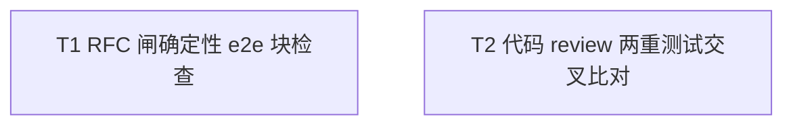

# 0057 · e2e 门控硬化：RFC 闸确定性强制 e2e 块 + 代码 review 两重测试交叉比对

<!-- 本文件由 spec 工具维护：frontmatter 为结构化源数据（含 tasks DAG），正文为组级 rust-RFC 9 段总览。 -->

## Summary

把 e2e 门控的两条关键约束从「埋在 LLM reviewer prompt 里的软 rubric」硬化成**确定性/结构化**检查：

- **T1（RFC 闸格式硬化）**：`_process_rfc_review` 在调 LLM reviewer 之前，先做一道**确定性**检查——本分支
  改动的 spec 组必须在 frontmatter 声明真实的 `e2e{intent, method}` 测法块（去空白后非空）。缺则**不问
  LLM，直接当 REWORK 自动返工**（refine_rfc 喂确定性文案，超 K 挂起）。这保证 `run_e2e` 永远有块可读、
  e2e v2 链路不会被非确定软闸静默绕过。
- **T2（代码 review 两重测试交叉比对）**：把 code reviewer 的证据 rubric 从「读 docs/e2e-results/」升级为
  **显式两重**——第一重 = 写代码的人自己的测试/自测（docs/evidence/ 自证，运动员），第二重 = 独立 executor
  的 e2e 证据（docs/e2e-results/，裁判）。要求 reviewer 交叉比对：**独立证据缺失时不得凭作者自测放行**。

两个证据目录**保持分开**（docs/evidence/ = 实现者自证 / docs/e2e-results/ = 独立裁判）——它们信任级别不同，
合并会让自证混进独立证据、毁掉「运动员≠裁判」隔离（这是 Spec-0055 差点走错、经 wind-palace PR #19 实证纠正的）。

## Motivation

**背景（就地复述）。** Spec-0055 把 e2e 重设计为：spec 声明 `e2e{intent,method}` → CI 绿后
`orchestrator.run_e2e` 派**独立 executor** 真跑、把证据写进 `docs/e2e-results/<pr>/` → 现有 `review_code`
读该证据判运行时行为。门控依赖两道 LLM 评审闸：RFC 闸判「spec 该不该有 e2e 块」、代码闸判「运行时行为达成没」。

**实证暴露（wind-palace-of-cc PR #19，一个 UI 特性，OpenAgents 含 Spec-0055 跑出）。** 逐条核对该 PR 的
agent 回执轨迹（`## 评审闸裁决(Spec) PASS → ## 实现自述 → ## 评审闸裁决(代码) PASS → 合并`，**无
`## 证据执行`**）后确认：**e2e v2 全程没启动**，根因是两道 LLM 软闸都被表象骗过：

1. **RFC 闸没逼出结构化 e2e 块。** spec 0005 的 frontmatter **没有** `e2e:` 块，但正文/tasks 里满是 e2e
   讨论（有一整个 Task 就是 `e2e/attention-terminal.spec.ts`）。单个非确定 reviewer（n=1）读到满眼 e2e，
   按**语义**判「e2e 覆盖得挺好 → PASS」，没意识到要查的是那个**结构化 frontmatter 块**（`run_e2e` 唯一
   读的东西）。→ 无块 → `run_e2e → _e2e_plan → None → 空过`，独立 executor 根本没跑。
2. **代码闸把自测当放行依据。** 实现者交付了真的 Playwright 测试文件 + 自己在 `docs/evidence/` 截的图 +
   实现自述里「自測全 green」。reviewer 看到「有测试、有截图、作者说测过」就 PASS，没去追 `docs/e2e-results/`
   里有没有**独立**证据（空的）。→ 把**自证（运动员=裁判）**当成了独立验证。

**共同的根：这两条是「流程契约有没有被遵守」的结构性检查，恰是 LLM 最不擅长、最容易被「看起来测过了」
骗过的**。Spec-0055 把 enforcement 放进 reviewer prompt 本身就是错配——该用机器硬判的东西交给了会被
表象合理化的非确定判官。本组按 spec skill 的「软约定硬化」把这两条拎出 prompt、变成确定性/结构化门控。

## Guide-level explanation

**T1 后**：起草一个 UI/交互（乃至任何）spec 后进 RFC 闸，编排层**先自己**读改动 spec 组的 frontmatter——
没有真实 `e2e{intent,method}` 块就**直接回一条确定性返工**「你的 spec 缺 e2e 测法块，请在 frontmatter 声明
`e2e:` 含 intent（验什么）+ method（怎么测的 prose 步骤）；纯文档/无运行时行为的改动也要声明（method 写
『无运行时行为可验』即可）」，让起草 agent 补上——**这一步不问 LLM，LLM 骗不过它**。补上后才进 LLM 评审
判质量。于是 `run_e2e` 永远有块可跑，e2e v2 不再被「spec 忘了声明」静默绕过。

**T2 后**：代码闸的 reviewer 被明确告知「运行时验证有两重、都要看、交叉比对」：
- 第一重是**写代码的人自己的测试**（单元测试、自己跑的截图，常在 `docs/evidence/`）——**作者的声明，不
  单独构成放行**；
- 第二重是**独立 executor 的 e2e**（`docs/e2e-results/<pr>/` 的 result.md + 截图）——**独立裁判的证据**。
reviewer 交叉比对：独立证据在不在、印不印证作者自测所称的行为？**独立证据缺失（只有自证）→ 判 REWORK**。
于是 PR #19 那种「只有自测、没独立证据也 PASS」的漏被堵上。

## Reference-level explanation

### T1 · RFC 闸确定性 e2e 块检查

- `orchestrator.e2e_block_missing(*, pr_number) -> str | None`：ensure worktree → 复用 `_e2e_plan`
  读改动 spec 组的 `metadata.e2e`；`None` 或 `intent`/`method` 去空白后为空 → 返回确定性返工文案
  `_E2E_BLOCK_MISSING_MSG`；否则 `None`。纯读，不改状态。
- `messages._process_rfc_review`：在 `hold.at_spec` 之后、`review_rfc`（LLM）之前插入——
  `e2e_block_missing` 非 None → 走与 REWORK 同款的 `increment_rounds`（超 K → `_block(gate="rfc")`，
  未超 → `refine_rfc(detail=文案)`，事件 `reason="refine-e2e-block"`）；为 None 才照常调 LLM 评审。
  放在 `has_label`（2a 人工/上轮批准）与 `skip.at_spec`（人显式旁路）**之后**——那两条是明确的人工放行意图，
  仍尊重；本检查只硬化**自动评审**路径。
- `_DRAFT_RFC_TASK` 补一句「**必须在 frontmatter 声明 `e2e{intent,method}` 测法块**（纯文档改动也声明，
  method 写『无运行时行为可验』）」，让起草 agent 一次到位、少一轮返工（软引导，非门控——门控在编排层确定性检查）。

### T2 · 代码 review 两重测试交叉比对

- 重写 `reviewer._EVIDENCE_RUBRIC`：显式声明两重（自测=声明 / 独立 executor=裁判）、要求交叉比对、
  **独立证据缺失不得凭自测放行**、两者矛盾以独立证据为准。落点措辞：第一重指 `docs/evidence/`（自证），
  第二重指 `docs/e2e-results/<pr>/`（独立）。仅改 rubric 文案，聚合/解析零改动。

### 状态机影响

不新增 status / 字段 / 标签。T1 复用现成 `rounds`/`MAX_ROUNDS`/`refine_rfc`/`_block(gate="rfc")`；新增事件
`reason` 值 `"refine-e2e-block"`（仅可观测，不参与路由）。

### DAG 与文件分配

| Task | 拥有文件（互斥） | depends-on |
|---|---|---|
| T1 | `openagents/orchestrator.py`, `openagents/messages.py`, `tests/test_orchestrator.py`, `tests/test_messages.py` | — |
| T2 | `openagents/reviewer.py`, `tests/test_reviewer.py` | — |

（T1/T2 无依赖、文件互斥，可并行。）

### 本组 e2e 测法

- **intent**：证明两道硬化真的挡得住 PR #19 那类漏——缺 e2e 块的 spec 在 RFC 闸被确定性返工（不靠 LLM）；
  code reviewer rubric 明含两重交叉比对且「独立证据缺失不得凭自测放行」。
- **method**（离线确定性，本组是纯后端编排无前端可导航）：单测（假 orchestrator/github）——喂「无 e2e 块」
  的改动断言走 `refine-e2e-block`（不调 review_rfc）、喂「有真实 e2e 块」断言照常进 LLM 评审；grep 断言
  `_EVIDENCE_RUBRIC` 含「两重 / 独立证据缺失 / 不得凭自测放行」关键字。脚本
  `scripts/e2e-spec-0057-e2e-gate-hardening.sh`（ruff + pytest + grep 锚点）。

## Drawbacks

- **每个 spec 都被强制声明 e2e 块**（纯文档/重构也要写 `method: 无运行时行为可验`）——多一点样板；但这正是
  「每个 PR 都过一遍 e2e 意图」的显式化（Spec-0055 已定的方向），且确定性返工只多一轮 refine。
- **确定性检查只判「块存在且非空」，判不了「块内容是否真的测到点」**——质量仍靠 LLM 评审 + T2 交叉比对。
  硬化的是「有没有」，不是「够不够好」；二者分层。
- **T2 仍是 LLM rubric**（reviewer 判两重比对）——比 T1 的确定性弱；但「独立证据文件在不在」这一半，reviewer
  照 docs/e2e-results/ 有没有 result.md 判，接近确定；「印证不印证」才需判断力。

## Rationale and alternatives

**为什么 T1 放编排层而非 `spec validate`。** `spec validate` 是仓库级、会对**所有存量 spec** 生效——强制 e2e
块要回填约 50 个历史 spec（低价值高噪声）。放 `_process_rfc_review` 只门控**走流程的新 spec**，无需回填，且
「自动返工让 RFC 重改」正是编排层能做、CI 静态校验做不到的（CI 只能 fail、不能驱动 agent 补）。

**备选：只提高 RFC reviewer 票数（n>1）。** 多个 LLM 也可能同样被表象骗（相关性失效不是独立的），且不解决
「该用机器判的交给了 LLM」的错配。确定性检查更省更稳。否决为主、可作正交增强。

**为什么两个证据目录不合并（纠 Spec-0055 差点走错）。** docs/evidence（自证）与 docs/e2e-results（独立）
信任级别不同；合并会让自证混进独立证据目录、reviewer 分不清可信度、自证冒充独立验证。分开 + T2 交叉比对
才保住「运动员≠裁判」。（曾尝试合并写侧的 PR #142 已因此关闭。）

## Prior art

- **Spec-0055**（直接前身）：e2e v2 能力感知重设计。本组补它的两个门控漏洞（RFC 软闸被绕过、代码闸认自证）。
- **Spec-0044**：docs/evidence/ 实现者自证 + 「无证据=REWORK」。本组把它定位成「第一重（声明）」、与独立
  executor 的「第二重（裁判）」分层交叉比对，而非合并。
- **spec skill「软约定硬化」原则**：像 `files` 同组互斥那样，把「别违反」的软约定变成 validate/结构规则让它
  **无法违反**。本组 T1 是这条原则在 e2e 块上的落地。
- **CI required checks / 门控**：把结构性契约做成硬门而非人工叮嘱——本组把门内化进编排层的确定性检查。

## Unresolved questions

- **T1 是否也顺带做成 `spec validate` warning**（只对含 e2e 块的 spec 查非空，不强制存在）作双保险？本组先只
  在编排层硬门，视实测再定要不要加 validate 侧。
- **纯文档 spec 的 e2e 块样板**是否值得给 `spec new` 脚手架预填 `e2e{intent: "N/A", method: "无运行时行为可验"}`
  减少返工？留 Future。
- **Spec-0057 之外的死码清扫**（`worknote._RUNBOOK_HEADER`、`_REASON_LABELS["e2e"]`、`E2E_FORM_VALUES`）
  与本组正交，另起收尾（不混进本组，保持单一意图）。

## Future possibilities

- **RFC 闸再加「UI 改动的 method 必须要求真实截图」的半确定性检查**（现由 ui_capable 分流的 LLM rubric 判）。
- **spec new 脚手架预填 e2e 块**减少 T1 返工。
- **独立 executor 证据的机读校验**（result.md 结构化字段 + 截图存在性）让 T2 的「独立证据在不在」也变确定性。

