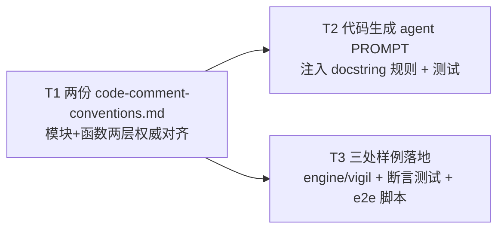

# 0059 · 注释规范对齐 PEP 257/PEP 8/Google：模块+函数 docstring 两层合规，让流程生成的注释天然合规

<!-- 本文件由 spec 工具维护：frontmatter 为结构化源数据（含 tasks DAG），正文为组级 rust-RFC 9 段总览。 -->

## Summary

OpenAgents 的注释规范（`code-comment-conventions.md`，rfc + spec 两份）与它教流程 agent 生成的
docstring，在**模块 docstring** 与**函数/类 docstring** 两层都偏离了 Python 权威标准。本 spec 把两份
规范和「会写代码的 agent」的 PROMPT 一起拉回 [PEP 257](https://peps.python.org/pep-0257/) /
[PEP 8](https://peps.python.org/pep-0008/) / [Google Python Style Guide §3.8](https://google.github.io/styleguide/pyguide.html)，
并落三处样例证明改法可行——从**源头**（规范 + 提示词）让 recipe 跑出的注释天然合规，而不是事后逐个回填。

核心两条改动：

1. **模块 docstring**：首行一句干净的英文人话摘要（给使用者、给 `help()`）→ 空行 → 用法示例 →
   `Exports:` 逐个列出导出的类/异常/函数各带一行摘要；**spec-id 从 docstring 内上移为文件顶部的 `#` 注释行**
   （对齐 CPython `argparse.py` 把 `# Author:` 放 docstring 之上的惯例），并**禁掉 `"""# Spec-…` 写法**
   ——因为 `#` 在三引号字符串里是字面文本，会原样进 `__doc__` 污染 `help()` 输出。
2. **函数/类 docstring**：summary 用**祈使句**、压成**一行短句**（≤ 一行、句号结尾），参数/返回/异常用
   `Args:` / `Returns:` / `Raises:` 结构化；OpenAgents 叠加的**溯源 spec 引用作第二行留在 docstring 内**
   （这层不上移，它是 house 规则、兼容 PEP 257）。

## Motivation

### 背景：规范落在哪、现状长什么样

CLAUDE.md 要求「每层级注释引用对应 RFC/Spec ID」，规则正文落在两份镜像文件：
`.claude/skills/rfc-driven-development/references/code-comment-conventions.md` 与
`.claude/skills/spec-driven-development/references/code-comment-conventions.md`。流程里「会写代码的
agent」（implementer / drafter 的 implement·iterate·backfill 段 / replier）按这套规范生成注释。

现状两份规范的**模块 docstring 范例**长这样（spec 版）：

```python
"""Agent 消息转告路由。

Spec-0007/T2: Agent 消息转告机制

提供：接收 Agent 间消息并包装为 User query；按目标 Agent 投递到其消息队列。
"""
```

而 recipe 跑出来的真实代码（样本 `openagents/runtime/engine.py` 首行）更糟：

```python
"""# Spec-0060/T2: runtime.engine —— run_agent 引擎（填占位符 → 派 backend → 收结构化输出）。
```

### 两层各自怎么偏、偏在哪

**模块 docstring（对照 PEP 257 与权威项目真实源码）：**

| 权威规则 | 出处 | 现状 | 判定 |
|---|---|---|---|
| 三引号内 `#` 是**字面文本**（Python 字符串语义），会原样进 `__doc__` / `help()` | Python 语言语义 | `"""# Spec-…` 的 `#` 污染文档 | ❌ **bug** |
| 首行为**一行人话摘要**（给使用者、句号结尾）+ 空行 | PEP 257 / Google §3.8.2 | spec-id + 模块名 + 括号全塞第一行，是给设计者看的 | ❌ |
| **列出导出的类/异常/函数**，各带一行摘要 | PEP 257 | 未列 `run_agent` / `AgentOutputError` | ❌ |
| **元信息（作者/版权）放 docstring 上方 `#` 注释或尾部 trailer** | argparse `# Author:` / requests `:copyright:` | spec-id 塞进 `"""` 内当首行 | ❌ |
| `__init__.py` 还须**列出导出的子模块/子包** | PEP 257 | 待逐个核对 | ❌ |

> PEP 257 原文：「The docstring for a module should generally list the classes, exceptions and
> functions (and any other objects) that are exported by the module, with a one-line summary of
> each.」（<https://peps.python.org/pep-0257/>）

**函数/类 docstring（样本 `openagents/recipes/vigil.py::run_vigil`）：**

| 权威规则 | 出处 | 现状 | 判定 |
|---|---|---|---|
| summary 为**一行短句**（句号结尾） | Google §3.8.1 / PEP 257「a phrase」 | 首行塞多个分句、超长 | ❌ |
| summary 用**祈使句**（"Do this / Return that"，非陈述） | PEP 257「Prescribe … as a command」 | 名词短语 / 陈述句 | ❌ |
| **记录参数/返回/异常**（`Args:` / `Returns:` / `Raises:`） | PEP 257 + Google §3.8.3 | 多参数无 `Args:`、无 `Raises:`，散在正文 | ❌ |

### 为什么改**源头**而不是逐个回填

注释是 agent **量产**的产物。如果只手工修几个文件、不改规范和提示词，下一个 recipe 跑出来的代码
又是老样子——回填永远追不上生成。所以本 spec 的落点是**两处源头**（规范文档 + 代码生成 agent 的
PROMPT），样例只是「证明改法可行」的三个锚点，不是终点。全量批量回填是**非目标**（另开 issue，避免
一个 PR 过大）。

## Guide-level explanation

### 权威项目文件开头到底怎么写（真实逐字范例）

三个权威项目的模块 docstring 提炼出同一个套路。

**CPython `argparse.py`**（<https://github.com/python/cpython/blob/main/Lib/argparse.py>）：

```python
# Author: Steven J. Bethard <steven.bethard@gmail.com>.     # ← 元信息放 # 注释，在 docstring 之上

"""Command-line parsing library                             # ← ① 一行人话摘要（短）

This module is an optparse-inspired command-line parsing library that:   # ← ② 空行后展开
    - handles both optional and positional arguments
    ...

The module contains the following public classes:          # ← ④ 列出导出对象
    - ArgumentParser -- The main entry point for command-line parsing...
    - ArgumentError -- The exception raised by ArgumentParser objects...
"""
```

**requests `__init__.py`**（<https://github.com/psf/requests/blob/main/src/requests/__init__.py>）：
首行一句话摘要 → `>>>` doctest 用法示例 → 尾部 `:copyright:` / `:license:` trailer 放元信息。

**CPython `json/__init__.py`**（<https://github.com/python/cpython/blob/main/Lib/json/__init__.py>）：
首行说明「这东西是什么」，再分节给 `dumps` / `loads` 的可执行用法示例。

| 顺序 | 内容 | 权威范例 |
|---|---|---|
| ① | **一行人话摘要**（这模块是什么 / 干什么） | "Command-line parsing library" |
| ② | 空行 → 展开描述 | argparse 的 bullet 列表 |
| ③ | **用法示例**（常带 `>>>` doctest） | requests / json |
| ④ | **列出导出的公开类/函数**，各一行摘要 | "The module contains the following public classes:" |
| ⑤ | 元信息放 **docstring 上方 `#` 注释 或 尾部 trailer** | argparse `# Author:` / requests `:copyright:` |

### 改造后模块 docstring 长这样（样例：`engine.py`）

学 argparse——spec-id 上移为 `#` 注释、首行干净英文摘要、用法示例、`Exports:` 列导出：

```python
# Spec-0060/T2: runtime.engine —— 新栈唯一「派 agent」入口（元信息放 docstring 之上，像 argparse # Author）

"""Fill an agent's prompt placeholders, dispatch to a backend, and return validated output.

调用示例：
    >>> out = run_agent(triager, backend=claude, work_dir=wt, issue_body=body)
    >>> out["verdict"]
    'actionable'

Exports:
    run_agent -- 填占位符 → 派 backend → 校验末行 JSON → 返回结构化 dict。
    AgentOutputError -- agent 输出不合 OUTPUT_SCHEMA 契约（坏 JSON / 缺键 / 类型不符）时抛出。
"""
```

首行干净英文摘要（无 `#`）→ 用法示例 → `Exports:` 列导出——和 argparse 一个模子。

### 改造后函数 docstring 长这样（样例：`run_vigil`）

祈使句一行短 summary → **spec 引用作第二行留 docstring 内** → 展开 → `Args:` / `Raises:`：

```python
def run_vigil(..., *, interval, once, ...) -> None:
    """Run the vigil main loop until interrupted.

    Spec-0065/T2: 图驱动并行守夜主循环——K 个 worker 领队列，生产者每 tick level-triggered 补给

    每轮先回收死行、准入 + 排依赖边，再对每个 subject 感知 / 分类 / 指纹分流；worker 领到就跑
    reconcile 分支表推到卡住为止。到 KeyboardInterrupt 收池停。

    Args:
        interval: 轮询间隔秒数；长驻模式每 tick 之间 sleep 这么久。
        once: True 只跑一轮（排空队列即返回，cron/CI 周期触发）；False 长驻。
        ...

    Raises:
        OrchestratorError: 生产者线程本身崩溃（单 subject / 单 worker 异常已各自隔离、不上抛）。
    """
```

> 注：函数/类内部的「spec 引用」是 OpenAgents 叠加的**溯源 house 规则**，作为第二行放 docstring 内即可
> （兼容 PEP 257 的「summary + 空行 + 展开」结构）；**仅模块级** spec-id 上移为文件顶部 `#` 注释。

### 规则怎么进 agent 的脑子

「会写代码」的 agent（implementer / drafter 的 implement·iterate·backfill 段 / replier）的 PROMPT 里，
显式注入上面两层规则的**要点清单**（模块：首行英文摘要 + 空行 + 用法示例 + `Exports:` + spec-id 上移
`#` + 禁 `"""#`；函数：祈使句一行 summary + spec 引用第二行 + `Args:`/`Returns:`/`Raises:`）。这样
recipe 派出的 agent 从**下笔第一行**就合规，无需事后 lint 追着改。

## Reference-level explanation

### 改动范围与文件分配（DAG）



- **T1**（`.claude/skills/{rfc,spec}-driven-development/references/code-comment-conventions.md` 两份）——
  是 T2/T3 的**规则真源**，先落。两份是镜像内容（rfc 版用 `RFC-NNNN`、spec 版用 `Spec-NNNN/Tn` 措辞），
  各自附 PEP 257 / PEP 8 / Google 三个标准链接 + argparse / requests / json 三个真实范例链接。
- **T2**（`openagents/agents/*.py` + 新测试）与 **T3**（`openagents/runtime/engine.py` +
  `openagents/recipes/vigil.py` + 新测试 + e2e 脚本）都只依赖 T1，**彼此文件不相交、可并行**。

### 各 Task 的验收锚点

- **T1**：两份文件均含三个标准链接 + 三个范例链接；模块 docstring 段覆盖「首行英文摘要 / 空行 /
  用法示例 / `Exports:` / spec-id 上移 `#` / 禁 `"""#` / `__init__.py` 列子模块」；函数 docstring 段
  覆盖「祈使句 / 一行短 summary / `Args:`/`Returns:`/`Raises:` / spec 引用第二行」。（文档改动，
  验收靠 grep 锚点 + 人读，无 pytest。）
- **T2**：新增 `tests/test_agents_docstring_rule.py`，断言每个代码生成 agent 的 `PROMPT.template`
  含模块层与函数层规则的锚点子串（如 `Exports:`、`Args:`、`禁`/`"""#`、祈使句提示）。
- **T3**：`engine.py` 模块 docstring 首行不再以 `#` 开头、spec-id 变为文件顶部 `#` 注释行、含
  `Exports:`；`vigil.py::run_vigil` docstring 含 `Args:` 与 `Raises:`。新增
  `tests/test_docstring_samples.py` 断言 `engine.__doc__` 首字符非 `#` 且含 `"Exports:"`、
  `run_vigil.__doc__` 含 `"Args:"` 与 `"Raises:"`。

### e2e 脚本

`scripts/e2e-spec-0059-docstring-conventions.sh`：`ruff check` + `ruff format --check` +
针对性 pytest（`test_agents_docstring_rule.py` + `test_docstring_samples.py`）+ grep 锚点
（两份 conventions 含标准/范例链接；engine 模块 docstring 无 `"""#`）。被 PR e2e signpost 采集。
形态是纯文档 + 提示词 + 内部样例、**无 product-facing 前端可导航**，故不设浏览器 e2e，用离线确定性
测法（沿用 Spec-0060/0064 同款）——这是一处纯内部改动，相称的自动化测试即足以取证（理念 8）。

## Drawbacks

- **`.claude/` 是权限受控目录。** T1 要改的两份 `code-comment-conventions.md` 都在 `.claude/skills/…`
  下，OpenAgents 环境对写 `.claude/` 有硬约束 / 需人显式授权（见 Unresolved）。若实现期拿不到授权，
  T1 无法落地，本 spec 只能退化成「样例 + 提示词」两半。
- **规范与生成物之间没有硬闸。** 改完规范和 PROMPT 只是「让 agent 更可能写对」，并没有一道
  `spec validate` / CI lint 去**强制**新代码的 docstring 合规。软约定仍是软约定（见 Rationale 备选二）。
- **样例只覆盖两个文件。** 存量代码里大量 `"""#` 写法和缺 `Args:` 的函数不在本 PR 修复范围，短期内
  规范与存量现状并存、观感不一致。

## Rationale and alternatives

**本设计：改两处源头（规范 + 提示词）+ 三处样例锚点。** 理由是注释由 agent 量产——只有把标准写进
「规则真源」和「下笔的提示词」，才能让合规成为默认产物；样例证明改法在真实文件上可行、且给 agent
一个可抄的模板。

- **备选一：只手工批量回填存量 docstring，不改规范/提示词。** 否决——回填追不上生成，下一个 recipe
  又产出老样式；且一个 PR 动全量文件过大（正是本 issue 的非目标）。
- **备选二：加一道 CI/`spec validate` 硬闸，强制新代码 docstring 合规（如 pydocstyle / ruff `D` 规则）。**
  更彻底（把软约定硬化，对齐本 skill「软约定→schema/validate 规则」的理念），但**超出本 issue 范围**、
  且需要单独评估误报与存量豁免策略。列入 Future / Unresolved，本轮不做。
- **备选三：把 spec-id 也保留在函数 docstring 外（全上移为 `#`）。** 否决——函数层 spec 引用是 house
  溯源规则、量大且贴着函数，留在 docstring 第二行既兼容 PEP 257「summary + 空行 + 展开」结构、又不打断
  `help()` 首行摘要；只有**模块级**元信息才对齐 argparse 上移为 `#`。

## Prior art

- **PEP 257 – Docstring Conventions**：<https://peps.python.org/pep-0257/>（多行 docstring = summary +
  空行 + 展开；模块 docstring 列出导出对象；函数用祈使句）。
- **PEP 8 – Comments**：<https://peps.python.org/pep-0008/>（`#` 块注释/行内注释规范，支撑 spec-id 上移为
  文件顶部 `#` 注释的写法）。
- **Google Python Style Guide §3.8**：<https://google.github.io/styleguide/pyguide.html>（模块 docstring
  §3.8.2、函数 `Args:`/`Returns:`/`Raises:` §3.8.3）。
- **真实源码范例**：CPython `argparse.py`（元信息 `#` 上移 + `Exports` 式列举）、requests `__init__.py`
  （doctest + trailer）、CPython `json/__init__.py`（首行「是什么」+ 用法分节）。

## Unresolved questions

- **`.claude/` 写权限：** 实现 T1 时能否获得写 `.claude/skills/…/code-comment-conventions.md` 的授权？
  若不能，是否把规范正文改放到 `docs/` 下、由 skill 引用？（需人拍板。）
- **规则注入哪些 agent：** 本 spec 取「会生成/修改 Python 源码」的 agent（implementer / drafter /
  replier）。deliver（只做 git 交付）与纯判断 agent（triager / reviewer / curator / admitter / tester）
  是否也要注入？倾向不注入（它们不产代码），请人确认。
- **规则文本是否抽公共常量：** T2 若把同一段 docstring 规则内联进 3 个 PROMPT 会有重复；是否值得新增一个
  `agents/_docstring_rule.py` 常量供各 PROMPT 插值（减漂移 vs 增实体）？倾向先内联、按需再抽。

## Future possibilities

- **硬化为 CI 闸**（备选二）：接 ruff `D` / pydocstyle，对新增/改动文件强制 docstring 合规，把软约定变成
  无法违反的规则——对齐本 skill「软约定→validate 规则」的一贯做法。
- **全量回填**：另开 issue，按模块分批把存量 `"""#` 与缺 `Args:` 的 docstring 迁到新规范。
- **`spec graph` 联动**：`ARCHITECTURE.md` 由模块 docstring 生成，模块 docstring 规范化后可提升生成图的
  可读性（首行摘要即模块一句话说明）。

