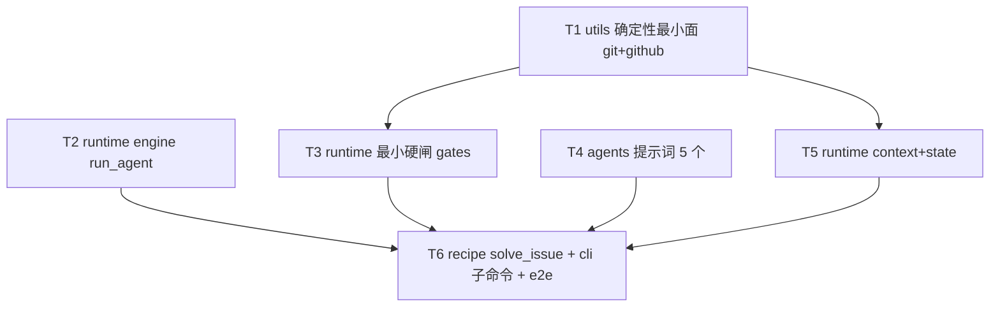

# 0060 · 架构重构（批次一）：核心收敛为 agents（提示词）+ recipes（编排），操作下放 agent，仅留最小硬闸 + runtime/utils 确定性层

<!-- 本文件由 spec 工具维护：frontmatter 为结构化源数据（含 tasks DAG），正文为组级 rust-RFC 9 段总览。 -->

## Summary

把 OpenAgents 的核心**反转并收敛**回初心——「一切需要判断的操作都通过 agent 完成，人只做宏观把控」——
落成两类代码：**agents（提示词）** 与 **recipes（编排）**。核心契约：

> **Agent 负责所有需要判断的操作（实现 / 评审判定 / git 交付 / 解冲突 / e2e 判读）并返回结构化裁决；
> recipe 只根据裁决路由（顺序 / 循环 / 分支），自己不做任何业务判断。**

- `agents/*.py`：每个 agent 一个模块，只有一段 `string.Template` 提示词（`PROMPT`）+ 一个
  `OUTPUT_SCHEMA`，**零逻辑**。
- `recipes/*.py`：每个 flow 只有控制流 + `runtime.run_agent` 调用，**无任何 git/gh/subprocess 直接调用**。
- `runtime/`：唯一允许的「机制代码」——`engine.run_agent`（填占位符 → 派 backend → 收结构化输出）+
  `gates.py`**最小硬闸**（只验客观事实、不含业务判断：head 前移断言、循环轮次上限、PR 存在性、证据溯源戳）。
- `utils/`：所有确定性、非 agent 的原语（git / gh 读写、发版等）。

本组是**分批交付的批次一**（issue「分批交付」约束）：**additive** 立起新栈骨架，让 `solve_issue`
recipe（`plan → implement → review(loop while REWORK) → deliver`）**端到端跑通一个真实 issue**，证明契约成立；
**不动**旧 `orchestrator/messages/vigil/github/workspace`（它们的删除、`vigil/poll_comments/fleet` 迁移、
旧 spec 作废，留后续批次）。

## Motivation

**初心（CLAUDE.md 理念 5–6）。** OpenAgents 的定位是多 agent 去中心化协作：需要判断的事交给 agent，人只做
宏观把控、面向成果验收（理念 8）。但当前代码走向了反面：业务逻辑绝大部分**硬编码在 Python 里**，agent 只被
薄薄地调用一下。

**现状证据（本仓 `openagents/`，2026-07-09 实测）。**
- 全包 **~8970 行 Python、40 个模块**（`find openagents -name '*.py' | xargs wc -l` = 8968 total）。
- 最大的几个模块全是「操作」：`messages.py`(950)、`github.py`(870)、`orchestrator.py`(781)、`reviewer.py`(510)、
  `state.py`(439)，另有 `conflict.py`(234)、`conflictdiag.py`(210)、`executor.py`(174) 等。
- git/gh/subprocess 硬编码操作散落各处（issue 记 **92 处**；本人 spot-check `grep -nE 'subprocess\.|"gh"|"git"'`
  在非 spec 模块即命中 **34 处直接字面量调用**，加上经 `github.py`/`workspace.py` 原语的间接调用与 issue 计数一致）。
- 真正「调 agent」的代码只有薄薄两层：`backends/base.py`（`AgentBackend` Protocol：`run(*, work_dir, task,
  context) -> AgentResult`）+ `backends/claude_code.py`（把 prompt 喂给 `claude -p`）。
- **根本没有 `agents/` 提示词目录**（`ls openagents/agents` = No such file）：所有 prompt 都是 Python 里内联
  拼出来的 task 字符串（`orchestrator.py` 里的 `_DRAFT_RFC_TASK` / refine / implement / iterate 文案、
  `reviewer.py` 的 rubric……），散落各处、既不统一也难复用。

结论：**90% 的 Python 是「操作」而非「编排」，与初心背离。**

**为什么现在做（把 #140 的教训上升为总原则）。** issue #140 的血泪教训（本仓 `git-in-harness-responsibility-
vacuum` 记录）：**git 全 harness 写死 → 分叉后空转（PR#127 干净工作区被当作「已交付」而实际 head 没前移）→
决策：把 git 交付/冲突下放 agent（agent 自己 rebase、`force-with-lease` 仅本分支），harness 只留一道「head
到底有没有前移」的确定性硬闸**（`assert_delivered_or_fail`，见 Spec-0056）。这条教训不是 git 特例，而是整个
架构的缩影：**凡「需要判断」的操作，硬编码进 harness 都会在边界情况下空转或撒谎；应下放 agent + 留最小客观硬闸
兜底。** 本组把这条从一个特例上升为**架构总原则**，一次性重排目录与职责边界。

**核心契约为何必要。** 编排里的循环要判断「评审过了没」才知道要不要再转一圈。若 Python 不许含业务判断，则
**分支条件必须来自 agent 的结构化输出**：reviewer agent 返回 `{"verdict": "PASS" | "REWORK", "reason": "..."}`，
recipe 只看 `verdict` 决定 loop 还是 next。没有结构化裁决，「零硬编码业务判断」无法成立——这是本重构的技术支点。

## Guide-level explanation

**一个 agent 长什么样（`agents/reviewer.py`）——只有字符串和占位符，零逻辑：**

```python
# openagents/agents/reviewer.py   # Spec-0060/T4
from string import Template

PROMPT = Template("""你是评审 agent。审查 PR #$pr_number 的改动，对照验收标准逐条检查。
最后只输出一行 JSON：{"verdict": "PASS" | "REWORK", "reason": "..."}
issue 原文：
$issue_body
""")
OUTPUT_SCHEMA = {"verdict": str, "reason": str}
```

用 `string.Template`（`$占位符`）**不用 f-string / `.format` / `.md`**：f-string 无法当值存起来延后填充；
`.format` 的 `{}` 会和 prompt 里 JSON 示例的 `{}` 打架；`.md` 分不清占位符也没 schema。`Template` 的 `$name`
既能延后 `substitute`、又与 JSON 的 `{}` 井水不犯河水。

**一个 recipe 长什么样（`recipes/solve_issue.py`）——纯控制流，只按裁决路由：**

```python
# openagents/recipes/solve_issue.py   # Spec-0060/T6（示意，非最终实现）
from openagents.runtime import engine, gates
from openagents import agents

def solve_issue(*, issue_number, backend, ctx):
    engine.run_agent(agents.planner,     backend=backend, **ctx.for_plan(issue_number))
    engine.run_agent(agents.implementer, backend=backend, **ctx.for_implement(issue_number))
    for _ in gates.round_cap():                        # 硬闸：轮次上限，防死循环
        v = engine.run_agent(agents.reviewer, backend=backend, **ctx.for_review(issue_number))
        if v["verdict"] == "PASS":
            break
        engine.run_agent(agents.implementer, backend=backend, feedback=v["reason"], **ctx.for_iterate(issue_number))
    d = engine.run_agent(agents.deliver, backend=backend, **ctx.for_deliver(issue_number))
    gates.assert_head_advanced(before=d["base_sha"], workspace=ctx.workspace)   # 硬闸：真交付了？
    return d
```

recipe **自己不判**「代码对不对 / 评审过没 / 冲突怎么解」——它只读 agent 返回的 `verdict`/裁决字段决定
loop-or-next，并在关键处调**最小硬闸**兜底 agent 的自述（防撒谎、防死循环）。`github.py` / `evidence_gate` /
`conflict` 这些整体「消失」：变成对应 agent 提示词里的一段指令 + agent 自己用工具执行。

**最小硬闸的分界线（与 agent 分工完全一致）：**
- **属于硬闸（`runtime/gates.py`，确定性 Python）**：head 有没有前移（真交付了？，#140 的 `assert_delivered`）、
  循环轮次上限（防死循环）、PR 号 / 分支存在性、证据溯源戳（`head_sha` 匹配，Spec-0055）。
- **属于 agent**：代码写得对不对、评审 PASS/REWORK、冲突怎么解、e2e 结果如何判读。
- 一句话：**需要判断 → agent；客观机械 → 确定性代码。** 发版（从 HEAD 切 tag + 生成 changelog）机械零判断，
  恰恰**不该**交给 agent——归 `utils/release.py`，与「最小硬闸」是同一条分界线，不是破例。

**本批次交付后你能做的事**：`oa solve <issue>`（或等价子命令）走**新栈** `solve_issue` recipe 跑通一个真实
issue、CI 全绿——证明「recipe 零业务判断 + agent 出裁决 + 最小硬闸兜底」这条契约在真实链路上成立。旧命令
（`vigil` 等）本批次照旧走老代码，零回归。

## Reference-level explanation

### 目标架构（总原则；本组只落其中的 additive 骨架 + solve_issue 竖切）

```
openagents/
  cli.py          # 薄入口：解析命令 → 调 recipe 或 utils，本身零业务逻辑
  agents/         # ① 提示词：python + string.Template，零逻辑，只有字符串和占位符
  recipes/        # ② 编排：纯控制流，只调 runtime.run_agent，按顺序/循环/分支串 agent
  runtime/        # ③ 引擎 + 最小硬闸：唯一允许的「机制代码」
    engine.py     #   run_agent：读 agents.PROMPT → 填占位符 → 派 backend → 收结构化输出
    gates.py      #   最小硬闸：head 前移断言、循环轮次上限、PR 存在性、证据溯源戳
    context.py    #   组装占位符的值：PR 历史注入等（调 utils.github 读）
    state.py      #   issue→run 状态 + comment 游标持久化
  backends/       # ④ CLI 适配：base.py / claude_code.py / codex.py（本组不动）
  utils/          # ⑤ 所有确定性、非 agent 的东西：github / git / release / notes / spec/ …
```

### 40 个旧模块的最终归宿（迁移映射；**删除动作留后续批次**）

| 归宿 | 来自哪些旧模块 | 变化 |
|---|---|---|
| **agents/**（提示词） | orchestrator 内联的 refine/implement/iterate 文案、reviewer、executor、conflict、conflictdiag、align、issuecheck、backfill 的判断部分 | 从 Python 逻辑**降为 prompt 字符串**，判断交给 agent |
| **recipes/**（编排） | orchestrator 的阶段串联、vigil、fleet、messages 的路由 | 只留**控制流**，操作全下放 agent |
| **runtime/**（引擎+硬闸） | backends 调用逻辑、agentcontext、state、evidence_gate 的客观校验部分、#140 的 assert_delivered | 硬闸只留客观事实核验 |
| **backends/** | backends/ 原样 | 基本不动，后续加 codex |
| **utils/**（确定性） | github、workspace→git、identity、config、envcheck、release、hold、skip、blocknote/worknote/replynote→notes、results、spec/、templates | 机械操作，不派 agent |

### 本组交付边界（批次一 = additive 竖切，不做大爆炸）

为兑现 issue「不做一次性大爆炸重构，按 recipe 逐条切」+「测试迁移风险」（下放 git 曾打断 ~6 个 test git-fakes，
见 #140），本组**只新增文件、不改/不删任何旧模块**：新栈与旧栈并存，`cli.py` 加一个走新栈的子命令。这样：
① 旧 orchestrator/messages/vigil 及其 11 个测试桩零回归；② 契约在真实 issue 上验证成立后，后续批次再逐个
recipe 迁移并删除对应旧模块 + 作废其 spec。

- **`runtime.engine.run_agent(agent_module, *, backend, **placeholders) -> dict`**：读 `agent_module.PROMPT`
  → `Template.substitute(**placeholders)` → `backend.run(work_dir, task=prompt, context=...)` → 解析 agent
  输出末尾那行 JSON、按 `agent_module.OUTPUT_SCHEMA` 校验键与类型 → 返回 dict。**engine 不认识任何具体流程**
  （换套 agent/recipe 零改动，理念 10 解耦）。
- **`runtime.gates`**：`snapshot_head(*, workspace)`（**由 recipe 在派 deliver 前调用**，确定性记录客观
  基点 `before`——绝不取 agent 自述的 `base_sha`，否则 agent 报个假基点即可让闸恒放行，见 #140）、
  `assert_head_advanced(*, before, workspace)`（head 未前移 → raise，兜底 #140 空转；返回实际 after）、
  `round_cap(*, max_rounds)`（生成器/计数器，超限 → raise，防死循环）、`assert_pr_exists(*, pr_number)`、
  `assert_evidence_stamp(*, head_sha, claimed)`（证据溯源戳不匹配 → raise，Spec-0055）。**只验客观事实，不含
  业务判断**——这是「兜底 agent 自述、防撒谎/死循环」的最后一道确定性防线。solve_issue 本组接线三闸
  （`round_cap` + `assert_head_advanced` + `assert_evidence_stamp`，`before` 经 `snapshot_head` 确定性取）；
  `assert_pr_exists` 待「开 PR 环节」批次接线（见本组交付边界的「无开 PR 环节」条与 Unresolved）。
- **`runtime.context` / `runtime.state`**：`context` 组装占位符的值（PR 历史/issue 正文注入，读侧调 `utils.github`）；
  `state` 持久化 issue→run 状态 + comment 游标。为不碰旧 `state.py`（439 行、被多测试桩打），新 `runtime/state.py`
  用**独立的状态文件命名空间**（新栈自成一套），旧 `state.py` 原地不动。
- **`agents/`（本组 5 个，solve_issue 所需）**：`planner`（起草/精炼 RFC）、`implementer`（按 RFC 实现 / 按反馈迭代）、
  `reviewer`（评审 → `{verdict, reason}`）、`deliver`（git 提交/推送/解冲突 → 结构化交付报告，吸收 conflict/
  conflictdiag 的判断）、`tester`（独立 e2e 执行 + 判读）。`triager`/`replier` 属 `vigil`/`poll_comments`，留后续批次。
- **`utils/`（本组只立 solve_issue 依赖的最小面）**：`utils/git.py`（head-sha / porcelain / worktree，薄封装现有
  `workspace.py` 原语）、`utils/github.py`（gh pr 读 + 机器评论写，薄封装现有 `github.py` 原语）。**薄再导出**为的是
  给新栈一个稳定 import 面而**不复制** 870 行 github.py（奥卡姆，理念 1）；旧模块整体搬进 utils/ 及 release/notes/
  spec/ 归位留后续批次。
- **`recipes/solve_issue.py`**：`plan → implement → review(loop while REWORK, round_cap 兜底) → deliver
  (snapshot_head 确定性记 before → assert_head_advanced + assert_evidence_stamp 兜底)`，只有控制流 +
  `run_agent`/`gates` 调用，**零 git/gh/subprocess 直接调用**（`before` 亦经 `gates.snapshot_head` 取，不在
  recipe 里碰 git）。
- **本组交付假定：无「开 PR」环节，PR 号可缺（`pr_number=0` 兜底）**：本组竖切聚焦 `plan→…→deliver` 的裁决
  路由与硬闸，**不含 `gh pr create`**——planner/implementer 只 commit+push，deliver 只推分支。故对**已有 PR**
  的 issue（如本 issue #145）端到端成立；对**全新、尚无 PR** 的 issue，reviewer/deliver 面对 `pr_number=0`、
  context 退化为「仅 issue 正文」，需承接「开 PR」的批次补齐（故 `assert_pr_exists` 本组先不接线）。这也是三处
  推分支（planner/implementer/deliver）与「deliver 才是收口交付」注释的张力来源——**单一交付点收敛**同样留后续
  批次（见 Unresolved / Future possibilities）。
- **`cli.py`**：加一个走新栈 `solve_issue` 的子命令（additive；旧子命令路由不动）。

### DAG 与文件分配



| Task | 拥有文件（组内互斥） | depends-on |
|---|---|---|
| T1 | `openagents/utils/__init__.py`, `openagents/utils/git.py`, `openagents/utils/github.py`, `tests/test_utils_git.py`, `tests/test_utils_github.py` | — |
| T2 | `openagents/runtime/__init__.py`, `openagents/runtime/engine.py`, `tests/test_runtime_engine.py` | — |
| T3 | `openagents/runtime/gates.py`, `tests/test_runtime_gates.py` | T1 |
| T4 | `openagents/agents/__init__.py`, `openagents/agents/planner.py`, `openagents/agents/implementer.py`, `openagents/agents/reviewer.py`, `openagents/agents/deliver.py`, `openagents/agents/tester.py`, `tests/test_agents_prompts.py` | — |
| T5 | `openagents/runtime/context.py`, `openagents/runtime/state.py`, `tests/test_runtime_context.py` | T1 |
| T6 | `openagents/recipes/__init__.py`, `openagents/recipes/solve_issue.py`, `openagents/cli.py`, `tests/test_recipe_solve_issue.py`, `scripts/e2e-spec-0060-agents-recipes-core.sh` | T2, T3, T4, T5 |

（`runtime/__init__.py` 归 T2、内容只作包标记；下游用 `from openagents.runtime.engine import run_agent` /
`from openagents.runtime import gates, context, state` 分模块导入，避免 `__init__` 成为跨 Task 的共写点。）

### 本组 e2e 测法

- **intent**：证明架构契约在**真实链路**上成立——`solve_issue` recipe 只按 agent 的结构化裁决路由（PASS→next /
  REWORK→loop）、自己零业务判断；最小硬闸真的能兜底（head 未前移 / 超轮次 → raise）；`agents/*` 确无逻辑、
  `recipes/*` 确无 git/gh/subprocess 直接调用。
- **method（离线确定性——本组是纯后端编排，无前端可导航；本人已自检工具列表：无 Playwright / Chrome DevTools
  MCP，故不设浏览器 e2e）**：
  1. **契约路由单测**（`tests/test_recipe_solve_issue.py`，假 backend 喂 canned 结构化输出）：reviewer 连回
     两次 `{"verdict":"REWORK"}` 再 `{"verdict":"PASS"}` → 断言 implementer 被迭代调用 2 次、循环在 PASS 后
     next；deliver 报告 head 未前移 → `assert_head_advanced` raise；reviewer 恒 REWORK → `round_cap` 到上限 raise。
  2. **零逻辑/零 IO grep 锚点**（e2e 脚本）：`agents/*.py` 只含 `Template(` + `OUTPUT_SCHEMA` 且**无 `def `/
     `import subprocess`/`gh`/`git` 调用**；`recipes/solve_issue.py` **无 `subprocess`/`"gh"`/`"git"`/直接
     `import ... github`/`workspace`**（只经 `runtime.run_agent` + `gates`）。
  3. **真实 issue 冒烟（dogfood，Phase-3 人验/runbook，非 CI 确定性闸）**：`oa solve <一个真实 issue>` 走新栈
     跑通、PR CI 全绿——这是 issue 第 5 条验收，作为成果验收（理念 8）在 runbook 记录，不塞进离线脚本。
- **脚本**：`scripts/e2e-spec-0060-agents-recipes-core.sh`（ruff check + ruff format --check + 针对性 pytest +
  grep 锚点），被 PR e2e signpost 采集。

## Drawbacks

- **新旧并存的过渡期**：批次一 additive 立新栈、旧栈仍在，短期内仓库同时有两套调用路径（`orchestrator` vs
  `recipes`），行数不降反略升。这是「不做大爆炸、逐 recipe 切」的必要代价；收敛（删旧模块、行数大降）在后续批次。
- **`utils/git`·`utils/github` 是薄再导出**：本批次没真把 `workspace.py`/`github.py` 搬进 `utils/`，只包了一层
  稳定 import 面。有「两个名字指同一实现」的临时冗余，直到后续批次真正搬迁。
- **最小硬闸判不了「对不对」**：`assert_head_advanced` 只证「head 前移了」，证不了「交付内容正确」；正确性仍靠
  reviewer agent。硬化的是「有没有真交付/有没有死循环」这类客观事实，不是质量——二者分层，符合设计。
- **agent 结构化输出可能不合 schema**：把业务判断挪进 agent 后，`run_agent` 依赖 agent 吐出合法 JSON；agent
  跑偏吐坏 JSON 时 engine 需有明确失败语义（见 Unresolved）。

## Rationale and alternatives

**为什么提示词用 Python `string.Template` 而非 `.md`。** `.md` 无法声明 `OUTPUT_SCHEMA`、无占位符类型、要额外
loader；Python 模块天然可 `import`、可和 schema 同居、可被测试直接断言「无逻辑」。`Template` 的 `$name` 相比
f-string（无法存值延后填充）、`.format`（`{}` 与 prompt 内 JSON 示例打架）是唯一同时满足「可存储、可延后填充、
不与 JSON `{}` 冲突」的选择。

**为什么保留「最小硬闸」而非追求绝对零硬编码。** #140 已实证：全靠 agent 自述会在边界情况空转/撒谎（干净工作区
被当已交付）。留一道**只验客观事实**的确定性闸兜底，成本极小、收益是防空转/防死循环/防撒谎。分界线严格等于
agent 分工：客观机械留代码，需判断下放 agent。

**备选 A：一次性大爆炸重构（直接搬 40 模块、删旧栈）。** 否决——issue 明列「分批交付」；#140 下放 git 就打断了
~6 个 test git-fakes，40 模块一次搬会同时打断 11 个测试桩 + 让 PR 巨大不可评审、契约未验证就先毁旧栈，风险失控。
本组选 additive 竖切：先用真实 issue 证契约成立，再逐 recipe 迁移删旧。

**备选 B：`utils/git`·`utils/github` 直接把旧模块搬过来（而非薄再导出）。** 否决（本批次）——搬 `github.py`(870)/
`workspace.py`(122) 会改动被 11 个测试桩引用的 import 路径，触发本组明确想避开的测试迁移风险。薄再导出把「搬迁」
与「立契约」解耦，搬迁留后续批次单独承受回归成本。

**备选 C：分支条件靠 recipe 自己 grep agent 的自然语言输出（不要结构化 schema）。** 否决——那等于把业务判断
（"这段话算不算 PASS"）又搬回 Python，正是本重构要消灭的东西。结构化 `OUTPUT_SCHEMA` 是「recipe 零业务判断」
的技术前提。

## Prior art

- **issue #140 / Spec-0056（直接思想来源）**：git 交付/冲突下放 agent（agent 自 rebase、`force-with-lease` 仅本
  分支）+ harness 只留 `assert_delivered_or_fail`「head 前移」硬闸。本组把这条**从 git 特例上升为架构总原则**，
  `gates.assert_head_advanced` 即其一般化。
- **Spec-0055（e2e 能力感知 + 证据溯源戳）**：`head_sha` 匹配的确定性核验。本组 `gates.assert_evidence_stamp`
  沿用之。
- **Spec-0057「软约定硬化」**：把「别违反」的软约定变成确定性/结构规则。本组的「recipe 零业务判断」正是把它推到
  架构层——业务判断在结构上只能出现在 agent 里。
- **rust-lang/rfcs**（本 spec 的 9 段形态本身）；**Unix「机制与策略分离」**：`runtime` 是机制、`recipes`+`agents`
  是策略，换套策略零改机制。
- **LangChain / CrewAI 等 agent 编排框架**：prompt 与编排分离是通行实践；本组的差异化在「recipe 严格零业务判断、
  一切判断经 agent 结构化裁决 + 最小客观硬闸兜底」这条硬契约。

## Unresolved questions

- **engine 遇到 agent 吐坏 JSON / 不合 `OUTPUT_SCHEMA` 时的失败语义**：直接 raise（交给上层 recipe 当一轮
  REWORK 处理）还是有限重试？本组倾向「raise + recipe 层按轮次消化」，实现时定死。
- **`OUTPUT_SCHEMA` 的表达力**：本组用「键→Python 类型」的极简 dict（`{"verdict": str}`）够不够，还是需要枚举
  取值约束（`verdict ∈ {PASS,REWORK}`）？先极简，值域校验留 agent prompt 自述 + 后续按需硬化。
- **`runtime/state` 与旧 `state.py` 的最终合并方式**：本组用独立命名空间并存；两套状态最终如何统一（迁移还是
  弃旧）留承接 `vigil` 迁移的批次决定。
- **子命令命名**：走新栈的入口叫 `oa solve` 还是复用 `oa run`？由用户在评审时定；不影响本组文件分配。
- **「开 PR」环节 + `assert_pr_exists` 接线**（评审 #2/#3）：本组 solve_issue 不含 `gh pr create`，故 `pr_number`
  可为 0、`assert_pr_exists` 定义并单测但**未接进 recipe**（对全新无 PR 的 issue，接了反而恒 raise）。承接「开 PR」
  的批次补上 `gh pr create` 后再把 `assert_pr_exists` 接进 deliver 前置闸。
- **单一交付点收敛**（评审 #4）：现 planner/implementer/deliver 三处都 commit+push，与「deliver 收口交付」有张力；
  后续批次把中途推分支收敛到唯一交付点（deliver），planner/implementer 只落本地提交。

## Future possibilities

- **后续批次（本组之后）**：`recipes/vigil.py`（循环 poll issues → solve_issue，吸收旧 vigil）、
  `recipes/poll_comments.py`（拉每个 PR 新 comment → 按阶段路由到对应 agent，吸收 `messages` 路由）、
  `recipes/fleet.py`（多仓库/同 worktree 多 agent 认领）；`agents/triager`（align+issuecheck）、`agents/replier`。
  每迁一条 recipe 就删对应旧模块 + **作废其 spec**（旧代码还活着时不能先作废其 spec，故作废动作绑定删除批次）。
- **`utils/` 完整归位**：`workspace→git`、`github`、`release`、`blocknote/worknote/replynote→notes`、`hold`/`skip`、
  `results`/`board`、`spec/`、`templates` 全部实搬进 `utils/`；`runtime/`+`backends/`+`recipes/` 压到几百行。
- **`backends/codex.py`**：新增 Codex 适配，验证 backend 抽象对异构 CLI-agent 的通用性（理念：兼容 claude code /
  codex / nexau）。
- **issue #71 运行期 owner 检查**：`files` 互斥是设计期所有权；把它硬化成运行期 lease/CAS，与本重构的「结构上
  无法违反」一脉相承。

