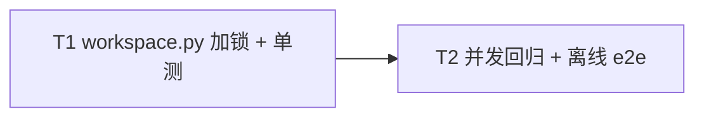

# 0068 · 并行守夜 worktree prepare 的共享 .git 锁竞争消除：一把粗粒度 git-mutation 串行锁

<!-- 本文件由 spec 工具维护：frontmatter 为结构化源数据（含 tasks DAG），正文为组级 rust-RFC 9 段总览。 -->

## Summary

issue #137 要「vigil --parallel N：同仓库内多 issue 并行求解」，列了六个并发风险 P1–P6。这里有个关键前提读者必须先知道：**其中 P1/P3/P4/P5 已经被 Spec-0065（图驱动并行守夜，issue #150）在把 vigil 原地重写为 level-triggered reconcile + K-worker 池时一并交付并合并进 main 了**——`vigil --parallel K` 这个命令**现在就能跑**。所以本 spec 不再重造 worker 池，只补 Spec-0065 唯一没碰到的那处遗留风险：

**P2 —— K 个 worker 并发对同一个主仓 `.git` 跑 `Workspace.prepare` / `Workspace.ensure`（`fetch` + `worktree remove` + `worktree prune` + `branch -D` + `worktree add`），无任何串行锁，会争 git 的 ref 锁 / worktree 管理锁，且 `worktree prune` 是跨 worker 的全局副作用、可误清他人半成品。**

修法遵循奥卡姆（理念 1，也是 issue 自己的建议方向 1）：在 `openagents/utils/workspace.py` 加**一把进程级 git-mutation 串行锁**（模块级，直接照抄本仓已有的 `RuntimeState._LOCK` 模式），把 `prepare` / `ensure` 里那整段作用于共享 `.git` 的变更操作串起来。`prepare` 只花秒级、其后的起草 + reconcile 是分钟级，串行化那几秒几乎不损失并行度，却一次性消掉全部三类 git 锁竞态；`worktree prune` 落在同一把锁内，从此不可能与并发 `worktree add` 相撞。真正隔离的 `commit_and_push`（跑在各 worktree 私有 index 上）不进锁。

## Motivation

### issue #137 的目标模型（就地复述，单 spec 自包含）

issue #137 要的是「worker 池，每个 worker 抢一个 issue、串行跑完它整条生命周期（抢 → 起草 → per-PR 推进到合并），N 个 worker 并行、各管各的 issue」。它把并行**新引入**的风险列成六条：

- **P1 — 共享本地 State 并发写**：N 个 worker 并发写同一份 RuntimeState → lost update / 文件损坏。
- **P2 — 共享主仓 `.git` 的 git 锁竞争**：每个 worker 建 worktree 都对同一个 `.git` 连打 `fetch` / `worktree remove` / `worktree prune` / `branch -D` / `worktree add`。
- **P3 — `messages.poll` 是全局的**：旧 poll 推进所有开着的 PR，与「每 worker 只推自己那条 PR」不匹配。
- **P4 — 并发上限与限流**：无上限 = 后端 fork 炸弹，须有 `--parallel N`（保守默认）。
- **P5 — 日志交织 / Ctrl-C 级联清理 / worker 级错误隔离**。
- **P6 — 多人使用特有**：agent_id 撞车 / 末位 created_at 抢占 thrash / 人评审吞吐瓶颈。

### 现状对账：P1/P3/P4/P5 已被 Spec-0065 交付（证据驱动）

Spec-0065（issue #150）在把 `run_vigil` 重写为 K 个常驻 worker 线程 + SQLite 认领队列 + flock 存活证明 + level-triggered reconcile 时，顺带闭合了 issue #137 的绝大部分。逐条核对当前 main 的代码：

| 风险 | 现状 | 证据（当前代码） |
|---|---|---|
| **P1** State 并发写 | ✅ 已解决 | `RuntimeState._LOCK = threading.RLock()`（`openagents/runtime/state.py:58`），每个 `set_run` / 游标更新等读-改-写全程 `with RuntimeState._LOCK`（同文件 :81/:123/:161/:180…）——K 个 worker 并发写不再丢更新 |
| **P3** 全局 poll | ✅ 已过时 | 旧 `messages.poll` 已随旧串行 vigil 删除；现为 per-subject `_reconcile`（`recipes/vigil.py`），每个 worker 只推进自己领到的那一个 subject |
| **P4** `--parallel N` | ✅ 已交付 | `oa vigil --parallel K`（`openagents/cli.py`：`_parallel_k` 校验 `1..{_MAX_PARALLEL}`，`default=1` 即串行）；K 由 issue 依赖图天然约束，`_MAX_PARALLEL` 只是防手滑护栏 |
| **P5** 日志/Ctrl-C/隔离 | ✅ 已交付 | `run_vigil` 起 K 个 worker 线程，单 subject 异常不杀 worker、`KeyboardInterrupt` 经 `stop_event` 收池（Spec-0065/T2 验收即含这几条） |

**所以 `vigil --parallel K` 现在就能跑。** 本 spec 若再设计一个 worker 池，就是往「living snapshot 无 legacy」的快照里塞一份和已合并代码打架的重复设计，违背奥卡姆。

### P2 仍然活着：worktree prepare 段对共享 `.git` 无串行锁

Spec-0065 的精力全在 reconcile 循环、SQLite 队列、flock 认领上；它**没有碰** worktree 的建/清那段 git 操作。当前 `Workspace.prepare`（`openagents/utils/workspace.py:55-72`）逐条串跑：

```
fetch origin <base>            # 决策 2：拉最新 base
worktree remove --force <path> # 决策 4：幂等清残留
worktree prune                 # ← 全局副作用
branch -D <branch>
worktree add -b <branch> <path> origin/<base>
```

**这五条全部作用于同一个主仓 `.git`**，而它被 `_do_solve`（`openagents/recipes/vigil.py:2802`：`git.Workspace(work_dir=work_dir).prepare(...)`）在 **K 条 worker 线程里并发调用**，中间没有任何串行锁（全仓唯一相关的锁是 `state._LOCK` 和认领 flock，都不覆盖这段）。`ensure`（`workspace.py:74-81`，续写路径 `vigil.py:3048/3051`）同样跑 `fetch` + `worktree add`，同样的暴露。并发下的具体故障：

- **`fetch` + `branch -D` 争 `.git/packed-refs.lock`** → `cannot lock ref … File exists`，git 非零退出（`prepare` 里 `fetch` / `worktree add` 是 `check=True`，一抛就把这个 worker 的 solve 打断）。
- **`worktree add` / `worktree remove` 争 `.git/worktrees/` 管理锁** → `could not lock working tree`。
- **`worktree prune` 是跨 worker 的全局副作用**：它清理 `$GIT_DIR/worktrees` 中「工作树已消失」的登记项；worker A 正 `worktree add`（目录已建、管理项半写）、worker B 恰好跑 prune → prune 可能把 A 那条半成品登记项当「消失的工作树」清掉，破坏「每 worker 只碰自己 issue」的隔离。
- **`fetch` 可能触发 auto-gc**，锁 object store 拖垮并发 git。

真正天然隔离的只有 `commit_and_push`（跑在各 worktree **私有 index** 上，`workspace.py` 的 add/commit），它不碰共享 `.git` 的 ref/worktree 管理，故不需要锁。

### P6 为什么不在本 spec 范围

- **agent_id 撞车** → 已由 `identity.resolve_agent_id`（env > state > 生成）收敛；启动期唯一性校验若要做，是独立的一条小 feature，另开 spec。
- **末位 created_at 抢占 thrash** → 已由既有认领防抖（Spec-0049 anti-thrash）覆盖，其归属/年龄判定与 worker 数无关，K>1 不改变其成立性。
- **人评审吞吐瓶颈** → 是运营参数（把 `--parallel` 调小），不是代码缺陷。

把这三条塞进本 spec 会稀释「一处并发正确性修复」的焦点，故列入 Unresolved 明确排除。

## Guide-level explanation

以「已经落地」的口吻讲一遍：

`run_vigil` 起 K 个常驻 worker（Spec-0065 已有）。某个 worker 领到一个还没有 PR 的 issue，走 solve 分支要建隔离 worktree 时，`Workspace.prepare` 的第一件事是**取一把进程级 git-mutation 锁**；拿到锁后它串行地把 `fetch` → `worktree remove` → `worktree prune` → `branch -D` → `worktree add` 这段对共享 `.git` 的变更一次做完（秒级），拿到 worktree 路径后**立刻释放锁**，随后进入分钟级的起草 + reconcile。于是：

- **K 个 worker 的起草 / 推进真并行**（各自 worktree 私有 index，互不相干）；
- **只有那几秒的 `.git` 变更段被串起来**——任一时刻至多一个 worker 在动主仓 `.git` 的 ref 和 worktree 管理表，`cannot lock ref` / `could not lock working tree` 结构性消失；
- **`worktree prune` 落在锁内** → 它只在没有别的 worker 正 `worktree add` 时执行 → 再不会误清半成品。

**为什么一把粗锁就够、不心疼那点串行**：`prepare` / `ensure` 是秒级，其后每个 issue 的起草 + reconcile 是分钟级。K=3 时，锁的争用窗口只是每个 issue 整条生命周期里开头那几秒，占比不到 1%。用这可忽略的并行度损失，换「一把锁一次消掉三类竞态、改动集中在一个文件」，是理念 1 的直接兑现。

## Reference-level explanation

### 锁的落点与类型

在 `openagents/utils/workspace.py` 加一个**模块级**锁：

```python
# Spec-0068/T1: 进程级 git-mutation 串行锁 —— 见 RuntimeState._LOCK 同款模式。
_GIT_MUTATION_LOCK = threading.Lock()
```

- **为什么模块级、不是实例级**：`Workspace` 现在每次调用都 new 一个新实例（`git.Workspace(work_dir=work_dir).prepare(...)`，`vigil.py:2802`），实例锁串不起跨 worker 的调用。一把模块级锁覆盖同进程内所有 worker。
- **为什么一把就够、不按 work_dir 分**：一个 vigil 进程只服务一个仓库（一个 `work_dir` / 一个 `.git`）；跨仓并行（fleet / `vigil-all`）走**子进程**，天生进程隔离 → 不同进程各自持一把独立的模块级锁 → 既不会跨仓误串、也不会漏保护。
- **为什么 `threading.Lock` 而非 `RLock`**：`prepare` / `ensure` 的变更段不自嵌套（不会在持锁时再调 `prepare`/`ensure`），互斥即够，无需可重入。

### 锁的范围（谁进锁、谁不进）

| 方法 | 是否进锁 | 理由 |
|---|---|---|
| `Workspace.prepare` | ✅ 整段 `fetch`→`remove`→`prune`→`branch -D`→`add` 进锁 | 全部作用于共享 `.git` 的 ref / worktree 管理表 |
| `Workspace.ensure` | ✅ 整段 `fetch`→`worktree add` 进锁 | 同样碰共享 `.git` |
| `Workspace.commit_and_push` | ❌ 不进锁 | 跑在各 worktree **私有 index**，天然隔离（issue #137 明确点出这是唯一真隔离的部分） |
| `Workspace.assert_delivered` | ❌ 不进锁 | 纯读（`fetch` + `rev-parse`），作用于 worktree 自身，不改共享 ref |

`prune` 与 `add` 现落在**同一把锁内** → 二者被串行化 → prune 永不在有 add 在飞时执行 → 「误清半成品」结构性消除，**无需**把 prune 外提成单独维护步（那是备选 A，见 Rationale）。

### DAG + 文件分配



| Task | 拥有文件（两两不相交） | 干什么 |
|---|---|---|
| **T1** | `openagents/utils/workspace.py`、`tests/test_workspace.py` | 加 `_GIT_MUTATION_LOCK`；用它包住 `prepare` / `ensure` 的 `.git` 变更段；单测断言两方法进锁、`commit_and_push`/`assert_delivered` 不进锁 |
| **T2** | `tests/test_workspace_concurrency.py`、`scripts/e2e-spec-0068-parallel-worktree-git-lock.sh` | 起 N 条线程对同一个临时 git 仓并发调 `prepare`，断言零 `cannot lock ref` / `could not lock working tree`、所有 worktree 都建成；离线 e2e 脚本聚合 ruff + pytest |

### e2e 脚本路径

`scripts/e2e-spec-0068-parallel-worktree-git-lock.sh`（离线确定性：`ruff check` + `ruff format --check` + 针对性 `pytest`；被 PR e2e signpost 采集）。这是纯内部并发正确性修复、无 product-facing 前端可导航，故按取证纪律「纯内部 → 相称自动化测试」用并发回归测法，不设浏览器 e2e。

## Drawbacks

- **粗锁把所有 worker 的 worktree 建/清串行化**：理论峰值下 K 个 worker 同一瞬间都要 `prepare` 会排队约「几秒 × K」。在起草分钟级的现状下可忽略；但若未来 `prepare` 变慢（如超大仓 `fetch`），这把锁会成瓶颈，届时需拆细锁（备选 B）或把 `fetch` 外提（备选 A）。
- **一把模块级锁把「一个进程只服务一个 `.git`」这个假设硬编码进来**：若未来出现同进程内多 `work_dir` 并行（现在不会——fleet 用子进程），这把锁会误串不同仓的 `prepare`。用 per-work_dir 锁字典可解，但当前是 YAGNI。

## Rationale and alternatives

**选定：一把粗粒度 git-mutation 锁串行化整段。** 理由：奥卡姆（理念 1）+ issue 建议方向 1；一把锁一次消掉三类竞态（ref 锁 / worktree 管理锁 / prune-vs-add），改动集中在一个文件的两个方法，正确性易审。

- **备选 A —— 把 `fetch` / `prune` 外提为生产者单线程维护步**（issue 建议方向 1 的后半）：每轮统一 `fetch origin <base>` 一次、`prune` 挪到单线程维护步。语义上更「对」（全局操作本就该单线程），但要改 `run_vigil` 生产者 tick + 改 `prepare` 签名（去掉内部 `fetch`/`prune`）+ 处理「worker 建 worktree 时 base ref 是否已被 fetch」的时序耦合 → 改动跨模块、面更大。粗锁用**一个文件**的改动拿到**同样的正确性**，故先选粗锁；`prune` 外提留作 Future。
- **备选 B —— per-op 细锁 / 只锁 `packed-refs` 段**：粒度小、并行度略高，但要精确识别每条 git 命令碰哪把内核锁，而 `worktree prune` 的全局副作用天然要求「跨 add 互斥」→ 细锁反而更易漏一处。在「`prepare` 只占生命周期几秒」的前提下并行度收益可忽略，不值得为它背细锁的正确性风险。
- **备选 C —— 改用 fleet 子进程模型**（每 worker 一进程）：子进程能拿到 State/cwd/崩溃隔离，但**仍共享同一主仓 `.git` 文件系统，git 锁竞争依旧存在**——它不解决 P2 本身。且 Spec-0065 已定线程模型（求解路径的 cwd 依赖已审计：git 命令全走 `cwd=` 参数、不靠 `os.chdir`，故线程安全）。推翻它成本极高且不治本，故不选。

## Prior art

- **git worktree 是并行 AI agent 的标准隔离手段，但需显式加锁防并发访问**：
  - Augment Code —《Git Worktrees for Parallel AI Agent Execution》 https://www.augmentcode.com/guides/git-worktrees-parallel-ai-agent-execution
  - sandcastle #427 —《Worktree locking to prevent concurrent agent access》 https://github.com/mattpocock/sandcastle/issues/427
- **并发 git 操作导致 `cannot lock ref`**：
  - desktop/desktop #5438 https://github.com/desktop/desktop/issues/5438
  - Baeldung —《Fixing cannot lock ref》 https://www.baeldung.com/ops/git-repo-structure-cannot-lock-ref
- **`worktree prune` 清理 `$GIT_DIR/worktrees` 中缺失工作树的登记项（全局）**：git 官方文档 https://git-scm.com/docs/git-worktree
- **本仓内部先例**：`RuntimeState._LOCK = threading.RLock()`（`openagents/runtime/state.py:58`）——同一个「共享可变资源加进程内锁、串行读-改-写」的模式；本 spec 把它复制到 workspace 的 git 变更段，一致性即可维护性。

## Unresolved questions

- **P6 三条本 spec 明确不做**（见 Motivation §P6）：agent_id 启动期唯一性校验（若要做另开 spec）、末位 created_at thrash（已由既有认领防抖覆盖，K>1 不改其成立性）、人评审吞吐（运营参数 `--parallel` 调小，非代码）。
- **本 spec 不需要新增 open 问题**：锁是否覆盖 `ensure` 已在方案内定死（覆盖，`ensure` 也碰共享 `.git`）。

## Future possibilities

- 若 `prepare` 变慢或要减少冗余 `fetch`，把 `fetch` / `prune` 外提为生产者单线程维护步（备选 A）。
- 若未来同进程内多仓并行（现不会），把单锁换成 per-work_dir 锁字典。
- 若目标 git 版本普遍支持 `worktree add --lock`（消除「add 后再 lock」的竞态），可进一步简化清理逻辑。

