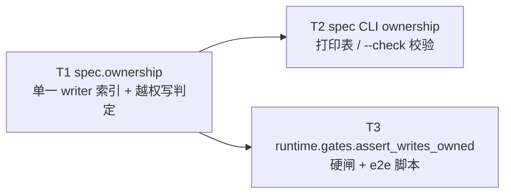

# 0071 · 把「单一 writer」文件所有权从设计期声明硬化为运行期可执行守卫

<!-- 本文件由 spec 工具维护：frontmatter 为结构化源数据（含 tasks DAG），正文为组级 rust-RFC 9 段总览。 -->

## Summary

OpenAgents 的**协同工作模式**（同一 worktree、多 agent 并行实现一个 spec 组）存在**写竞争**：两个
agent 可能同时改同一文件——这是 agent 版的 **data race**。当前只靠**理念 6「每个 Task 占一组互斥
`files`」+ reviewer 肉眼 + 自觉**维持；`spec validate` 也只在**设计期**校验同组 `files` 不重叠（error），
**没有运行期强制**——一个 agent 完全可以去写不属于它 Task 的文件而无人拦。

本 spec 借鉴 Rust 的**所有权唯一 + `&mut` 独占**（aliasing XOR mutability，在编译期根除 data race），
把「单一 writer」从**设计期声明**推进到**运行期可执行守卫**，落三层薄机制：

1. **`spec.ownership`（纯解析器）**：从一个组的 `tasks[].files` 建**单一 writer 索引**（path → 唯一
   owner Task），并据它判「一个 changeset 里有哪些写落在无主文件上」（越权写）；生成物（本组 spec md /
   `OVERVIEW.md` / `ARCHITECTURE.md`）恒放行。
2. **`runtime.gates.assert_writes_owned`（硬闸）**：raise 版拒绝原语——harness 交付后读实际改动文件集，
   越权写直接 `GateError`，与 `assert_head_advanced` / `assert_evidence_stamp` 同层同风格。
3. **`spec ownership`（CLI 操作面）**：无 `--check` 打印单一 writer 所有权表（人读 + 可 grep）；
   `--check --group --changed` 校验一个 changeset，有越权写则退出码 1（CI/harness 可调用）。

本轮**只做「文件所有权」这一半**（issue #71 验收的「越权写被 harness 拦截」）。**版本化共享状态
CAS**（reader 拿带版本号的不可变快照、writer 带 `expected_version`）与 **capability manifest**
（`capabilities: [read_fs]` + 子 agent 权限 ⊆ 父）是另一半，列入 Future，另开 issue，避免一个 PR 过大。

## Motivation

### 背景：协同模式下的「agent 版 data race」

理念 2/6 允许**同一项目里多 agent 协同实现一个 spec 组**，每个 Task 通过 frontmatter `files`
声明它**独占**的一组文件。这套「文件分配」就是把 Rust 的「所有权唯一」搬到 agent 编排上：一个文件
任意时刻只有一个 writer Task，别的 Task 只读。问题在于——**它至今只是一句散文约定 + 一道设计期
校验**：

- `spec validate` 的 `_file_overlap_checks` 只在**设计期**（写 spec 时）校验**同组 `files` 不重叠**
  （error），跨组重叠仅 warning。
- 一旦 agent 开始**跑**，没有任何机制阻止它去写**不属于它 Task 的文件**。理念 6 说的「每个 Task 占
  一组互斥 files」和 reviewer 闸，本质都是「**靠大家自觉**」——规模一大必然破。

`Task` 数据类的 docstring 早已预留了这个扩展点（原文）：「`files` 是单一 writer 所有权声明（理念 6 /
issue #71 运行期 owner 检查的**结构化源**）」。本 spec 正是把那句「运行期 owner 检查」兑现。

### 借鉴 Rust 的思路（学想法，不写 Rust）

Rust 用 **aliasing XOR mutability**（别名与可变，二选一）在编译期根除 data race：一个值任意时刻要么
多人只读（`&T`，可并发任意多），要么唯一一人可写（`&mut T`，独占）；**绝不允许「有人读的同时有人
写」**。映射到 multi-agent：

| 软约定（散文里的祈使句） | 对应 Rust 概念 | 本 spec 硬化成 |
|---|---|---|
| 别让两个 agent 同时写同一文件 | 所有权唯一 + `&mut` 独占 | 每个文件在组内有唯一 owner Task；写非自己 `files` 的文件 → `assert_writes_owned` 拒 |
| 越权写要被机制拦、而非靠自觉 | 编译期借用检查 | `spec.ownership.unowned_writes` 把设计期声明变成运行期可执行判定 |

### 为什么先做「文件所有权」这一半

issue #71 列了两条落地路径（模块级注释 / spec 文件分配）与两半验收（**越权写被拦** + **共享状态
版本化读写 CAS**）。**文件所有权**这一半：

- **结构化源已就位**——`tasks[].files` 是既有的机器可解析 frontmatter（issue #69 已把文件分配收进
  `Reference-level explanation` 并保留结构化源），无需新造声明格式；
- **判定是纯集合运算**——「changeset ⊆ 声明 files ∪ 生成物」，无需引入 lease/租约/SQLite 等重机制
  （理念 1 奥卡姆）；
- **enforcement 有现成的家**——`runtime.gates` 就是「最小硬闸、harness 侧调用」层，加一个
  `assert_writes_owned` 与既有硬闸严丝合缝。

而**版本化共享状态 CAS + capability manifest** 需要动 `state.json` 读写协议与 agent 沙箱模型，是更大
的一块，强行塞进本 PR 会违反「6-Task 上限 + files 两两不相交 + 一个 PR 一个 feature」。故本轮聚焦、
另一半列 Future。

## Guide-level explanation

三层机制，从纯逻辑到操作面：

### ① 单一 writer 索引（`spec.ownership`）

```python
from openagents.spec import model, ownership

group = next(g for g in model.load_all(specs_root=Path("docs/specs")) if g.number == "0071")

index = ownership.build_index(group=group)
index.owner_of(path="openagents/spec/ownership.py")   # -> '0071/T1'（唯一 owner）
index.owner_of(path="does/not/exist.py")              # -> None（无主）

# 一个 changeset 里的越权写（写了本组任何 Task 都没声明、且非生成物的文件）：
ownership.unowned_writes(group=group, changed_paths=[
    "openagents/spec/ownership.py",   # 有主（T1）→ 放行
    "docs/specs/OVERVIEW.md",         # 生成物 → 放行
    "evil.py",                        # 无主 → 越权
])                                    # -> ['evil.py']
```

**生成物恒放行**：解决一个 issue 时，changeset 除了各 Task 的 `files`，必然还碰三类生成物——本组
spec markdown（`NNNN-slug.md`）、`spec render` 重渲的 `OVERVIEW.md`、`spec graph` 重渲的
`ARCHITECTURE.md`。它们不写进 `tasks[].files`（约定），但绝非越权，故 `generated_artifacts` 把它们
并入允许集。

### ② harness 硬闸（`runtime.gates.assert_writes_owned`）

```python
from openagents.runtime import gates

# harness 在 agent 交付后调用（changed_paths 由 git diff --name-only 得到）：
gates.assert_writes_owned(group=group, changed_paths=changed)   # 有越权写 → raise GateError
```

与 `assert_head_advanced`（head 有没有前移）、`assert_evidence_stamp`（证据戳对不对）并列——都是
「兜底 agent 自述、防撒谎/死循环」的确定性防线，**纯读客观事实、零业务判断**（「代码对不对」归
reviewer agent）。

### ③ CLI 操作面（`spec ownership`）

```console
$ spec ownership                       # 打印单一 writer 所有权表（owner Task → 声明文件）
# 单一 writer 所有权表（Spec-0071：owner Task → 声明文件）
0071/T1	openagents/spec/ownership.py
0071/T1	tests/test_spec_ownership.py
0071/T2	openagents/spec/cli.py
...

$ spec ownership --check --group 0071 --changed "openagents/spec/ownership.py,evil.py"
[error] evil.py: 越权写（组 0071 无 Task 声明该文件，且非生成物）
✗ 越权写检测失败：1 个无主写
$ echo $?
1
```

CI 或 harness 可直接调 `spec ownership --check` 把「越权写」挡在门外，无需写 Python。

## Reference-level explanation

### 改动范围与文件分配（DAG）



- **T1**（`openagents/spec/ownership.py` + `tests/test_spec_ownership.py`）是纯解析器，**规则真源**，
  先落。T2、T3 都只依赖 T1，**彼此文件不相交、可并行**。
- **T2**（`openagents/spec/cli.py` + `tests/test_spec_cli.py`）薄路由转发 `ownership`。
- **T3**（`openagents/runtime/gates.py` + `tests/test_gates_ownership.py` +
  `scripts/e2e-spec-0071-*.sh`）加 raise 版硬闸 + e2e 脚本。

### 关键判定：允许写的文件集

`unowned_writes(group, changed_paths, specs_root)` 的核心是一条集合式：

```
allowed = { 组内所有 Task 的 files } ∪ generated_artifacts(group, specs_root)
offenders = sorted({ p for p in changed_paths if p ∉ allowed })
```

- `build_index` 用 `dict.setdefault`（**首个声明者胜**）保证确定性——同组一个文件被两个 Task 声明本身
  是 `spec validate` 的 error，本索引**不复述**该校验、只取首个 owner 供查询（职责单一，理念 10）。
- `generated_artifacts` 用 `model.group_path` 拼本组 spec md 路径，加固定的
  `{specs_root}/OVERVIEW.md`、`{specs_root}/ARCHITECTURE.md`。`specs_root` 可注入 → hermetic 可测
  （测「自定义根让旧默认生成物路径不再放行」）。

### enforcement 的两个调用面

- **程序内**：`runtime.gates.assert_writes_owned` —— harness/orchestrator 交付后调用，raise `GateError`
  是既有的「拒绝」信号（与其它硬闸同）。本 PR **提供原语**并全量单测；把它接进 `recipes.vigil` 的
  实际交付路径（读 `git diff --name-only` 后调用）是**下一增量**——那条路径要同时确定「本次交付对应
  哪个 spec 组」，牵动 vigil 内部较多，按奥卡姆不塞进本 PR（见 Unresolved）。
- **命令行/CI**：`spec ownership --check` —— 无需写 Python 即可把越权写挡在门外，是**当下就能跑**的
  运行期守卫面。

### 分层与依赖

`runtime.gates` 新增对 `spec.ownership` / `spec.model` 的 import（runtime → spec）。这是合理的方向：
**harness 强制 spec 声明的所有权**，本就依赖 spec 模型；`spec` 层不反向依赖 `runtime`（无环）。
`ARCHITECTURE.md` 随 `spec graph` 重渲、纳入这条新边。

## Drawbacks

- **只覆盖「文件所有权」半个 issue。** 版本化共享状态 CAS 与 capability manifest 未做，`state.json`
  的并发写、只读 agent 的 fs/网络越权仍无机制强制（列 Future）。
- **硬闸尚未接进 live vigil 交付路径。** 本 PR 提供 `assert_writes_owned` 原语 + `spec ownership
  --check` 操作面，但没有改 `recipes.vigil` 在每次交付时自动调用它——真正「运行期自动拒绝」还差最后
  一根接线（见 Unresolved / Future）。当下的 enforcement 靠 CI/harness **显式调用** `--check`。
- **owner 粒度到「Task」，不到「agent 实例」。** 当前机械路径是「一个 issue 一个 agent 解整份 spec」，
  故 changeset 只需 ⊆ **全组** files ∪ 生成物；真正「per-Task-agent 各自独占」的更细检查要等协同模式
  多-agent-per-worktree 真正落地才有对象可查（见 Prior art / issue #71 原文）。

## Rationale and alternatives

**本设计：三层薄机制（纯解析器 + 硬闸原语 + CLI 操作面），只做文件所有权半个 issue。** 理由是——
结构化源（`tasks[].files`）已就位，判定是纯集合运算，enforcement 有现成的 `runtime.gates` 家；把设计期
声明兑现成运行期可执行判定，用最小实体（一个纯模块 + 一个硬闸函数 + 一个子命令）拿下 issue #71 最
可落地、最可测的那一半。

- **备选一：把 owner 检查加进 `spec validate`（设计期），不做运行期。** 否决——issue #71 的核心诉求
  正是「从**设计期声明**推进到**运行期强制**」，`spec validate` 已经在设计期查重叠了，再加也还是设计期。
- **备选二：模块级 docstring 声明 owner（issue 的路径 1），配合 `spec graph` docstring 扫描强制。**
  可行但更重且易漂移——要给每个源文件的 docstring 加 `Owner: 0071/T1`，与 `tasks[].files` 两处真相
  需对账，违反「单一真源」。`tasks[].files` 已是机器可解析的**唯一**所有权源，直接用它更省实体（理念 1）。
- **备选三：本轮就把版本化共享状态 CAS + capability 一起做。** 否决——牵动 `state.json` 读写协议与
  agent 沙箱模型，远超一个 PR / 6-Task 上限，且与文件所有权是两条相对独立的机制。拆开、Future 承接。
- **备选四：硬闸直接接进 `recipes.vigil` 交付路径（本轮就自动拒绝）。** 诱人但风险大——要在 vigil 内
  确定「本次交付对应哪个 spec 组」并读 `git diff`，牵动并发 worker 与既有测试较多，按奥卡姆本轮先交付
  原语 + CLI，接线列 Future（与 Spec-0055 e2e「先 gate 原语、后接 recipe」同款渐进）。

## Prior art

- **Rust ownership & borrowing、Send/Sync**（*The Rust Programming Language*，所有权与无畏并发章节）：
  aliasing XOR mutability 在编译期根除 data race——本 spec 把「所有权唯一」搬到 agent 文件写。
- **Rust RFC 治理流程**：[rust-lang/rfcs](https://github.com/rust-lang/rfcs)（RFC 先于实现 + team
  ownership）——每个领域有归属 team = 「所有权唯一」在社会层的同构，正是理念 4「先改 rfc/spec 再改
  代码」的来源。
- **issue #69**（本 issue 的前置）：把 spec 转成 rust-RFC 形态、DAG + 文件分配收进
  `Reference-level explanation`，并**保留 `tasks[].files` 为结构化源**——本 spec 消费的正是那个预留的
  机器可解析源。
- **OpenAgents 既有硬闸**（`runtime.gates`：`assert_head_advanced` / `assert_merge_allowed` /
  `assert_evidence_stamp`，Spec-0060/0017/0055）：本 spec 的 `assert_writes_owned` 与它们同层同风格
  （纯读客观事实、raise `GateError`），是「harness 兜底 agent 自述」防线的又一员。

## Unresolved questions

- **硬闸接进 live vigil 的时机与形态：** `recipes.vigil` 的每个 worker 在交付后如何确定「本次对应哪个
  spec 组」并读 `git diff --name-only` 调 `assert_writes_owned`？倾向复用 `snapshot_head` 那套「交付前
  确定性记基点」的位置，但要评估对并发 worker 与既有测试的影响，故本轮不接、列 Future。
- **越权写被拒后的收口：** live 接线后，一个 agent 若写了越权文件，是 needs-human 还是让它自己 rebase
  掉越权改动？倾向 needs-human（与其它硬闸失败一致），待接线时定。
- **跨组重叠是否也要运行期拦：** 当前只拦「本组内无主写」。跨组 `files` 重叠是 `spec validate` 的
  warning（协作信号），是否要在运行期也拦，待协同模式多-agent-per-worktree 落地后再看。

## Future possibilities

- **版本化共享状态 CAS**（issue #71 的另一半）：reader 拿带版本号的不可变快照，writer 写时带
  `expected_version`，不匹配就拒（compare-and-swap）——把「有人读的同时有人写」从 `state.json` 根除。
- **capability manifest + 子 agent 权限传播**：manifest 声明 `capabilities: [read_fs]`，harness 按声明
  enforce 越权直接拦；子 agent 权限强制 ⊆ 父 agent（Send/Sync 自动传播的同构）。
- **`assert_writes_owned` 接进 `recipes.vigil` 交付路径**：把「运行期拒绝」从「CI/harness 显式调
  `--check`」升级为「每次交付自动拦」，补上本 PR 差的最后一根接线。
- **per-Task-agent 细粒度检查**：协同模式多-agent-per-worktree 真正落地后，把「changeset ⊆ 全组
  files」收紧为「每个 agent 只能写它那个 Task 的 files」，真正对齐 Rust 的 `&mut` 独占。
