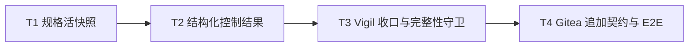

# 0075 · needs-human 结构化交接与标签完整性守卫

<!-- 本文件由 spec 工具维护：frontmatter 为结构化源数据（含 tasks DAG），正文为组级 rust-RFC 9 段总览。 -->

## Summary

把 `needs-human` 从“提示 Agent 自己调用 forge API 打标签和评论”改成 Agent 向 Vigil 返回的结构化控制结果。运行时识别 `{"needs_human": true, "reason": "..."}`，Vigil 统一经已有 additive label API 和签名评论完成交接。与此同时，在每次 Agent 动作前后比较 subject labels；若 Agent 绕过协议、错误使用 Gitea replace-labels API 导致既有标签消失，Vigil 会重新读取、仅补回仍缺失的标签，再以 `needs-human` 阻塞并记录诊断。Gitea driver 的测试明确锁定追加标签必须使用 `POST`，跨仓验收保证来源、平面、优先级和轮次不会被阻塞出口覆盖。

## Motivation

OpenAgents 的 `needs-human` 本意是一等安全出口：Agent 遇到超出授权、需求含糊、外部服务异常或无法可靠完成的工作时，应停止自动执行并把原因交给人。但当前 `_NEEDS_HUMAN_CONTRACT` 要求每个 Agent **自行**给 issue/PR 打 `needs-human` 并留言。Agent 拥有 forge token，也能执行任意命令；提示词没有强制它调用 `openagents.utils.github.issue_add_label/add_label`，因此它可能根据 Swagger 或经验直接拼 HTTP 请求。

一次真实 Gitea 运行已经暴露了该边界。issue #7 在进入交付前拥有 `from-synthesize + P1 + openagents + ready`；执行 Agent 请求人工介入时发出了：

```text
PUT /api/v1/repos/designer/auto-designer-work/issues/7/labels
```

Gitea v1.22.6 将该端点定义为 **Replace an issue's labels**，所以最终只剩 `needs-human`。同一轮的 #10、#14 由框架 `_park_needs_human` 处理，走 `POST .../labels`，原有业务标签全部保留。这说明问题不在 Gitea 缺少 additive API，也不在此前修复的服务端 label filter，而在于“控制面把安全写入委托给了通用 Agent”。

标签并非装饰：上游用 `proposal/report/ready` 表示平面，用 `from-*` 表示来源，用 `P*` 和 `round-*` 做调试、筛选与归因，Vigil 自己还依赖 `ready/openagents/needs-human/review-*` 路由。一次 replace 会同时损坏多个消费者，且当前流程只能在下一 tick 看到 `needs-human` 后把它当作正常终态，无法指出元数据已丢失。

因此必须建立两层保障：正常路径不再让 Agent 直接写阻塞标签；即使 Agent 忽略契约或使用原始 token，编排层也能发现一次动作造成的非预期删除并恢复。OpenAgents 不需要理解 auto-designer 的每类业务标签，只需维护通用不变量：“一个普通 Agent 动作可以追加事实，但不能静默删除它开始时已经存在的标签”。

## Guide-level explanation

所有经 Vigil 派出的 Agent 仍能主动决定“这里必须交人”，但它的最后输出改为：

```json
{"needs_human": true, "reason": "上游测试服务持续返回 503，继续修改代码无法验证正确性"}
```

它不再被要求查找 issue 编号、调用 GitHub/Gitea API、挑选 HTTP method 或自行签名。`reason` 必须非空，描述具体阻塞和已验证事实；正常完成时仍返回该 Agent 原有的最后行 JSON schema。

运行时在普通角色结果校验之前识别这一特殊 envelope，并把它作为类型化的 `NeedsHumanRequest` 传回 Vigil。Vigil 捕获后调用唯一的收口函数 `_park_needs_human`：

```text
Agent structured exit
        │
        ▼
runtime raises NeedsHumanRequest(reason)
        │
        ▼
Vigil _park_needs_human(subject, signed reason, agent_id)
        │
        ├── issue → issue_add_label (additive)
        └── PR    → add_label       (additive)
```

以 Gitea 为 forge 时，追加标签的请求必须是 `POST /issues/{n}/labels`；`PUT` 只代表显式替换，不允许出现在该路径。`_park_needs_human` 保留已有幂等与签名评论语义，下一 tick 仍把 subject 分类为 TERMINAL，行为对用户不变。

编排层还会围绕每次 `_act` 做标签完整性检查：动作前记录 subject 的 labels，动作后重新读取。正常新增标签允许通过；若动作前存在的任意标签在动作后消失，并且这不是框架当前分支明确拥有的删除动作，则判为完整性违规。例如：

```text
before: ready, from-synthesize, P1, round-1
after:  needs-human
missing: ready, from-synthesize, P1, round-1
```

Vigil 在恢复前再读一次最新标签，只用 additive API 补回仍缺失项，避免覆盖并发新增；随后经 `_park_needs_human` 留下带 Agent 身份、缺失标签和 subject 的诊断。最终状态应为：

```text
ready, from-synthesize, P1, round-1, needs-human
```

也就是说，违规动作仍被阻塞、不会继续自动交付，但标签元数据恢复。新增标签不会被守卫移除。已经 merged/closed 的终态路径不做恢复；由 Vigil 明确执行的过期 review verdict 清理和 `needs-human` 人工解挂仍由现有框架函数负责，不会被误判为 Agent 删除。

## Reference-level explanation

### 1. 结构化控制结果

`runtime.engine` 新增类型化 `NeedsHumanRequest`，至少包含非空 `reason: str`。`run_agent` 解析 Agent 最后一行 JSON 后，按以下顺序处理：

1. JSON 是对象且 `needs_human is true`：校验 `reason` 为去除空白后非空字符串；合法则抛出类型化 `NeedsHumanRequest`；
2. 出现 `needs_human` 但值不是 `true`，或 reason 缺失/为空：作为明确的协议错误失败，不降级成普通角色输出；
3. 其它对象：继续既有 `parse_response` 与角色 schema 校验；
4. 非 JSON、backend 失败和超时：保持既有错误路径。

特殊 envelope 必须先于各 Agent 不同的响应 schema，否则 merger、deliver、replier 等会把它视为缺字段的无效普通响应，无法统一收口。它只是一条控制结果，不算 Agent 已完成工作。

`_NEEDS_HUMAN_CONTRACT` 改为要求输出上述单行 JSON，并明确禁止 Agent 自行修改标签或发送交接评论。该契约仍注入所有 Agent 分支，覆盖 replier 与 conflict resolver；旧 prompt 中“自己打标签”的措辞和针对该措辞的测试同步替换。

### 2. Vigil 中央收口

`_reconcile` 在调用 `_act` 的边界捕获 `NeedsHumanRequest`，但先保留该控制信号并执行动作后的标签完整性读取；若有缺失先恢复，再使用当前 subject 和 worker identity 生成签名正文并调用 `_park_needs_human`。当轮停止且不累计普通“零进展” attempt。正文至少包含 reason，不信任 Agent 提供 issue/PR 编号或任意评论签名。

错误传播边界保持窄：只有类型化控制信号被转换为人工交接；普通异常继续现有 requeue/attempt/watchdog 流程，避免把解析 bug、网络瞬断全部误判为业务 needs-human。

### 3. 动作标签完整性守卫

守卫只包围由 `_act` 发起的通用 Agent 动作，不改变 `_sense/_classify/_intake`。输入基线来自动作前刚观测到的 `facts.labels`；动作结束后通过现有 forge-neutral subject 读取路径获取最新 labels：

```text
missing = baseline_labels - latest_labels - allowed_removals
```

`allowed_removals` 必须由调用分支显式给出，不能用标签前缀宽泛放行。本组初始规则：

- 普通 issue/PR Agent 动作为空集；
- merge/closed 后不恢复，因为 subject 已进入 forge 终态；
- `review-or-fix` 只有在 facts 判定为“派 reviewer 生成新裁决”的子路径，才把 baseline 中陈旧的 `review-approved:<sha>`、`review-changes-requested:<sha>` 精确列入 allowlist；已有 CHANGES_REQUESTED@head 而派 implementer 返工的子路径仍为空集；
- 人类越水位线后由框架执行的 `needs-human` 删除在 `_act` 之前完成，也不属于守卫窗口。

发现 missing 后：

1. 再读 subject，终态则只记录诊断并退出恢复；
2. 计算仍缺失的标签，逐个调用 `issue_add_label` 或 `add_label`；这些调用必须幂等、additive；
3. 调 `_park_needs_human`，评论列出缺失与恢复结果，并使用框架签名；
4. 当轮停止，不继续 merge、review 或下一动作。

若恢复某一标签失败，异常继续向现有队列恢复机制传播；不得用 replace-all 试图一次性恢复，也不得移除 Agent 新增的标签。这样并发写入的最坏结果是重复 additive 请求，而不是再次覆盖。

结构化交接也执行完整性检查：即使 Agent 在返回 envelope 前已经用 raw API 破坏 labels，Vigil 先完成恢复，再落统一 `needs-human`。如果它没有破坏，中央 park 只追加标签。

### 4. Forge driver 契约

本组不新增“replace labels”公共能力。`openagents.utils.gitea.issue_add_label` 继续先解析 label id，再使用：

```text
POST /api/v1/repos/{owner}/{repo}/issues/{number}/labels
body: {"labels": [label_id]}
```

PR 版 `add_label` 复用 issue 版，因为 Gitea PR 也是 issue。单测必须同时断言 path、body 和 HTTP method，防止未来把 POST 重构成语义不同的 PUT 而测试仍绿。GitHub driver 已通过 `gh issue edit --add-label` 提供 additive 语义，守卫只调用 forge 抽象，不按 auto-designer 的标签分类写分支。

### 5. 验证与跨仓契约

单元测试覆盖：

- 各角色正常 schema 不受特殊 envelope 影响；
- 合法/非法 needs-human envelope；
- Vigil 对结构化出口只调用一次 `_park_needs_human`，不让 Agent 自写 forge；
- Agent 只新增标签不触发守卫；
- Agent 删除一个或多个标签时，守卫二次读取、只补缺失并阻塞；
- restore 前发生并发重加时不重复破坏；
- merged/closed 与框架显式删除不被复活；
- Gitea add-label 只允许 POST。

确定性 E2E 脚本用 hermetic fake forge 模拟 Agent 把 `[ready, from-synthesize, P1, round-1]` 替换为 `[needs-human]`，断言恢复后的并集、签名诊断和 TERMINAL 分类。与 auto-designer 的配套 0039 规格做真实 Gitea 联调再验证：阻塞后 issue 详情仍投影为 `ready / from-synthesize / P1 / round-1`，timeline 只出现 additive `+needs-human`，无 metadata-loss 告警。

### 6. DAG 与文件分配



| Task | 职责 | 独占文件 |
|---|---|---|
| T1 | 0075 规格、故障边界与验收 | `docs/specs/0075-needs-human-label-integrity.md` |
| T2 | 识别特殊 envelope，定义类型化控制信号 | `runtime/engine.py`, runtime tests |
| T3 | 改写 Agent/merger 契约，中央 park，动作前后标签守卫 | `recipes/vigil.py`, `agents/merger.py`, vigil/merger tests |
| T4 | 锁定 Gitea POST 语义，提供 hermetic E2E | `utils/gitea.py`, driver tests, e2e script |

组内 `files` 互斥；T3 只依赖 forge-neutral 的 `github` 模块门面，T4 验证当前 Gitea backend 实现，不把 auto-designer 领域标签硬编码进 OpenAgents。

## Drawbacks

- 每次 Agent 动作后多一次 subject 读取，发现删除时还会二次读取并逐标签恢复。成本只发生在已经派 Agent 的动作边界，不进入纯观察轮询。
- `NeedsHumanRequest` 成为所有角色 schema 之外的第二种输出 envelope，运行时和测试必须维护清晰优先级。
- Agent 仍持有 forge token，理论上可以在进程退出前继续做破坏性写入；守卫能在 `_act` 返回时检测并修复标签删除，但不是权限沙箱。彻底消除能力需要凭据代理/最小权限 broker，超出本组范围。
- 标签删除默认视为异常较保守。当前工作流的合法删除集中在框架函数中，因此边界可控；未来若新增 Agent 被授权改标签，必须显式扩充 action contract，而不是关闭守卫。
- 已受损的 #7 不自动改写。历史修复需要人确认应恢复哪些标签，避免把一次代码发布偷偷变成数据迁移。

## Rationale and alternatives

选择“结构化意图 + 编排层副作用”，因为 `needs-human` 是控制流而非业务实现结果。Vigil 已拥有 subject、agent identity、forge backend、幂等 park 和签名规则，让每个 Agent 重复这些细节只会扩大差异和 prompt 注入面。

同时保留完整性守卫，而不是只改 prompt。真实事故正是 Agent 没有使用框架 helper；提示词无法构成权限边界，模型升级或不同 backend 都可能重新选择 raw PUT。前后快照守卫不依赖具体命令，能覆盖直接 HTTP、CLI 误用以及未来同类回归。

备选一是给 Agent 暴露一个 `openagents mark-needs-human` CLI，然后继续允许它自行调用。它比 raw curl 易用，但仍依赖 Agent 遵守提示，也无法发现其它命令造成的标签删除，因此不作为安全边界。

备选二是完全不把 forge token 交给 Agent。方向更强，但当前 deliver/merger/replier 仍需推分支、开 PR、回复与合并；需要独立 capability broker 和每动作授权协议，属于后续安全架构，不应阻塞本次数据完整性修复。

备选三是在 auto-designer 看板用历史标签回填当前状态。它只能让污染“看起来正常”，不能恢复 Gitea 真源，Vigil 与其它消费者仍会读到坏数据；auto-designer 的配套 0039 规格因而只做观测和告警，不替代本仓修复。

选择逐标签 additive 恢复而非 PUT 恢复完整集合，是为了保留 baseline 之后的并发新增。Gitea 已提供 POST add-label，无需模拟 compare-and-swap；恢复前二次读取进一步缩小竞争窗口。

## Prior art

- GitHub Actions 的 step output、CI 的特殊退出码和 Kubernetes controller 的 typed reconcile error 都把“需要重试/需要人工”作为编排信号处理，而不是让业务进程直接改控制面状态。
- Kubernetes controller 以 observe → diff → reconcile 维护对象不变量；本组的 label guard 同样比较动作前后事实并用幂等 additive 写恢复。
- 数据库 migration 工具通常区分 INSERT/UPSERT 与整表 replace；Gitea 的 POST add-label / PUT replace-labels 也具有相同的危险边界，方法级测试应锁定语义而非只断言 URL。

## Unresolved questions

本版没有阻塞实施的未决问题。初始守卫采用“Agent 不得删除任何既有标签”的保守契约；未来若确有一个 Agent 需要执行标签迁移，应给 `_act` action 增加显式、可测试的 `allowed_removals`，而不是按标签前缀或 Agent 名称隐式猜测。

是否进一步撤销 Agent 的 forge token 留到 capability broker 专项设计；本组验收不依赖该安全加固。

## Future possibilities

- 引入最小权限 forge broker：Agent 只返回结构化操作提议，Vigil 校验后代为执行 comment/label/merge。
- 把完整性违规形成结构化 telemetry，供 auto-designer 时间线显示 Agent id、恢复结果和关联 run。
- 为标签增加声明式 policy（immutable、exclusive、framework-owned），让守卫由协议清单生成，而不是统一保守规则。
- 在 GitHub 与 Gitea 的 contract tests 中复用一套 forge-neutral label monotonicity suite。
- 经人工确认后提供一次性修复工具，从 Gitea timeline 预览并恢复既有受损 issue 的最后已知标签。
