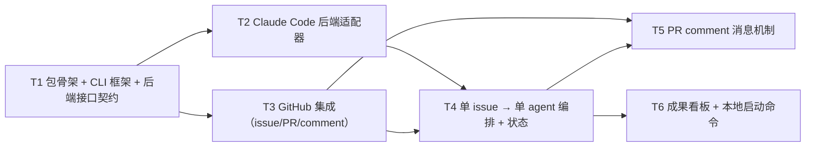

# 0001 MVP — 单 issue → 单 agent → 真实 PR 的最小自举闭环

> 本文件由 `spec render` 自动生成，请勿手工编辑。
> 内容来源：本组 `metadata.yaml` 与 `tasks/T*.yaml`（关联 issue #0）。

## 任务编排

| 任务 | 标题 | 优先级 | 状态 | 依赖 |
|----|----|----|----|----|
| T1 | 包骨架 + CLI 框架 + 后端接口契约 | P0 | done | — |
| T2 | Claude Code 后端适配器 | P0 | done | T1 |
| T3 | GitHub 集成（issue/PR/comment） | P0 | done | T1 |
| T4 | 单 issue → 单 agent 编排 + 状态 | P0 | done | T2, T3 |
| T5 | PR comment 消息机制 | P0 | done | T3, T4 |
| T6 | 成果看板 + 本地启动命令 | P0 | done | T4 |

## 各任务方案

### T1 · 包骨架 + CLI 框架 + 后端接口契约（P0 / done）

**涉及文件**

- `openagents/__init__.py`
- `openagents/cli.py`
- `openagents/config.py`
- `openagents/backends/__init__.py`
- `openagents/backends/base.py`
- `pyproject.toml`
- `tests/test_cli.py`
- `tests/test_config.py`
- `tests/test_base.py`

**范围**

建 `openagents/` 包；`cli.py` 注册 `init`/`solve`/`poll`/`watch`/`board` 五个子命令（命令体内延迟 import 业务模块，本子任务只放可运行的骨架与占位提示）；`config.py` 实现项目绑定 `resolve_project`/`ensure_project`（决策 10：cwd 解析 git root + remote，缺失时交互式新建；`gh repo create` 部分通过延迟 import 调用 `github.create_repo`）；`backends/base.py` 定义 `AgentBackend` 协议与 `AgentResult`；在 `pyproject.toml` 声明 CLI entry point 与必要依赖（CLI 框架）。

**验收标准**

`openagents --help` 列出五个子命令；`AgentBackend` 协议可被导入；`resolve_project` 能从 cwd 正确识别 git root 与 remote、非仓库返回 `None`，`ensure_project(interactive=False)` 缺失时抛错（交互分支与 `git init`/`gh` 被 mock）；`ruff check`/`ruff format --check` 通过；`tests/test_cli.py` 验证子命令注册与 preflight 调用。

### T2 · Claude Code 后端适配器（P0 / done）

**涉及文件**

- `openagents/backends/claude_code.py`
- `tests/test_backend_claude_code.py`

**范围**

实现 `ClaudeCodeBackend`，以子进程方式非交互调用 Claude Code，在给定工作目录按任务描述改代码，返回 `AgentResult`。

**验收标准**

给定一个临时仓库与任务，适配器能驱动 Claude Code 产生文件改动并正确报告 `changed/summary`；子进程调用被 mock 的单测通过。

### T3 · GitHub 集成（issue/PR/comment）（P0 / done）

**涉及文件**

- `openagents/github.py`
- `tests/test_github.py`

**范围**

封装 `gh` CLI，实现 `create_repo`（供冷启动绑定）/`get_issue`/`create_pr`/`list_comments`/`post_comment`/`check_status`（CI 状态，决策 11），统一错误处理。

**验收标准**

各函数对 `gh` 输出正确解析为数据类；`create_repo` 正确组装 `gh repo create` 参数（私有/公开）；`check_status` 正确归类 pass/fail 并提取失败日志摘要；`gh` 子进程被 mock 的单测覆盖正常与错误路径。

### T4 · 单 issue → 单 agent 编排 + 状态（P0 / done）

**涉及文件**

- `openagents/orchestrator.py`
- `openagents/state.py`
- `tests/test_orchestrator.py`
- `tests/test_state.py`

**范围**

实现 `Orchestrator.solve`（拉 issue → 建分支 → 调后端 → 开 PR → 写 State）与 `iterate`（喂回 comment → 追加 commit → push，决策 7）；实现 `State` 的 JSON 持久化（`.openagents/state.json`）含状态机（含 `done`）与 comment 游标。

**验收标准**

用 mock 的 backend + github，`solve` 端到端产出一条 RunRecord 且状态流转正确；State 读写与游标逻辑单测通过。

### T5 · PR comment 消息机制（P0 / done）

**涉及文件**

- `openagents/messages.py`
- `tests/test_messages.py`

**范围**

实现 `Messages.poll`：对 open 状态 PR 先检测是否已 merge（已 merge → 置 `done` 并跳过，决策 8）；否则 (a) 读 CI 状态，失败则以失败日志触发 `iterate(reason="ci")`（决策 11，修到 CI 全绿）；(b) 比对游标，新 comment 触发 `iterate(reason="comment")` 并更新游标。实现 `Messages.watch`：按间隔循环 `poll`（决策 6）。

**验收标准**

给定带新 comment 的 mock PR，`poll` 正确触发一次 `iterate(reason="comment")` 并推进游标；CI 失败的 mock PR 触发 `iterate(reason="ci")`，CI 全绿则不触发；已 merge 的 PR 被置 `done` 且不再迭代；无新 comment 且 CI 绿时不触发；`watch` 的循环间隔逻辑（`time.sleep` 被 mock）单测通过。

### T6 · 成果看板 + 本地启动命令（P0 / done）

**涉及文件**

- `openagents/results.py`
- `openagents/templates/board.html`
- `tests/test_results.py`

**范围**

实现 `results.render(runs) -> html` 与 `board()` 启动逻辑（渲染 State 为单页 HTML 并用 `webbrowser` 打开）；提供 HTML 模板。

**验收标准**

给定若干 RunRecord，`render` 产出含 issue 标题/状态/PR 链接的 HTML；`board` 命令能生成文件并触发本地打开（打开动作在测试中被 mock）；单测通过。
