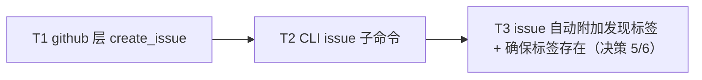

# 0002 OpenAgents 主动提 issue

> 本文件由 `spec render` 自动生成，请勿手工编辑。
> 内容来源：本组 `metadata.yaml` 与 `tasks/T*.yaml`（关联 issue #0）。

## 任务编排

| 任务 | 标题 | 优先级 | 状态 | 依赖 |
|----|----|----|----|----|
| T1 | github 层 create_issue | P1 | done | — |
| T2 | CLI issue 子命令 | P1 | done | T1 |
| T3 | issue 自动附加发现标签 + 确保标签存在（决策 5/6） | P1 | done | T2 |

## 各任务方案

### T1 · github 层 create_issue（P1 / done）

**涉及文件**

- `openagents/github.py`
- `tests/test_github.py`

**范围**

在 `openagents/github.py` 增加 `create_issue(*, title, body, labels)`，调用 `gh issue create`，解析 issue number，返回 `Issue`；增加 `_parse_issue_number` 助手。

**验收标准**

单测覆盖——成功解析 number、带 labels 时命令含 `--label`、url 不可解析时抛 `GithubError`、gh 非零退出时抛 `GithubError`。

### T2 · CLI issue 子命令（P1 / done）

**涉及文件**

- `openagents/cli.py`
- `tests/test_cli.py`

**范围**

在 `openagents/cli.py` 注册 `issue` 子命令（positional title + `--body` + 可重复 `--label`），实现 `_cmd_issue` 走 preflight 并调用 `github.create_issue`，挂入 `_dispatch` handlers。

**验收标准**

单测覆盖——parser 注册了 `issue`、`issue "T" --body B --label x --label y` 正确透传给打桩的 `create_issue` 且走 preflight、返回码 0。

### T3 · issue 自动附加发现标签 + 确保标签存在（决策 5/6）（P1 / done）

**范围**

在 `openagents/cli.py` 引入模块级常量 `DISCOVERY_LABEL = "openagents"`；`_cmd_issue` 在用户 `--label` 之外追加 `DISCOVERY_LABEL` 并按出现顺序去重，且在 `create_issue` 前先调 `github.ensure_label(name=DISCOVERY_LABEL)`；`_cmd_vigil` 的发现回落改用同一常量。在 `openagents/github.py` 新增 `ensure_label`（不存在则建、已存在则吞 "already exists"）。

**验收标准**

单测覆盖——无 `--label` 时 `create_issue` 收到 `["openagents"]`；`--label bug --label p1` 时收到 `["bug","p1","openagents"]`；`--label openagents --label bug` 去重为 `["openagents","bug"]`；vigil 默认门控仍为 `["openagents"]`；`_cmd_issue` 在 create 前调用 `ensure_label(name="openagents")`；`ensure_label` 缺失时建标签、"already exists" 时不抛、其它 gh 错误照抛。
