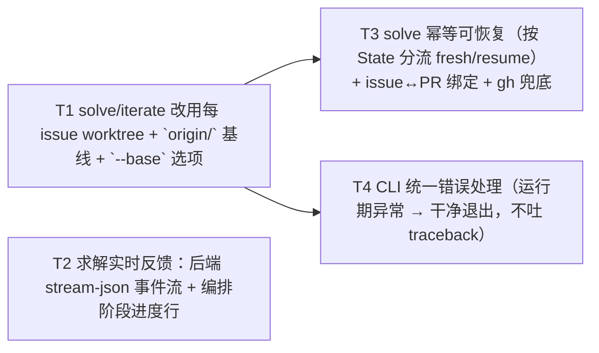

# 0003 issue 求解隔离 —— 每 issue 独立 worktree + 分支基线锁定最新 main

> 本文件由 `spec render` 自动生成，请勿手工编辑。
> 内容来源：本组 `metadata.yaml` 与 `tasks/T*.yaml`（关联 issue #0）。

## 任务编排

| 任务 | 标题 | 优先级 | 状态 | 依赖 |
|----|----|----|----|----|
| T1 | solve/iterate 改用每 issue worktree + `origin/<base>` 基线 + `--base` 选项 | P1 | done | — |
| T2 | 求解实时反馈：后端 stream-json 事件流 + 编排阶段进度行 | P1 | done | — |
| T3 | solve 幂等可恢复（按 State 分流 fresh/resume）+ issue↔PR 绑定 + gh 兜底 | P1 | done | T1 |
| T4 | CLI 统一错误处理（运行期异常 → 干净退出，不吐 traceback） | P1 | done | T1 |

## 各任务方案

### T1 · solve/iterate 改用每 issue worktree + `origin/<base>` 基线 + `--base` 选项（P1 / done）

**涉及文件**

- `openagents/orchestrator.py`
- `openagents/cli.py`
- `tests/test_orchestrator.py`
- `tests/test_cli.py`

**范围**

重写 `Orchestrator` 的工作区逻辑——`solve` 先 `fetch origin <base>`，在 `<repo_root>/.openagents/worktrees/issue-<n>` 建从 `origin/<base>` 拉出的 worktree（建前幂等清理残留），在该 worktree 内调后端、`add/commit/push`、开 PR；`iterate` 复用/重建同一 worktree 后续写。`cli.py` 的 `solve` 子命令新增 `--base`（默认 `main`）并透传给 `Orchestrator.solve`。

**验收标准**

`solve` 调用序列含 `git fetch origin main` 与 `git worktree add -b openagents/issue-<n> <path> origin/main`，**不再**在主树 `checkout -b`；后端 `work_dir` 为 worktree 路径；`commit/push` 正常且不 force-push；`solve --base <ref>` 时 worktree 自 `origin/<ref>` 拉出；`iterate` 在 worktree 内追加 commit；CLI 将 `--base` 透传、默认 `main`；`ruff check`/`ruff format --check`/`pytest` 全通过。

### T2 · 求解实时反馈：后端 stream-json 事件流 + 编排阶段进度行（P1 / done）

**涉及文件**

- `openagents/backends/claude_code.py`
- `tests/test_backend_claude_code.py`

**范围**

`ClaudeCodeBackend.run` 改用 `--output-format stream-json --verbose` + `Popen`，逐行解析 NDJSON 事件，实时打印助手文本与工具动作（`🔧 <tool>: <hint>`）到 stdout，从 `result` 事件取摘要；非零退出抛 `RuntimeError`（带详情），非 JSON 行原样透传并作兜底详情。`Orchestrator` 在各阶段向 stderr 打 `▶ …` 进度行。`git status` 判定改动逻辑不变。

**验收标准**

后端 `Popen` 命令含 `--output-format stream-json --verbose`；assistant 文本/工具事件经 `capsys` 实时可见；`summary` 取自 `result` 事件；非零退出抛 `RuntimeError`；`solve` 各阶段在 stderr 有 `▶` 进度行；子进程 mock 单测全通过。

### T3 · solve 幂等可恢复（按 State 分流 fresh/resume）+ issue↔PR 绑定 + gh 兜底（P1 / done）

**涉及文件**

- `openagents/state.py`
- `openagents/github.py`
- `tests/test_state.py`
- `tests/test_github.py`

**范围**

`solve` 入口 `state.find_by_issue` 反查并按决策 7 分流——续写复用分支/worktree（不走决策 4 的清理）、追加 commit、`find_pr_by_branch` 复用或补开 PR；全新走决策 1/2/4 并 `begin_run` 先记 `solving`。`_commit_and_push` 容忍「无改动可提交」（跳过 commit 仍 push）。`state.py` 加 `begin_run` / `find_by_issue`；`github.py` 加 `find_pr_by_branch`。

**验收标准**

该 issue 已有 open PR 时 `solve` 走续写、复用 PR（不调用 `create_pr`）、不重建分支、状态置 `iterating`；`begin_run` 后崩溃场景（无 PR）重跑能补开 PR；`find_by_issue`/`begin_run`/`find_pr_by_branch` 单测通过。

### T4 · CLI 统一错误处理（运行期异常 → 干净退出，不吐 traceback）（P1 / done）

**范围**

`cli` 在分发外层捕获 `OrchestratorError` / `GithubError` / `RuntimeError`，打印 `✗ <消息>` 到 stderr 并返回非零退出码；未知异常仍向上抛出。

**验收标准**

`solve` 抛 `OrchestratorError` 时 `main` 返回 1、stderr 含 `✗` 与原因、无 traceback；单测通过。
