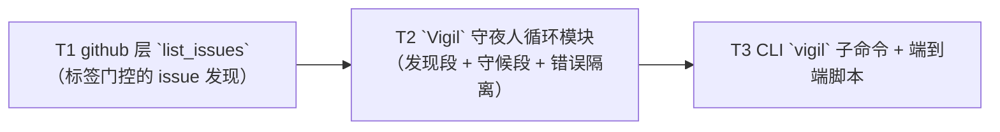

# 0004 openagents vigil —— 守夜人模式（自主 issue→PR 全流程循环）

> 本文件由 `spec render` 自动生成，请勿手工编辑。
> 内容来源：本组 `metadata.yaml` 与 `tasks/T*.yaml`（关联 issue #9）。

## 任务编排

| 任务 | 标题 | 优先级 | 状态 | 依赖 |
|----|----|----|----|----|
| T1 | github 层 `list_issues`（标签门控的 issue 发现） | P1 | done | — |
| T2 | `Vigil` 守夜人循环模块（发现段 + 守候段 + 错误隔离） | P1 | done | T1 |
| T3 | CLI `vigil` 子命令 + 端到端脚本 | P1 | done | T2 |

## 各任务方案

### T1 · github 层 `list_issues`（标签门控的 issue 发现）（P1 / done）

**涉及文件**

- `openagents/github.py`
- `tests/test_github.py`

**范围**

在 `openagents/github.py` 增加 `list_issues(*, labels, state="open")`，调用 `gh issue list --state <state> [--label L ...] --json number,title,body`，解析为既有 `Issue` 列表；复用 `_gh_json`/`GithubError`，不新增数据类型。

**验收标准**

单测覆盖——无 label 时命令不含 `--label` 且正确解析多条 issue；带多个 label 时命令含对应多个 `--label`；空结果返回 `[]`；gh 非零退出抛 `GithubError`；`ruff check`/`ruff format --check`/`pytest` 通过。

### T2 · `Vigil` 守夜人循环模块（发现段 + 守候段 + 错误隔离）（P1 / done）

**涉及文件**

- `openagents/vigil.py`
- `tests/test_vigil.py`

**范围**

新建 `openagents/vigil.py`，实现 `Vigil`（注入 `Orchestrator`/`Messages`/`State`）的 `run`、`discover_and_dispatch`。`discover_and_dispatch` 调 `github.list_issues` 后按决策 3 三道闸（标签已在 list 层、State 无 run、远端无分支）过滤出新 issue，串行 `start_rfc`（RFC-0005：派单只起草 RFC；决策 5），单项失败记录并跳过（决策 8）。`run` 每轮先发现再 `messages.poll`，`once` 跑一轮即返回，否则 `time.sleep(interval)` 续循环，`KeyboardInterrupt` 干净退出。远端分支判据复用一处 `git ls-remote`（在 vigil 内实现一个最小私有助手或经由注入的 orchestrator 暴露；实现细节 Phase 3 定，不改 orchestrator 既有契约）。

**验收标准**

单测（mock `github.list_issues`/`Orchestrator.start_rfc`/`Messages.poll`/`time.sleep` 与远端分支判据）覆盖——已有 State run 的 issue 被跳过；远端已有分支的 issue 被跳过；全新 issue 触发一次 `start_rfc`；某 issue `start_rfc` 抛 `OrchestratorError` 时被跳过且不影响同轮其余 issue 与 `poll`；`once=True` 只跑一轮、不 `sleep`；`once=False` 多轮调用 `sleep(interval)`；`KeyboardInterrupt` 干净返回；`discover_and_dispatch` 返回实际派单编号列表。

### T3 · CLI `vigil` 子命令 + 端到端脚本（P1 / done）

**涉及文件**

- `openagents/cli.py`
- `tests/test_cli.py`
- `scripts/e2e-rfc-0004-vigil.sh`

**范围**

在 `openagents/cli.py` 注册 `vigil` 子命令（`--interval` 默认 60、可重复 `--label` 默认 `["openagents"]`、`--base` 默认 `main`、`--once` 旗标），实现 `_cmd_vigil` 走 preflight、构造 `Vigil`（新增 `_vigil_for` 工厂，复用既有 `_orchestrator_for`/`_messages_for`/`_state_for`）并调用 `run`，挂入 `_dispatch` handlers；运行期异常由既有 `_run` 统一处理。新增 `scripts/e2e-rfc-0004-vigil.sh`（离线确定性段 + 可选真实冒烟段，仿 `e2e-rfc-0002`）。

**验收标准**

单测覆盖——`vigil` 出现在子命令集合；默认 `interval=60`/`labels=["openagents"]`/`base="main"`/`once=False`；`vigil --once --interval 5 --label a --label b --base dev` 正确解析并透传给打桩的 `Vigil.run`；`_cmd_vigil` 先跑 preflight；返回码 0。e2e 脚本离线段（`ruff` + `pytest`）可独立跑通。
