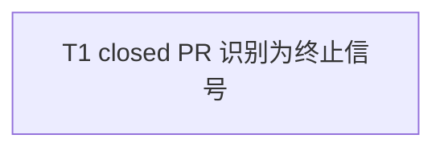

# 0006 守夜人识别 PR/issue 关闭作为终止信号

> 本文件由 `spec render` 自动生成，请勿手工编辑。
> 内容来源：本组 `metadata.yaml` 与 `tasks/T*.yaml`（关联 issue #0）。

## 任务编排

| 任务 | 标题 | 优先级 | 状态 | 依赖 |
|----|----|----|----|----|
| T1 | closed PR 识别为终止信号 | P1 | done | — |

## 各任务方案

### T1 · closed PR 识别为终止信号（P1 / done）

**涉及文件**

- `openagents/github.py`
- `openagents/state.py`
- `openagents/messages.py`
- `tests/test_github.py`
- `tests/test_messages.py`

**范围**

1. `github.py` 新增 `is_closed(*, pr_number)`，读 `gh pr view --json state` 判定 `CLOSED`。 2. `state.py` 新增 `STATUS_CLOSED = "closed"` 常量。 3. `messages.py` `_process_run` 在 merged 判定之后、阶段路由之前插入 closed 分支：置 `STATUS_CLOSED`、返回 `reason="closed"`，不触发任何编排动作。

**验收标准**

- 一个 `state=CLOSED`、带 `rfc-approved` 标签、本地状态 `rfc-review` 的 run 经 `poll` 后：不调用 `implement`，状态被置为 `closed`，事件 `reason="closed"`。 - `closed` 状态的 run 在后续 `poll` 中被跳过（不在 `_OPEN_STATUSES`）。 - merged 仍优先于 closed 与阶段路由，既有测试不回归。 - `ruff check` / `ruff format --check` / `pytest` 全绿。
