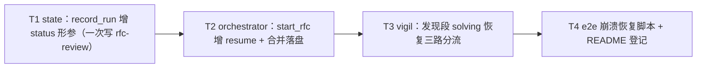

# 0007 守夜人恢复——激活 solving 为 resume 入口，修复 start_rfc 中途崩溃的孤儿 run

> 本文件由 `spec render` 自动生成，请勿手工编辑。
> 内容来源：本组 `metadata.yaml` 与 `tasks/T*.yaml`（关联 issue #0）。

## 任务编排

| 任务 | 标题 | 优先级 | 状态 | 依赖 |
|----|----|----|----|----|
| T1 | state：record_run 增 status 形参（一次写 rfc-review） | P1 | done | — |
| T2 | orchestrator：start_rfc 增 resume + 合并落盘 | P1 | done | T1 |
| T3 | vigil：发现段 solving 恢复三路分流 | P1 | done | T2 |
| T4 | e2e 崩溃恢复脚本 + README 登记 | P1 | done | T3 |

## 各任务方案

### T1 · state：record_run 增 status 形参（一次写 rfc-review）（P1 / done）

**涉及文件**

- `openagents/state.py`
- `tests/test_state.py`

**范围**

给 `record_run` 增加 `status: str = STATUS_PR_OPEN` 关键字形参，一次 `_save` 落盘带 `pr_number/pr_url` 且 `status=<给定值>` 的 run；更新 `find_by_issue` docstring 为「供发现段分流 fresh / resume」与 `RunRecord` docstring 的状态枚举说明（无新增状态）。不改 `begin_run` / `update_status` 签名。

**验收标准**

单测覆盖 `record_run(status=STATUS_RFC_REVIEW)` 一次落盘即得 `rfc-review` + 非零 `pr_number`；默认（不传 status）仍落 `pr-open`（既有用例不回归）；ruff 通过；注释引用 `RFC-0007`。

### T2 · orchestrator：start_rfc 增 resume + 合并落盘（P1 / done）

**涉及文件**

- `openagents/orchestrator.py`
- `tests/test_orchestrator.py`

**范围**

`start_rfc` 增加 `resume: bool = False` 形参。`resume=False` 保持现状（`workspace.prepare` + `begin_run`）；`resume=True` 改走 `workspace.ensure`（复用既有 worktree）且**不**调 `begin_run`。两分支汇合到同一尾段：`backend.run`（起草）→ `commit_and_push` → `create_pr(draft=True)` → **单次** `record_run(status=STATUS_RFC_REVIEW, 带 pr)`（删去原 `record_run` + `update_status` 两次写）。

**验收标准**

单测（假 backend + 注入假 Workspace + monkeypatch github）覆盖：fresh 走 prepare + begin_run；resume 走 ensure、不调 begin_run、不调 prepare；两者末态都是一次写成的 `rfc-review`（带 pr）、无瞬态 pr-open（断言 `record_run` 以 `rfc-review` 调用且不再单独 `update_status`）；ruff 通过；注释引用 `RFC-0007`。

### T3 · vigil：发现段 solving 恢复三路分流（P1 / done）

**涉及文件**

- `openagents/vigil.py`
- `tests/test_vigil.py`

**范围**

用 `_dispatch_kind`（返回 `"fresh" | "resume" | None`）取代 `_is_new`：`record is None` 且远端无分支 → `"fresh"`；`record.status == STATUS_SOLVING and record.pr_number == 0` → `"resume"`；其它 → `None`。`discover_and_dispatch` 据此调 `start_rfc(resume=...)`，错误隔离（单 issue 失败记录跳过）保持不变，返回本轮派单编号列表。

**验收标准**

单测覆盖：无 run + 远端无分支 → fresh 派单（resume=False）；`solving/pr=0` → resume 派单（resume=True）；`rfc-review` / `pr-open` / 已开 PR / `done` / `closed` → 跳过；远端已有分支但无 run → 跳过（去重闸 c）；resume 成功落 `rfc-review` 后下一轮不再重复派单。ruff 通过；注释引用 `RFC-0007`。

### T4 · e2e 崩溃恢复脚本 + README 登记（P1 / done）

**涉及文件**

- `scripts/e2e-rfc-0007-resume.sh`
- `docs/rfcs/README.md`

**范围**

新增 `scripts/e2e-rfc-0007-resume.sh`：构造一条 `solving/pr=0` 的 run + 残留 worktree（模拟起草阶段崩溃），跑一轮 `openagents vigil --once`，断言该 issue 被自动恢复并最终开出 draft PR（state 落 `rfc-review`），无需人工干预。`docs/rfcs/README.md` 增加 RFC-0007 行。

**验收标准**

脚本可读、步骤完整（崩溃模拟 → discover 恢复 → 验证 draft PR + rfc-review）；README 列表含 RFC-0007 条目。
