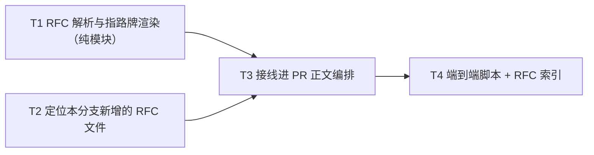

# 0008 PR 正文「端到端验证」指路牌（从 RFC 自动生成）

> 本文件由 `spec render` 自动生成，请勿手工编辑。
> 内容来源：本组 `metadata.yaml` 与 `tasks/T*.yaml`（关联 issue #0）。

## 任务编排

| 任务 | 标题 | 优先级 | 状态 | 依赖 |
|----|----|----|----|----|
| T1 | RFC 解析与指路牌渲染（纯模块） | P1 | done | — |
| T2 | 定位本分支新增的 RFC 文件 | P1 | done | — |
| T3 | 接线进 PR 正文编排 | P1 | done | T1, T2 |
| T4 | 端到端脚本 + RFC 索引 | P1 | done | T3 |

## 各任务方案

### T1 · RFC 解析与指路牌渲染（纯模块）（P1 / done）

**涉及文件**

- `openagents/rfc.py`
- `tests/test_rfc.py`

**范围**

新建 `openagents/rfc.py`，实现 `E2EHints`、`extract_e2e`、`render_signpost`、 `signpost_for`（见接口契约）。抽取脚本路径（限 `### 集成测试` 子段）与一行预期 （限 `### 手动验证` 子段），各字段缺失置 `None` 并在渲染时降级；从文件名解析 NNNN。 全程不抛错。模块 docstring 与公开函数引用 `RFC-0008`。

**验收标准**

单测覆盖——完整 RFC 抽出脚本+预期并渲染三行；无集成测试脚本 / 无手动验证 / 二者皆无 时各自降级且不抛错；畸形 Markdown 不抛错；文件名 `0008-x.md` 解析出编号 8。 ruff + pytest 通过。

### T2 · 定位本分支新增的 RFC 文件（P1 / done）

**涉及文件**

- `openagents/workspace.py`
- `tests/test_workspace.py`

**范围**

在 `Workspace` 增 `changed_rfc_path`，用 `git diff --name-only origin/<base>...HEAD -- docs/rfcs/` 取首个 `NNNN-*.md`（排除 `README.md`）返回绝对 `Path`，无则 `None`； 复用既有 `_git` 封装。方法 docstring 引用 `RFC-0008`。

**验收标准**

单测——在临时 git 仓库造 base 与含新 RFC 的分支，方法返回该 RFC 路径； 无新增 RFC 时返回 `None`；不把 `README.md` 误判为 RFC。ruff + pytest 通过。

### T3 · 接线进 PR 正文编排（P1 / done）

**涉及文件**

- `openagents/orchestrator.py`
- `tests/test_orchestrator.py`

**范围**

改 `orchestrator`：`import rfc`；扩展 `_pr_body` 增 `e2e_section`（无默认值）； `start_rfc` 在 `commit_and_push` 后、`create_pr` 前定位 RFC 文件→渲染指路牌→拼进正文。 定位失败/渲染为 `None` 时正文回退为原样、不抛错。新增/改动处注释引用 `RFC-0008`。

**验收标准**

单测（假 backend + 假 Workspace + monkeypatch github）——`start_rfc` 传给 `create_pr` 的 body 含「## 端到端验证」段且内容来自 RFC；`changed_rfc_path` 返回 `None` 时 body 不含该段且不抛错。ruff + pytest 通过。

### T4 · 端到端脚本 + RFC 索引（P1 / done）

**涉及文件**

- `scripts/e2e-rfc-0008-pr-e2e-signpost.sh`
- `docs/rfcs/README.md`

**范围**

新增 `scripts/e2e-rfc-0008-pr-e2e-signpost.sh`（沿用既有 e2e 脚本两段式：默认离线 `ruff check`/`ruff format --check`/`pytest`；`OPENAGENTS_E2E_REAL=1` + `OPENAGENTS_E2E_ISSUE` 时真实演练 `openagents rfc <issue>` 并断言其 draft PR 正文含「## 端到端验证」段）。 在 `docs/rfcs/README.md` 的 RFC 列表追加 RFC-0008 行。

**验收标准**

离线段在干净仓库通过；脚本可执行（`set -euo pipefail`、`chmod +x`）； README 列表含 RFC-0008 条目。
