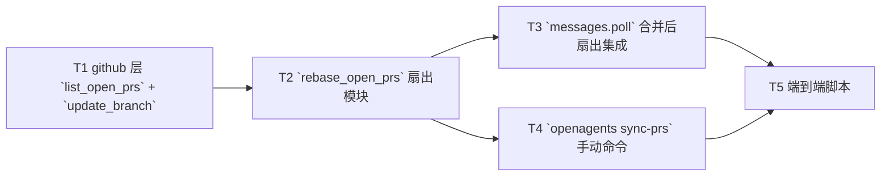

# 0009 合并后自动 rebase 其他 open PR

> 本文件由 `spec render` 自动生成，请勿手工编辑。
> 内容来源：本组 `metadata.yaml` 与 `tasks/T*.yaml`（关联 issue #24）。

## 任务编排

| 任务 | 标题 | 优先级 | 状态 | 依赖 |
|----|----|----|----|----|
| T1 | github 层 `list_open_prs` + `update_branch` | P1 | done | — |
| T2 | `rebase_open_prs` 扇出模块 | P1 | done | T1 |
| T3 | `messages.poll` 合并后扇出集成 | P1 | done | T2 |
| T4 | `openagents sync-prs` 手动命令 | P1 | done | T2 |
| T5 | 端到端脚本 | P1 | done | T3, T4 |

## 各任务方案

### T1 · github 层 `list_open_prs` + `update_branch`（P1 / done）

**涉及文件**

- `openagents/github.py`
- `tests/test_github.py`

**范围**

在 `github.py` 新增两个模块函数：`list_open_prs()`（`gh pr list --state open --json number,url`，解析为 `PR` 列表）与 `update_branch(*, pr_number, rebase=False)`（`gh pr update-branch <n> [--rebase]`，成功返回 `True`、「已是最新」吞掉返回 `False`、冲突/其它失败抛 `GithubError`）。复用既有 `_run_gh` / `_gh_json` / `PR`。函数体注释引用 `RFC-0009`。

**验收标准**

单测覆盖 `list_open_prs` 解析（含空列表）、`update_branch` 三态（updated→True / already-up-to-date→False / 冲突→GithubError）；ruff + pytest 全绿。

### T2 · `rebase_open_prs` 扇出模块（P1 / done）

**涉及文件**

- `openagents/rebase.py`
- `tests/test_rebase.py`

**范围**

新建 `openagents/rebase.py`，实现 `rebase_open_prs(*, merged_pr_number=None, rebase=False)`：调 `github.list_open_prs`、排除 `merged_pr_number`、逐个 `github.update_branch`；冲突（`GithubError`）时 `github.post_comment` 贴冲突提示评论并继续；返回 `[{pr_number, result}]`。冲突评论文案以模块常量定义。注释引用 `RFC-0009`。

**验收标准**

单测（monkeypatch `github.list_open_prs` / `update_branch` / `post_comment`）覆盖：正常更新、排除已合并 PR、`up-to-date` 归类、冲突→留言且不中断后续、空 open 列表；ruff + pytest 全绿。

### T3 · `messages.poll` 合并后扇出集成（P1 / done）

**涉及文件**

- `openagents/messages.py`
- `tests/test_messages.py`

**范围**

在 `messages._process_run` 侦测到 `is_merged`、置 `STATUS_DONE` 后追加 `rebase.rebase_open_prs(merged_pr_number=pr_number)`；`merged` 事件可附带同步结果。其余路由逻辑不变。注释引用 `RFC-0009`。

**验收标准**

单测断言「侦测到合并时调用了 `rebase.rebase_open_prs` 且传入正确 `merged_pr_number`」（monkeypatch rebase 函数）；既有 poll 用例不回归；ruff + pytest 全绿。

### T4 · `openagents sync-prs` 手动命令（P1 / done）

**涉及文件**

- `openagents/cli.py`
- `tests/test_cli.py`

**范围**

在 `cli.build_parser` 注册 `sync-prs` 子命令（`--merged`、`--rebase`），新增 `_cmd_sync_prs` handler 延迟 import 并调 `rebase.rebase_open_prs`，打印结果摘要；接入 `_dispatch` handlers 表。注释引用 `RFC-0009`。

**验收标准**

单测断言参数解析与 handler 透传（monkeypatch `rebase.rebase_open_prs`，校验 `merged_pr_number` / `rebase` 入参与退出码）；ruff + pytest 全绿。

### T5 · 端到端脚本（P1 / done）

**涉及文件**

- `scripts/e2e-rfc-0009-auto-rebase.sh`

**范围**

新增 `scripts/e2e-rfc-0009-auto-rebase.sh`：在一个测试仓库建两个 open PR、合并其一、运行 `openagents sync-prs --merged <n>`（或一轮 poll），校验另一 PR 分支已并入最新 main（`gh pr view --json mergeStateStatus` 或对比 commits），并演示冲突场景下的留言。脚本含前置条件与运行说明（对齐既有 `scripts/e2e-rfc-000X-*.sh` 风格）。

**验收标准**

脚本可独立运行并打印每步结果；README/RFC 给出启动说明；`bash -n` 语法检查通过。
