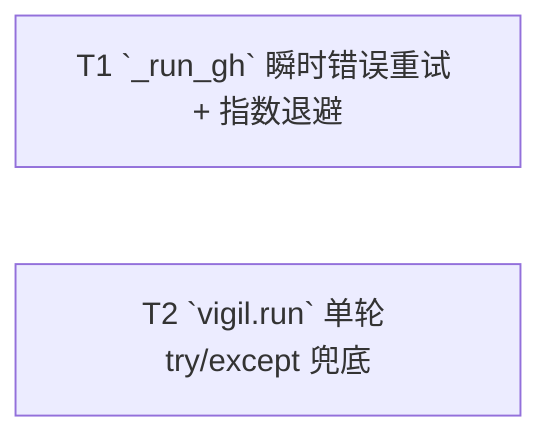

# 0010 gh 瞬时错误重试 + 守夜循环单轮容错

> 本文件由 `spec render` 自动生成，请勿手工编辑。
> 内容来源：本组 `metadata.yaml` 与 `tasks/T*.yaml`（关联 issue #0）。

## 任务编排

| 任务 | 标题 | 优先级 | 状态 | 依赖 |
|----|----|----|----|----|
| T1 | `_run_gh` 瞬时错误重试 + 指数退避 | P1 | done | — |
| T2 | `vigil.run` 单轮 try/except 兜底 | P1 | done | — |

## 各任务方案

### T1 · `_run_gh` 瞬时错误重试 + 指数退避（P1 / done）

**涉及文件**

- `openagents/github.py`
- `tests/test_github.py`

**范围**

在 `_run_gh` 内部加重试循环；新增 `_is_transient_gh_error` 纯函数与模块级常量 （`_GH_RETRY_MAX_ATTEMPTS`、`_GH_RETRY_BACKOFF_BASE`、`_GH_TRANSIENT_MARKERS`）；捕获并 归一化 `subprocess.TimeoutExpired` 为 `GithubError`。对外签名/返回类型不变（决策 1–4）。

**验收标准**

- stderr 含 `HTTP 504` / `Gateway Timeout` 等：首次失败、第二次成功 → 最终成功， `subprocess.run` 被调用 2 次，`time.sleep` 被调用 1 次（退避）。 - 持续瞬时失败 → 重试 `_GH_RETRY_MAX_ATTEMPTS` 次后抛 `GithubError`。 - `subprocess.TimeoutExpired` → 视为瞬时、重试，耗尽后抛 `GithubError`（非 TimeoutExpired）。 - 非瞬时非零（如 `not found`）→ **不重试**，立即抛 `GithubError`，`subprocess.run` 仅调 1 次。 - `allow_returncodes` 放行的退出码（如 pending=8）→ 不触发重试，行为与现状一致。 - `time.sleep` 在测试中被 monkeypatch，零真实等待。 - 既有 `tests/test_github.py` 全部用例仍通过（向后兼容）。

### T2 · `vigil.run` 单轮 try/except 兜底（P1 / done）

**涉及文件**

- `openagents/vigil.py`
- `tests/test_vigil.py`

**范围**

把 `run` 循环体抽成 `_run_one_round(labels, base)`；长驻模式用 try/except 包裹、 单轮 `Exception` 失败记日志并 `continue`；`once` 模式直接调用、异常上抛；`KeyboardInterrupt` 仍走既有干净退出（决策 5/6）。

**验收标准**

- 长驻模式（`once=False`）：第一轮 `discover_and_dispatch` 或 `poll` 抛 `GithubError`/通用 `Exception` → 记日志、不抛出、进入下一轮（mock `time.sleep` 后让第二轮正常/或用计数终止）。 - `once=True`：单轮抛异常 → 异常照旧向上传播（不被吞），便于 cron/CI 得到非零退出。 - `KeyboardInterrupt`：仍打印「✓ 守夜人已停止」并干净返回，不被单轮兜底误捕。 - 正常路径（无异常）：行为与现状逐字一致（发现+poll+sleep 续循环 / once 一轮返回）。 - 既有 `tests/test_vigil.py` 全部用例仍通过。
