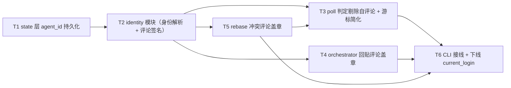

# 0011 本地 Agent 身份 + 评论签名（区分自评论与真人评论，根治 poll 自循环）

> 本文件由 `spec render` 自动生成，请勿手工编辑。
> 内容来源：本组 `metadata.yaml` 与 `tasks/T*.yaml`（关联 issue #28）。

## 任务编排

| 任务 | 标题 | 优先级 | 状态 | 依赖 |
|----|----|----|----|----|
| T1 | state 层 agent_id 持久化 | P1 | done | — |
| T2 | identity 模块（身份解析 + 评论签名） | P1 | done | T1 |
| T3 | poll 判定剔除自评论 + 游标简化 | P1 | done | T2, T5 |
| T4 | orchestrator 回贴评论盖章 | P1 | done | T2 |
| T5 | rebase 冲突评论盖章 | P1 | done | T2 |
| T6 | CLI 接线 + 下线 current_login | P1 | done | T3, T4, T5 |

## 各任务方案

### T1 · state 层 agent_id 持久化（P1 / done）

**涉及文件**

- `openagents/state.py`
- `tests/test_state.py`

**范围**

在 `State` 上新增 `get_agent_id` / `set_agent_id`，state.json 顶层增可选键 `"agent_id"`；`_load` 容错（缺键返回不含 agent_id 的状态），保持既有 runs/cursors 不变。

**验收标准**

set 后 get 取回同值；未设过时 get 返回 None；写入不破坏既有 runs/cursors；文件缺失/损坏仍容错为空状态。

### T2 · identity 模块（身份解析 + 评论签名）（P1 / done）

**涉及文件**

- `openagents/identity.py`
- `tests/test_identity.py`

**范围**

新建 `openagents/identity.py`，实现 `resolve_agent_id`（env > state > 生成落盘）、`sign`、`parse_agent_id`、`post_signed_comment`，及签名标记常量与字符集约束。

**验收标准**

`sign` → `parse_agent_id` 往返一致；无签名/真人正文 `parse_agent_id` 返回 None；`resolve_agent_id` 三级优先级正确，自动生成时落盘且跨调用稳定；`post_signed_comment` 调 `github.post_comment` 且正文带签名（monkeypatch 断言）。

### T3 · poll 判定剔除自评论 + 游标简化（P1 / done）

**涉及文件**

- `openagents/messages.py`
- `tests/test_messages.py`

**范围**

`Messages.__init__` 增 `agent_id`；`_latest_new_comment` 额外剔除「我自己签名」的评论；`_process_rfc_review` 游标只推进到触发评论；删除 `_newest_comment_id`；`poll` 合并分支把 `agent_id` 透传给 `rebase.rebase_open_prs`。

**验收标准**

自己签名的评论不触发处理（含「post 后未推游标即崩溃重启」场景）；其他 agent 签名 / 无签名评论照常触发；refine 后游标等于触发评论的 `created_at`；干活期间到达的真人评论下一轮被处理。

### T4 · orchestrator 回贴评论盖章（P1 / done）

**涉及文件**

- `openagents/orchestrator.py`
- `tests/test_orchestrator.py`

**范围**

`Orchestrator.__init__` 增 `agent_id`；`refine_rfc` 的回贴改走 `identity.post_signed_comment(..., agent_id=self._agent_id)`。

**验收标准**

`refine_rfc` 发出的评论正文带本实例签名（monkeypatch `identity.post_signed_comment` 或 `github.post_comment` 断言）；其余流程（commit/push、状态流转）不变。

### T5 · rebase 冲突评论盖章（P1 / done）

**涉及文件**

- `openagents/rebase.py`
- `tests/test_rebase.py`

**范围**

`rebase_open_prs` 增必填 `agent_id`；冲突留言改走 `identity.post_signed_comment(..., agent_id=agent_id)`。

**验收标准**

冲突时留言带签名；`agent_id` 正确透传；错误隔离/结果分类行为不变。

### T6 · CLI 接线 + 下线 current_login（P1 / done）

**涉及文件**

- `openagents/cli.py`
- `openagents/github.py`
- `tests/test_cli.py`
- `tests/test_github.py`

**范围**

`cli` 解析 `agent_id` 并注入 `Orchestrator` / `Messages`，`_cmd_sync_prs` 透传 `agent_id`；删除 `github.current_login` 及其测试。

**验收标准**

poll / vigil / sync-prs 端到端拿到一致 agent_id；`current_login` 全仓无引用；ruff + 全量 pytest 通过。
