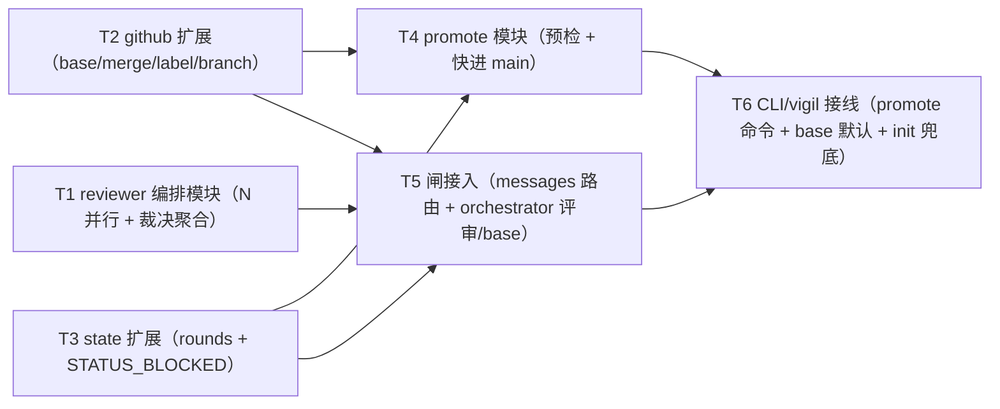

# 0012 test 分支门控流程 —— 人只在「提 issue」与「promote」介入

> 本文件由 `spec render` 自动生成，请勿手工编辑。
> 内容来源：本组 `metadata.yaml` 与 `tasks/T*.yaml`（关联 issue #32）。

## 任务编排

| 任务 | 标题 | 优先级 | 状态 | 依赖 |
|----|----|----|----|----|
| T1 | reviewer 编排模块（N 并行 + 裁决聚合） | P1 | done | — |
| T2 | github 扩展（base/merge/label/branch） | P1 | done | — |
| T3 | state 扩展（rounds + STATUS_BLOCKED） | P1 | done | — |
| T4 | promote 模块（预检 + 快进 main） | P1 | done | T2, T3 |
| T5 | 闸接入（messages 路由 + orchestrator 评审/base） | P1 | done | T1, T2, T3 |
| T6 | CLI/vigil 接线（promote 命令 + base 默认 + init 兜底） | P1 | done | T4, T5 |

## 各任务方案

### T1 · reviewer 编排模块（N 并行 + 裁决聚合）（P1 / done）

**涉及文件**

- `openagents/reviewer.py`
- `tests/test_reviewer.py`

**范围**

新建 `reviewer.py`：`ReviewDecision` 数据模型、`review()` 函数（线程池并行派 N 个 backend.run、解析每个 `AgentResult.summary` 的裁决 token、聚合「全票 PASS」）；内置 rfc/code 两套 review 任务模板（移植 vigil-reviewer 的 PASS/REWORK/RETHINK rubric）；N 从 `OPENAGENTS_REVIEWERS`(默认1) 读取。

**验收标准**

单测打桩 `AgentBackend`，覆盖：N=1 PASS→passed=True；N=3 含一个 REWORK→passed=False 且 feedback 含该反馈；RETHINK 同 REWORK 归为非 PASS；裁决 token 解析鲁棒（大小写/前后缀）。

### T2 · github 扩展（base/merge/label/branch）（P1 / done）

**涉及文件**

- `openagents/github.py`
- `tests/test_github.py`

**范围**

`create_pr` 增 `base` 形参（→ `--base`）；新增 `merge_pr`、`add_label`、`ensure_branch`（幂等）、`branch_ci_green`。复用 `_run_gh`/`_gh_json`（RFC-0010 重试）与既有 `_classify_checks`。

**验收标准**

单测打桩子进程，验证各函数拼出正确 `gh` 参数；`ensure_branch` 在分支已存在时不报错（幂等）；`branch_ci_green` 全绿→True、有失败→False；`create_pr(base=...)` 透传 `--base`。

### T3 · state 扩展（rounds + STATUS_BLOCKED）（P1 / done）

**涉及文件**

- `openagents/state.py`
- `tests/test_state.py`

**范围**

新增 `STATUS_BLOCKED` 常量；`RunRecord` 加 `rounds: int = 0`（默认值保证 `RunRecord(**旧记录)` 不报错）；新增 `increment_rounds`/`reset_rounds`。

**验收标准**

单测：加载缺 `rounds` 键的旧 state.json 不抛错且 rounds=0；`increment_rounds` 返回递增值并落盘；`reset_rounds` 归零；`STATUS_BLOCKED` 不被 `all_runs` 误改。

### T4 · promote 模块（预检 + 快进 main）（P1 / done）

**涉及文件**

- `openagents/promote.py`
- `tests/test_promote.py`

**范围**

新建 `promote.py`：`PromoteResult` + `promote()`，执行预检（无 `STATUS_BLOCKED` run ∧ 无 `needs-human` open PR ∧ `branch_ci_green(test)`），通过则 `ensure_branch` 兜底 + `git push origin test:main`。

**验收标准**

单测打桩 github/state/子进程：有 BLOCKED run→promoted=False 且 reason 指明；有 needs-human PR→False；CI 非绿→False；全通过→执行 push 并 promoted=True。

### T5 · 闸接入（messages 路由 + orchestrator 评审/base）（P1 / done）

**涉及文件**

- `openagents/messages.py`
- `openagents/orchestrator.py`
- `tests/test_messages.py`
- `tests/test_orchestrator.py`

**范围**

`orchestrator`：`DEFAULT_BASE="test"`、`start_rfc` 透传 base 给 `create_pr`、新增 `review_rfc`/`review_code`、`implement` 末尾 `reset_rounds`。`messages`：`_process_rfc_review`/`_process_coding` 接入评审闸（PASS→加标签/merge、非 PASS→rounds++ 后 refine/iterate、超 K→BLOCKED+needs-human），新增 `MAX_ROUNDS`/`BLOCKED_LABEL`。

**验收标准**

单测打桩 reviewer/github/state：rfc 闸 PASS→打 rfc-approved 并 implement；rfc 闸非 PASS 且 rounds<K→refine 且 rounds++；coding 闸 CI 绿+PASS→merge_pr+DONE+rebase；coding 闸非 PASS 超 K→STATUS_BLOCKED+needs-human 且 PR 不关；CI fail/pending 行为保持。

### T6 · CLI/vigil 接线（promote 命令 + base 默认 + init 兜底）（P1 / done）

**涉及文件**

- `openagents/cli.py`
- `openagents/vigil.py`
- `tests/test_cli.py`
- `scripts/e2e-rfc-0012-gated-flow.sh`

**范围**

`cli`：`rfc`/`vigil` 的 `--base` 默认改 `test`；`_cmd_init` 调 `ensure_branch`；注册 `promote` 子命令 + `_cmd_promote`。`vigil`：默认基线随之为 test。补 e2e 脚本。

**验收标准**

单测：`promote` 子命令路由到 `promote.promote` 并按结果设退出码；`--base` 默认值为 `test`；`init` 触发 `ensure_branch`。e2e 脚本可独立运行（见测试方案）。
